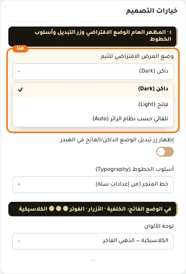
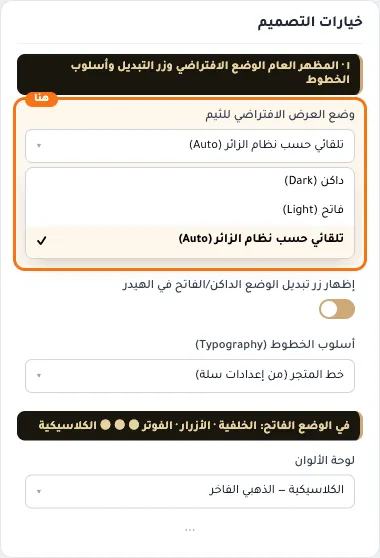
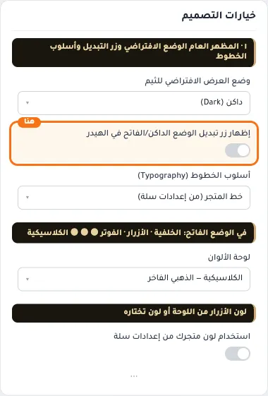
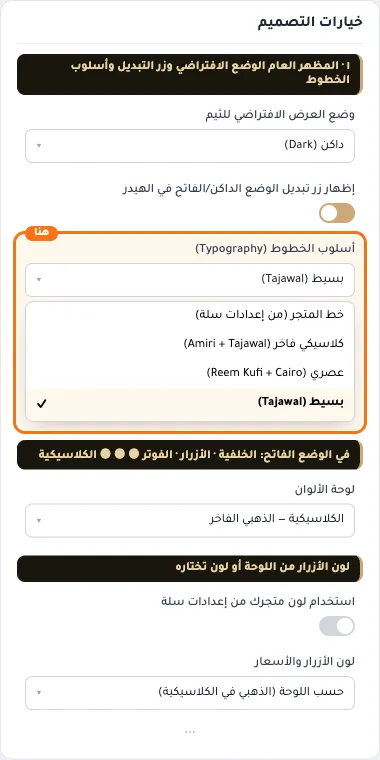

# ١ · المظهر العام الوضع الافتراضي وزر التبديل وأسلوب الخطوط

## «وضع العرض الافتراضي للثيم»
قائمة منسدلة · الافتراضي: داكن (Dark)

**الوظيفة:** الوضع الداكن هو الأساس. يمكن للزائر التبديل من زر التبديل في أعلى الصفحة.

- **داكن (Dark)** — القيمة الافتراضية.
  
- **فاتح (Light)**
  
- **تلقائي حسب نظام الزائر (Auto)**
  

## «إظهار زر تبديل الوضع الداكن/الفاتح في الهيدر»
مفتاح · الافتراضي: مفعّل

**الوظيفة:** زر صغير في الهيدر يقلّب الزائر بين الداكن والفاتح، واختياره يُحفظ لجهازه.

- **بعد قلب المفتاح**
  

## «أسلوب الخطوط (Typography)»
قائمة منسدلة · الافتراضي: خط المتجر (من إعدادات سلة)

**الوظيفة:** اختر أسلوب الخطوط. «خط المتجر» يستخدم الخط الذي اخترته في إعدادات سلة (وهو الأسرع — بدون تحميل خطوط خارجية).

- **خط المتجر (من إعدادات سلة)** — القيمة الافتراضية.
  
- **كلاسيكي فاخر (Amiri + Tajawal)**
  
- **عصري (Reem Kufi + Cairo)**
  
- **بسيط (Tajawal)**
  
