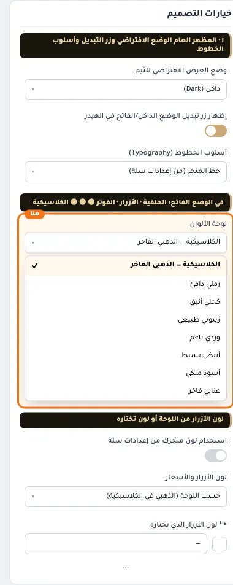
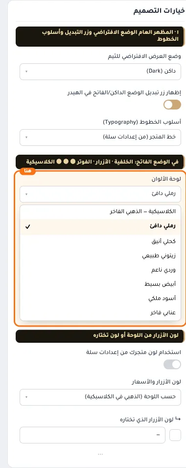
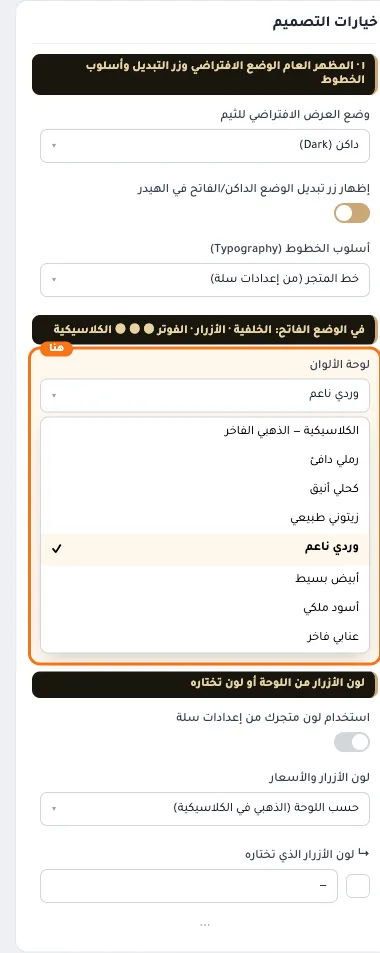
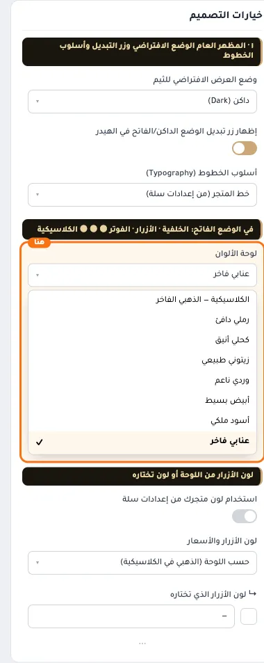

# في الوضع الفاتح: الخلفية · الأزرار · الفوتر ● ● ● الكلاسيكية ● ● ● رملي دافئ ● ●

## «لوحة الألوان»
قائمة منسدلة · الافتراضي: الكلاسيكية — الذهبي الفاخر

**الوظيفة:** ألوان متناسقة جاهزة للوضعين الفاتح والداكن. أي لون تختاره بنفسك في الأقسام التالية يعلو على اللوحة.

- **الكلاسيكية — الذهبي الفاخر** — القيمة الافتراضية.
  
- **رملي دافئ**
  
- **كحلي أنيق**
  
- **زيتوني طبيعي**
  
- **وردي ناعم**
  
- **أبيض بسيط**
  
- **أسود ملكي**
  
- **عنابي فاخر**
  
