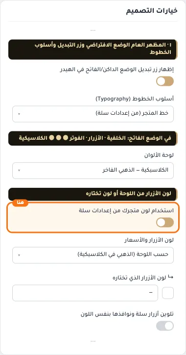
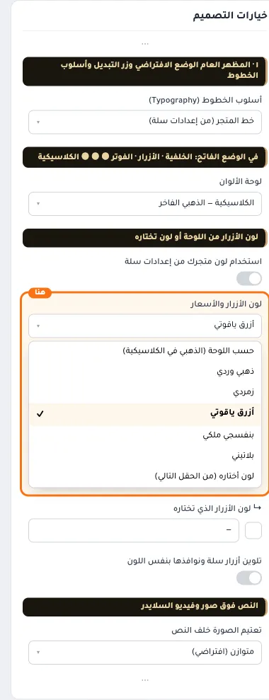
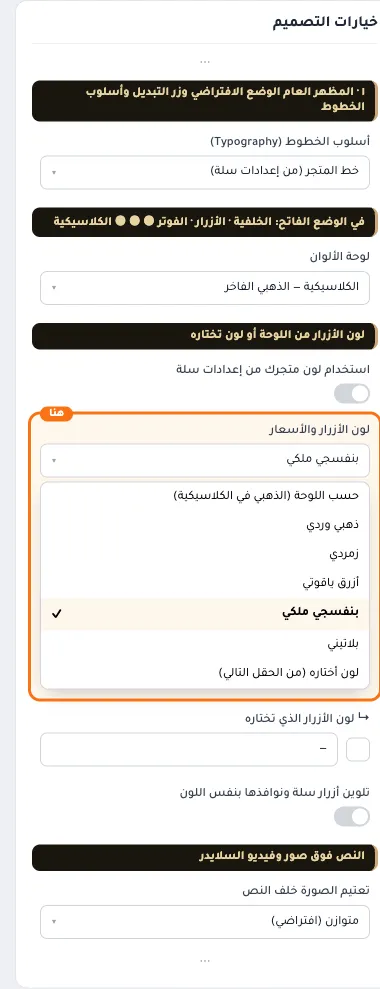
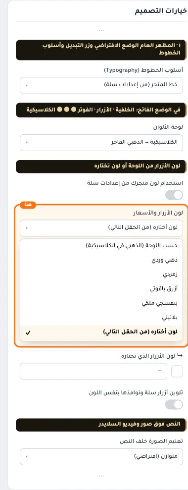
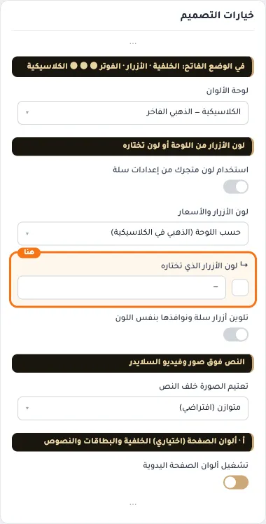
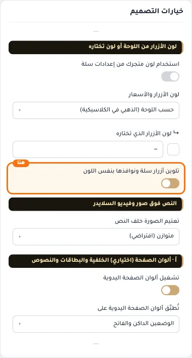

# لون الأزرار من اللوحة أو لون تختاره

## «استخدام لون متجرك من إعدادات سلة»
مفتاح · الافتراضي: مطفأ

**الوظيفة:** يلوّن الأزرار والأسعار وعناوين الأقسام بلون متجرك بدل لون اللوحة، ويُهمل الحقل التالي.

- **بعد قلب المفتاح**
  

## «لون الأزرار والأسعار»
قائمة منسدلة · الافتراضي: حسب اللوحة (الذهبي في الكلاسيكية)

**الوظيفة:** للأزرار والأسعار وعناوين الأقسام والروابط المميزة. «حسب اللوحة» يأخذ لون اللوحة المختارة أعلاه.

- **حسب اللوحة (الذهبي في الكلاسيكية)** — القيمة الافتراضية.
  
- **ذهبي وردي**
  
- **زمردي**
  
- **أزرق ياقوتي**
  
- **بنفسجي ملكي**
  
- **بلاتيني**
  
- **لون أختاره (من الحقل التالي)**
  

## «↳ لون الأزرار الذي تختاره»
لون · الافتراضي: فارغ

**الوظيفة:** يعمل مع «لون أختاره» في الحقل السابق. يُفتَّح أو يُغمَّق تلقائيًا ليبقى واضحًا، فإن لم يكفِ ذلك يأخذ لون النص.

**يظهر حين:** «لون الأزرار والأسعار» = لون أختاره (من الحقل التالي)

- **↳ لون الأزرار الذي تختاره**
  

## «تلوين أزرار سلة ونوافذها بنفس اللون»
مفتاح · الافتراضي: مطفأ

**الوظيفة:** زر الإضافة للسلة والخيارات والتقييمات والنوافذ. عند الإطفاء تبقى بلون متجرك من إعدادات سلة.

- **بعد قلب المفتاح**
  
