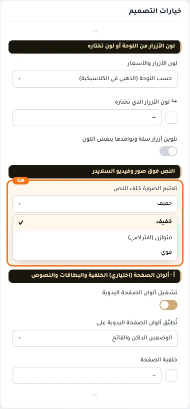
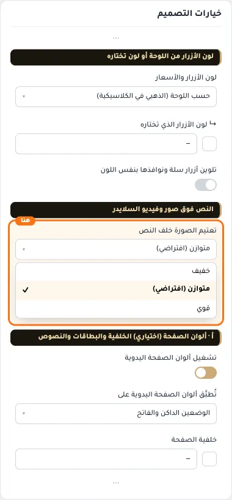
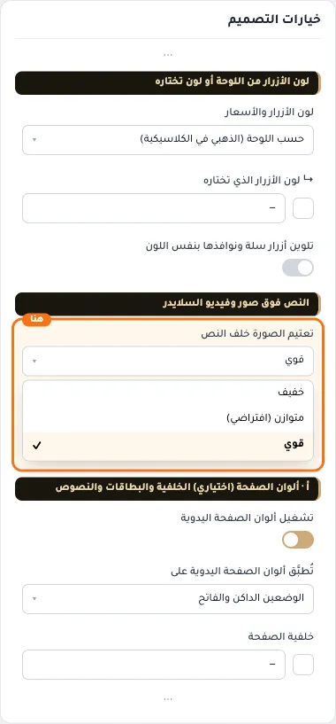

# النص فوق صور وفيديو السلايدر

## «تعتيم الصورة خلف النص»
قائمة منسدلة · الافتراضي: متوازن (افتراضي)

**الوظيفة:** يوضّح العنوان والوصف فوق صور وفيديو السلايدر. «قوي» للصور الفاتحة جدًا، و«خفيف» للداكنة.

- **خفيف**
  
- **متوازن (افتراضي)** — القيمة الافتراضية.
  
- **قوي**
  
