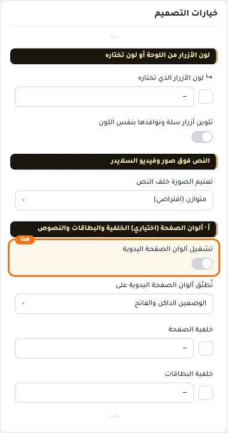
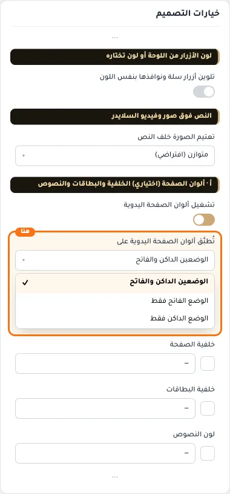
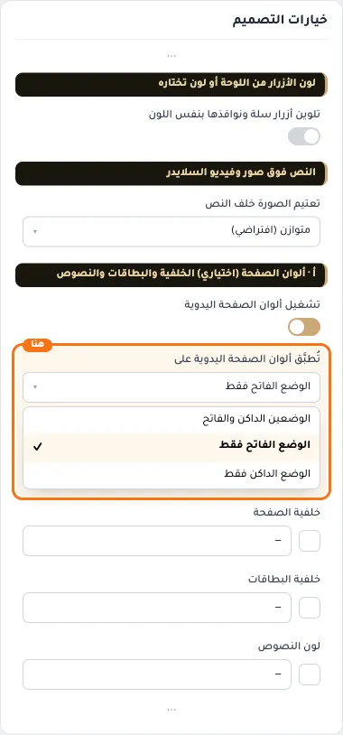
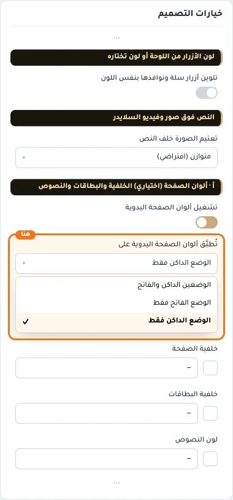
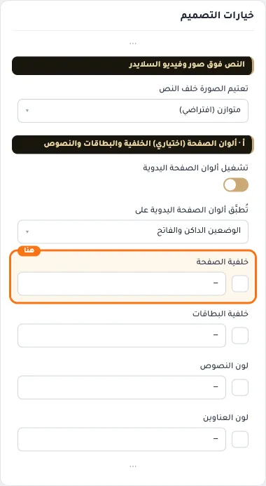
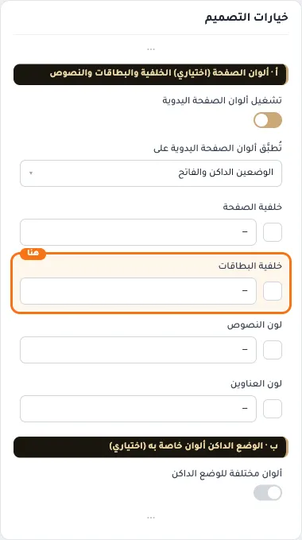
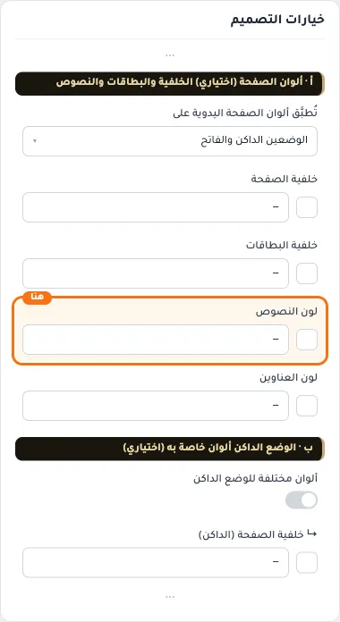
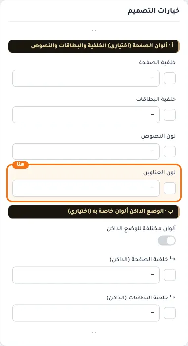

# أ · ألوان الصفحة (اختياري) الخلفية والبطاقات والنصوص

## «تشغيل ألوان الصفحة اليدوية»
مفتاح · الافتراضي: مفعّل

**الوظيفة:** أطفئه لتعود ألوان اللوحة مكان حقول (أ) وتبقى ألوانك محفوظة. ألوان الداكن في (ب) لها مفتاحها.

- **بعد قلب المفتاح**
  

## «تُطبَّق ألوان الصفحة اليدوية على»
قائمة منسدلة · الافتراضي: الوضعين الداكن والفاتح

**الوظيفة:** «الوضعين»: لونك في الفاتح والداكن ويُصحَّح أي نص لا يُقرأ. أو اختر وضعًا ويبقى الآخر بألوان اللوحة. إن شغّلت (ب) تصير ألوانك هنا للفاتح فقط.

- **الوضعين الداكن والفاتح** — القيمة الافتراضية.
  
- **الوضع الفاتح فقط**
  
- **الوضع الداكن فقط**
  

## «خلفية الصفحة»
لون · الافتراضي: فارغ

**الوظيفة:** لون خلفية كل الصفحات. إن لم تحدد البطاقات والنصوص تُشتق منه تلقائيًا.

- **خلفية الصفحة**
  

## «خلفية البطاقات»
لون · الافتراضي: فارغ

**الوظيفة:** بطاقات المنتجات والنوافذ والقوائم المنسدلة. إن تركتها، أو كانت فاتحة والخلفية داكنة أو العكس، تُشتق من خلفية الصفحة.

- **خلفية البطاقات**
  

## «لون النصوص»
لون · الافتراضي: فارغ

**الوظيفة:** الفقرات والأوصاف، ومنه النصوص الخافتة والحدود. يُستبدل تلقائيًا إن صار غير مقروء.

- **لون النصوص**
  

## «لون العناوين»
لون · الافتراضي: فارغ

**الوظيفة:** أسماء المنتجات وعناوين الصفحات. لعناوين أقسام الرئيسية خيار مستقل في (ج).

- **لون العناوين**
  
