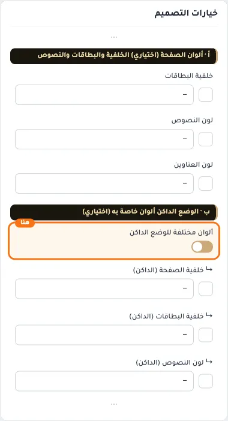
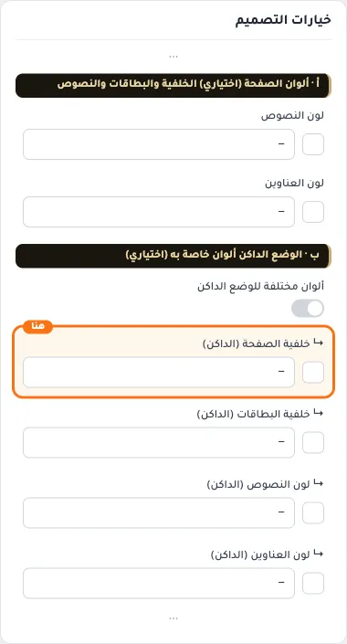
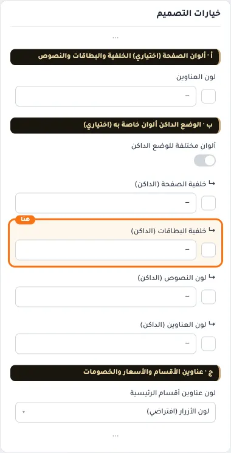
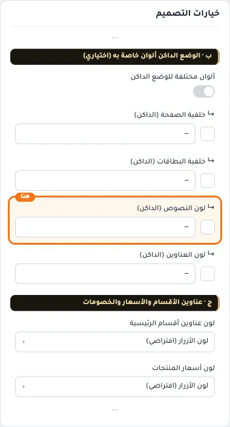
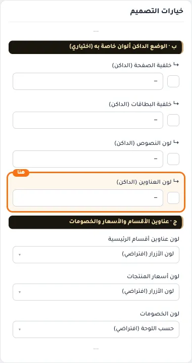

# ب · الوضع الداكن ألوان خاصة به (اختياري)

## «ألوان مختلفة للوضع الداكن»
مفتاح · الافتراضي: مطفأ

**الوظيفة:** عند التشغيل تُستخدم الحقول التالية في الداكن، وتصير ألوان (أ) للفاتح فقط.

- **بعد قلب المفتاح**
  

## «↳ خلفية الصفحة (الداكن)»
لون · الافتراضي: فارغ

**الوظيفة:** تُشتق منها البطاقات والنصوص في الداكن إن لم تحددها.

**يظهر حين:** «ألوان مختلفة للوضع الداكن» = مفعّل

- **↳ خلفية الصفحة (الداكن)**
  

## «↳ خلفية البطاقات (الداكن)»
لون · الافتراضي: فارغ

**الوظيفة:** إن تركتها، أو كانت فاتحة والخلفية داكنة أو العكس، تُشتق من خلفية الصفحة في الداكن.

**يظهر حين:** «ألوان مختلفة للوضع الداكن» = مفعّل

- **↳ خلفية البطاقات (الداكن)**
  

## «↳ لون النصوص (الداكن)»
لون · الافتراضي: فارغ

**الوظيفة:** يُستبدل تلقائيًا إن لم يكن مقروءًا على الخلفية.

**يظهر حين:** «ألوان مختلفة للوضع الداكن» = مفعّل

- **↳ لون النصوص (الداكن)**
  

## «↳ لون العناوين (الداكن)»
لون · الافتراضي: فارغ

**الوظيفة:** أسماء المنتجات وعناوين الصفحات في الوضع الداكن.

**يظهر حين:** «ألوان مختلفة للوضع الداكن» = مفعّل

- **↳ لون العناوين (الداكن)**
  
