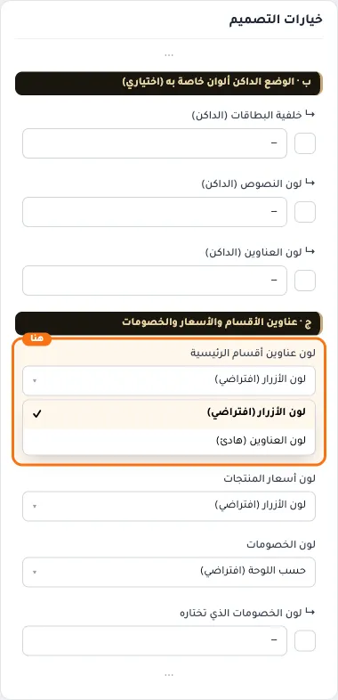
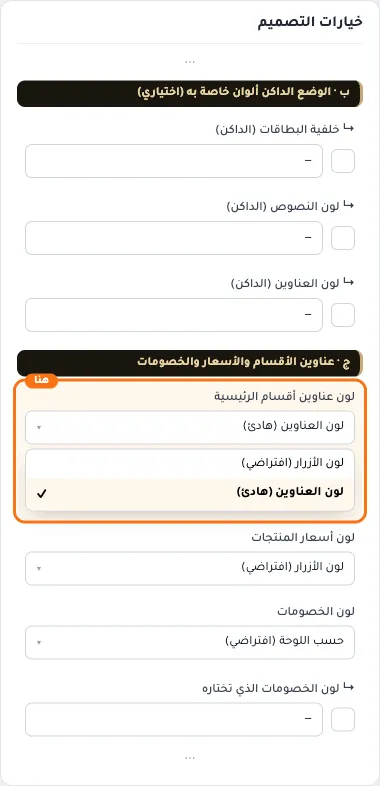
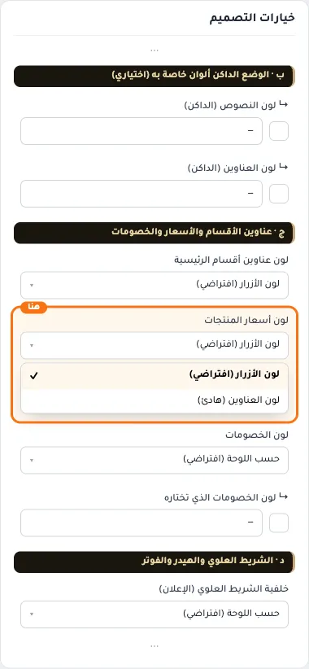
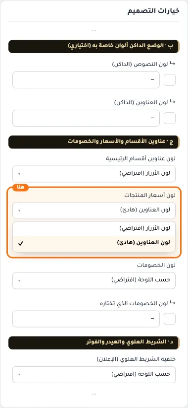
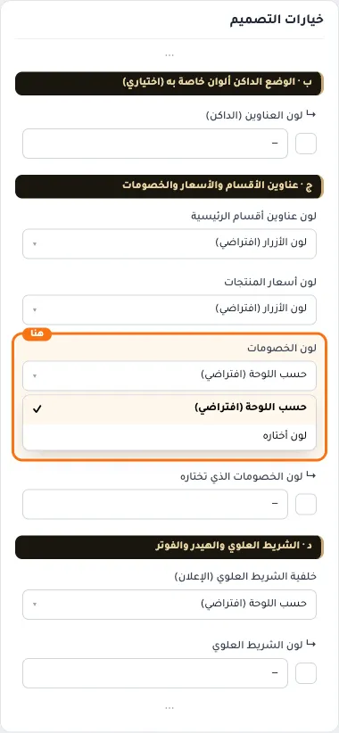
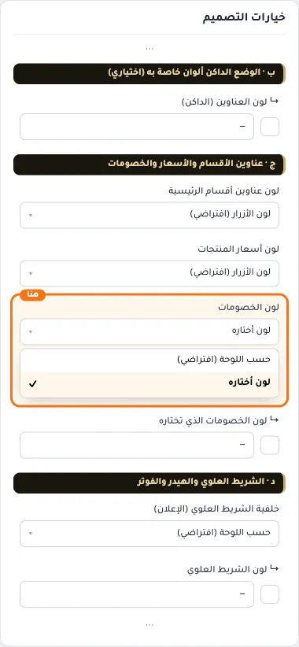
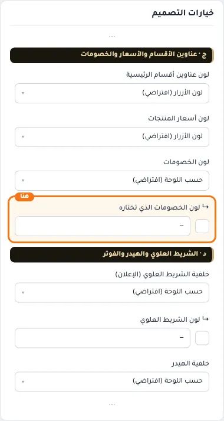

# ج · عناوين الأقسام والأسعار والخصومات

## «لون عناوين أقسام الرئيسية»
قائمة منسدلة · الافتراضي: لون الأزرار (افتراضي)

**الوظيفة:** العنوان الكبير فوق كل قسم مثل «وصل حديثًا». «هادئ» يجعله بلون أسماء المنتجات.

- **لون الأزرار (افتراضي)** — القيمة الافتراضية.
  
- **لون العناوين (هادئ)**
  

## «لون أسعار المنتجات»
قائمة منسدلة · الافتراضي: لون الأزرار (افتراضي)

**الوظيفة:** السعر في صفحة المنتج والبطاقات والسلة والبحث والمفضلة. سعر الخصم له خيار مستقل تحته.

- **لون الأزرار (افتراضي)** — القيمة الافتراضية.
  
- **لون العناوين (هادئ)**
  

## «لون الخصومات»
قائمة منسدلة · الافتراضي: حسب اللوحة (افتراضي)

**الوظيفة:** سعر الخصم وشارة العرض على صورة المنتج وسطر الخصم في السلة.

- **حسب اللوحة (افتراضي)** — القيمة الافتراضية.
  
- **لون أختاره**
  

## «↳ لون الخصومات الذي تختاره»
لون · الافتراضي: فارغ

**الوظيفة:** يعمل مع «لون أختاره» في الحقل السابق. يُفتَّح أو يُغمَّق تلقائيًا ليبقى مقروءًا، فإن لم يكفِ ذلك يأخذ لون النص.

**يظهر حين:** «لون الخصومات» = لون أختاره

- **↳ لون الخصومات الذي تختاره**
  
