# د · الشريط العلوي والهيدر والفوتر

## «خلفية الشريط العلوي (الإعلان)»
قائمة منسدلة · الافتراضي: حسب اللوحة (افتراضي)

**الوظيفة:** الشريط الرفيع أعلى الصفحة. لون النص يصير أبيض أو أسود تلقائيًا.

- **حسب اللوحة (افتراضي)** — القيمة الافتراضية.
  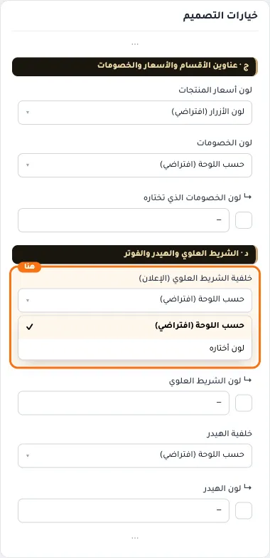
- **لون أختاره**
  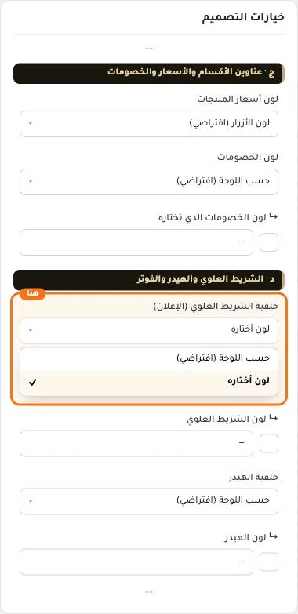

## «↳ لون الشريط العلوي»
لون · الافتراضي: فارغ

**الوظيفة:** يعمل مع «لون أختاره» في الحقل السابق، ويبقى نفسه في الفاتح والداكن.

**يظهر حين:** «خلفية الشريط العلوي (الإعلان)» = لون أختاره

- **↳ لون الشريط العلوي**
  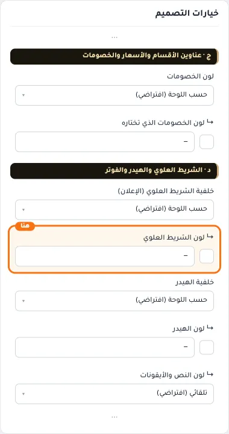

## «خلفية الهيدر»
قائمة منسدلة · الافتراضي: حسب اللوحة (افتراضي)

**الوظيفة:** النص والأيقونات تتعدّل تلقائيًا، أو اختر لونها تحته. فوق السلايدر يظهر اللون شبه شفاف.

- **حسب اللوحة (افتراضي)** — القيمة الافتراضية.
  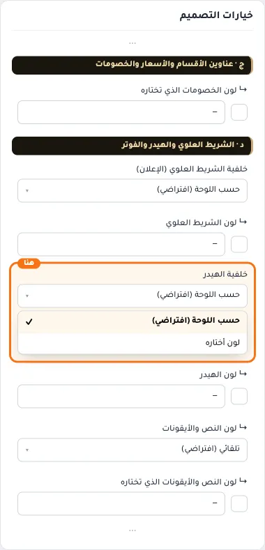
- **لون أختاره**
  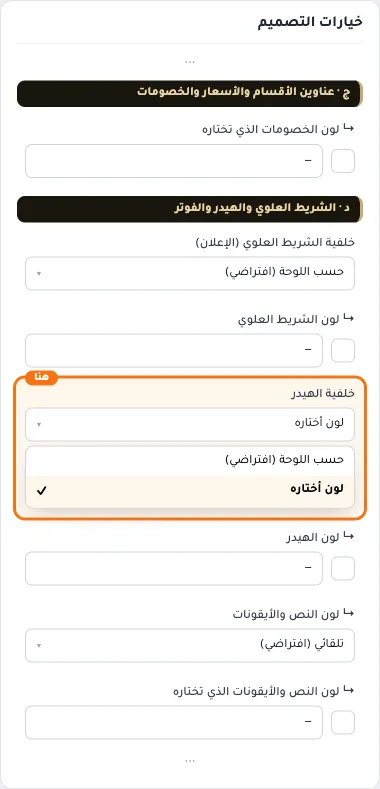

## «↳ لون الهيدر»
لون · الافتراضي: فارغ

**الوظيفة:** يعمل مع «لون أختاره» في الحقل السابق. يُستخدم في الفاتح والداكن، إلا إذا شغّلت «ألوان مختلفة للوضع الداكن» تحته.

**يظهر حين:** «خلفية الهيدر» = لون أختاره

- **↳ لون الهيدر**
  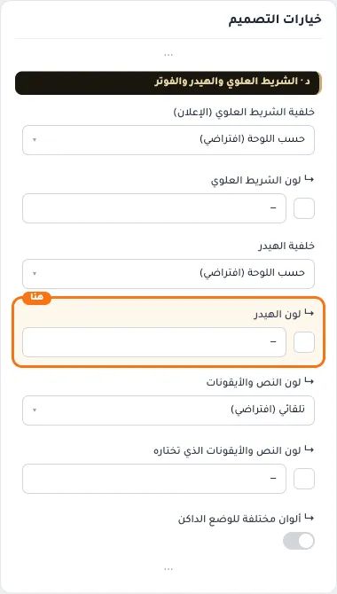

## «↳ لون النص والأيقونات»
قائمة منسدلة · الافتراضي: تلقائي (افتراضي)

**الوظيفة:** «تلقائي» يختار الأبيض أو الأسود حسب لون الهيدر. اختر «لون أختاره» لتحدده بنفسك.

**يظهر حين:** «خلفية الهيدر» = لون أختاره

- **تلقائي (افتراضي)** — القيمة الافتراضية.
  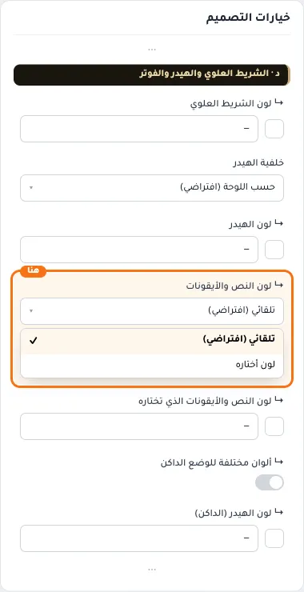
- **لون أختاره**
  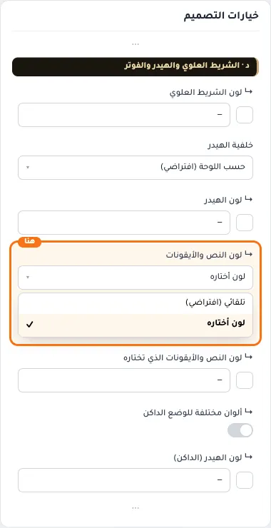

## «↳ لون النص والأيقونات الذي تختاره»
لون · الافتراضي: فارغ

**الوظيفة:** إذا لم يكن مقروءًا على لون الهيدر يرجع الثيم للون التلقائي حتى يبقى النص واضحًا.

**يظهر حين:** «خلفية الهيدر» = لون أختاره و «↳ لون النص والأيقونات» = لون أختاره

- **↳ لون النص والأيقونات الذي تختاره**
  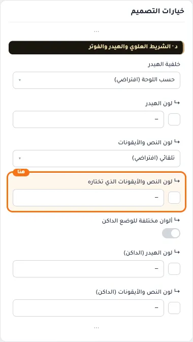

## «↳ ألوان مختلفة للوضع الداكن»
مفتاح · الافتراضي: مطفأ

**الوظيفة:** عند التشغيل تختار لون الهيدر ولون النص والأيقونات للوضع الداكن، وتبقى الألوان أعلاه للفاتح.

**يظهر حين:** «خلفية الهيدر» = لون أختاره

- **بعد قلب المفتاح**
  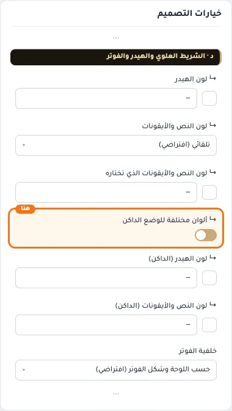

## «↳ لون الهيدر (الداكن)»
لون · الافتراضي: فارغ

**الوظيفة:** اتركه فارغًا ليبقى اللون نفسه في الوضعين.

**يظهر حين:** «خلفية الهيدر» = لون أختاره و «↳ ألوان مختلفة للوضع الداكن» = مفعّل

- **↳ لون الهيدر (الداكن)**
  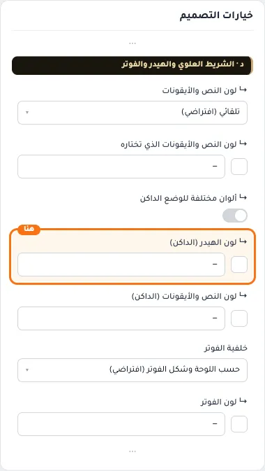

## «↳ لون النص والأيقونات (الداكن)»
لون · الافتراضي: فارغ

**الوظيفة:** اتركه فارغًا ليأخذ لون الفاتح، أو التلقائي.

**يظهر حين:** «خلفية الهيدر» = لون أختاره و «↳ لون النص والأيقونات» = لون أختاره و «↳ ألوان مختلفة للوضع الداكن» = مفعّل

- **↳ لون النص والأيقونات (الداكن)**
  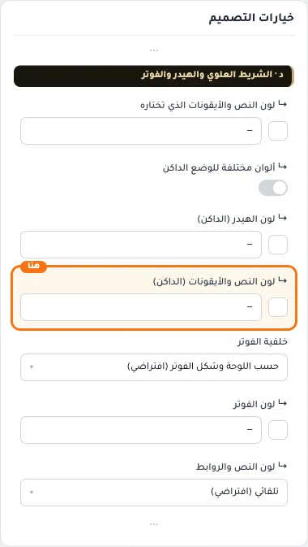

## «خلفية الفوتر»
قائمة منسدلة · الافتراضي: حسب اللوحة وشكل الفوتر (افتراضي)

**الوظيفة:** النص والروابط تتعدّل تلقائيًا، أو اختر لونها تحته. الافتراضي يأخذ لون اللوحة بالشكل المختار في القسم ٧.

- **حسب اللوحة وشكل الفوتر (افتراضي)** — القيمة الافتراضية.
  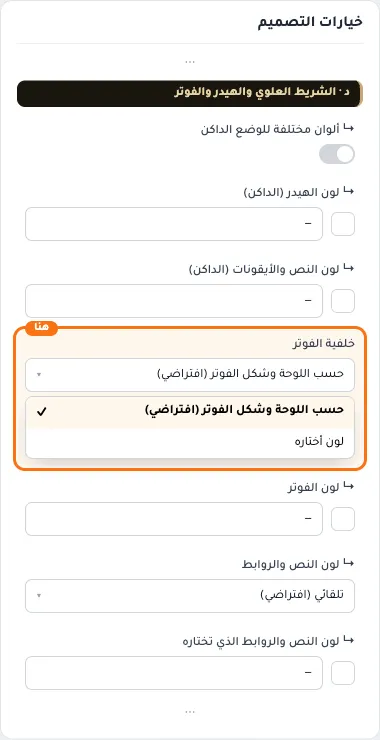
- **لون أختاره**
  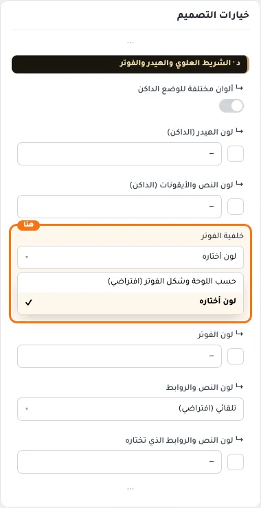

## «↳ لون الفوتر»
لون · الافتراضي: فارغ

**الوظيفة:** يعمل مع «لون أختاره» في الحقل السابق. يُستخدم في الفاتح والداكن، إلا إذا شغّلت «ألوان مختلفة للوضع الداكن» تحته.

**يظهر حين:** «خلفية الفوتر» = لون أختاره

- **↳ لون الفوتر**
  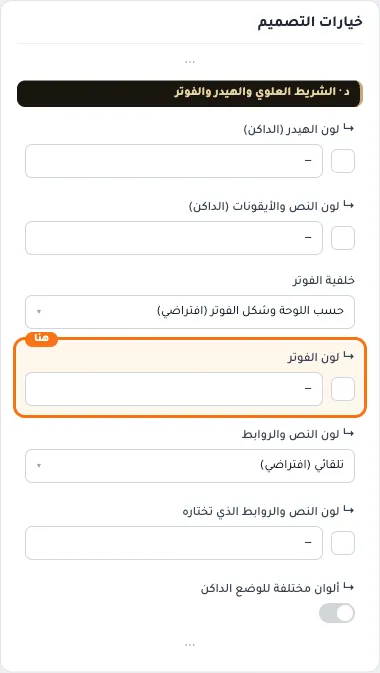

## «↳ لون النص والروابط»
قائمة منسدلة · الافتراضي: تلقائي (افتراضي)

**الوظيفة:** «تلقائي» يختار الأبيض أو الأسود حسب لون الفوتر. اختر «لون أختاره» لتحدده بنفسك.

**يظهر حين:** «خلفية الفوتر» = لون أختاره

- **تلقائي (افتراضي)** — القيمة الافتراضية.
  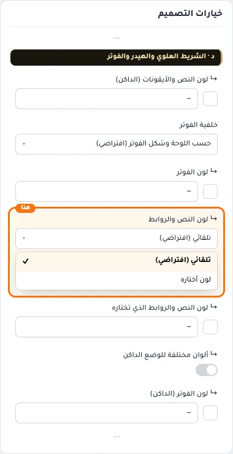
- **لون أختاره**
  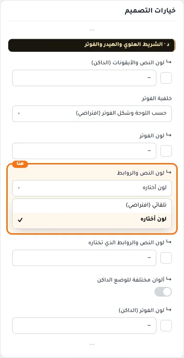

## «↳ لون النص والروابط الذي تختاره»
لون · الافتراضي: فارغ

**الوظيفة:** إذا لم يكن مقروءًا على لون الفوتر يرجع الثيم للون التلقائي حتى يبقى النص واضحًا.

**يظهر حين:** «خلفية الفوتر» = لون أختاره و «↳ لون النص والروابط» = لون أختاره

- **↳ لون النص والروابط الذي تختاره**
  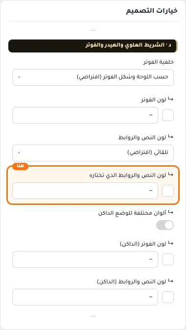

## «↳ ألوان مختلفة للوضع الداكن»
مفتاح · الافتراضي: مطفأ

**الوظيفة:** عند التشغيل تختار لون الفوتر ولون النص والروابط للوضع الداكن، وتبقى الألوان أعلاه للفاتح.

**يظهر حين:** «خلفية الفوتر» = لون أختاره

- **بعد قلب المفتاح**
  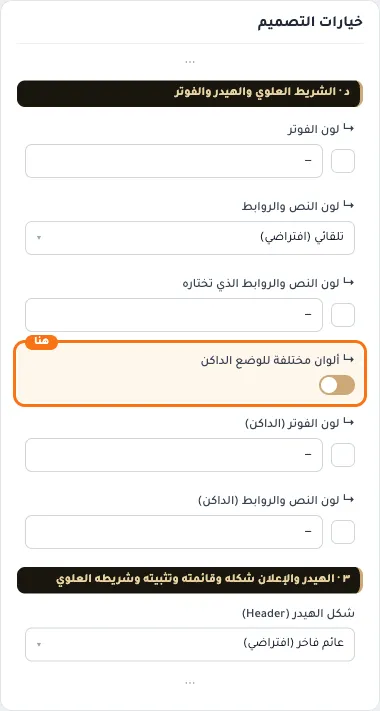

## «↳ لون الفوتر (الداكن)»
لون · الافتراضي: فارغ

**الوظيفة:** اتركه فارغًا ليبقى اللون نفسه في الوضعين.

**يظهر حين:** «خلفية الفوتر» = لون أختاره و «↳ ألوان مختلفة للوضع الداكن» = مفعّل

- **↳ لون الفوتر (الداكن)**
  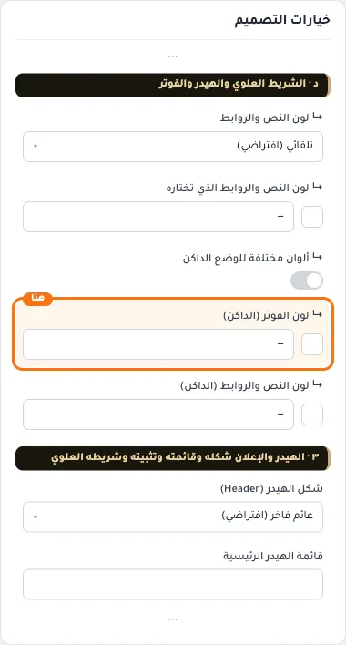

## «↳ لون النص والروابط (الداكن)»
لون · الافتراضي: فارغ

**الوظيفة:** اتركه فارغًا ليأخذ لون الفاتح، أو التلقائي.

**يظهر حين:** «خلفية الفوتر» = لون أختاره و «↳ لون النص والروابط» = لون أختاره و «↳ ألوان مختلفة للوضع الداكن» = مفعّل

- **↳ لون النص والروابط (الداكن)**
  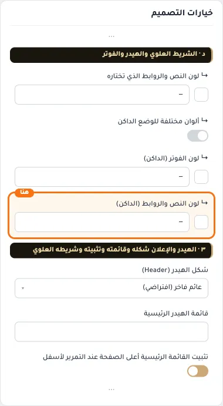
