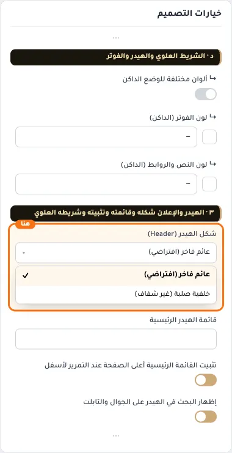
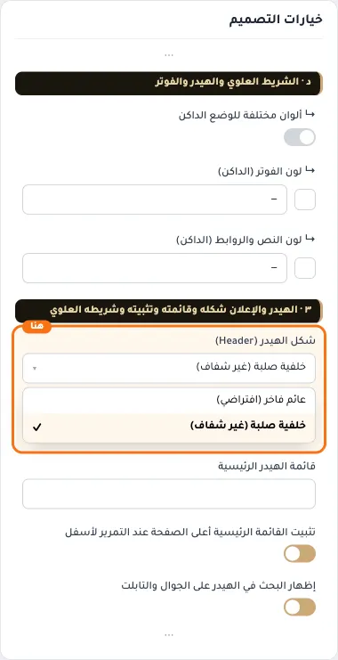
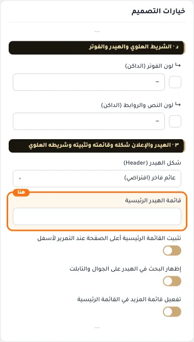
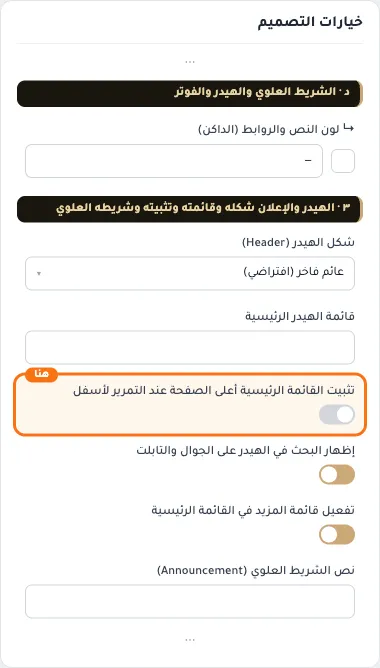
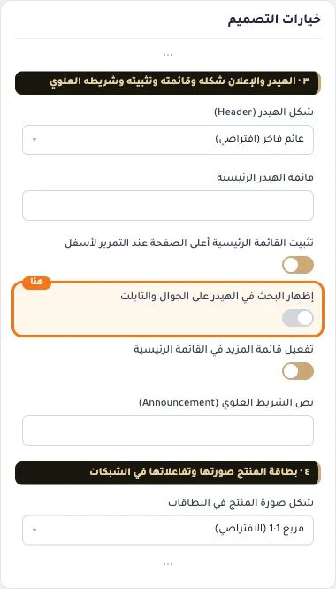
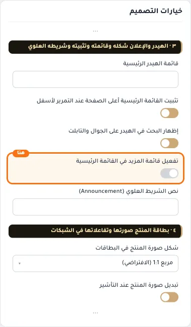
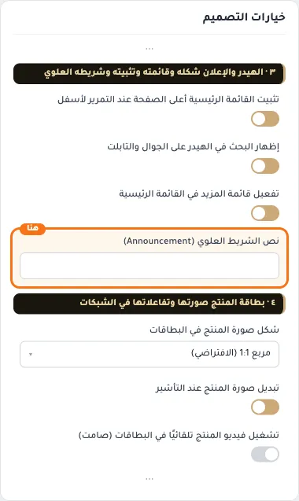

# ٣ · الهيدر والإعلان شكله وقائمته وتثبيته وشريطه العلوي

## «شكل الهيدر (Header)»
قائمة منسدلة · الافتراضي: عائم فاخر (افتراضي)

**الوظيفة:** العائم الفاخر هو الأساس (شفاف فوق الواجهة). اختر "خلفية صلبة" لهيدر بخلفية غير شفافة ثابتة أعلى الصفحة.

- **عائم فاخر (افتراضي)** — القيمة الافتراضية.
  
- **خلفية صلبة (غير شفاف)**
  

## «قائمة الهيدر الرئيسية»
اختيار من المتجر · الافتراضي: فارغ

**الوظيفة:** اختر القائمة التي تظهر في شريط التنقل العلوي (افتراضياً: القائمة المعيّنة لموضع الهيدر من إدارة القوائم).

- **قائمة الهيدر الرئيسية**
  

## «تثبيت القائمة الرئيسية أعلى الصفحة عند التمرير لأسفل»
مفتاح · الافتراضي: مفعّل

**الوظيفة:** يُنصح بإلغاء تفعيلها في حالة وجود عناصر كثيرة في القائمة المنسدلة

- **بعد قلب المفتاح**
  

## «إظهار البحث في الهيدر على الجوال والتابلت»
مفتاح · الافتراضي: مفعّل

**الوظيفة:** يظهر زر البحث بجانب السلة في الشاشات الصغيرة بدل القائمة الجانبية فقط. يبقى البحث في القائمة الجانبية أيضًا.

- **بعد قلب المفتاح**
  

## «تفعيل قائمة المزيد في القائمة الرئيسية»
مفتاح · الافتراضي: مفعّل

**الوظيفة:** عند تفعيلها، ستظهر الروابط الإضافية في قائمة منسدلة تسمى 'المزيد' عند عدم وجود مساحة كافية

- **بعد قلب المفتاح**
  

## «نص الشريط العلوي (Announcement)»
نص · الافتراضي: فارغ

**الوظيفة:** يظهر في أعلى الهيدر. اتركه فارغاً لإخفاء الشريط. للرسائل المتعددة المتناوبة افصل بينها بعلامة | (مثال: شحن مجاني | إرجاع خلال ١٤ يوماً).

- **نص الشريط العلوي (Announcement)**
  
