# ٤ · بطاقة المنتج صورتها وتفاعلاتها في الشبكات

## «شكل صورة المنتج في البطاقات»
قائمة منسدلة · الافتراضي: مربع 1:1 (الافتراضي)

**الوظيفة:** يطبَّق على بطاقات المنتجات في كل القوائم والمكوّنات. الطولي يناسب الصور الملتقطة بالطول (أزياء، عطور)؛ الصورة المربعة تُقص من جانبيها فيه، إلا إذا اخترت «احتواء» من توحيد ارتفاع البطاقات في إعدادات المنتجات بلوحة سلة.

- **مربع 1:1 (الافتراضي)** — القيمة الافتراضية.
  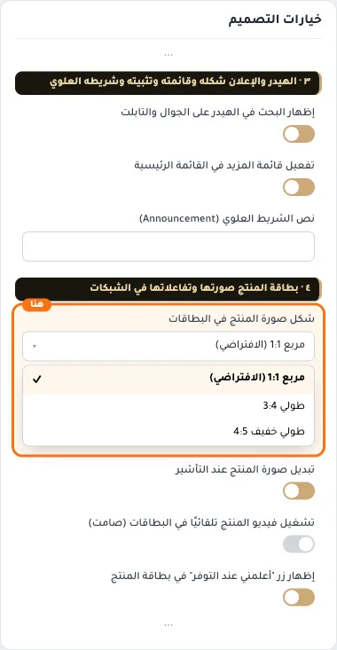
- **طولي 3:4**
  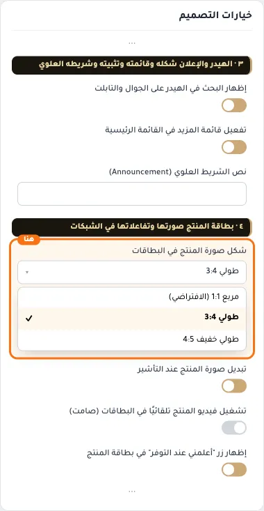
- **طولي خفيف 4:5**
  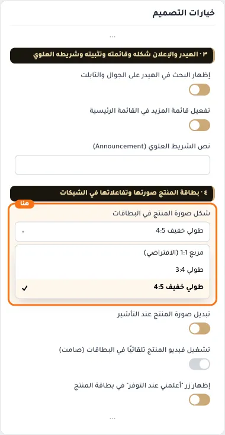

## «تبديل صورة المنتج عند التأشير»
مفتاح · الافتراضي: مفعّل

**الوظيفة:** عند تمرير الماوس على بطاقة منتج له صورتان أو أكثر تظهر صورته الثانية. يعمل على أجهزة الكمبيوتر فقط، ولا يتغيّر شيء للمنتج الذي فيه فيديو أو صورة واحدة. يجلب صور منتجات الصفحة القريبة من الشاشة في طلبات مجمَّعة (حتى 40 منتجًا لكل طلب).

- **بعد قلب المفتاح**
  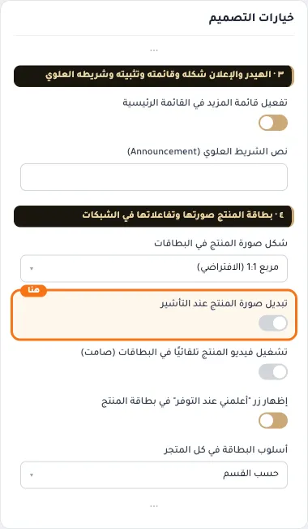

## «تشغيل فيديو المنتج تلقائيًا في البطاقات (صامت)»
مفتاح · الافتراضي: مطفأ

**الوظيفة:** إذا كان الوسيط الأساسي للمنتج فيديو مرفوعًا على سلة، يُشغَّل في بطاقة المنتج تلقائيًا وبدون صوت وبتكرار، ويتوقّف حين يخرج من الشاشة. يجلب وسائط منتجات الصفحة في طلبات مجمَّعة (حتى 40 منتجًا لكل طلب)، فاتركه مطفأً إن لم تستخدم فيديو في منتجاتك. يعمل على الكمبيوتر (بالفأرة) فقط، ولا يُشغَّل على شاشات اللمس.

- **بعد قلب المفتاح**
  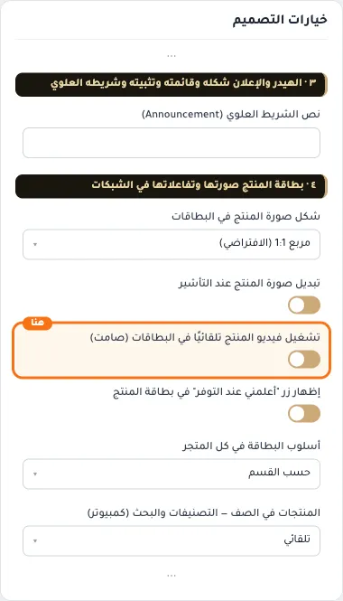

## «إظهار زر "أعلمني عند التوفر" في بطاقة المنتج»
مفتاح · الافتراضي: مفعّل

**الوظيفة:** يظهر زر إشعار التوفر في بطاقات المنتجات التي نفذت كميتها

- **بعد قلب المفتاح**
  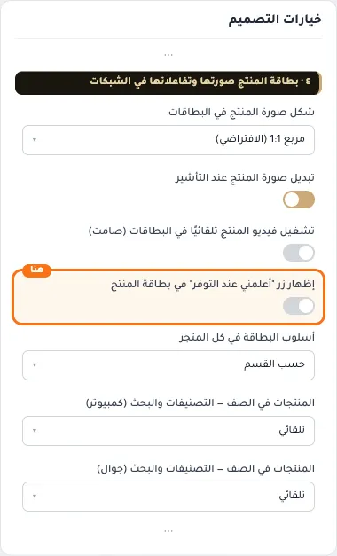

## «أسلوب البطاقة في كل المتجر»
قائمة منسدلة · الافتراضي: حسب القسم

**الوظيفة:** لصفحات التصنيف والبحث ولأقسام الرئيسية التي «شكل البطاقات» فيها «الافتراضي لهذا القسم»، ما عدا «منتجات مميزة» و«تبويبات جانبية» فلهما شكلهما. مكان زر الإضافة يتبع «أسلوب البطاقة عند التأشير» في كل قسم.

- **حسب القسم** — القيمة الافتراضية.
  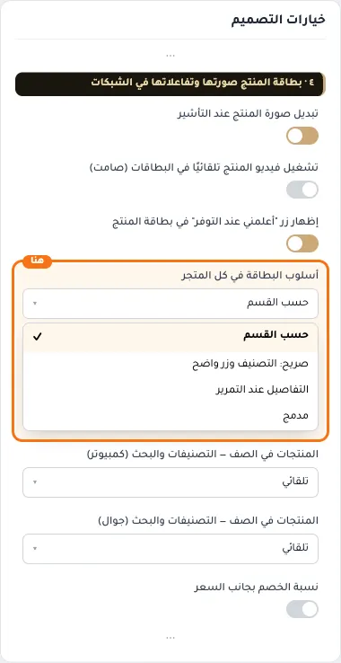
- **صريح: التصنيف وزر واضح**
  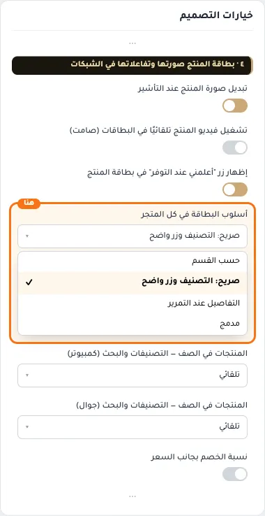
- **التفاصيل عند التمرير**
  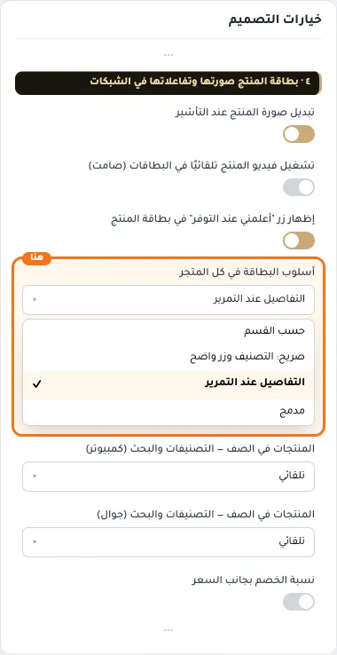
- **مدمج**
  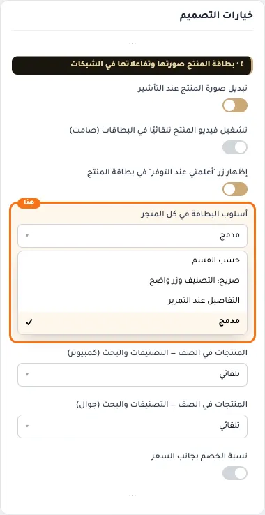

## «المنتجات في الصف — التصنيفات والبحث (كمبيوتر)»
قائمة منسدلة · الافتراضي: تلقائي

**الوظيفة:** مع شريط الفلاتر 4 منتجات كحد أقصى حتى لا تضيق البطاقات.

- **تلقائي** — القيمة الافتراضية.
  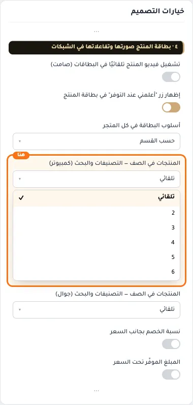
- **2**
  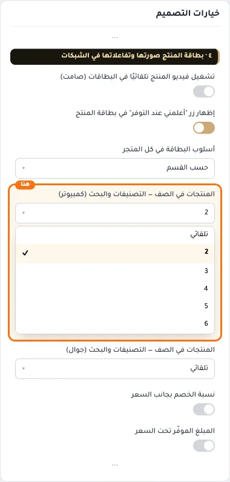
- **3**
  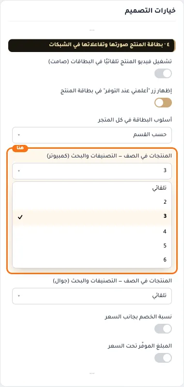
- **4**
  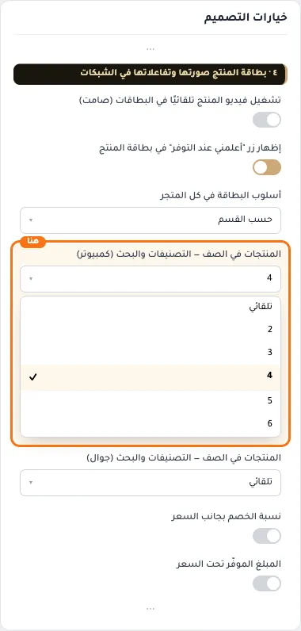
- **5**
  
- **6**
  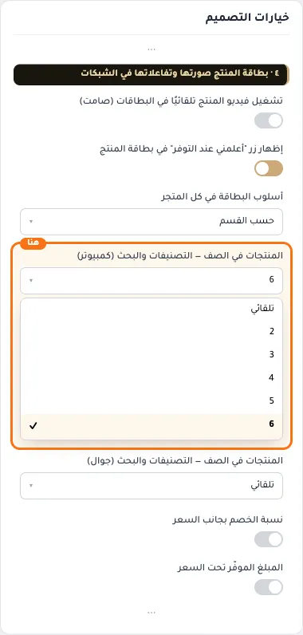

## «المنتجات في الصف — التصنيفات والبحث (جوال)»
قائمة منسدلة · الافتراضي: تلقائي

**الوظيفة:** عدد المنتجات في الصف على الجوال في صفحات التصنيفات والبحث.

- **تلقائي** — القيمة الافتراضية.
  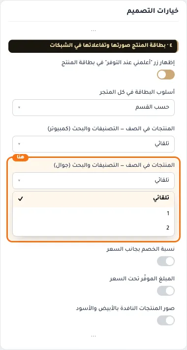
- **1**
  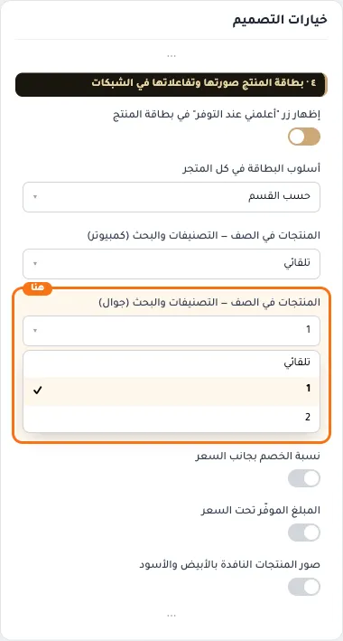
- **2**
  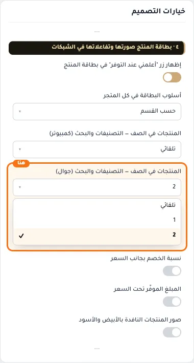

## «نسبة الخصم بجانب السعر»
مفتاح · الافتراضي: مطفأ

**الوظيفة:** يظهر نسبة الخصم (مثل ‎-20%‎) بجانب السعر على بطاقة المنتج.

- **بعد قلب المفتاح**
  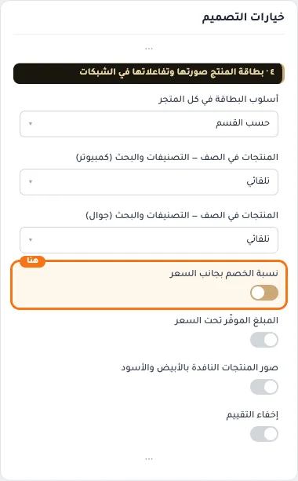

## «المبلغ الموفّر تحت السعر»
مفتاح · الافتراضي: مطفأ

**الوظيفة:** يظهر المبلغ الذي يوفّره العميل تحت السعر حين يكون المنتج مخفّضًا.

- **بعد قلب المفتاح**
  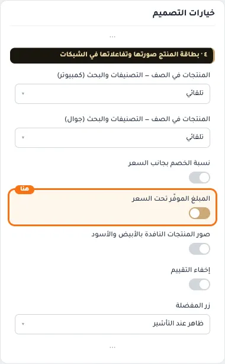

## «صور المنتجات النافدة بالأبيض والأسود»
مفتاح · الافتراضي: مطفأ

**الوظيفة:** يعرض صور المنتجات النافدة بالأبيض والأسود لتمييزها عن المتوفرة.

- **بعد قلب المفتاح**
  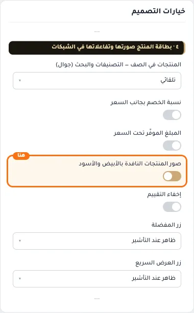

## «إخفاء التقييم»
مفتاح · الافتراضي: مطفأ

**الوظيفة:** يخفي نجوم التقييم من بطاقات المنتجات.

- **بعد قلب المفتاح**
  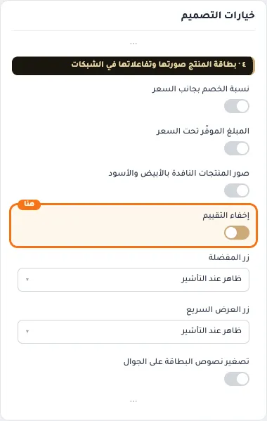

## «زر المفضلة»
قائمة منسدلة · الافتراضي: ظاهر عند التأشير

**الوظيفة:** يشمل كل أقسام المتجر.

- **ظاهر عند التأشير** — القيمة الافتراضية.
  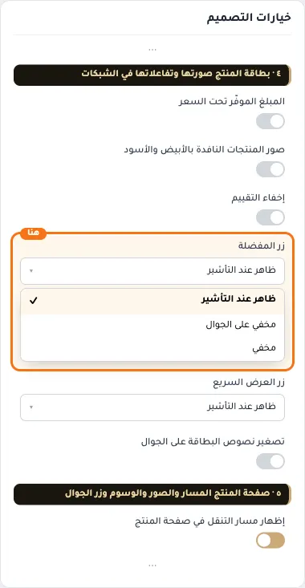
- **مخفي على الجوال**
  
- **مخفي**
  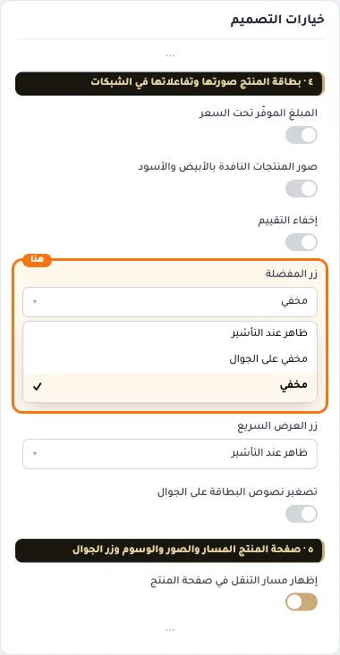

## «زر العرض السريع»
قائمة منسدلة · الافتراضي: ظاهر عند التأشير

**الوظيفة:** يظهر زر العرض السريع على البطاقة لفتح المنتج في نافذة دون مغادرة الصفحة.

- **ظاهر عند التأشير** — القيمة الافتراضية.
  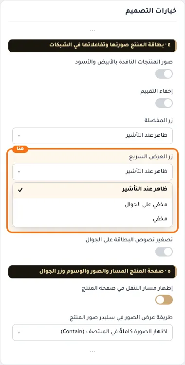
- **مخفي على الجوال**
  
- **مخفي**
  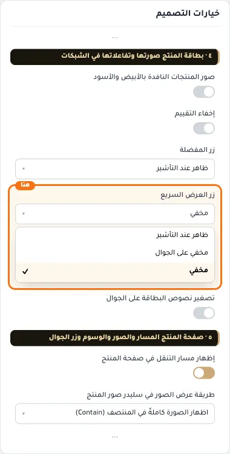

## «تصغير نصوص البطاقة على الجوال»
مفتاح · الافتراضي: مطفأ

**الوظيفة:** نص أصغر ومسافات أقل على الجوال. غير أسلوب البطاقة «مدمج».

- **بعد قلب المفتاح**
  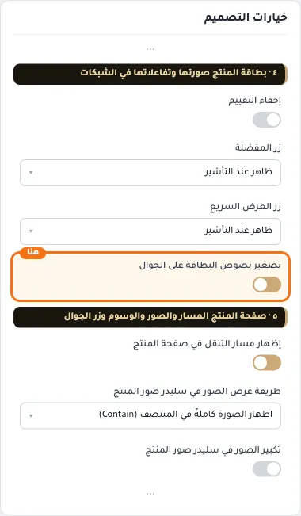
