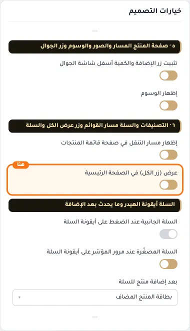

# ٦ · التصنيفات والسلة مسار القوائم وزر عرض الكل والسلة

## «إظهار مسار التنقل في صفحة قائمة المنتجات»
مفتاح · الافتراضي: مفعّل

**الوظيفة:** مسار التنقل أعلى صفحات الأقسام وقوائم المنتجات.

- **بعد قلب المفتاح**
  

## «عرض (زر الكل) في الصفحة الرئيسية»
مفتاح · الافتراضي: مطفأ

**الوظيفة:** يظهر بجانب عنوان مكوّن الماركات وحده، وينقل إلى قائمة الماركات كاملة.

- **بعد قلب المفتاح**
  
