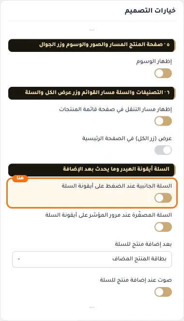
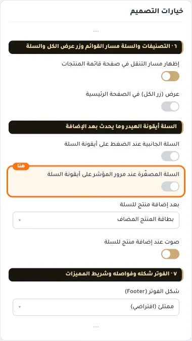
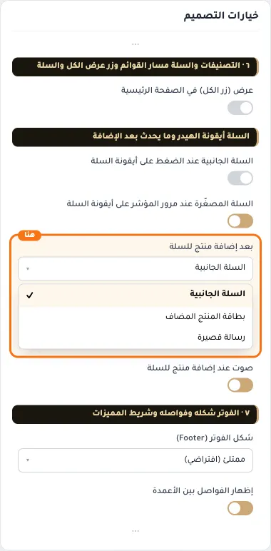
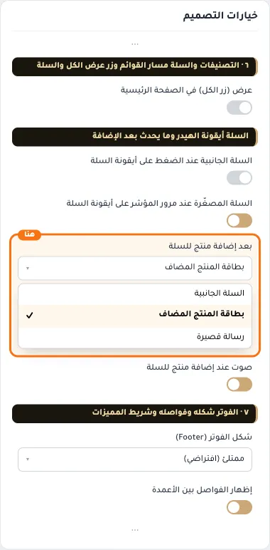
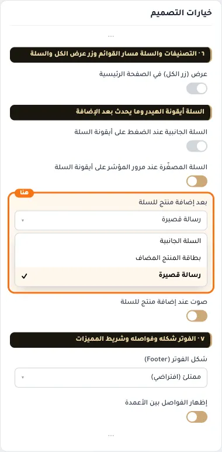
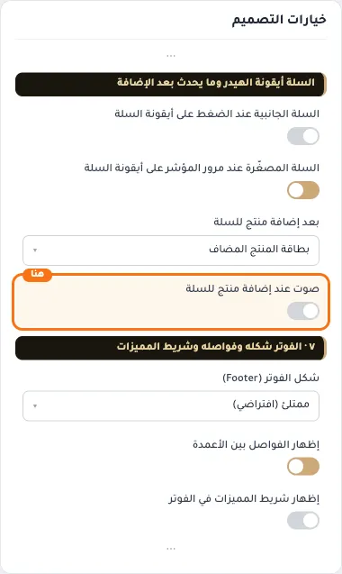

# السلة أيقونة الهيدر وما يحدث بعد الإضافة

## «السلة الجانبية عند الضغط على أيقونة السلة»
مفتاح · الافتراضي: مطفأ

**الوظيفة:** بالضغط على أيقونة السلة في الهيدر يُفتح الدرج الجانبي: المنتجات مع تعديل الكمية والحذف، والإجمالي، وإتمام الطلب — دون مغادرة الصفحة. مطفأً، الضغط ينقل لصفحة السلة كالمعتاد.

- **بعد قلب المفتاح**
  

## «السلة المصغّرة عند مرور المؤشر على أيقونة السلة»
مفتاح · الافتراضي: مفعّل

**الوظيفة:** على الحاسوب: وقوف المؤشر على أيقونة السلة يُظهر قائمة صغيرة بآخر المنتجات والإجمالي مع الحذف. لا تظهر على الجوال (لا مؤشر). تعمل مع السلة الجانبية أو بدونها.

- **بعد قلب المفتاح**
  

## «بعد إضافة منتج للسلة»
قائمة منسدلة · الافتراضي: بطاقة المنتج المضاف

**الوظيفة:** ردّ فعل واحد يراه الزائر بعد ضغط زر الإضافة. «السلة الجانبية»: درج يعرض السلة وإتمام الطلب دون مغادرة الصفحة. «بطاقة المنتج المضاف»: بطاقة صغيرة بالمنتج وزرّي إتمام الطلب وعرض السلة. «رسالة قصيرة»: رسالة سلة المعتادة وحدها.

- **السلة الجانبية**
  
- **بطاقة المنتج المضاف** — القيمة الافتراضية.
  
- **رسالة قصيرة**
  

## «صوت عند إضافة منتج للسلة»
مفتاح · الافتراضي: مفعّل

**الوظيفة:** نغمة قصيرة تؤكد للمتسوق أن المنتج أُضيف. أطفئه لإضافة صامتة.

- **بعد قلب المفتاح**
  
