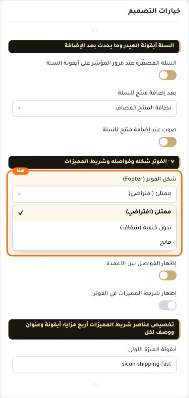
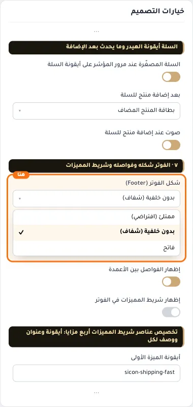
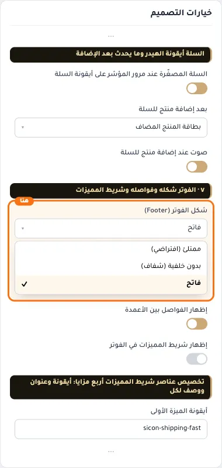

# ٧ · الفوتر شكله وفواصله وشريط المميزات

## «شكل الفوتر (Footer)»
قائمة منسدلة · الافتراضي: ممتلئ (افتراضي)

**الوظيفة:** اختر مظهر أسفل الصفحة: ممتلئ (افتراضي) بلون فوتر اللوحة، ومع «الكلاسيكية» يتبع وضع العرض (فاتح في الفاتح وداكن في الداكن)؛ أو بدون خلفية (شفاف يندمج مع الصفحة)؛ أو فاتح.

- **ممتلئ (افتراضي)** — القيمة الافتراضية.
  
- **بدون خلفية (شفاف)**
  
- **فاتح**
  

## «إظهار الفواصل بين الأعمدة»
مفتاح · الافتراضي: مفعّل

**الوظيفة:** خطوط فاصلة رفيعة بين أعمدة الفوتر لمظهر أكثر تنظيماً.

- **بعد قلب المفتاح**
  

## «إظهار شريط المميزات في الفوتر»
مفتاح · الافتراضي: مطفأ

**الوظيفة:** شريط مميزات (شحن سريع، إرجاع، دعم...) أعلى الفوتر.

- **بعد قلب المفتاح**
  
