# تخصيص عناصر شريط المميزات أربع مزايا: أيقونة وعنوان ووصف لكلٍّ

## «أيقونة الميزة الأولى»
نص · الافتراضي: sicon-shipping-fast

**الوظيفة:** مثال: sicon-shipping-fast / sicon-rotate / sicon-gold-badge / sicon-phone / sicon-shield-check / sicon-gift / sicon-star / sicon-clock

- **أيقونة الميزة الأولى**
  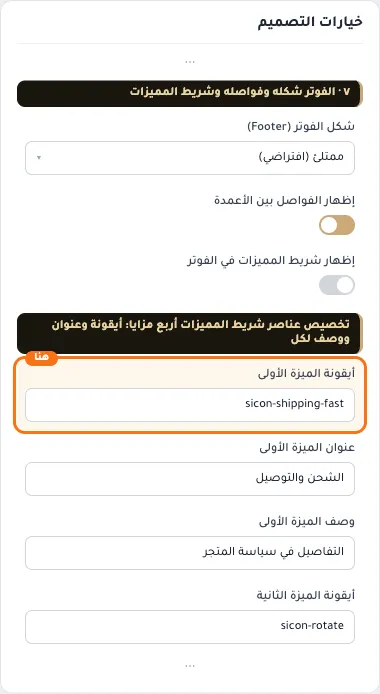

## «عنوان الميزة الأولى»
نص · الافتراضي: الشحن والتوصيل

**الوظيفة:** سطر الميزة الرئيسي.

- **عنوان الميزة الأولى**
  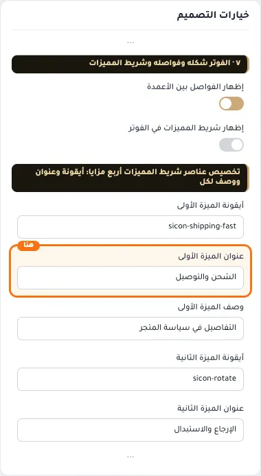

## «وصف الميزة الأولى»
نص · الافتراضي: التفاصيل في سياسة المتجر

**الوظيفة:** سطر توضيحي أصغر تحت العنوان.

- **وصف الميزة الأولى**
  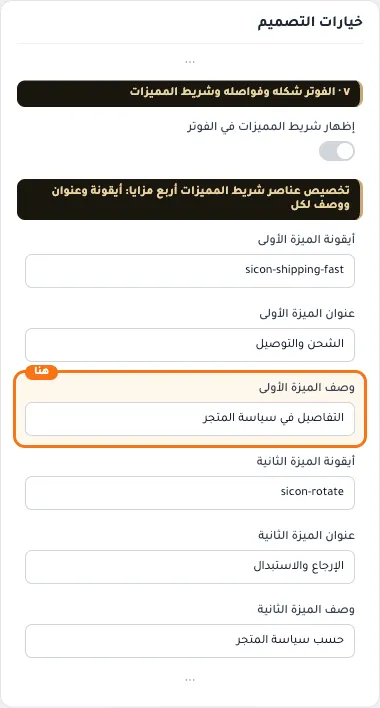

## «أيقونة الميزة الثانية»
نص · الافتراضي: sicon-rotate

**الوظيفة:** اسم أيقونة سلة (sicon-…).

- **أيقونة الميزة الثانية**
  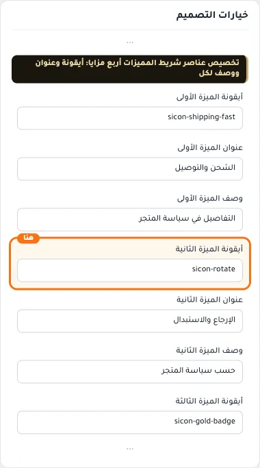

## «عنوان الميزة الثانية»
نص · الافتراضي: الإرجاع والاستبدال

**الوظيفة:** سطر الميزة الرئيسي.

- **عنوان الميزة الثانية**
  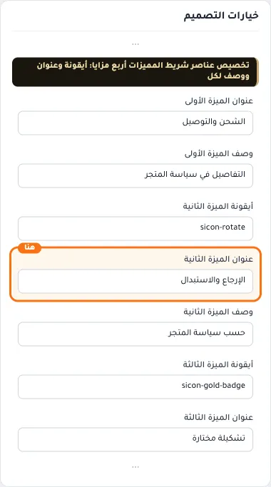

## «وصف الميزة الثانية»
نص · الافتراضي: حسب سياسة المتجر

**الوظيفة:** سطر توضيحي أصغر تحت العنوان.

- **وصف الميزة الثانية**
  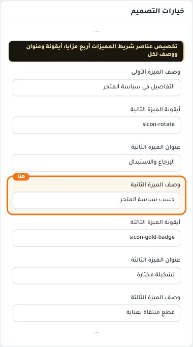

## «أيقونة الميزة الثالثة»
نص · الافتراضي: sicon-gold-badge

**الوظيفة:** اسم أيقونة سلة (sicon-…).

- **أيقونة الميزة الثالثة**
  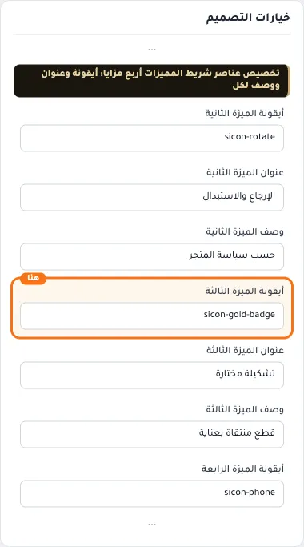

## «عنوان الميزة الثالثة»
نص · الافتراضي: تشكيلة مختارة

**الوظيفة:** سطر الميزة الرئيسي.

- **عنوان الميزة الثالثة**
  

## «وصف الميزة الثالثة»
نص · الافتراضي: قطع منتقاة بعناية

**الوظيفة:** سطر توضيحي أصغر تحت العنوان.

- **وصف الميزة الثالثة**
  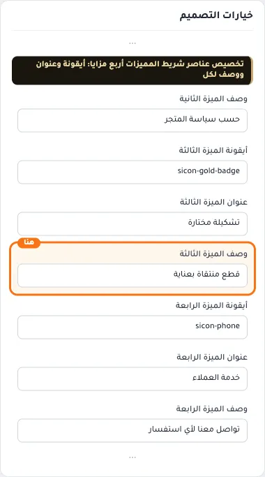

## «أيقونة الميزة الرابعة»
نص · الافتراضي: sicon-phone

**الوظيفة:** اسم أيقونة سلة (sicon-…).

- **أيقونة الميزة الرابعة**
  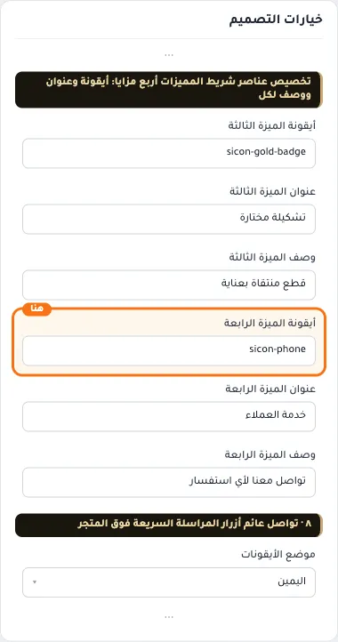

## «عنوان الميزة الرابعة»
نص · الافتراضي: خدمة العملاء

**الوظيفة:** سطر الميزة الرئيسي.

- **عنوان الميزة الرابعة**
  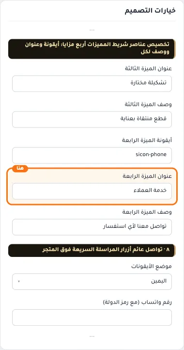

## «وصف الميزة الرابعة»
نص · الافتراضي: تواصل معنا لأي استفسار

**الوظيفة:** سطر توضيحي أصغر تحت العنوان.

- **وصف الميزة الرابعة**
  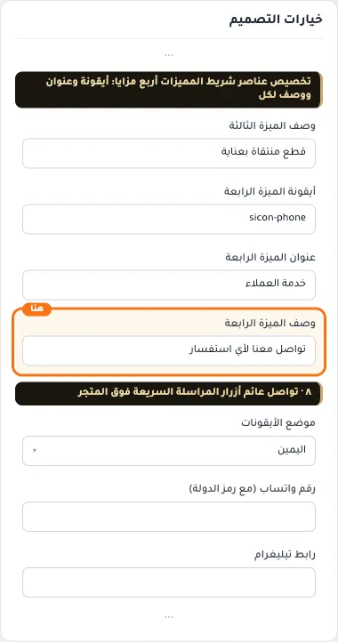
