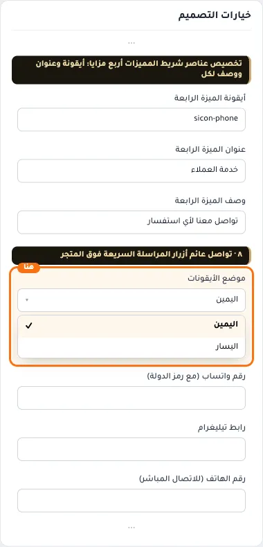
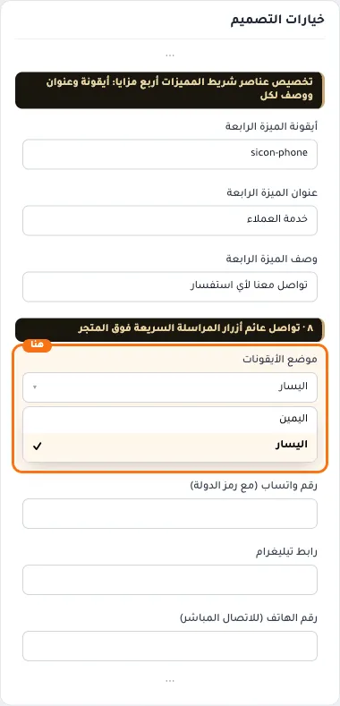
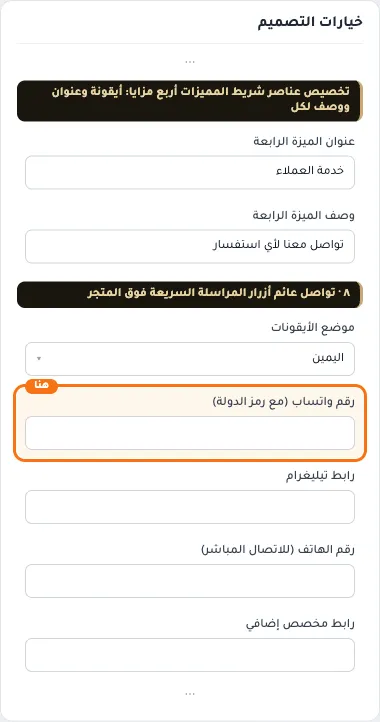
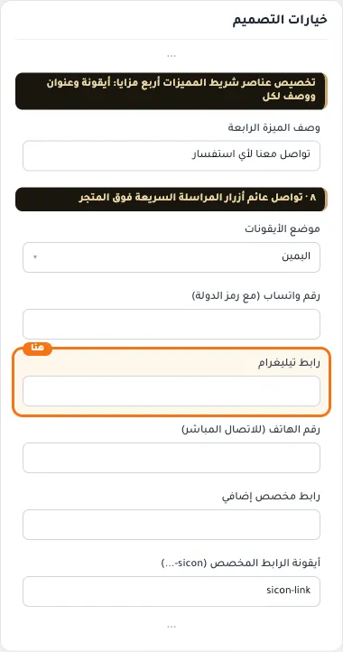
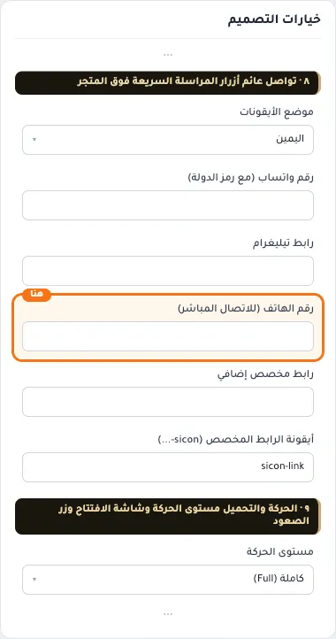
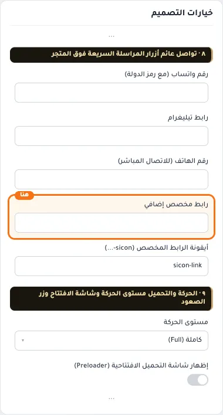
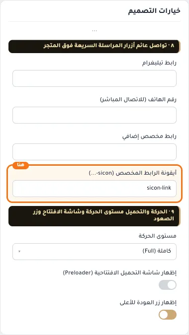

# ٨ · تواصل عائم أزرار المراسلة السريعة فوق المتجر

## «موضع الأيقونات»
قائمة منسدلة · الافتراضي: اليمين

**الوظيفة:** جهة ظهور أيقونات التواصل. زر العودة للأعلى يجلس على الجهة المقابلة تلقائيًا.

- **اليمين** — القيمة الافتراضية.
  
- **اليسار**
  

## «رقم واتساب (مع رمز الدولة)»
نص · الافتراضي: فارغ

**الوظيفة:** مثال: 9665XXXXXXXX (بدون + أو مسافات)

- **رقم واتساب (مع رمز الدولة)**
  

## «رابط تيليغرام»
نص · الافتراضي: فارغ

**الوظيفة:** رابط حسابك أو قناتك (https://t.me/…).

- **رابط تيليغرام**
  

## «رقم الهاتف (للاتصال المباشر)»
نص · الافتراضي: فارغ

**الوظيفة:** يفتح الاتصال مباشرة من الجوال؛ اتركه فارغًا لإخفاء الزر.

- **رقم الهاتف (للاتصال المباشر)**
  

## «رابط مخصص إضافي»
نص · الافتراضي: فارغ

**الوظيفة:** زر إضافي لأي رابط تريده: فرع، خريطة، صفحة…

- **رابط مخصص إضافي**
  

## «أيقونة الرابط المخصص (sicon-...)»
نص · الافتراضي: sicon-link

**الوظيفة:** اسم أيقونة سلة للزر المخصص، مثل sicon-location.

- **أيقونة الرابط المخصص (sicon-...)**
  
