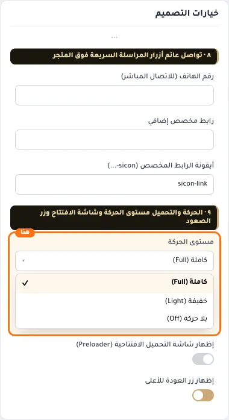
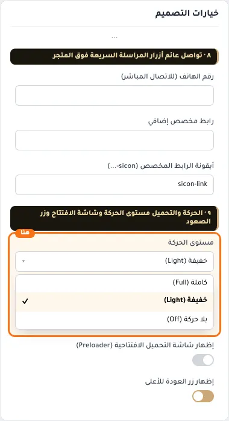
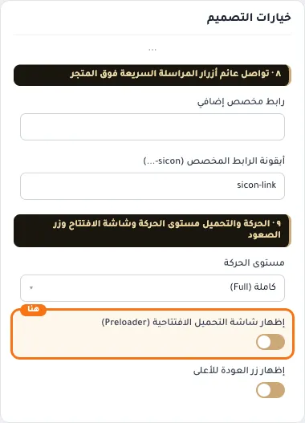
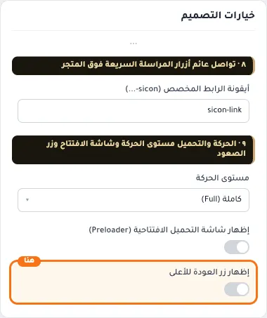

# ٩ · الحركة والتحميل مستوى الحركة وشاشة الافتتاح وزر الصعود

## «مستوى الحركة»
قائمة منسدلة · الافتراضي: كاملة (Full)

**الوظيفة:** كاملة: كل المؤثرات على سطح المكتب. خفيفة: بلا بارالاكس، وبلا تثبيت المقاطع أثناء التمرير، وبلا تقطيع النص (تراكم البطاقات يبقى — فهو تخطيط لا حركة). بلا حركة: يُلغى الزخرف كله بما فيه تراكم البطاقات، وتبقى كل الوظائف (التبويبات، قبل/بعد، النقاط، الشراء) تعمل. الجوال محدود بـ«خفيفة» تلقائيًا، وطلب النظام «تقليل الحركة» يتقدّم على هذا الإعداد دائمًا.

- **كاملة (Full)** — القيمة الافتراضية.
  
- **خفيفة (Light)**
  
- **بلا حركة (Off)**
  

## «إظهار شاشة التحميل الافتتاحية (Preloader)»
مفتاح · الافتراضي: مطفأ

**الوظيفة:** غلاف بصري أنيق يظهر لثوانٍ أثناء تحميل المتجر ثم يختفي تلقائيًا.

- **بعد قلب المفتاح**
  

## «إظهار زر العودة للأعلى»
مفتاح · الافتراضي: مفعّل

**الوظيفة:** زر عائم يظهر عند التمرير لأسفل ويعيد الزائر لأعلى الصفحة بسلاسة.

- **بعد قلب المفتاح**
  
