# صور متحركة (محسنة)

المسافات والعرض والخلفية والحواف: انظر [الخيارات المشتركة](../../01-shared/README.md).

## «slides»
عناصر متكررة · الافتراضي: عناصر جاهزة

**الوظيفة:** الشرائح التي يعرضها القسم؛ لكل شريحة صورتها ونصوصها ورابطها.

- **slides**
  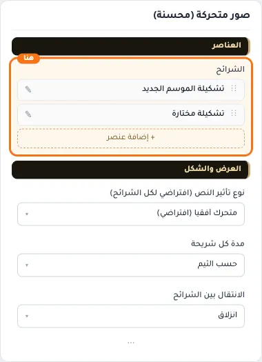

**حقول كل عنصر:**
- «صورة البنر» (صورة، الافتراضي: فارغ): * المقاس المناسب للصورة هو 900×600 بكسل
- «عنوان رئيسي» (نص، الافتراضي: فارغ): يتم عرضه على الصورة بحجم بارز جداً، مع إضافة تأثير دخول للنص يضيف لمسة جمالية على معرض الصور.
- «نص إضافي» (نص طويل، الافتراضي: فارغ): يتم عرضه على الصورة بحجم أصغر من العنوان الرئيسي، مع إضافة تأثير دخول للنص يضيف لمسة جمالية على معرض الصور.
- «إزالة طبقة التعتيم» (مفتاح، الافتراضي: مطفأ): يزيل الطبقة الداكنة فوق الصورة؛ مناسب للصور الفاتحة التي تحمل نصًا داكنًا أو بلا نص.
- «نص علوي صغير (Eyebrow)» (نص، الافتراضي: فارغ): يظهر فوق العنوان بحروف متباعدة وبلون ذهبي، يمنح الهيرو طابعاً فاخراً.
- «نص زر الإجراء (CTA)» (نص، الافتراضي: فارغ): يظهر كزر ذهبي بارز. اتركه فارغاً لإخفاء الزر.
- «وجهة الزر» (اختيار من المتجر، الافتراضي: فارغ): اختر منتجاً أو تصنيفاً أو صفحة تعريفية... أو الصق رابطاً خارجياً.
- «تأثير نص هذه الشريحة» (قائمة منسدلة، الافتراضي: افتراضي (حسب الإعداد العام)): اتركه على (افتراضي) لاستخدام إعداد المكوّن العام.
- «موضع النص» (قائمة منسدلة، الافتراضي: وسط): مكان النص فوق الشريحة: يمين أو وسط أو يسار، وأعلى أو أسفل.
- «موضع الصورة» (قائمة منسدلة، الافتراضي: حسب الثيم): الجزء من الصورة الذي يبقى ظاهرًا حين تُقص على الشاشات الضيقة.
- «شكل الزر» (قائمة منسدلة، الافتراضي: ممتلئ): شكل زر الشريحة: ممتلئ أو بإطار.
- «جعل الشريحة كلها رابطاً» (مفتاح، الافتراضي: مطفأ): يجعل الضغط في أي مكان على الشريحة يفتح الرابط، لا الزر وحده.

## «نوع تأثير النص (افتراضي لكل الشرائح)»
قائمة منسدلة · الافتراضي: متحرك أفقياً (افتراضي)

**الوظيفة:** اختر كيف تظهر نصوص الشرائح. يمكن تخصيص كل شريحة على حدة من إعداداتها.

- **متحرك أفقياً (افتراضي)** — القيمة الافتراضية.
  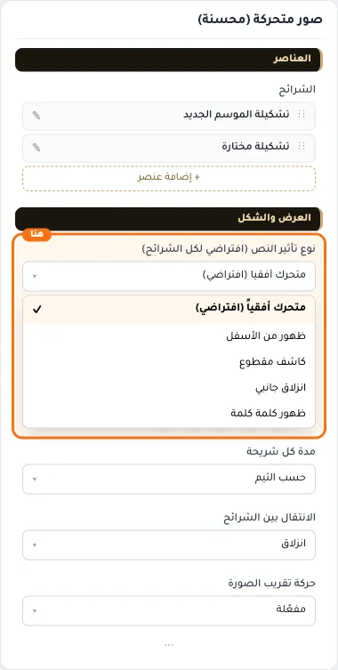
  
- **ظهور من الأسفل**
  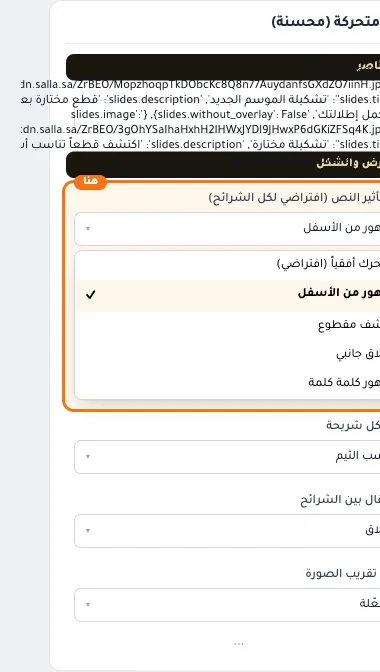
- **كاشف مقطوع**
  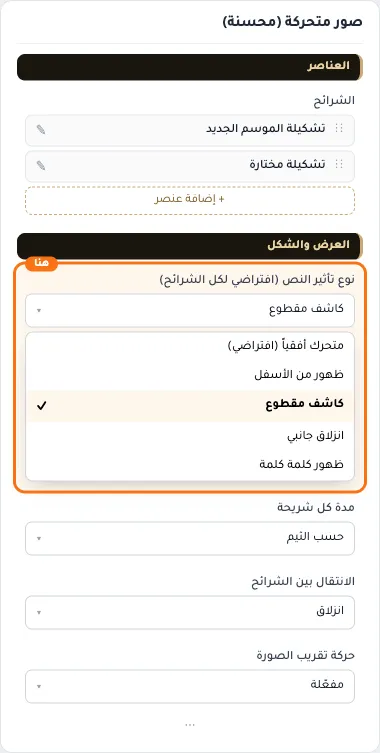
- **انزلاق جانبي**
  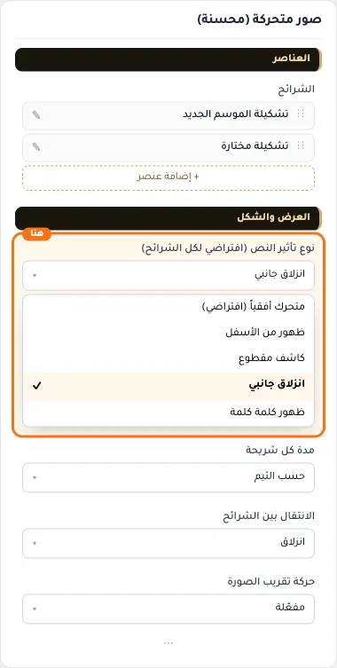
- **ظهور كلمة كلمة**
  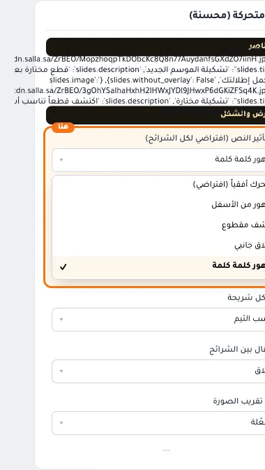

## «مدة كل شريحة»
قائمة منسدلة · الافتراضي: حسب الثيم

**الوظيفة:** كم ثانية تبقى كل شريحة قبل الانتقال للتالية.

- **حسب الثيم** — القيمة الافتراضية.
  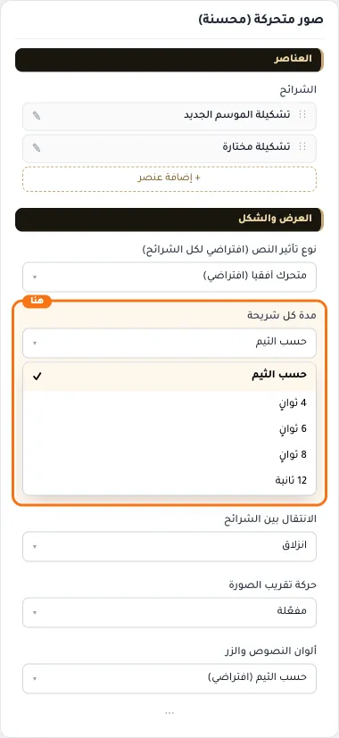
  
- **4 ثوانٍ**
  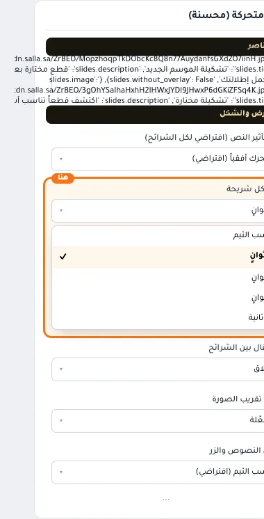
- **6 ثوانٍ**
  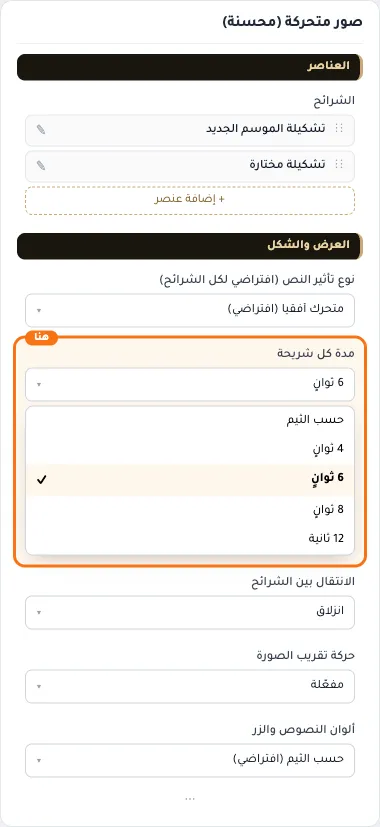
- **8 ثوانٍ**
  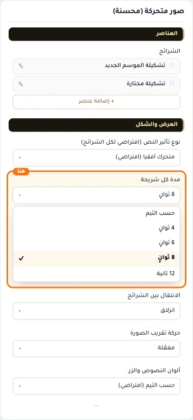
- **12 ثانية**
  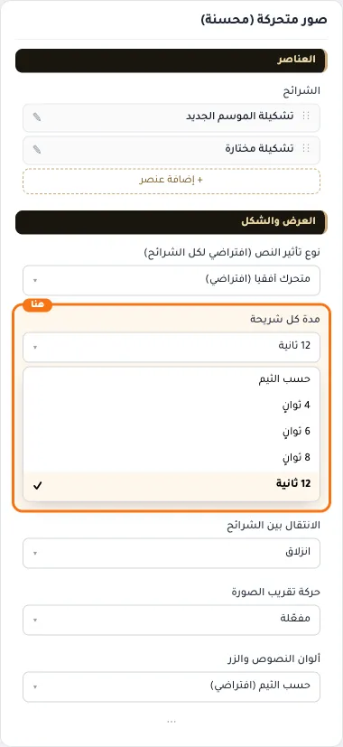

## «الانتقال بين الشرائح»
قائمة منسدلة · الافتراضي: انزلاق

**الوظيفة:** شكل الانتقال بين الشرائح: انزلاق أو تلاشي.

- **انزلاق** — القيمة الافتراضية.
  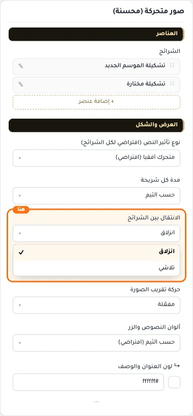
  
- **تلاشي**
  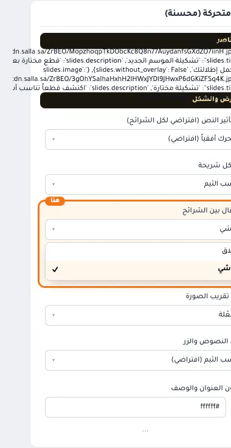

## «حركة تقريب الصورة»
قائمة منسدلة · الافتراضي: مفعّلة

**الوظيفة:** تقريب بطيء للصورة أثناء ظهور الشريحة يعطي إحساسًا بالحركة.

- **مفعّلة** — القيمة الافتراضية.
  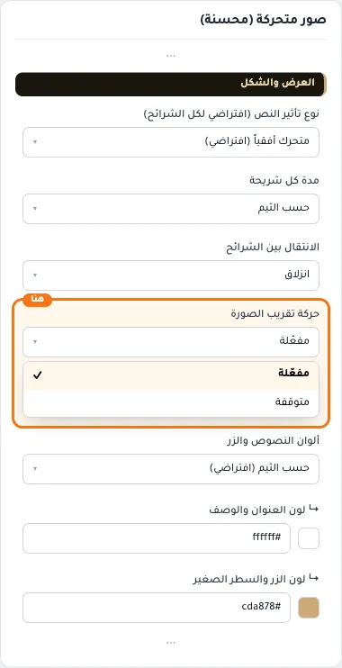
  
- **متوقفة**
  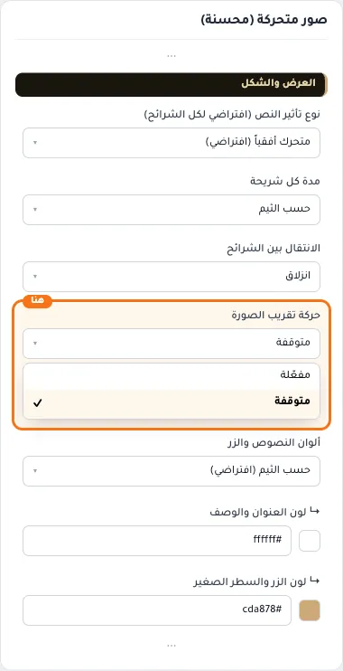

## «ألوان النصوص والزر»
قائمة منسدلة · الافتراضي: حسب الثيم (افتراضي)

**الوظيفة:** حسب الثيم: العنوان أبيض فوق الصورة، والزر والسطر الصغير بلون أزرار المتجر. «العنوان بلون الثيم» يلوّن العنوان بلون الأزرار ويتغير معه تلقائيًا.

- **حسب الثيم (افتراضي)** — القيمة الافتراضية.
  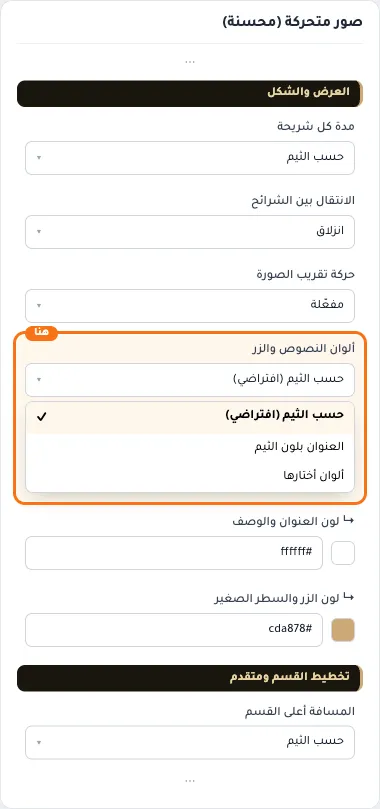
  
- **العنوان بلون الثيم**
  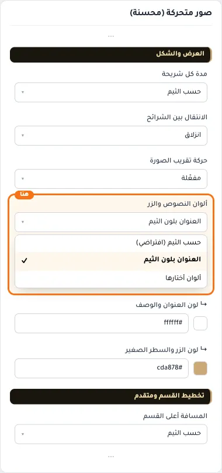
- **ألوان أختارها**
  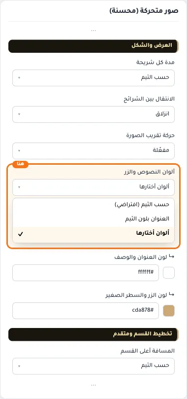

## «↳ لون العنوان والوصف»
لون · الافتراضي: #ffffff

**الوظيفة:** الوصف يأخذ نفس اللون بشفافية خفيفة.

**يظهر حين:** «ألوان النصوص والزر» = ألوان أختارها

- **↳ لون العنوان والوصف**
  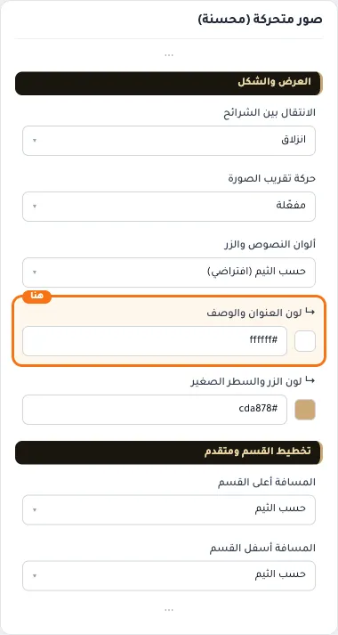

## «↳ لون الزر والسطر الصغير»
لون · الافتراضي: #cda878

**الوظيفة:** لون نص الزر يُختار تلقائيًا ليبقى مقروءًا، واللون الداكن يُفتَّح فوق الصورة للسطر الصغير والزر المفرّغ.

**يظهر حين:** «ألوان النصوص والزر» = ألوان أختارها

- **↳ لون الزر والسطر الصغير**
  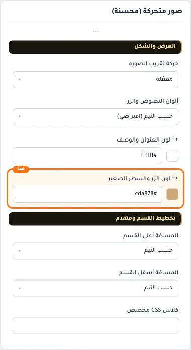

## «كلاس CSS مخصص»
نص · الافتراضي: فارغ

**الوظيفة:** للمصممين. كلاس القسم الثابت: cml-s--enhanced-slider

- **كلاس CSS مخصص**
  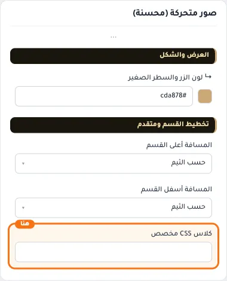
