# روابط سريعة

المسافات والعرض والخلفية والحواف: انظر [الخيارات المشتركة](../../01-shared/README.md).

## «العنوان»
نص · الافتراضي: فارغ

**الوظيفة:** العنوان الرئيسي الذي يظهر أعلى القسم. اتركه فارغًا لإخفائه.

- **العنوان**
  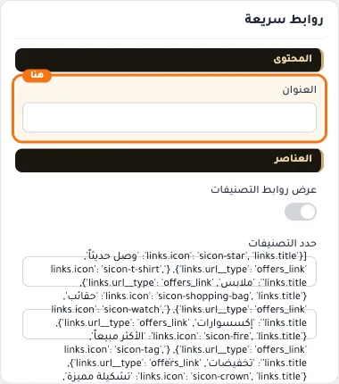

## «عرض روابط التصنيفات»
مفتاح · الافتراضي: مطفأ

**الوظيفة:** يمكنك تحديد التصنيفات بدل العناصر الخاصة، مع امكانية عرض صورة التصنيف مع العنصر

- **بعد قلب المفتاح**
  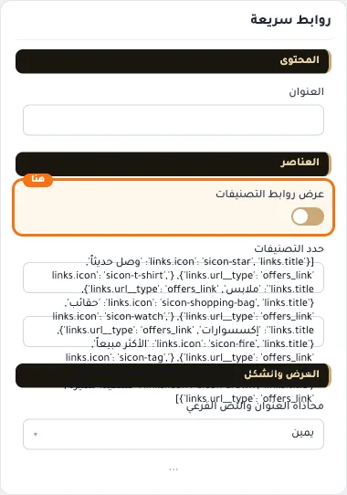

## «حدد التصنيفات»
اختيار من المتجر · الافتراضي: فارغ

**الوظيفة:** التصنيفات التي تظهر في القسم، كل تصنيف بصورته واسمه ويفتح صفحته عند الضغط.

**يظهر حين:** «عرض روابط التصنيفات» = مفعّل

- **حدد التصنيفات**
  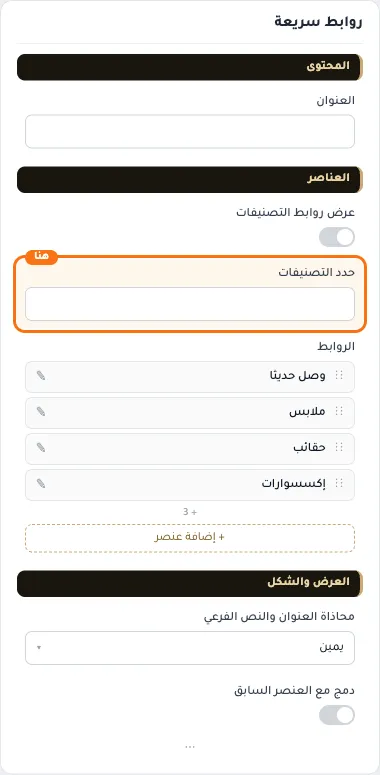

## «الروابط»
عناصر متكررة · الافتراضي: عناصر جاهزة

**الوظيفة:** الروابط التي يعرضها القسم، لكل رابط نصه ووجهته وأيقونته.

**يظهر حين:** «عرض روابط التصنيفات» = مطفأ

- **الروابط**
  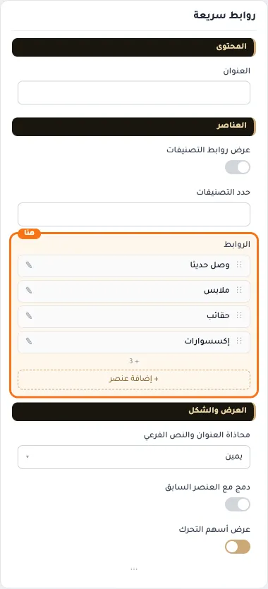

**حقول كل عنصر:**
- «أيقونة الرابط» (أيقونة، الافتراضي: sicon-store2): الأيقونة التي تظهر بجانب العنصر.
- «عنوان الرابط» (نص، الافتراضي: فارغ): العنوان الرئيسي الذي يظهر أعلى القسم. اتركه فارغًا لإخفائه.
- «الرابط» (اختيار من المتجر، الافتراضي: فارغ): الصفحة التي يفتحها الضغط على الزر أو العنصر.

## «محاذاة العنوان والنص الفرعي»
قائمة منسدلة · الافتراضي: يمين

**الوظيفة:** محاذاة العنوان الرئيسي والفرعي داخل القسم (الافتراضي: يمين).

- **يمين** — القيمة الافتراضية.
  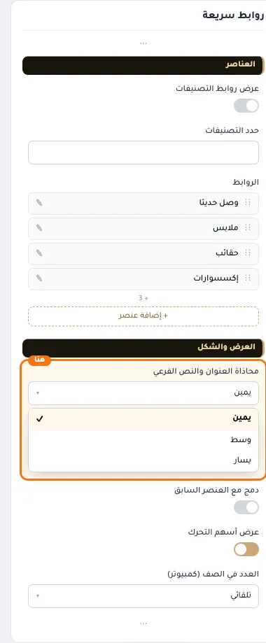
- **وسط**
  
- **يسار**
  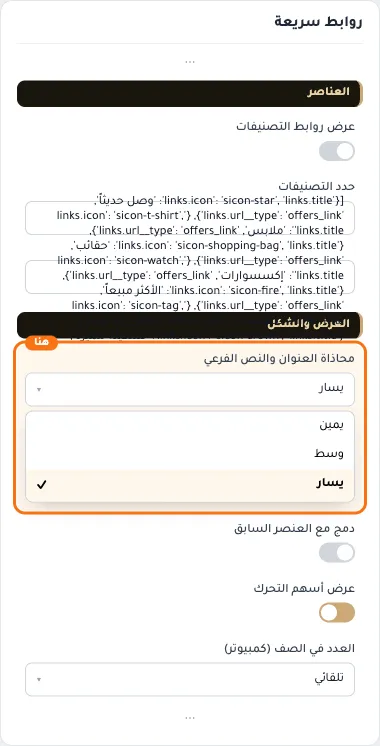

## «دمج مع العنصر السابق»
مفتاح · الافتراضي: مطفأ

**الوظيفة:** يلصق القسم بالقسم الذي فوقه بلا فراغ، ليبدوا قسمًا واحدًا.

- **بعد قلب المفتاح**
  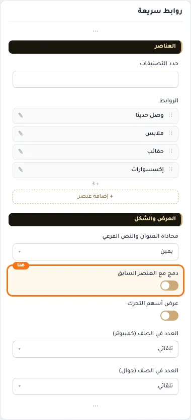

## «عرض أسهم التحرك»
مفتاح · الافتراضي: مفعّل

**الوظيفة:** يظهر أسهم التنقل يمينًا ويسارًا.

- **بعد قلب المفتاح**
  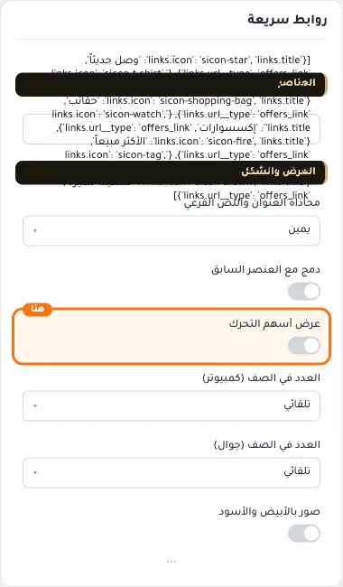

## «العدد في الصف (كمبيوتر)»
قائمة منسدلة · الافتراضي: تلقائي

**الوظيفة:** عدد العناصر في الصف الواحد على شاشة الكمبيوتر.

- **تلقائي** — القيمة الافتراضية.
  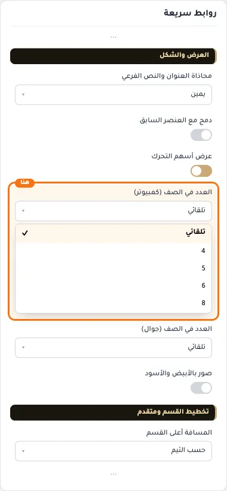
- **4**
  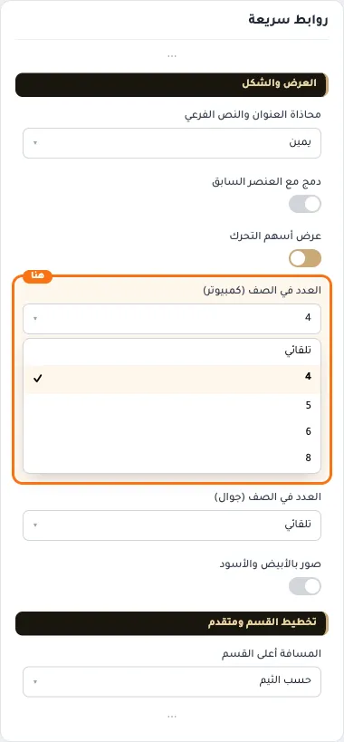
- **5**
  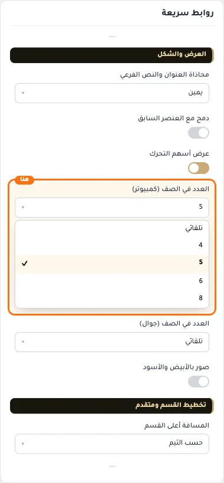
- **6**
  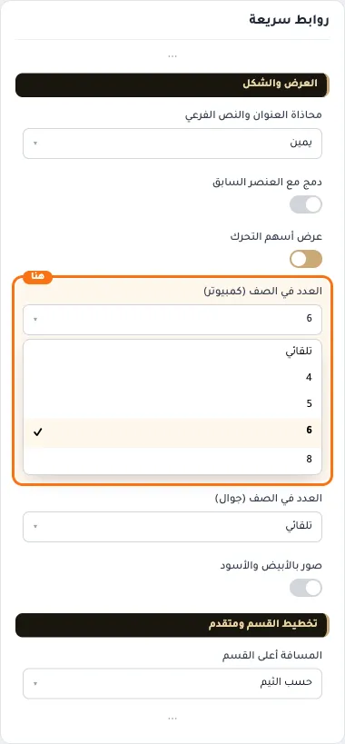
- **8**
  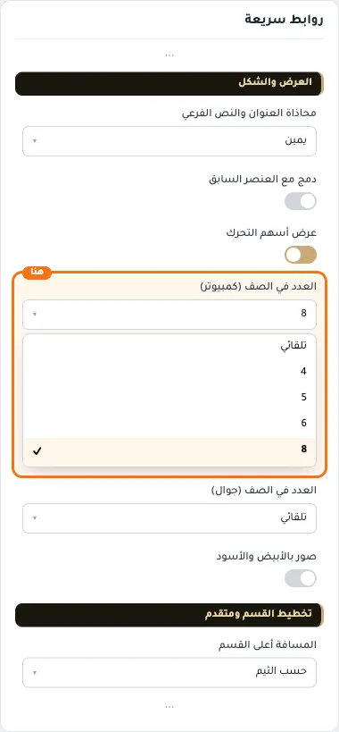

## «العدد في الصف (جوال)»
قائمة منسدلة · الافتراضي: تلقائي

**الوظيفة:** عدد العناصر في الصف الواحد على الجوال.

- **تلقائي** — القيمة الافتراضية.
  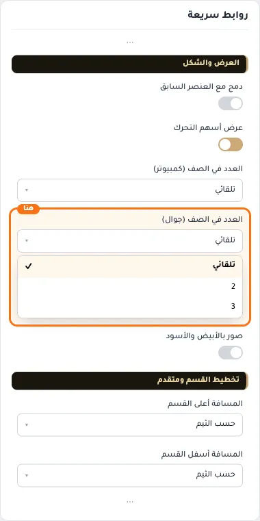
- **2**
  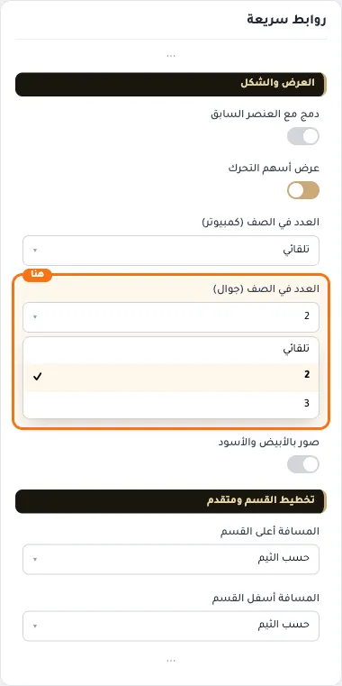
- **3**
  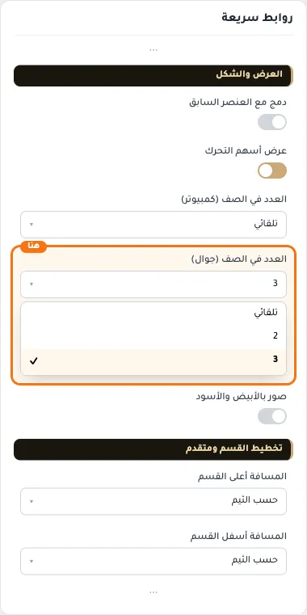

## «صور بالأبيض والأسود»
مفتاح · الافتراضي: مطفأ

**الوظيفة:** تتلوّن عند مرور الماوس، وتبقى ملوّنة على الجوال.

- **بعد قلب المفتاح**
  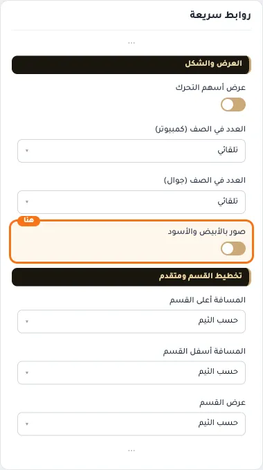

## «كلاس CSS مخصص»
نص · الافتراضي: فارغ

**الوظيفة:** للمصممين. كلاس القسم الثابت: cml-s--main-links

- **كلاس CSS مخصص**
  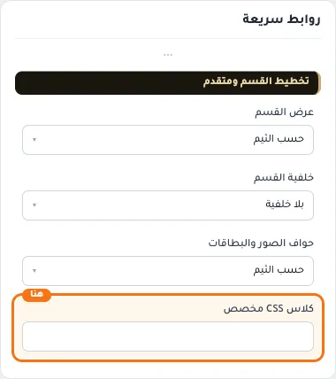
