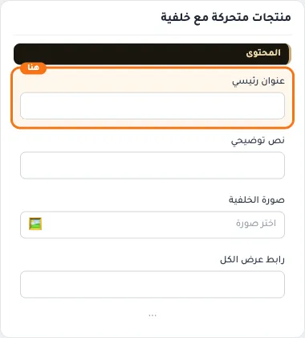
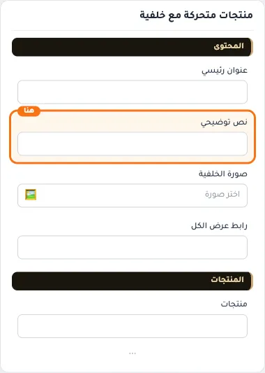
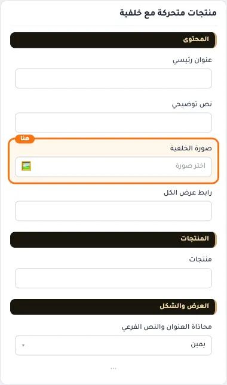
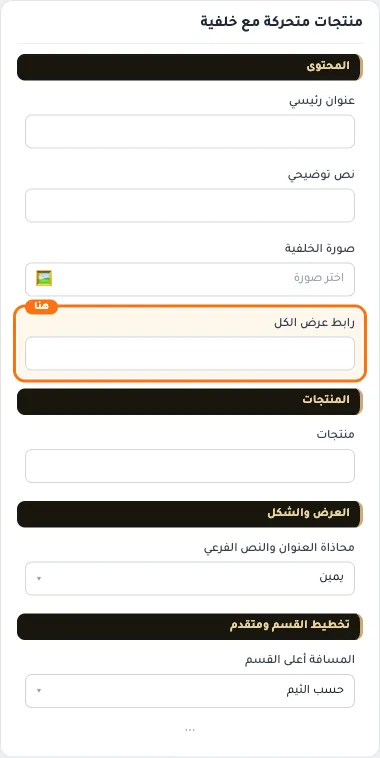
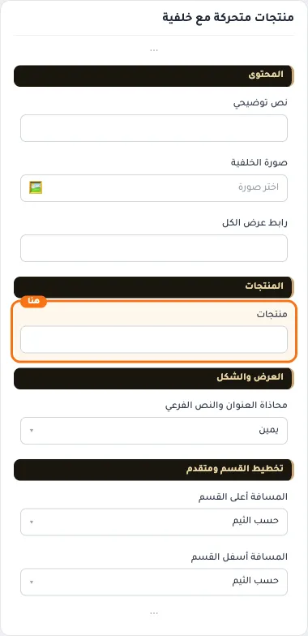
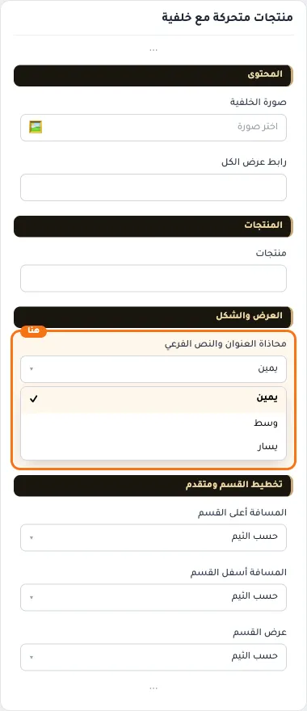
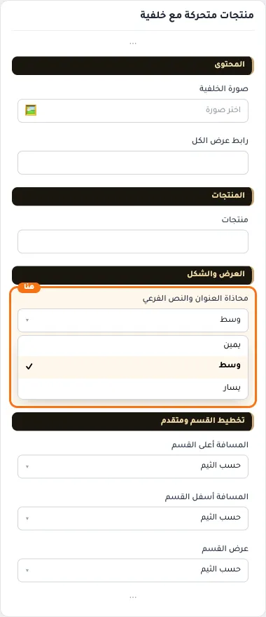
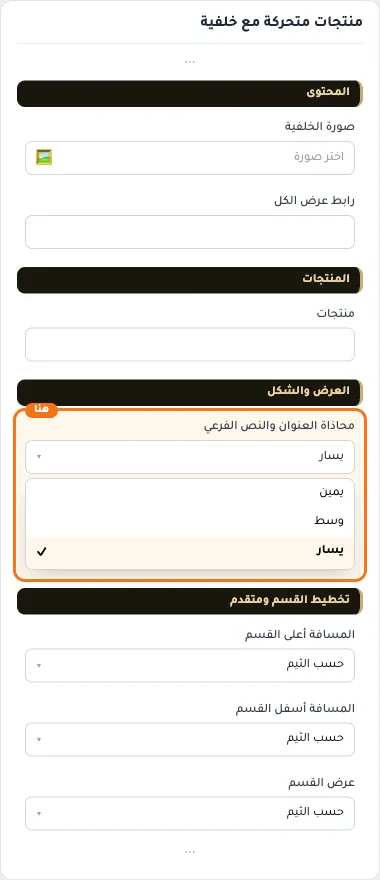
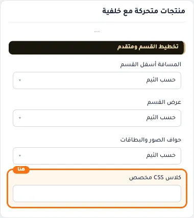

# منتجات متحركة مع خلفية

المسافات والعرض والخلفية والحواف: انظر [الخيارات المشتركة](../../01-shared/README.md).

## «عنوان رئيسي»
نص · الافتراضي: فارغ

**الوظيفة:** العنوان الرئيسي الذي يظهر أعلى القسم. اتركه فارغًا لإخفائه.

- **عنوان رئيسي**
  

## «نص توضيحي»
نص طويل · الافتراضي: فارغ

**الوظيفة:** نص توضيحي يظهر مع العنوان لشرح العرض أو المجموعة.

- **نص توضيحي**
  

## «صورة الخلفية»
صورة · الافتراضي: https://cdn.salla.sa/form-builder/D7bG3pgSit43TheOejBOZV7LIfG1y1Cj0hWLmgIh.jpg

**الوظيفة:** * المقاس المناسب للصورة هو 1233×500 بكسل

- **صورة الخلفية**
  

## «رابط عرض الكل»
اختيار من المتجر · الافتراضي: فارغ

**الوظيفة:** عند إختيار رابط فارغ سيتم إخفاء زر 'عرض الكل'

- **رابط عرض الكل**
  

## «منتجات»
اختيار من المتجر · الافتراضي: فارغ

**الوظيفة:** المنتجات المعروضة في القسم.

- **منتجات**
  

## «محاذاة العنوان والنص الفرعي»
قائمة منسدلة · الافتراضي: يمين

**الوظيفة:** محاذاة العنوان الرئيسي والفرعي داخل القسم (الافتراضي: يمين).

- **يمين** — القيمة الافتراضية.
  
- **وسط**
  
- **يسار**
  

## «كلاس CSS مخصص»
نص · الافتراضي: فارغ

**الوظيفة:** للمصممين. كلاس القسم الثابت: cml-s--slider-products-with-header

- **كلاس CSS مخصص**
  
