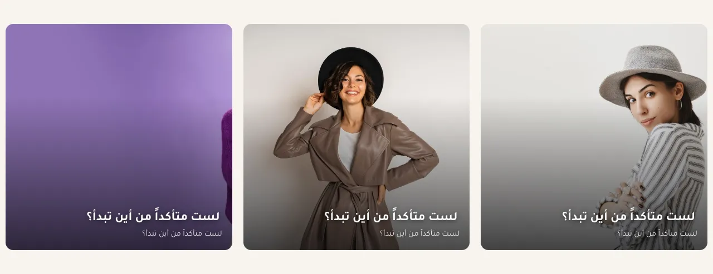
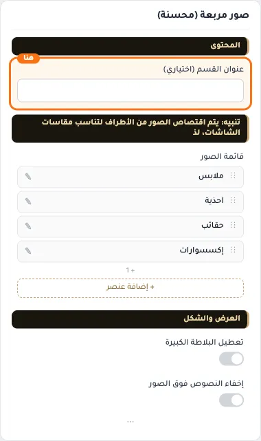
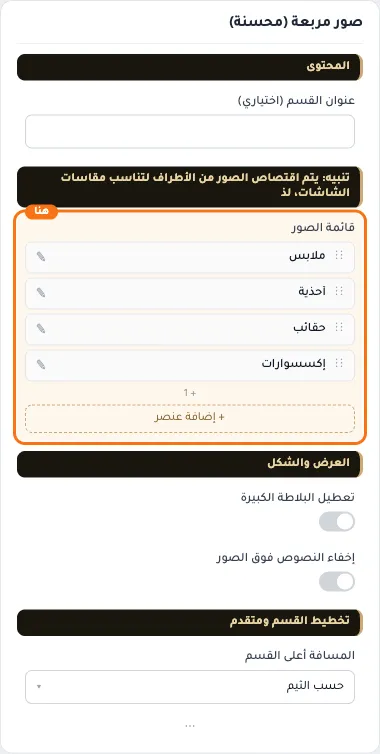
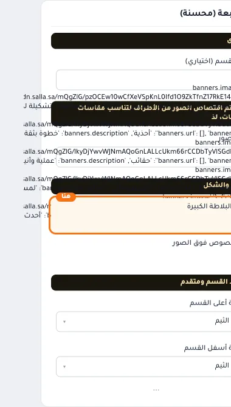
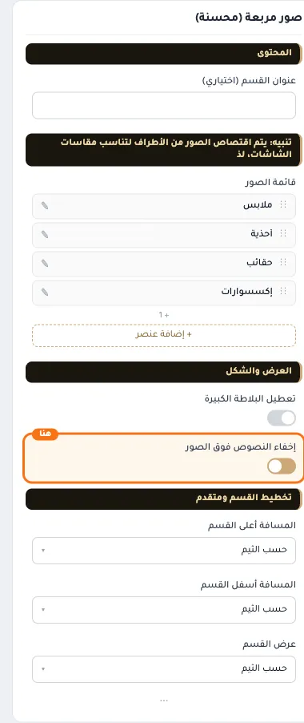
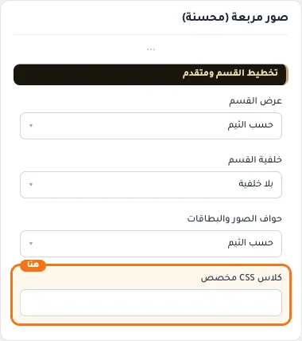

# صور مربعة (محسنة)

المسافات والعرض والخلفية والحواف: انظر [الخيارات المشتركة](../../01-shared/README.md).

## «عنوان القسم (اختياري)»
نص · الافتراضي: فارغ

**الوظيفة:** يظهر فوق الشبكة عند تعبئته.

- **عنوان القسم (اختياري)**
  

## «قائمة الصور»
عناصر متكررة · الافتراضي: عناصر جاهزة

**الوظيفة:** الصور التي يعرضها القسم، لكل صورة رابطها.

- **قائمة الصور**
  

**حقول كل عنصر:**
- «صورة البنر» (صورة، الافتراضي: فارغ): * المقاس المناسب للصورة هو 640×427 بكسل
- «الرابط» (اختيار من المتجر، الافتراضي: فارغ): الصفحة التي يفتحها الضغط على الزر أو العنصر.
- «عنوان رئيسي» (نص، الافتراضي: فارغ): نص يتم إضافته على الصورة بنمط خط كبير
- «نص توضيحي» (نص طويل، الافتراضي: فارغ): نص يتم إضافته على الصورة بخط أصغر من العنوان الرئيسي

## «تعطيل البلاطة الكبيرة»
مفتاح · الافتراضي: مطفأ

**الوظيفة:** شبكة متساوية دائمًا حتى مع أربع صور فأكثر.

- **بعد قلب المفتاح**
  

## «إخفاء النصوص فوق الصور»
مفتاح · الافتراضي: مطفأ

**الوظيفة:** عرض الصور وحدها بلا عناوين أو أوصاف.

- **بعد قلب المفتاح**
  

## «كلاس CSS مخصص»
نص · الافتراضي: فارغ

**الوظيفة:** للمصممين. كلاس القسم الثابت: cml-s--enhanced-square-banners

- **كلاس CSS مخصص**
  
