# بانرات ترويجية (شبكة)

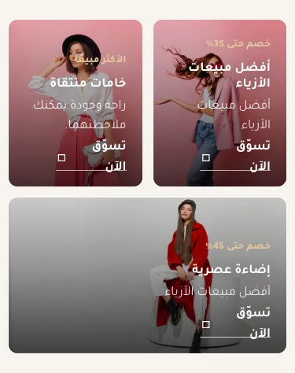

المسافات والعرض والخلفية والحواف: انظر [الخيارات المشتركة](../../01-shared/README.md).

## «البانرات»
عناصر متكررة · الافتراضي: عناصر جاهزة

**الوظيفة:** من بانر واحد إلى ستة.

- **البانرات**
  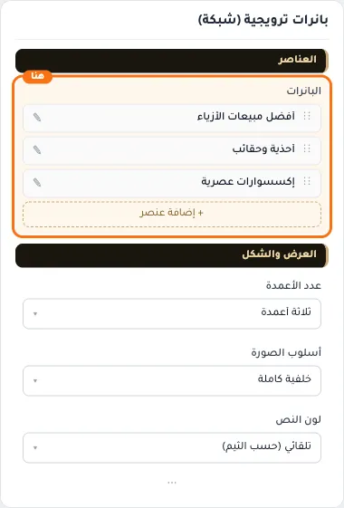

**حقول كل عنصر:**
- «الصورة» (صورة، الافتراضي: فارغ): الصورة المعروضة في هذا العنصر.
- «أيقونة (اختياري)» (أيقونة، الافتراضي: فارغ): من مكتبة أيقونات سلة. اتركها فارغة لإخفائها.
- «نص علوي صغير» (نص، الافتراضي: فارغ): مثل: خصم 35% — أو الأكثر مبيعًا.
- «العنوان» (نص، الافتراضي: فارغ): العنوان الرئيسي الذي يظهر أعلى القسم. اتركه فارغًا لإخفائه.
- «وصف قصير» (نص طويل، الافتراضي: فارغ): يُقصّ إلى سطرين لتبقى البطاقات متساوية.
- «نص الزر» (نص، الافتراضي: فارغ): اتركه فارغًا لإخفاء الزر.
- «وجهة الزر» (اختيار من المتجر، الافتراضي: فارغ): اختر منتجًا أو تصنيفًا أو صفحة، أو ضع رابطًا مخصصًا.

## «عدد الأعمدة»
قائمة منسدلة · الافتراضي: ثلاثة أعمدة

**الوظيفة:** ينزل تلقائيًا إلى عمودين على الأجهزة اللوحية وعمود واحد على الجوال.

- **ثلاثة أعمدة** — القيمة الافتراضية.
  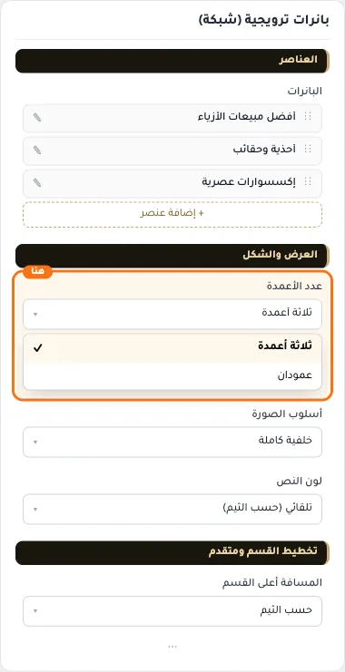
  
- **عمودان**
  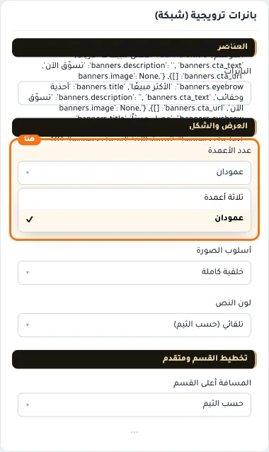

## «أسلوب الصورة»
قائمة منسدلة · الافتراضي: خلفية كاملة

**الوظيفة:** بجانب النص، أو خلفية كاملة للبطاقة مع تعتيم يضمن وضوح النص.

- **بجانب النص**
  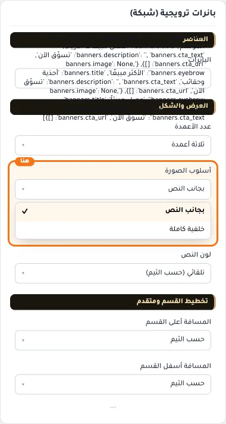
- **خلفية كاملة** — القيمة الافتراضية.
  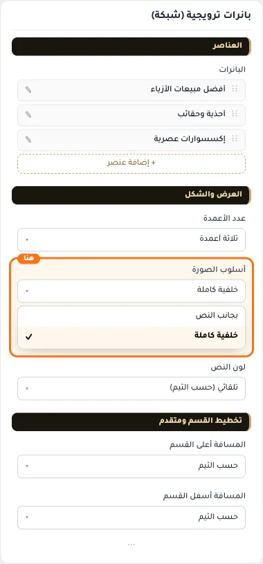
  

## «لون النص»
قائمة منسدلة · الافتراضي: تلقائي (حسب الثيم)

**الوظيفة:** اتركه تلقائيًا ليتبع ألوان الثيم. اختر فاتحًا أو داكنًا إذا كانت صورك تحتاج ذلك.

- **تلقائي (حسب الثيم)** — القيمة الافتراضية.
  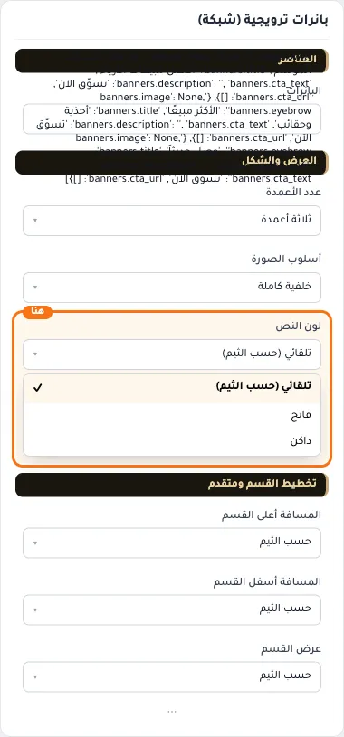
  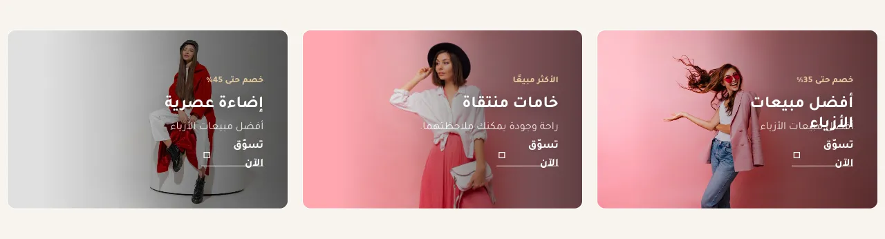
- **فاتح**
  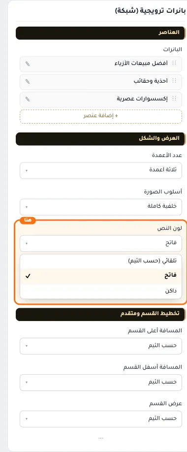
- **داكن**
  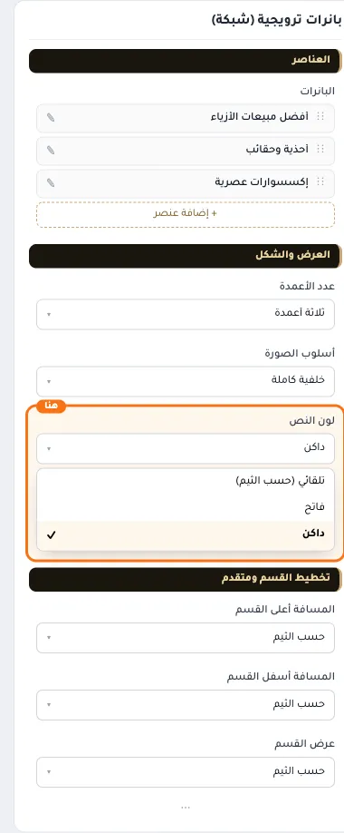

## «كلاس CSS مخصص»
نص · الافتراضي: فارغ

**الوظيفة:** للمصممين. كلاس القسم الثابت: cml-s--cml-promo-banners

- **كلاس CSS مخصص**
  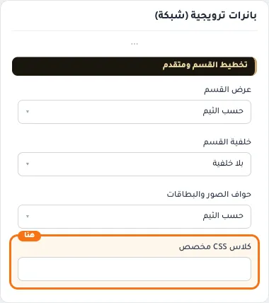
