# الماركات التجارية

المسافات والعرض والخلفية والحواف: انظر [الخيارات المشتركة](../../01-shared/README.md).

## «العنوان»
نص · الافتراضي: تصفح من خلال العلامات التجارية

**الوظيفة:** العنوان الرئيسي الذي يظهر أعلى القسم. اتركه فارغًا لإخفائه.

- **العنوان**
  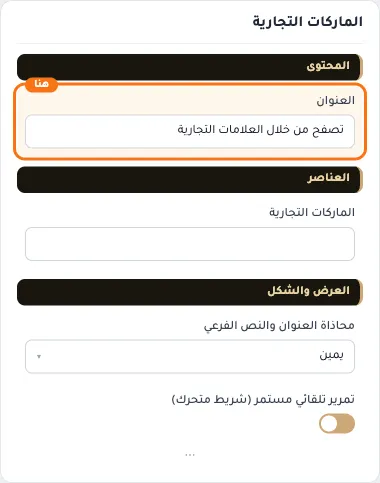

## «الماركات التجارية»
اختيار من المتجر · الافتراضي: فارغ

**الوظيفة:** العلامات التجارية المعروضة، كل منها بشعارها ويفتح صفحتها.

- **الماركات التجارية**
  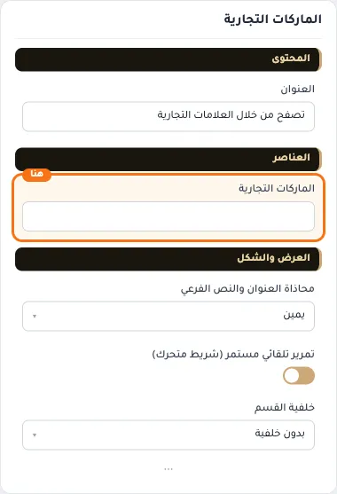

## «محاذاة العنوان والنص الفرعي»
قائمة منسدلة · الافتراضي: يمين

**الوظيفة:** محاذاة العنوان الرئيسي والفرعي داخل القسم (الافتراضي: يمين).

- **يمين** — القيمة الافتراضية.
  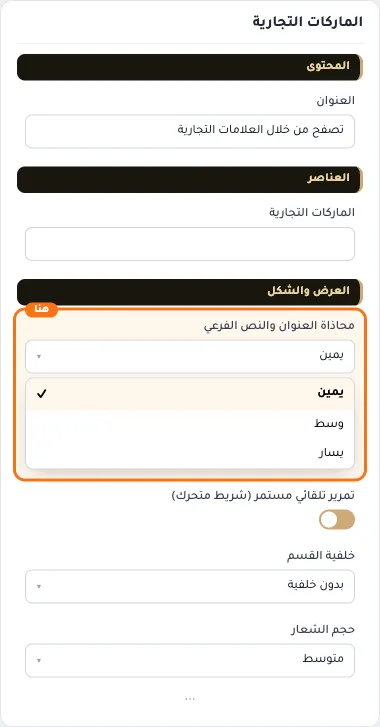
- **وسط**
  
- **يسار**
  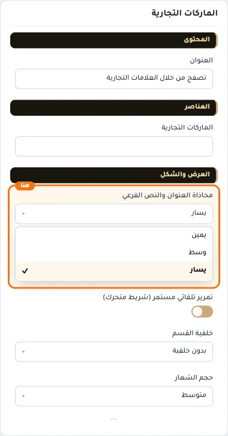

## «تمرير تلقائي مستمر (شريط متحرك)»
مفتاح · الافتراضي: مفعّل

**الوظيفة:** يحرك العناصر باستمرار مثل شريط متحرك بدل التمرير اليدوي.

- **بعد قلب المفتاح**
  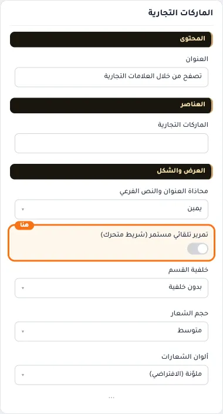

## «خلفية القسم»
قائمة منسدلة · الافتراضي: بدون خلفية

**الوظيفة:** خلفية القسم: بلا خلفية، أو لون سطح، أو لون ناعم، أو لون تختاره.

- **بدون خلفية** — القيمة الافتراضية.
  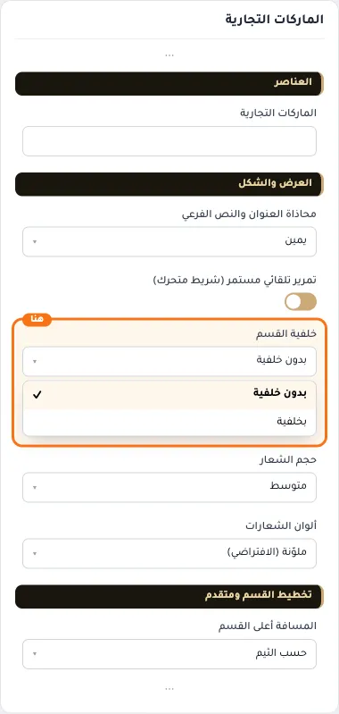
- **بخلفية**
  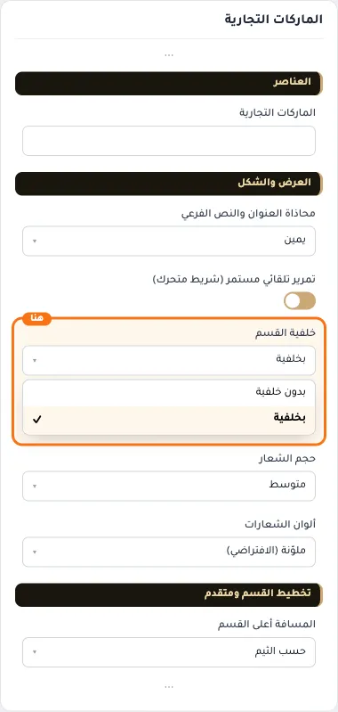

## «حجم الشعار»
قائمة منسدلة · الافتراضي: متوسط

**الوظيفة:** حجم الشعارات داخل القسم.

- **صغير**
  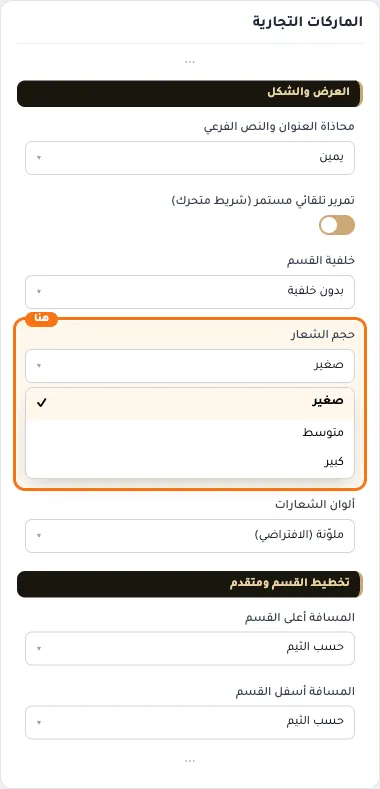
- **متوسط** — القيمة الافتراضية.
  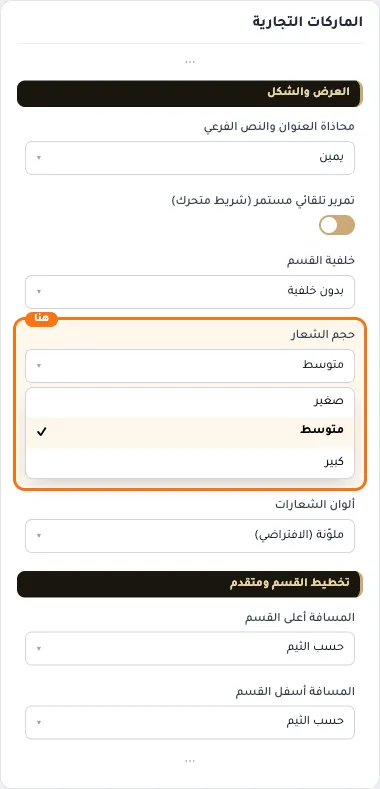
- **كبير**
  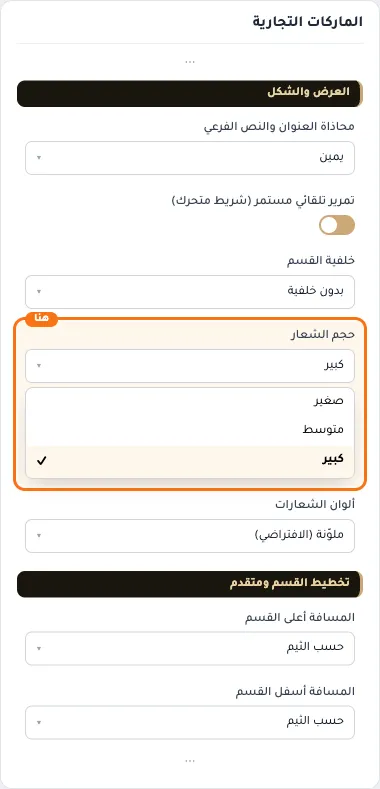

## «ألوان الشعارات»
قائمة منسدلة · الافتراضي: ملوّنة (الافتراضي)

**الوظيفة:** ألوان الشعارات: بألوانها الأصلية أو رمادية موحّدة تتلوّن عند التأشير.

- **ملوّنة (الافتراضي)** — القيمة الافتراضية.
  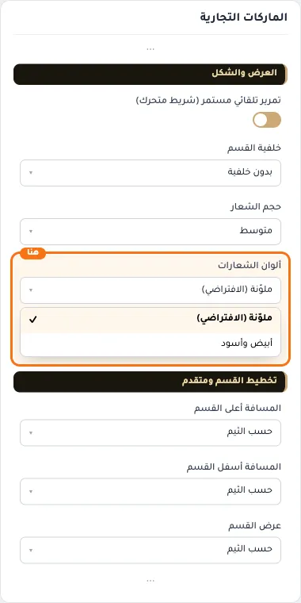
- **أبيض وأسود**
  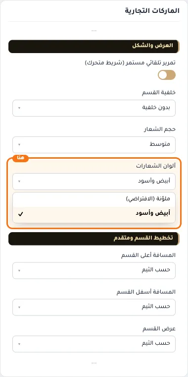

## «كلاس CSS مخصص»
نص · الافتراضي: فارغ

**الوظيفة:** للمصممين. كلاس القسم الثابت: cml-s--brands

- **كلاس CSS مخصص**
  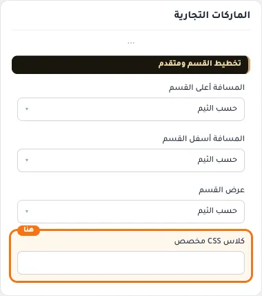
