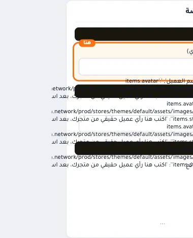
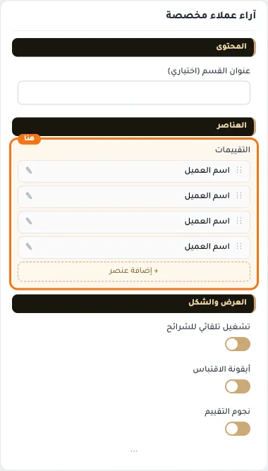
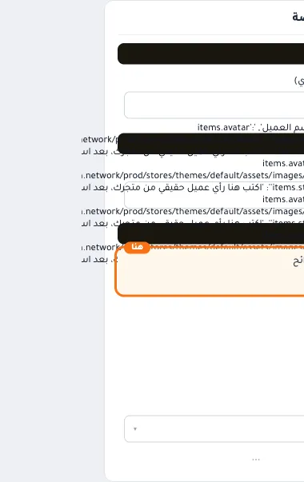
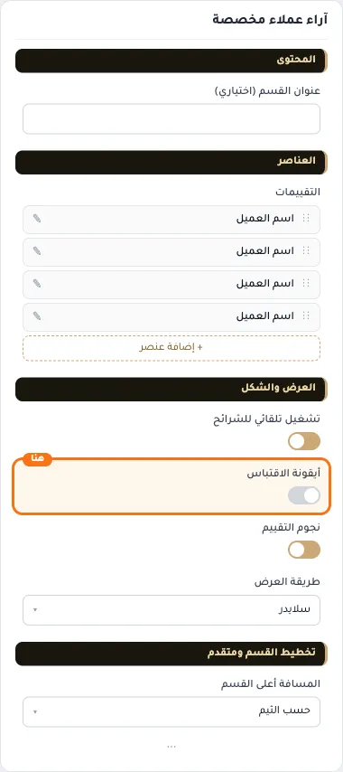
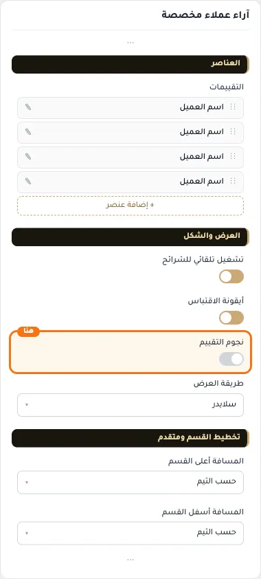
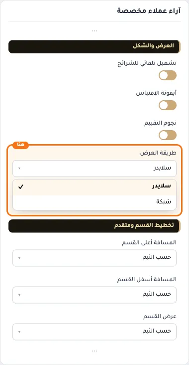
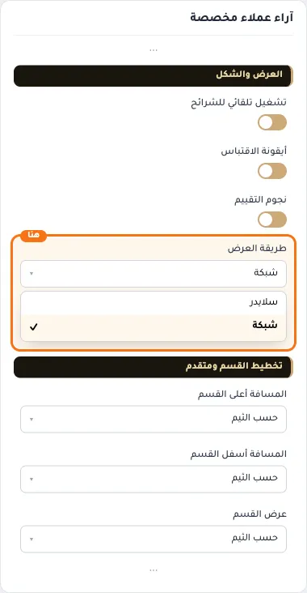
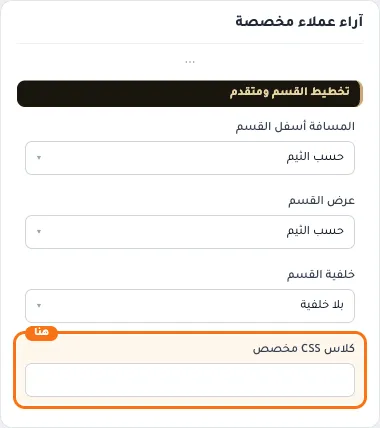

# آراء عملاء مخصصة

المسافات والعرض والخلفية والحواف: انظر [الخيارات المشتركة](../../01-shared/README.md).

## «عنوان القسم (اختياري)»
نص · الافتراضي: فارغ

**الوظيفة:** يستبدل العنوان الافتراضي «آراء العملاء».

- **عنوان القسم (اختياري)**
  

## «التقييمات»
عناصر متكررة · الافتراضي: عناصر جاهزة

**الوظيفة:** قائمة العناصر التي يعرضها القسم؛ أضف عنصرًا أو احذفه أو اسحبه لتغيير الترتيب.

- **التقييمات**
  

**حقول كل عنصر:**
- «اسم العميل» (نص، الافتراضي: فارغ): اسم العميل صاحب التقييم.
- «صورة العميل» (صورة، الافتراضي: فارغ): المقاس المناسب للصورة هو 68*68 بكسل
- «عدد النجوم» (رقم، الافتراضي: 5): عدد النجوم الظاهر مع التقييم (من 1 إلى 5).
- «نص التقييم» (نص طويل، الافتراضي: فارغ): النص المعروض في العنصر.

## «تشغيل تلقائي للشرائح»
مفتاح · الافتراضي: مفعّل

**الوظيفة:** ينقل الشرائح تلقائيًا دون ضغط الزائر.

- **بعد قلب المفتاح**
  

## «أيقونة الاقتباس»
مفتاح · الافتراضي: مفعّل

**الوظيفة:** علامة التنصيص الزخرفية في البطاقة.

- **بعد قلب المفتاح**
  

## «نجوم التقييم»
مفتاح · الافتراضي: مفعّل

**الوظيفة:** إظهار تقييم النجوم لكل رأي.

- **بعد قلب المفتاح**
  

## «طريقة العرض»
قائمة منسدلة · الافتراضي: سلايدر

**الوظيفة:** طريقة عرض التقييمات: شبكة أو سلايدر.

- **سلايدر** — القيمة الافتراضية.
  
- **شبكة**
  

## «كلاس CSS مخصص»
نص · الافتراضي: فارغ

**الوظيفة:** للمصممين. كلاس القسم الثابت: cml-s--custom-testimonials

- **كلاس CSS مخصص**
  
