# معرض أكورديون تفاعلي

المسافات والعرض والخلفية والحواف: انظر [الخيارات المشتركة](../../01-shared/README.md).

## «العنوان»
نص · الافتراضي: إطلالات مختارة

**الوظيفة:** العنوان الرئيسي الذي يظهر أعلى القسم. اتركه فارغًا لإخفائه.

- **العنوان**
  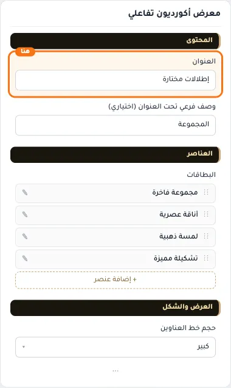

## «وصف فرعي تحت العنوان (اختياري)»
نص · الافتراضي: المجموعة

**الوظيفة:** سطر قصير يظهر أسفل العنوان الرئيسي.

- **وصف فرعي تحت العنوان (اختياري)**
  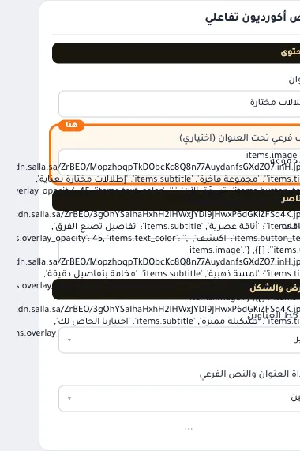

## «البطاقات»
عناصر متكررة · الافتراضي: عناصر جاهزة

**الوظيفة:** قائمة العناصر التي يعرضها القسم؛ أضف عنصرًا أو احذفه أو اسحبه لتغيير الترتيب.

- **البطاقات**
  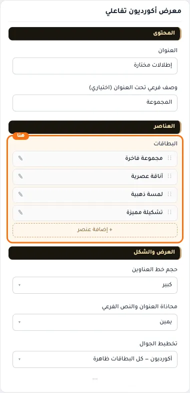

**حقول كل عنصر:**
- «الصورة» (صورة، الافتراضي: فارغ): المقاس المناسب 800×1000 بكسل
- «صورة الجوال (اختياري)» (صورة، الافتراضي: فارغ): صورة خاصة بالجوال؛ إن تُركت فارغة تُستخدم الصورة الرئيسية.
- «العنوان» (نص، الافتراضي: فارغ): العنوان الرئيسي الذي يظهر أعلى القسم. اتركه فارغًا لإخفائه.
- «الوصف الفرعي» (نص، الافتراضي: فارغ): سطر قصير تحت العنوان يشرح محتوى القسم. اختياري؛ يختفي إن تُرك فارغًا.
- «نص الزر» (نص، الافتراضي: فارغ): النص المكتوب على الزر.
- «الرابط» (اختيار من المتجر، الافتراضي: فارغ): اختر منتجاً أو تصنيفاً أو صفحة... أو الصق رابطاً خارجياً.
- «لون النص» (لون، الافتراضي: فارغ): اتركه فارغًا للأبيض الافتراضي.
- «شفافية التعتيم %» (رقم، الافتراضي: 45): قوة الطبقة الداكنة فوق الصورة بالنسبة المئوية؛ الأعلى أوضح للنص الأبيض.

## «حجم خط العناوين»
قائمة منسدلة · الافتراضي: كبير

**الوظيفة:** يشمل عنوان القسم وعناوين البطاقات. «كبير» هو الحجم الحالي للمكوّن.

- **صغير**
  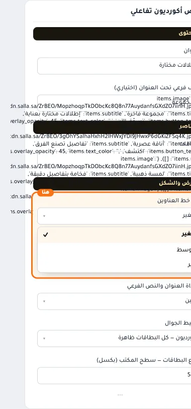
- **متوسط**
  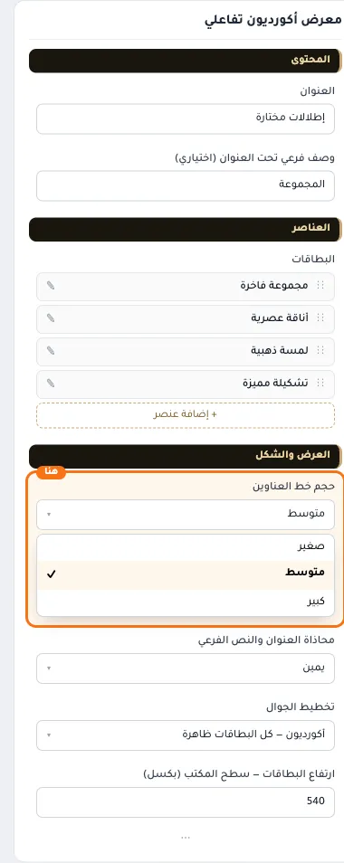
- **كبير** — القيمة الافتراضية.
  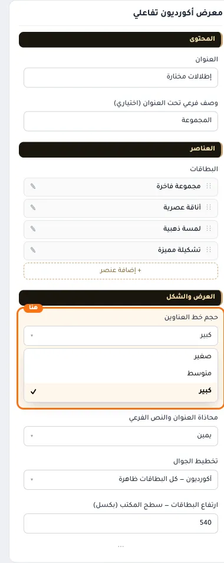
  

## «محاذاة العنوان والنص الفرعي»
قائمة منسدلة · الافتراضي: يمين

**الوظيفة:** محاذاة العنوان الرئيسي والفرعي داخل القسم (الافتراضي: يمين).

- **يمين** — القيمة الافتراضية.
  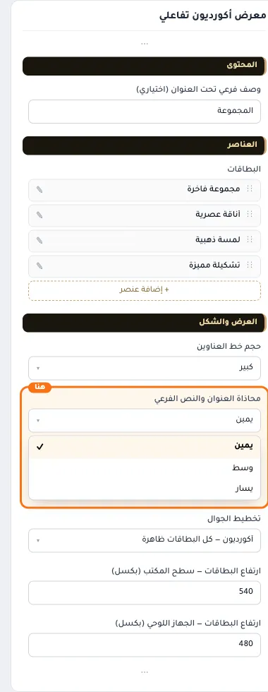
  
- **وسط**
  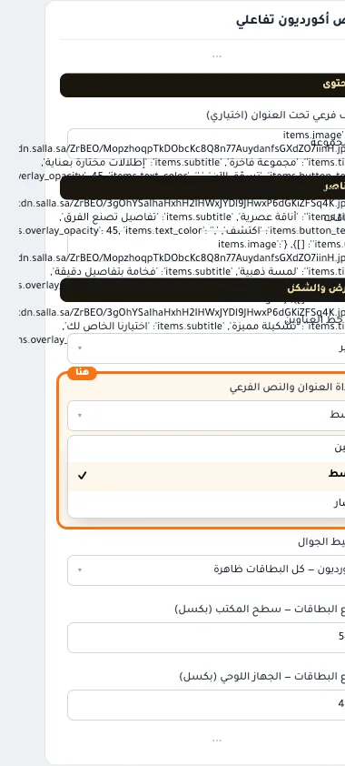
- **يسار**
  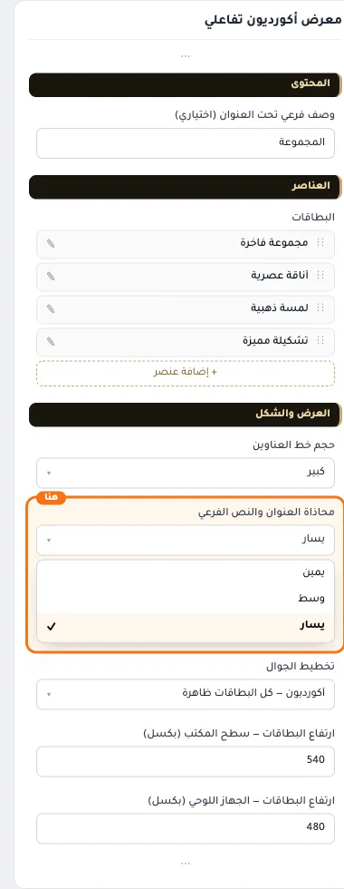

## «تخطيط الجوال»
قائمة منسدلة · الافتراضي: أكورديون — كل البطاقات ظاهرة

**الوظيفة:** طريقة عرض البطاقات على الشاشات الصغيرة. الأكورديون يُظهر كل البطاقات معًا، وتفتح البطاقة باللمس.

- **أكورديون — كل البطاقات ظاهرة** — القيمة الافتراضية.
  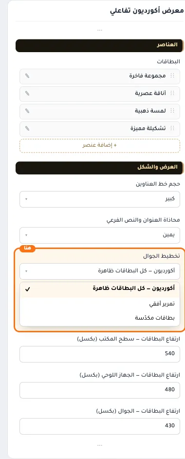
  
- **تمرير أفقي**
  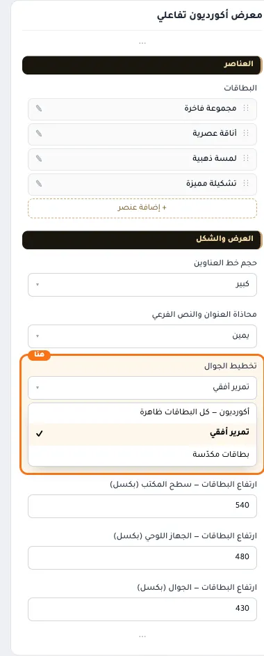
- **بطاقات مكدّسة**
  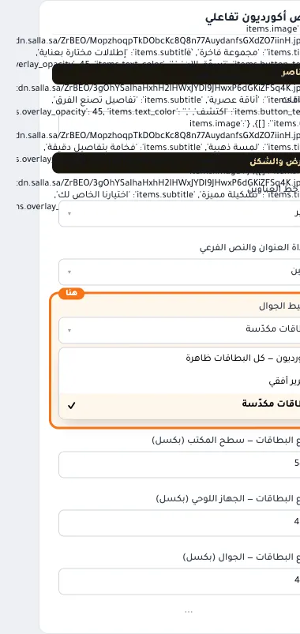

## «ارتفاع البطاقات — سطح المكتب (بكسل)»
رقم · الافتراضي: 540

**الوظيفة:** ارتفاع البطاقات بالبكسل على الكمبيوتر.

- **ارتفاع البطاقات — سطح المكتب (بكسل)**
  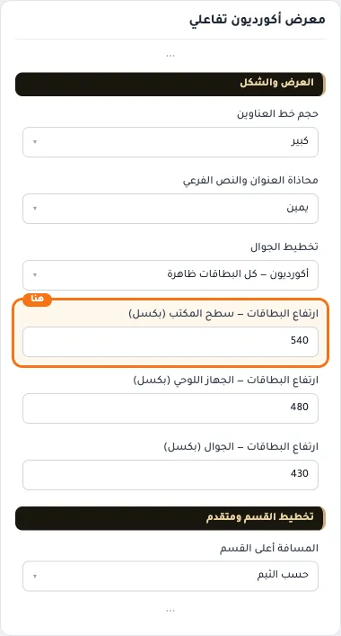

## «ارتفاع البطاقات — الجهاز اللوحي (بكسل)»
رقم · الافتراضي: 480

**الوظيفة:** ارتفاع البطاقات بالبكسل على الجهاز اللوحي.

- **ارتفاع البطاقات — الجهاز اللوحي (بكسل)**
  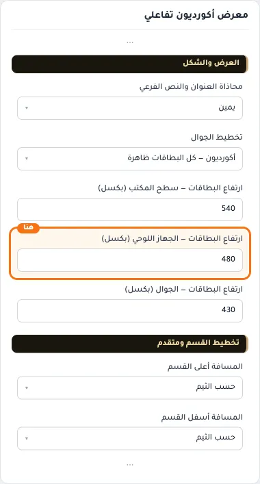

## «ارتفاع البطاقات — الجوال (بكسل)»
رقم · الافتراضي: 430

**الوظيفة:** ارتفاع البطاقات بالبكسل على الجوال.

- **ارتفاع البطاقات — الجوال (بكسل)**
  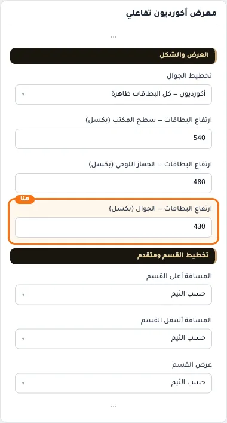

## «كلاس CSS مخصص»
نص · الافتراضي: فارغ

**الوظيفة:** للمصممين. كلاس القسم الثابت: cml-s--accordion-gallery

- **كلاس CSS مخصص**
  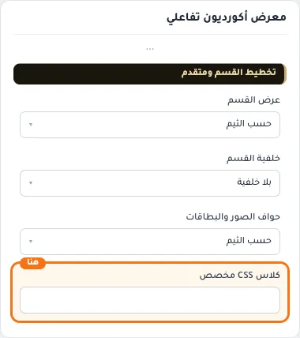
