# تسوّق من الصورة (نقاط)

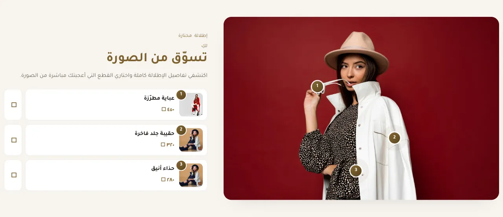

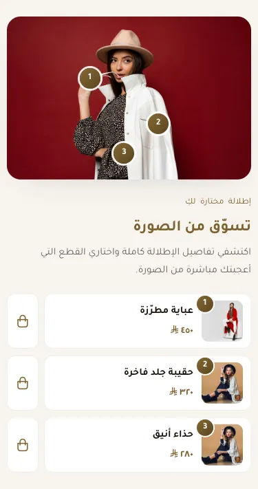

المسافات والعرض والخلفية والحواف: انظر [الخيارات المشتركة](../../01-shared/README.md).

## «نص علوي صغير»
نص · الافتراضي: تسوّق الإطلالة

**الوظيفة:** كلمة صغيرة فوق العنوان (مثل «جديد» أو «موسم الصيف») تلفت الانتباه قبل العنوان.

- **نص علوي صغير**
  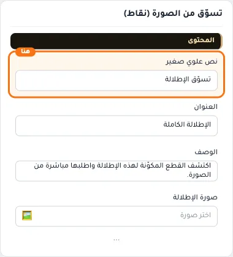

## «العنوان»
نص · الافتراضي: الإطلالة الكاملة

**الوظيفة:** العنوان الرئيسي الذي يظهر أعلى القسم. اتركه فارغًا لإخفائه.

- **العنوان**
  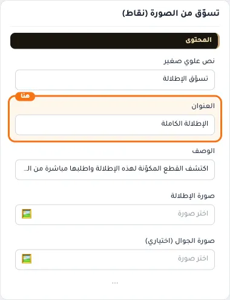

## «الوصف»
نص طويل · الافتراضي: اكتشف القطع المكوّنة لهذه الإطلالة واطلبها مباشرة من الصورة.

**الوظيفة:** نص توضيحي يظهر مع العنوان لشرح العرض أو المجموعة.

- **الوصف**
  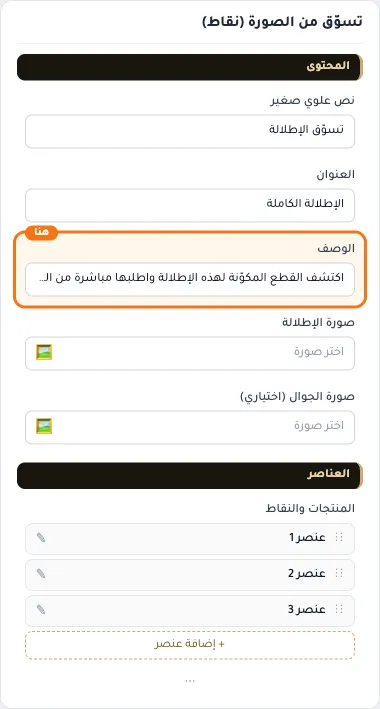

## «صورة الإطلالة»
صورة · الافتراضي: فارغ

**الوظيفة:** المقاس المناسب 1000×1200 بكسل

- **صورة الإطلالة**
  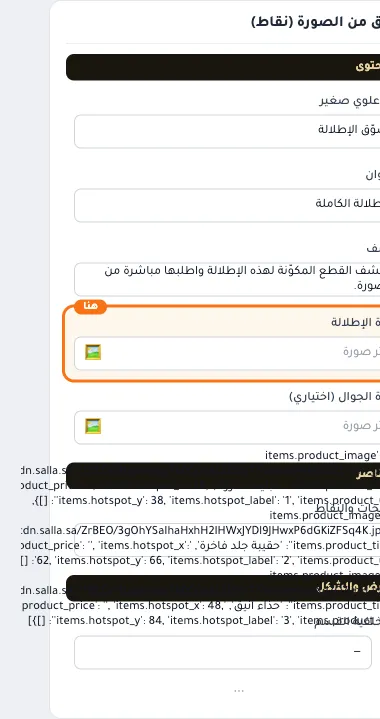

## «صورة الجوال (اختياري)»
صورة · الافتراضي: فارغ

**الوظيفة:** صورة خاصة بالجوال؛ إن تُركت فارغة تُستخدم الصورة الرئيسية.

- **صورة الجوال (اختياري)**
  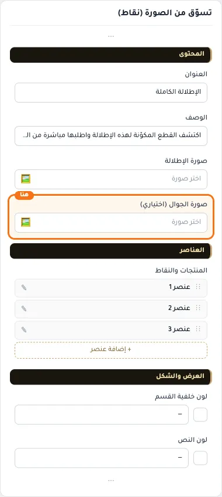

## «المنتجات والنقاط»
عناصر متكررة · الافتراضي: عناصر جاهزة

**الوظيفة:** قائمة العناصر التي يعرضها القسم؛ أضف عنصرًا أو احذفه أو اسحبه لتغيير الترتيب.

- **المنتجات والنقاط**
  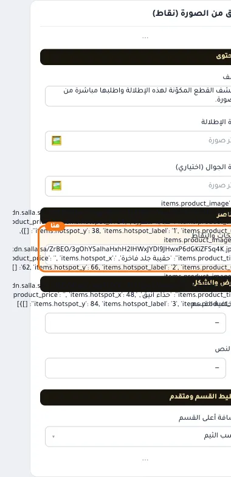

**حقول كل عنصر:**
- «صورة المنتج» (صورة، الافتراضي: فارغ): صورة المنتج التي تظهر عند فتح النقطة.
- «اسم المنتج» (نص، الافتراضي: فارغ): اسم المنتج الذي يظهر عند فتح النقطة.
- «السعر (نص)» (نص، الافتراضي: فارغ): السعر كما تريد كتابته عند فتح النقطة.
- «معرّف المنتج (للإضافة للسلة)» (نص، الافتراضي: فارغ): اكتب معرّف المنتج الرقمي من سلة لتفعيل زر الإضافة للسلة. اتركه فارغاً ليتحوّل الزر إلى رابط المنتج.
- «رابط المنتج» (اختيار من المتجر، الافتراضي: فارغ): اختر منتجاً أو تصنيفاً أو صفحة... أو الصق رابطاً خارجياً.
- «الموضع الأفقي %» (رقم، الافتراضي: فارغ): اتركه فارغاً ليتم توزيع النقاط تلقائياً على الصورة، أو حدّد نسبة من 0 إلى 100. تُقاس من الحافة اليسرى للصورة.
- «الموضع العمودي %» (رقم، الافتراضي: فارغ): اتركه فارغاً ليتم توزيع النقاط تلقائياً على الصورة، أو حدّد نسبة من 0 إلى 100.
- «رقم/تسمية النقطة» (نص، الافتراضي: فارغ): الرقم أو الحرف المكتوب داخل النقطة فوق الصورة.

## «لون خلفية القسم»
لون · الافتراضي: فارغ

**الوظيفة:** اتركه فارغًا للّون الافتراضي.

- **لون خلفية القسم**
  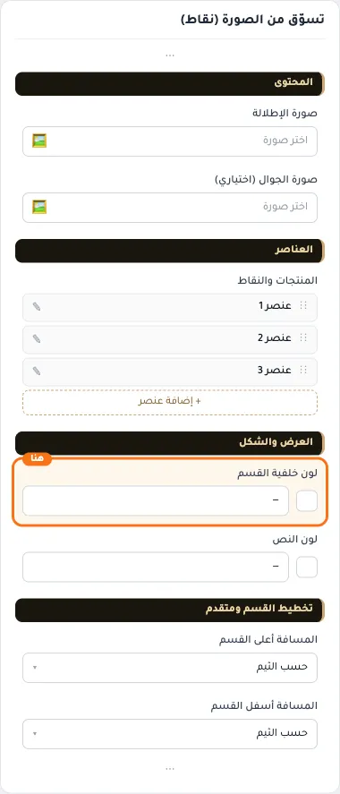

## «لون النص»
لون · الافتراضي: فارغ

**الوظيفة:** اتركه فارغًا للّون الافتراضي.

- **لون النص**
  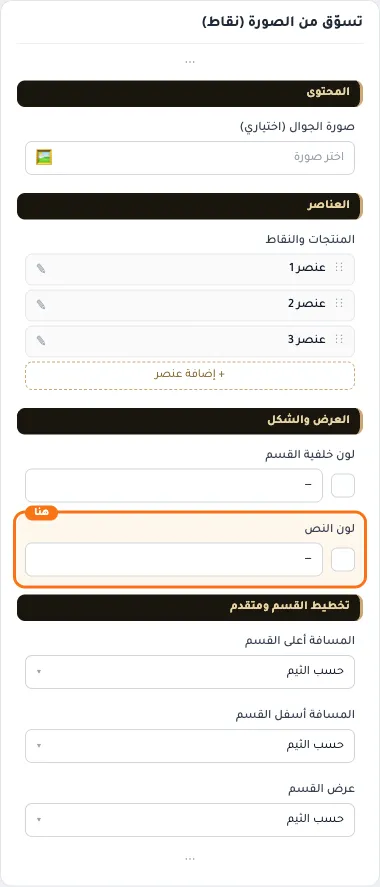

## «كلاس CSS مخصص»
نص · الافتراضي: فارغ

**الوظيفة:** للمصممين. كلاس القسم الثابت: cml-s--hotspot-shop-look

- **كلاس CSS مخصص**
  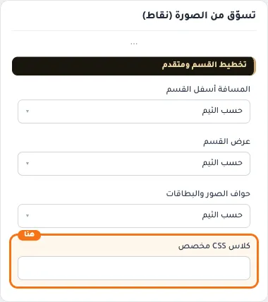
