# قبل / بعد

المسافات والعرض والخلفية والحواف: انظر [الخيارات المشتركة](../../01-shared/README.md).

## «العنوان»
نص · الافتراضي: قبل وبعد

**الوظيفة:** العنوان الرئيسي الذي يظهر أعلى القسم. اتركه فارغًا لإخفائه.

- **العنوان**
  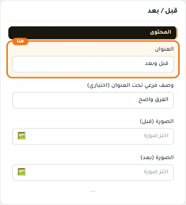

## «وصف فرعي تحت العنوان (اختياري)»
نص · الافتراضي: الفرق واضح

**الوظيفة:** سطر قصير تحت العنوان يشرح محتوى القسم. اختياري؛ يختفي إن تُرك فارغًا.

- **وصف فرعي تحت العنوان (اختياري)**
  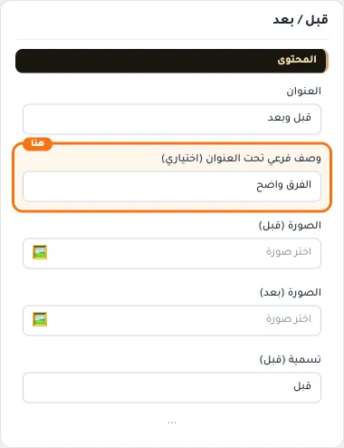

## «الصورة (قبل)»
صورة · الافتراضي: https://cdn.salla.sa/ZrBEO/MopzhoqpTkDObcKc8Q8n77AuydanfsGXdZO7iinH.jpg

**الوظيفة:** صورة الحالة «قبل» في المقارنة.

- **الصورة (قبل)**
  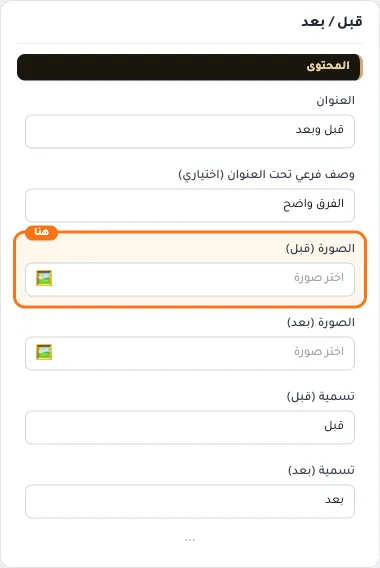

## «الصورة (بعد)»
صورة · الافتراضي: https://cdn.salla.sa/ZrBEO/3gOhYSaIhaHxhH2IHWxJYDl9JHwxP6dGKiZFSq4K.jpg

**الوظيفة:** صورة الحالة «بعد» في المقارنة.

- **الصورة (بعد)**
  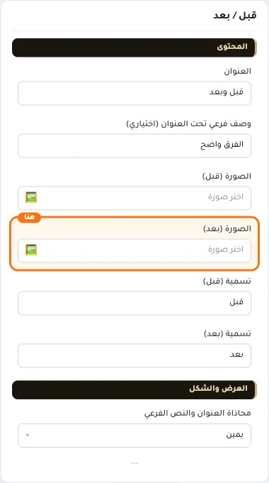

## «تسمية (قبل)»
نص · الافتراضي: قبل

**الوظيفة:** الكلمة التي تظهر على صورة «قبل».

- **تسمية (قبل)**
  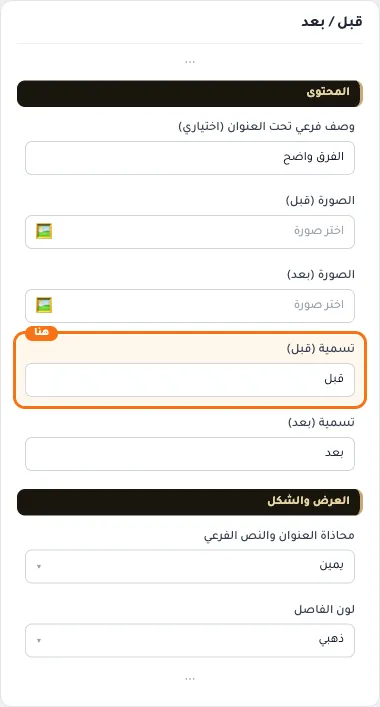

## «تسمية (بعد)»
نص · الافتراضي: بعد

**الوظيفة:** الكلمة التي تظهر على صورة «بعد».

- **تسمية (بعد)**
  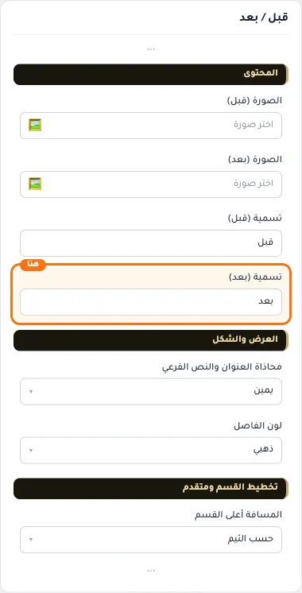

## «محاذاة العنوان والنص الفرعي»
قائمة منسدلة · الافتراضي: يمين

**الوظيفة:** محاذاة العنوان الرئيسي والفرعي داخل القسم (الافتراضي: يمين).

- **يمين** — القيمة الافتراضية.
  
  
- **وسط**
  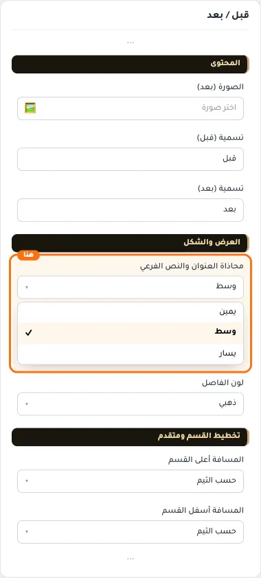
- **يسار**
  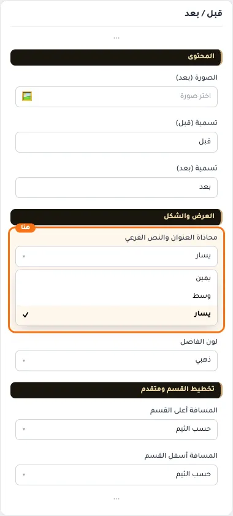

## «لون الفاصل»
قائمة منسدلة · الافتراضي: ذهبي

**الوظيفة:** لون الخط الفاصل بين العناصر.

- **ذهبي** — القيمة الافتراضية.
  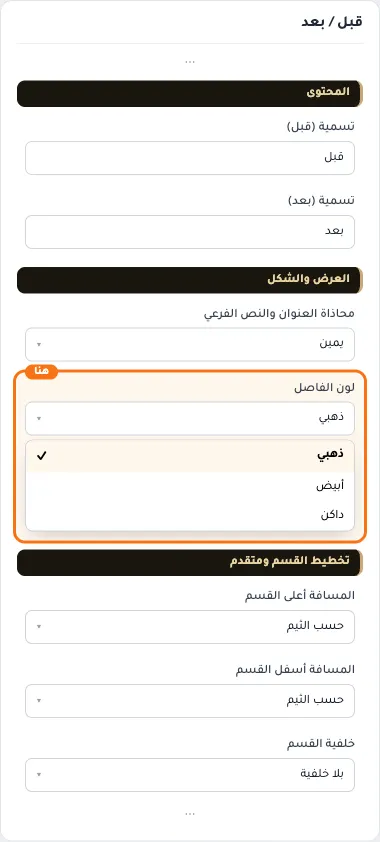
  
- **أبيض**
  
  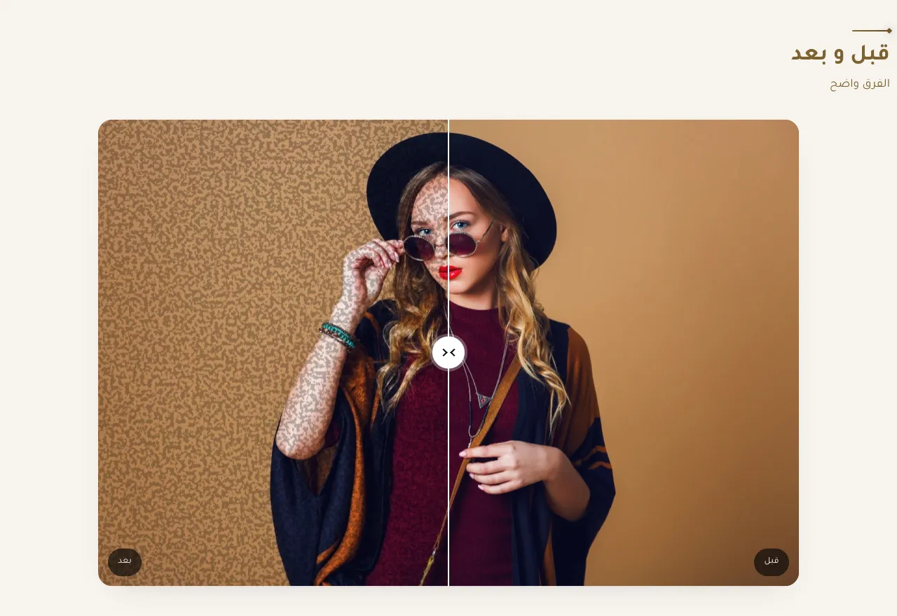
- **داكن**
  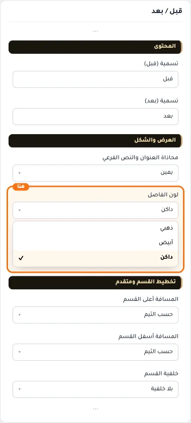
  

## «كلاس CSS مخصص»
نص · الافتراضي: فارغ

**الوظيفة:** للمصممين. كلاس القسم الثابت: cml-s--before-after

- **كلاس CSS مخصص**
  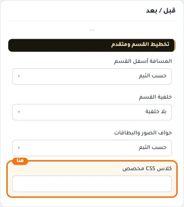
