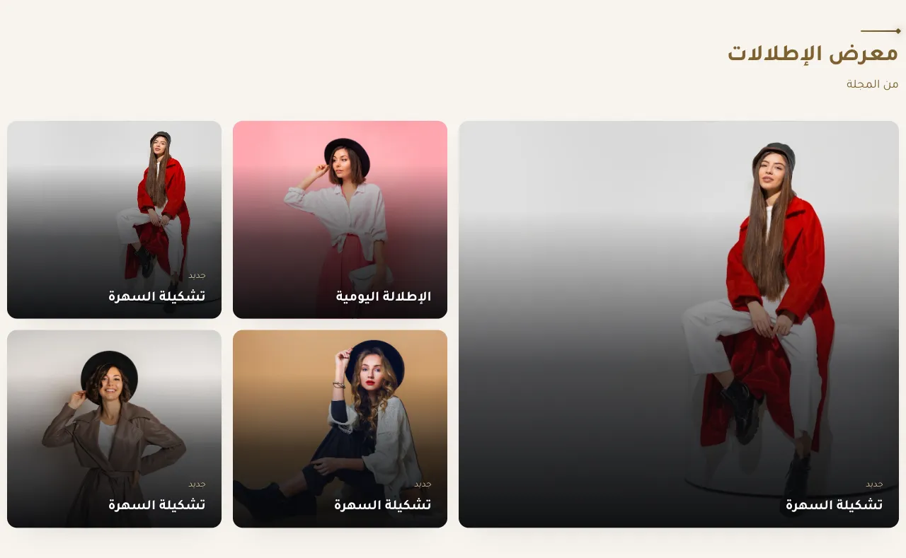
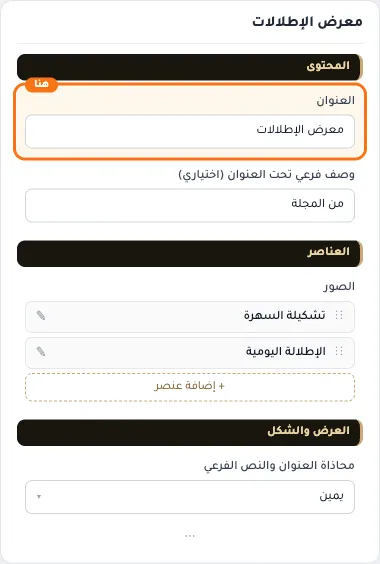
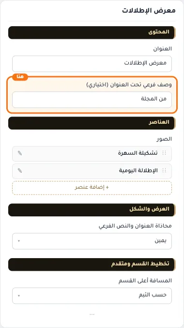
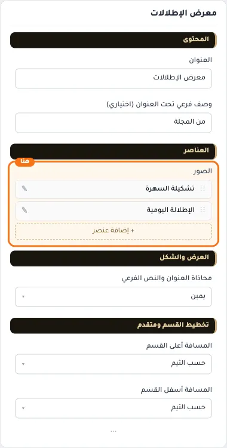
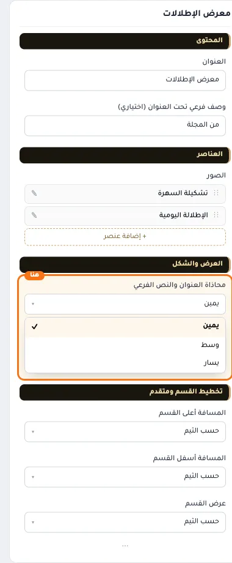
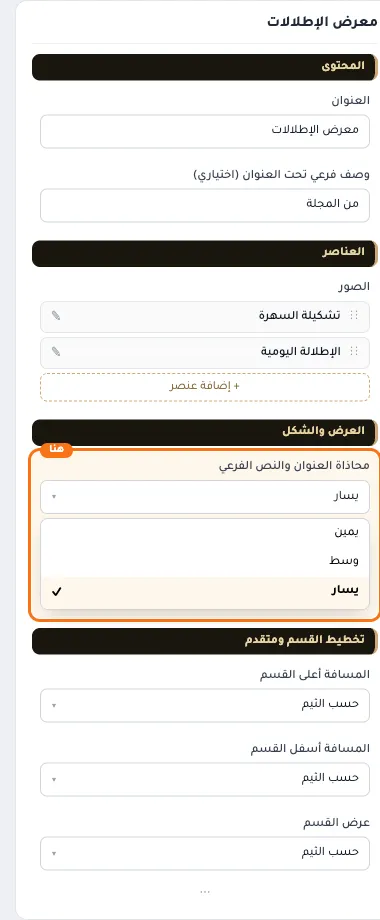
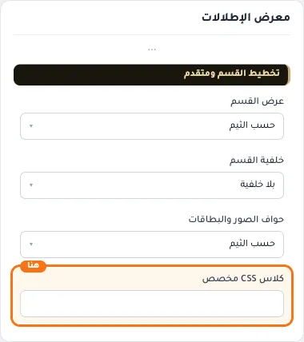

# معرض الإطلالات

المسافات والعرض والخلفية والحواف: انظر [الخيارات المشتركة](../../01-shared/README.md).

## «العنوان»
نص · الافتراضي: معرض الإطلالات

**الوظيفة:** العنوان الرئيسي الذي يظهر أعلى القسم. اتركه فارغًا لإخفائه.

- **العنوان**
  

## «وصف فرعي تحت العنوان (اختياري)»
نص · الافتراضي: من المجلة

**الوظيفة:** سطر قصير تحت العنوان يشرح محتوى القسم. اختياري؛ يختفي إن تُرك فارغًا.

- **وصف فرعي تحت العنوان (اختياري)**
  

## «الصور»
عناصر متكررة · الافتراضي: عناصر جاهزة

**الوظيفة:** قائمة العناصر التي يعرضها القسم؛ أضف عنصرًا أو احذفه أو اسحبه لتغيير الترتيب.

- **الصور**
  

**حقول كل عنصر:**
- «الصورة» (صورة، الافتراضي: فارغ): الصورة المعروضة في هذا العنصر.
- «العنوان» (نص، الافتراضي: فارغ): النص الظاهر على العنصر.
- «وسم صغير» (نص، الافتراضي: فارغ): كلمة صغيرة فوق العنوان تصنّف العنصر.
- «الرابط» (اختيار من المتجر، الافتراضي: فارغ): اختر منتجاً أو تصنيفاً أو صفحة تعريفية أو ماركة... أو الصق رابطاً خارجياً.
- «عرض موسّع (خليتين)» (مفتاح، الافتراضي: مطفأ): يجعل العنصر يأخذ خليتين بالعرض ليبرز بين الباقي.

## «محاذاة العنوان والنص الفرعي»
قائمة منسدلة · الافتراضي: يمين

**الوظيفة:** محاذاة العنوان الرئيسي والفرعي داخل القسم (الافتراضي: يمين).

- **يمين** — القيمة الافتراضية.
  
  
- **وسط**
  
- **يسار**
  

## «كلاس CSS مخصص»
نص · الافتراضي: فارغ

**الوظيفة:** للمصممين. كلاس القسم الثابت: cml-s--lookbook

- **كلاس CSS مخصص**
  
