# شعارات العملاء مخصص

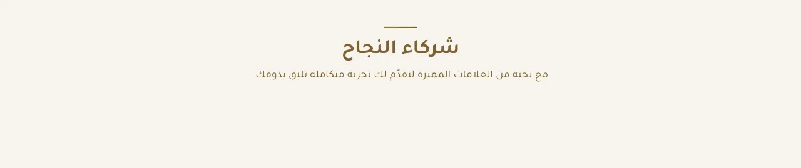

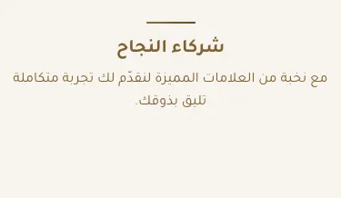

المسافات والعرض والخلفية والحواف: انظر [الخيارات المشتركة](../../01-shared/README.md).

## «العنوان»
نص · الافتراضي: علامات تجارية

**الوظيفة:** العنوان الرئيسي الذي يظهر أعلى القسم. اتركه فارغًا لإخفائه.

- **العنوان**
  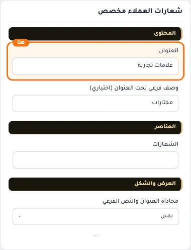

## «وصف فرعي تحت العنوان (اختياري)»
نص · الافتراضي: مختارات

**الوظيفة:** سطر قصير تحت العنوان يشرح محتوى القسم. اختياري؛ يختفي إن تُرك فارغًا.

- **وصف فرعي تحت العنوان (اختياري)**
  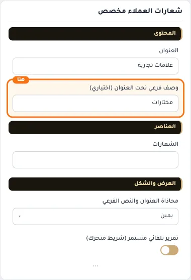

## «الشعارات»
عناصر متكررة · الافتراضي: فارغ

**الوظيفة:** قائمة الشعارات المعروضة، لكل شعار صورته ورابطه.

- **الشعارات**
  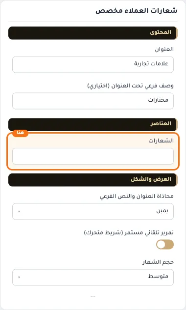

**حقول كل عنصر:**
- «الشعار» (صورة، الافتراضي: فارغ): يفضّل شعار أحادي اللون
- «اسم الشريك» (نص، الافتراضي: فارغ): يُقرأ لقارئ الشاشة بدل الشعار. اتركه فارغاً لاستخدام «شعار شريك».
- «الرابط» (اختيار من المتجر، الافتراضي: فارغ): اختر تصنيفًا أو ماركة من المتجر، أو ضع رابطًا خارجيًا.

## «محاذاة العنوان والنص الفرعي»
قائمة منسدلة · الافتراضي: يمين

**الوظيفة:** محاذاة العنوان الرئيسي والفرعي داخل القسم (الافتراضي: يمين).

- **يمين** — القيمة الافتراضية.
  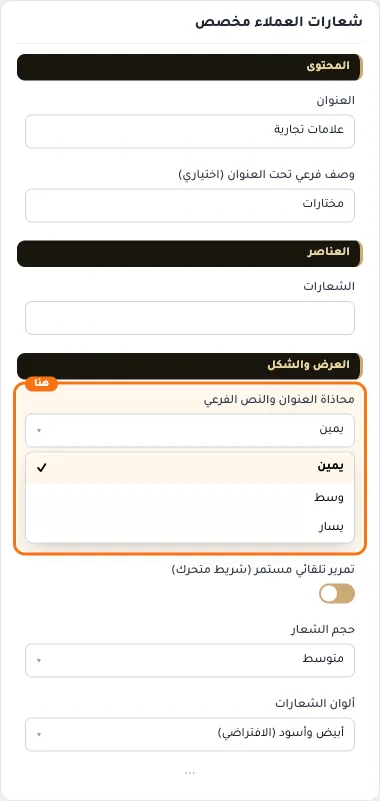
  
- **وسط**
  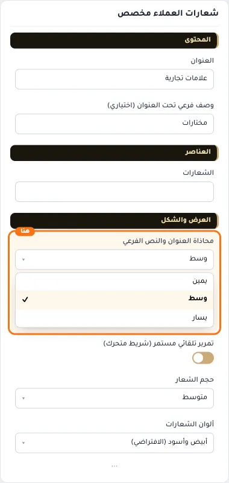
- **يسار**
  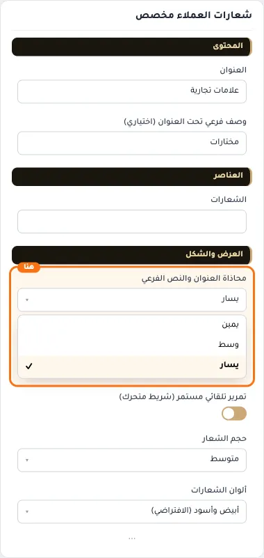

## «تمرير تلقائي مستمر (شريط متحرك)»
مفتاح · الافتراضي: مفعّل

**الوظيفة:** يحرك العناصر باستمرار مثل شريط متحرك بدل التمرير اليدوي.

- **بعد قلب المفتاح**
  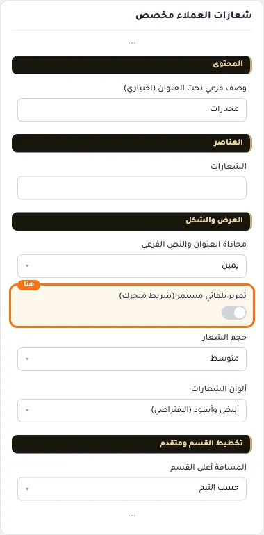

## «حجم الشعار»
قائمة منسدلة · الافتراضي: متوسط

**الوظيفة:** حجم الشعارات داخل القسم.

- **صغير**
  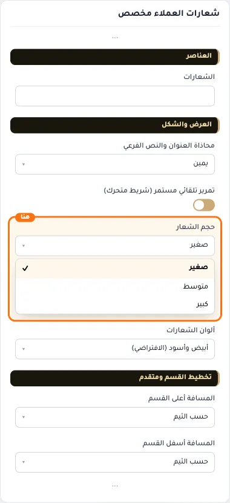
  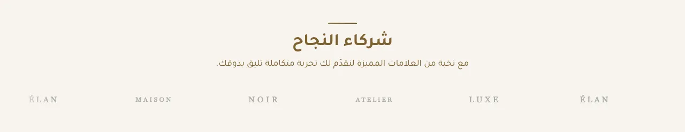
- **متوسط** — القيمة الافتراضية.
  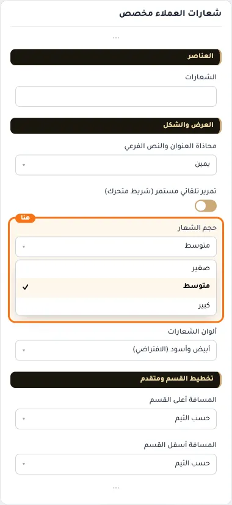
  
- **كبير**
  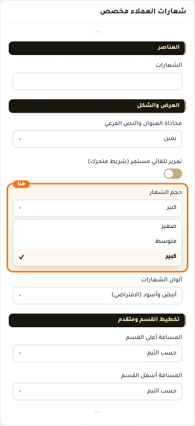
  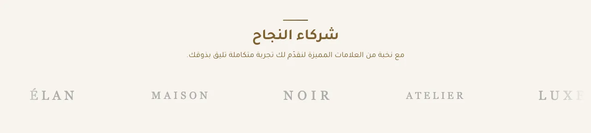

## «ألوان الشعارات»
قائمة منسدلة · الافتراضي: أبيض وأسود (الافتراضي)

**الوظيفة:** ألوان الشعارات: بألوانها الأصلية أو رمادية موحّدة تتلوّن عند التأشير.

- **أبيض وأسود (الافتراضي)** — القيمة الافتراضية.
  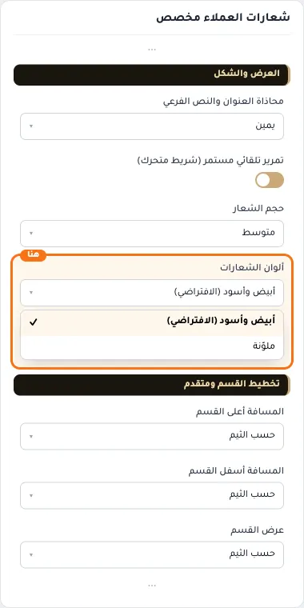
  
- **ملوّنة**
  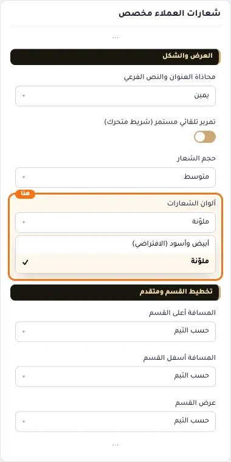
  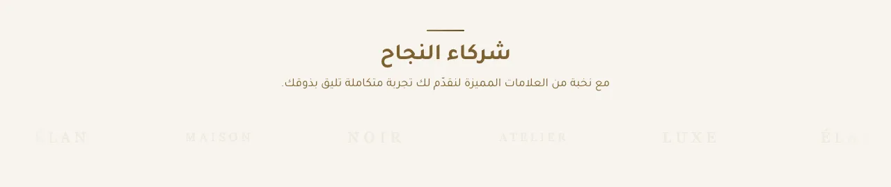

## «كلاس CSS مخصص»
نص · الافتراضي: فارغ

**الوظيفة:** للمصممين. كلاس القسم الثابت: cml-s--press-logos

- **كلاس CSS مخصص**
  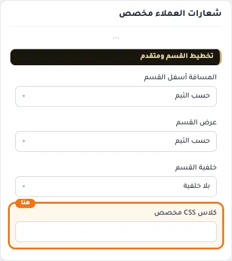
