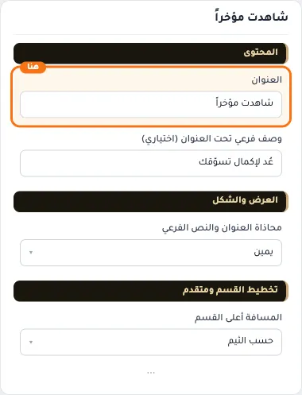
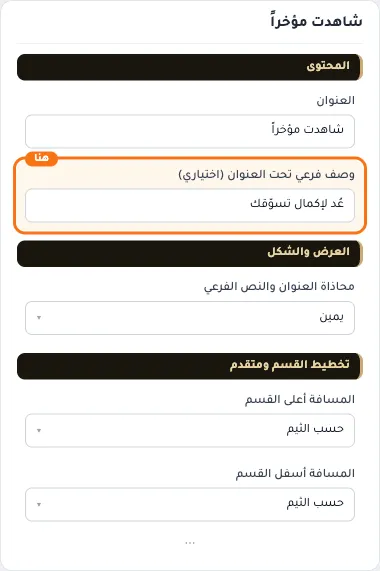
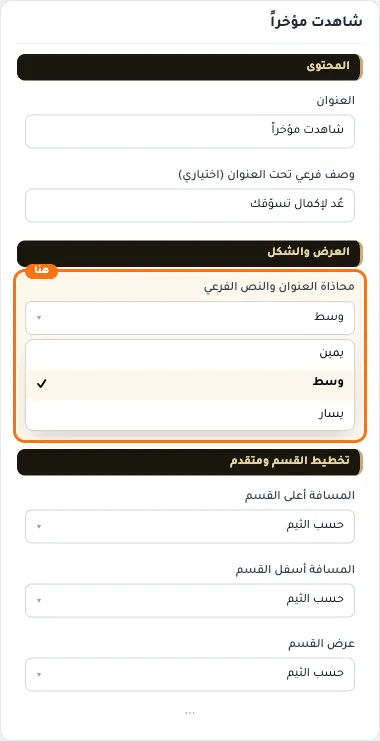
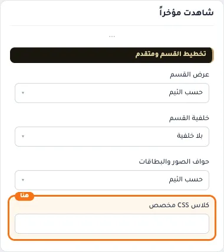

# شاهدت مؤخراً

المسافات والعرض والخلفية والحواف: انظر [الخيارات المشتركة](../../01-shared/README.md).

## «العنوان»
نص · الافتراضي: شاهدت مؤخراً

**الوظيفة:** العنوان الرئيسي الذي يظهر أعلى القسم. اتركه فارغًا لإخفائه.

- **العنوان**
  

## «وصف فرعي تحت العنوان (اختياري)»
نص · الافتراضي: عُد لإكمال تسوّقك

**الوظيفة:** سطر قصير تحت العنوان يشرح محتوى القسم. اختياري؛ يختفي إن تُرك فارغًا.

- **وصف فرعي تحت العنوان (اختياري)**
  

## «محاذاة العنوان والنص الفرعي»
قائمة منسدلة · الافتراضي: يمين

**الوظيفة:** محاذاة العنوان الرئيسي والفرعي داخل القسم (الافتراضي: يمين).

- **يمين** — القيمة الافتراضية.
  
- **وسط**
  
- **يسار**
  

## «كلاس CSS مخصص»
نص · الافتراضي: فارغ

**الوظيفة:** للمصممين. كلاس القسم الثابت: cml-s--recently-viewed

- **كلاس CSS مخصص**
  
