# واجهة التصنيفات

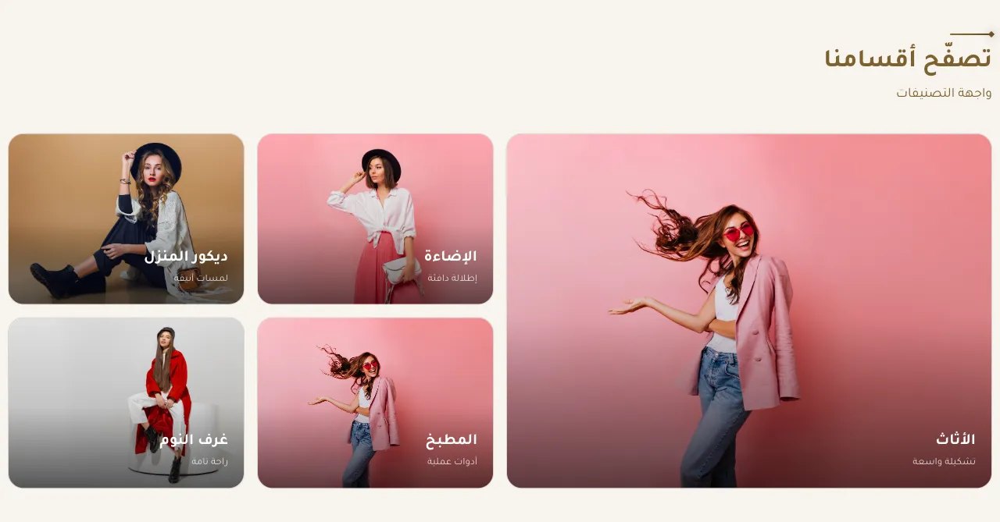

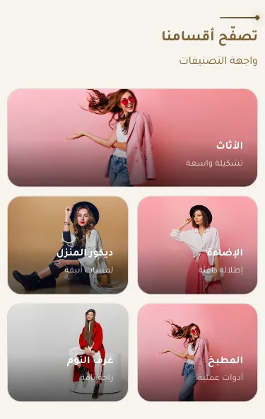

المسافات والعرض والخلفية والحواف: انظر [الخيارات المشتركة](../../01-shared/README.md).

## «العنوان»
نص · الافتراضي: تصفّح أقسامنا

**الوظيفة:** العنوان الرئيسي الذي يظهر أعلى القسم. اتركه فارغًا لإخفائه.

- **العنوان**
  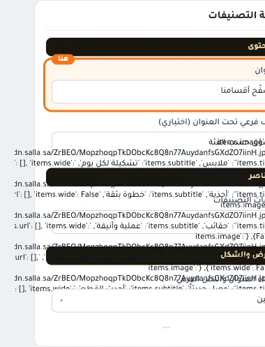

## «وصف فرعي تحت العنوان (اختياري)»
نص · الافتراضي: تسوّق حسب الفئة

**الوظيفة:** سطر قصير تحت العنوان يشرح محتوى القسم. اختياري؛ يختفي إن تُرك فارغًا.

- **وصف فرعي تحت العنوان (اختياري)**
  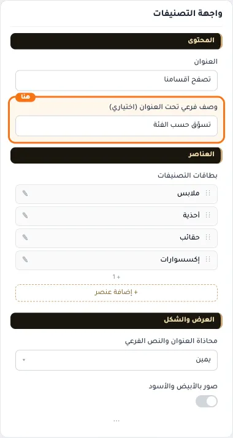

## «بطاقات التصنيفات»
عناصر متكررة · الافتراضي: عناصر جاهزة

**الوظيفة:** قائمة العناصر التي يعرضها القسم؛ أضف عنصرًا أو احذفه أو اسحبه لتغيير الترتيب.

- **بطاقات التصنيفات**
  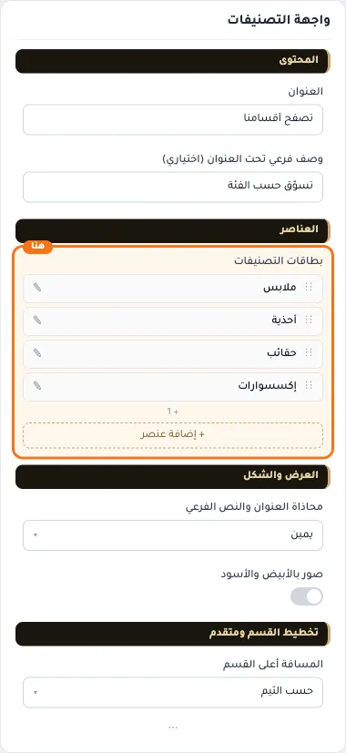

**حقول كل عنصر:**
- «الصورة» (صورة، الافتراضي: فارغ): * المقاس المناسب 800×800 بكسل
- «العنوان» (نص، الافتراضي: فارغ): العنوان الرئيسي الذي يظهر أعلى القسم. اتركه فارغًا لإخفائه.
- «نص فرعي» (نص، الافتراضي: فارغ): سطر قصير تحت العنوان يشرح محتوى القسم. اختياري؛ يختفي إن تُرك فارغًا.
- «الرابط» (اختيار من المتجر، الافتراضي: فارغ): اختر تصنيفًا أو ماركة من المتجر، أو ضع رابطًا خارجيًا.
- «بطاقة عريضة» (مفتاح، الافتراضي: مطفأ): يجعل العنصر يأخذ خليتين بالعرض ليبرز بين الباقي.

## «محاذاة العنوان والنص الفرعي»
قائمة منسدلة · الافتراضي: يمين

**الوظيفة:** محاذاة العنوان الرئيسي والفرعي داخل القسم (الافتراضي: يمين).

- **يمين** — القيمة الافتراضية.
  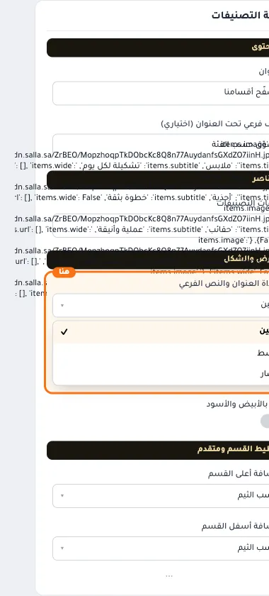
  
- **وسط**
  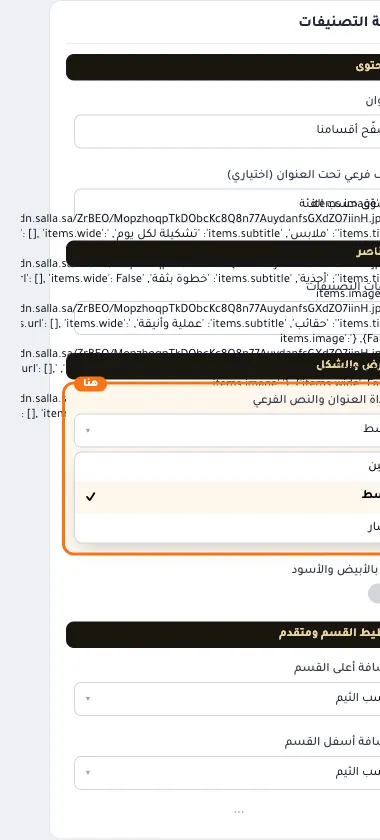
- **يسار**
  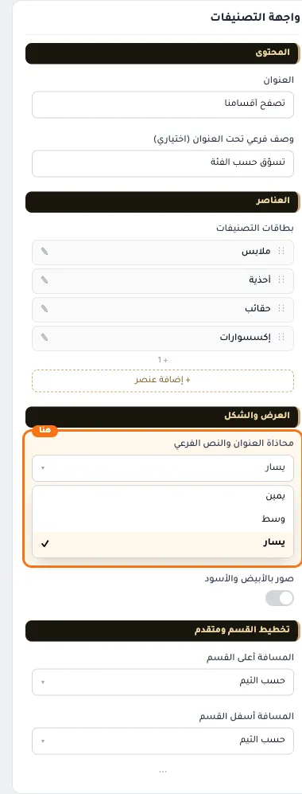

## «صور بالأبيض والأسود»
مفتاح · الافتراضي: مطفأ

**الوظيفة:** تتلوّن عند مرور الماوس، وتبقى ملوّنة على الجوال.

- **بعد قلب المفتاح**
  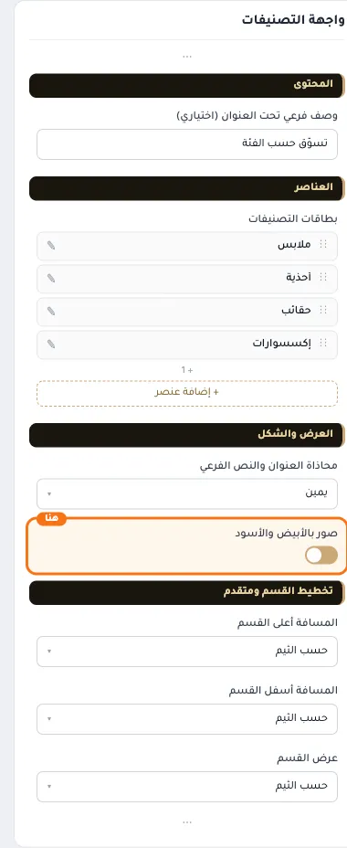
  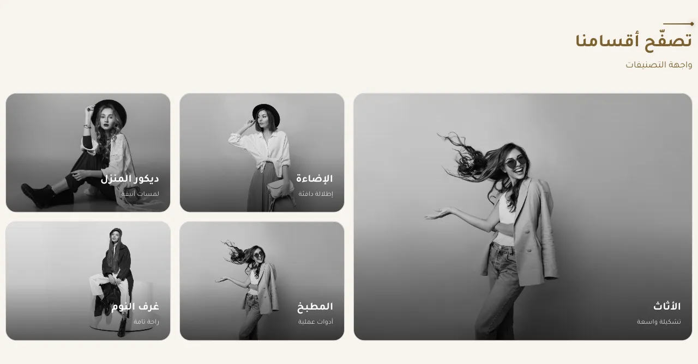

## «كلاس CSS مخصص»
نص · الافتراضي: فارغ

**الوظيفة:** للمصممين. كلاس القسم الثابت: cml-s--category-showcase

- **كلاس CSS مخصص**
  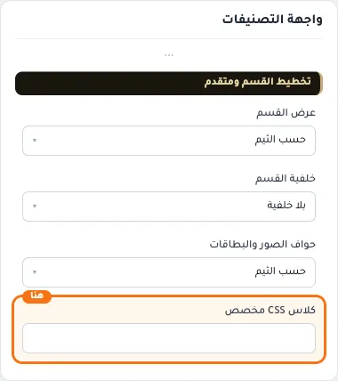
