# عرض + عدّاد تنازلي

المسافات والعرض والخلفية والحواف: انظر [الخيارات المشتركة](../../01-shared/README.md).

## «نص علوي صغير»
نص · الافتراضي: عرض خاص

**الوظيفة:** كلمة صغيرة فوق العنوان (مثل «جديد» أو «موسم الصيف») تلفت الانتباه قبل العنوان.

- **نص علوي صغير**
  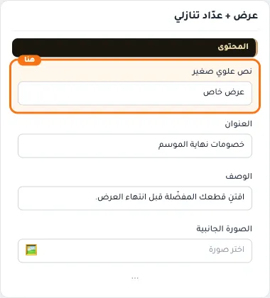

## «العنوان»
نص · الافتراضي: خصومات نهاية الموسم

**الوظيفة:** العنوان الرئيسي الذي يظهر أعلى القسم. اتركه فارغًا لإخفائه.

- **العنوان**
  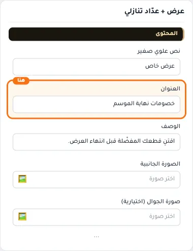

## «الوصف»
نص طويل · الافتراضي: اقتنِ قطعك المفضّلة قبل انتهاء العرض.

**الوظيفة:** نص توضيحي يظهر مع العنوان لشرح العرض أو المجموعة.

- **الوصف**
  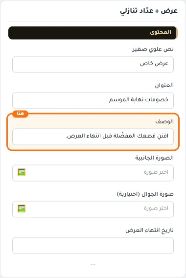

## «الصورة الجانبية»
صورة · الافتراضي: https://cdn.salla.sa/ZrBEO/MopzhoqpTkDObcKc8Q8n77AuydanfsGXdZO7iinH.jpg

**الوظيفة:** * المقاس المناسب 900×900 بكسل. اتركها فارغة لعرض البانر بلون التمييز فقط.

- **الصورة الجانبية**
  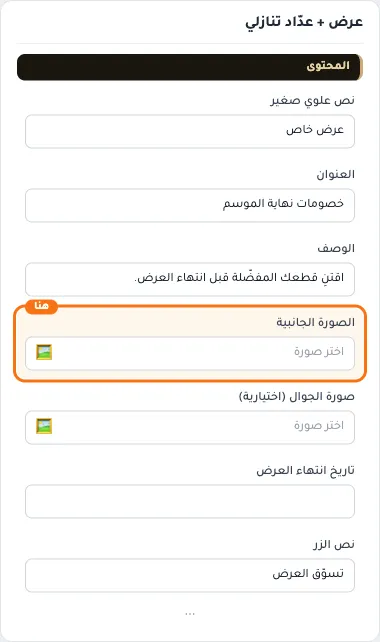

## «صورة الجوال (اختيارية)»
صورة · الافتراضي: فارغ

**الوظيفة:** * تظهر بدل الصورة الجانبية على الشاشات الأصغر من 768 بكسل. المقاس المناسب 800×600. اتركها فارغة لاستخدام الصورة الجانبية على كل المقاسات.

- **صورة الجوال (اختيارية)**
  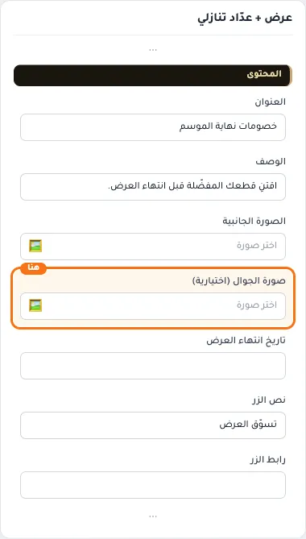

## «تاريخ انتهاء العرض»
نص · الافتراضي: فارغ

**الوظيفة:** تاريخ انتهاء العرض بالصيغة YYYY-MM-DD. تاريخ فقط بلا وقت؛ ينتهي العدّاد في آخر ذلك اليوم. اتركه فارغاً لإخفاء العدّاد.

- **تاريخ انتهاء العرض**
  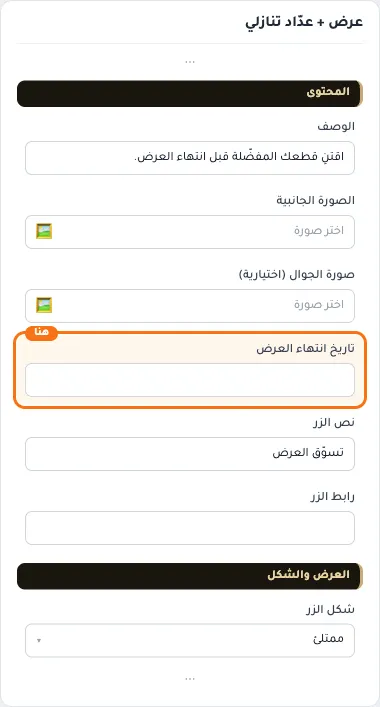

## «نص الزر»
نص · الافتراضي: تسوّق العرض

**الوظيفة:** النص المكتوب على الزر. اتركه فارغًا لإخفاء الزر.

- **نص الزر**
  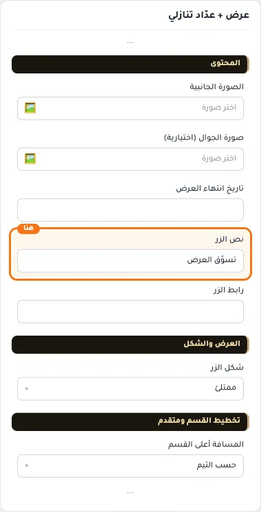

## «رابط الزر»
اختيار من المتجر · الافتراضي: فارغ

**الوظيفة:** اختر منتجاً أو تصنيفاً أو صفحة تعريفية أو ماركة... أو الصق رابطاً خارجياً.

- **رابط الزر**
  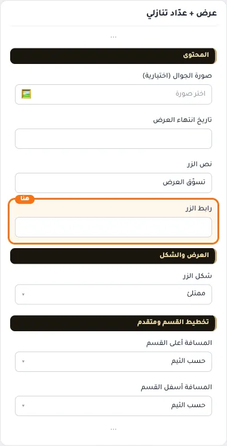

## «شكل الزر»
قائمة منسدلة · الافتراضي: ممتلئ

**الوظيفة:** شكل الزر: ممتلئ أو بإطار أو رابط نصي.

- **ممتلئ** — القيمة الافتراضية.
  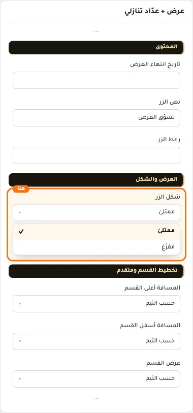
  
- **مفرّغ**
  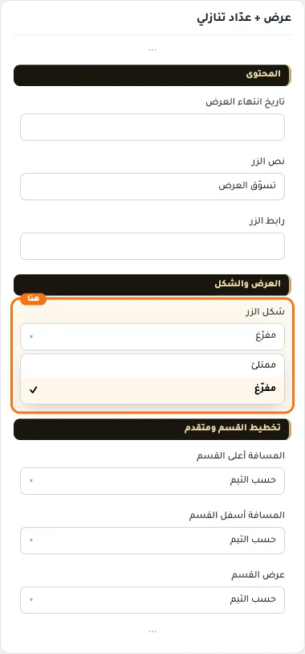
  

## «كلاس CSS مخصص»
نص · الافتراضي: فارغ

**الوظيفة:** للمصممين. كلاس القسم الثابت: cml-s--promo-countdown

- **كلاس CSS مخصص**
  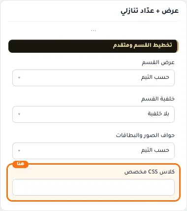
