# كارميلا | صورة متحركة

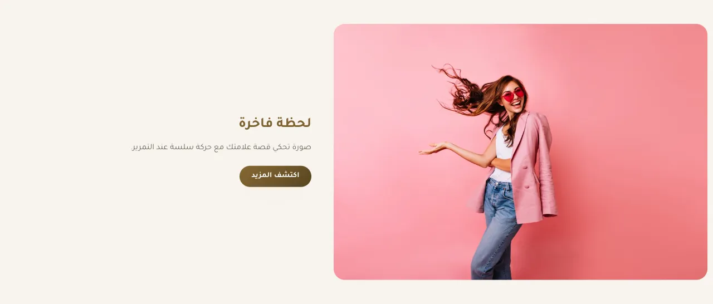

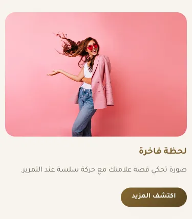

المسافات والعرض والخلفية والحواف: انظر [الخيارات المشتركة](../../01-shared/README.md).

## «العنوان»
نص · الافتراضي: لحظة فاخرة

**الوظيفة:** العنوان الرئيسي الذي يظهر أعلى القسم. اتركه فارغًا لإخفائه.

- **العنوان**
  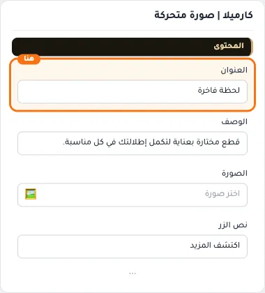

## «الوصف»
نص طويل · الافتراضي: قطع مختارة بعناية لتكمل إطلالتك في كل مناسبة.

**الوظيفة:** نص توضيحي يظهر مع العنوان لشرح العرض أو المجموعة.

- **الوصف**
  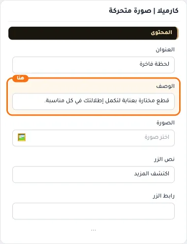

## «الصورة»
صورة · الافتراضي: https://cdn.salla.sa/ZrBEO/MopzhoqpTkDObcKc8Q8n77AuydanfsGXdZO7iinH.jpg

**الوظيفة:** الصورة المعروضة في هذا العنصر.

- **الصورة**
  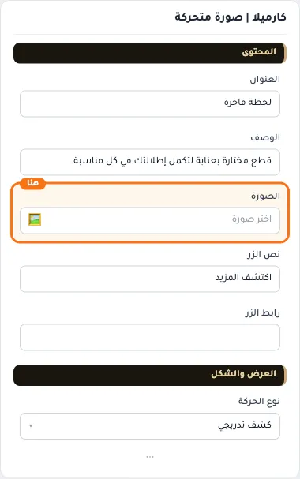

## «نص الزر»
نص · الافتراضي: اكتشف المزيد

**الوظيفة:** النص المكتوب على الزر.

- **نص الزر**
  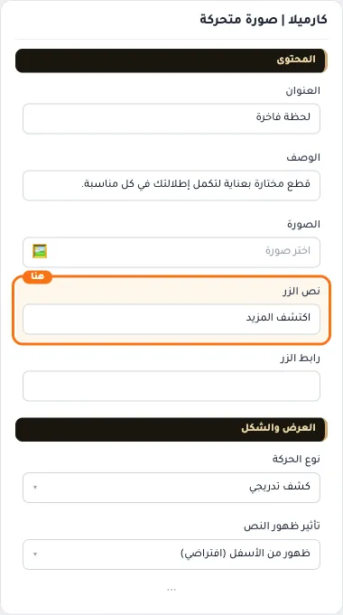

## «رابط الزر»
اختيار من المتجر · الافتراضي: فارغ

**الوظيفة:** اختر منتجاً أو تصنيفاً أو صفحة تعريفية... أو الصق رابطاً خارجياً.

- **رابط الزر**
  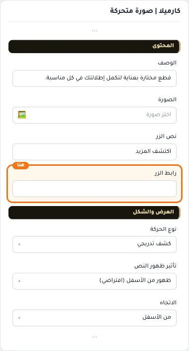

## «نوع الحركة»
قائمة منسدلة · الافتراضي: كشف تدريجي

**الوظيفة:** نوع حركة ظهور العناصر عند التمرير.

- **كشف تدريجي** — القيمة الافتراضية.
  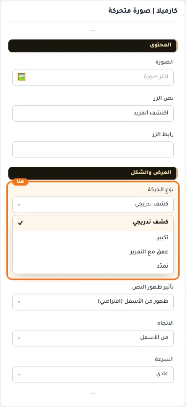
  
- **تكبير**
  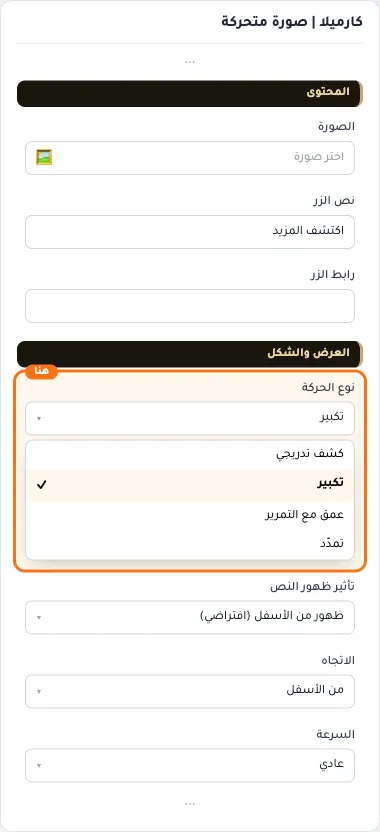
- **عمق مع التمرير**
  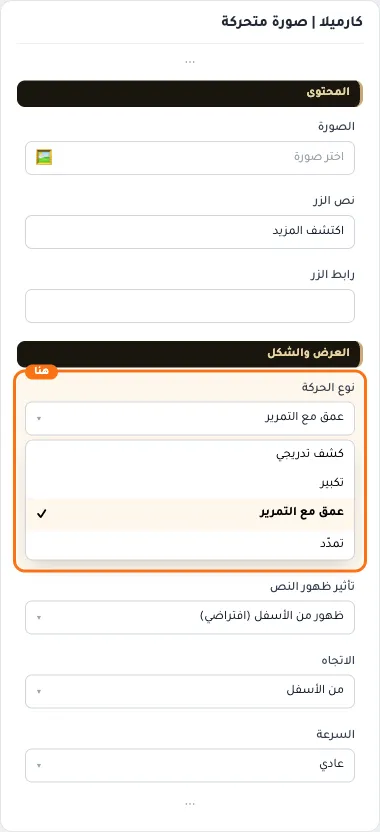
- **تمدّد**
  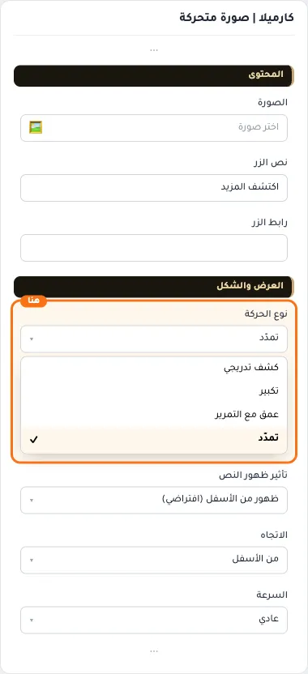

## «تأثير ظهور النص»
قائمة منسدلة · الافتراضي: ظهور من الأسفل (افتراضي)

**الوظيفة:** طريقة ظهور النص عند وصول الزائر للقسم.

- **ظهور من الأسفل (افتراضي)** — القيمة الافتراضية.
  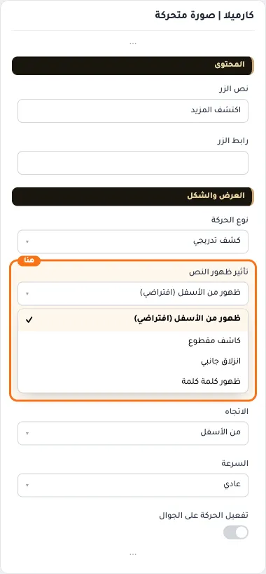
  
- **كاشف مقطوع**
  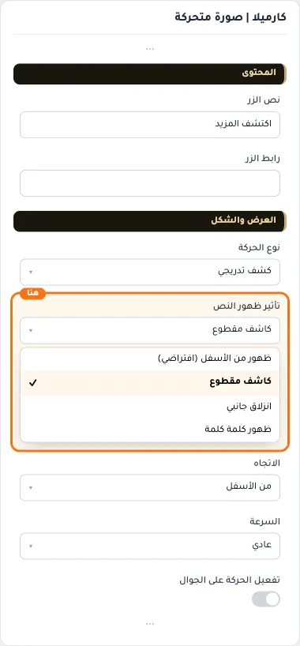
- **انزلاق جانبي**
  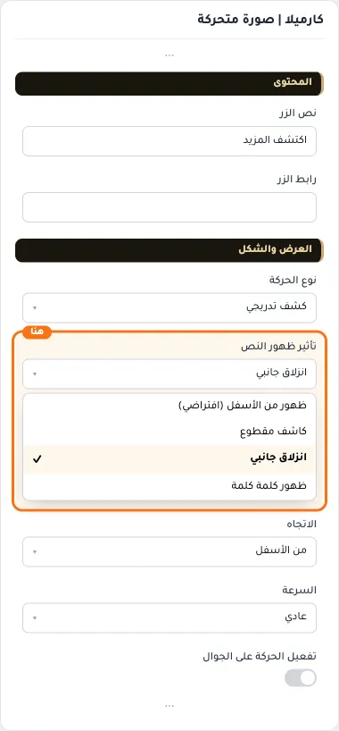
- **ظهور كلمة كلمة**
  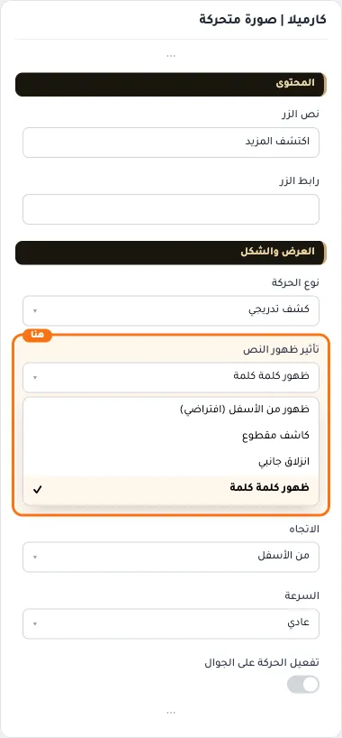

## «الاتجاه»
قائمة منسدلة · الافتراضي: من الأسفل

**الوظيفة:** اتجاه الحركة: مع اتجاه القراءة أو عكسه.

- **من الأعلى**
  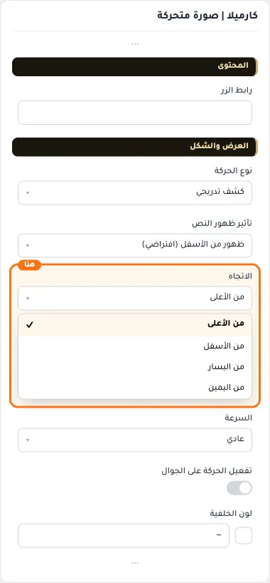
- **من الأسفل** — القيمة الافتراضية.
  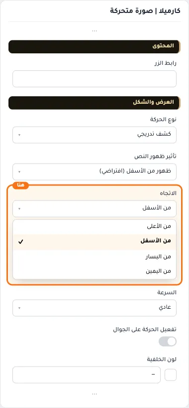
  
- **من اليسار**
  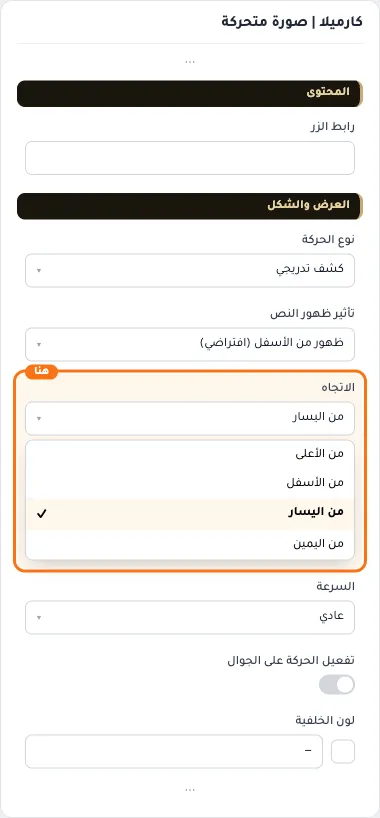
- **من اليمين**
  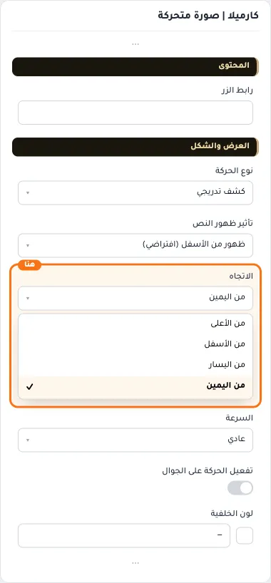

## «السرعة»
قائمة منسدلة · الافتراضي: عادي

**الوظيفة:** سرعة الحركة: الأبطأ أهدأ للقراءة، والأسرع أكثر حيوية.

- **بطيء**
  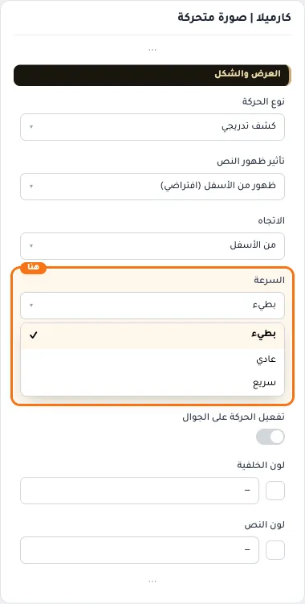
- **عادي** — القيمة الافتراضية.
  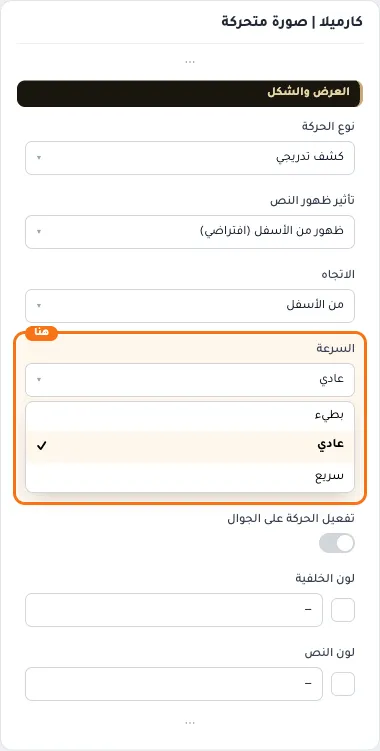
  
- **سريع**
  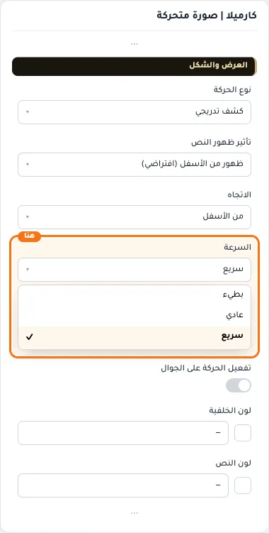

## «تفعيل الحركة على الجوال»
مفتاح · الافتراضي: مطفأ

**الوظيفة:** يشغّل الحركة على الجوال أيضًا؛ أطفئه لصفحة أخف على الأجهزة الضعيفة.

- **بعد قلب المفتاح**
  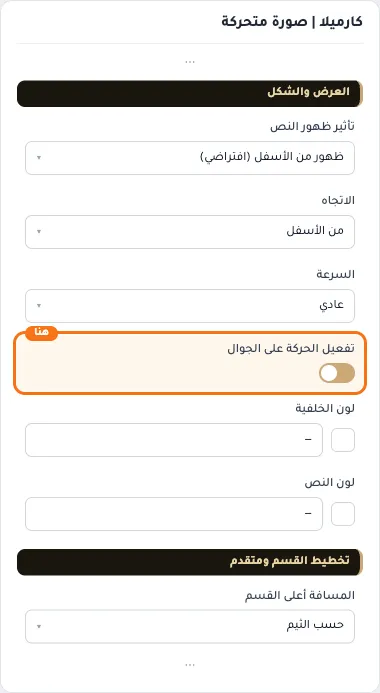

## «لون الخلفية»
لون · الافتراضي: فارغ

**الوظيفة:** لون خلفية القسم.

- **لون الخلفية**
  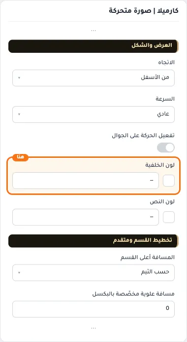

## «لون النص»
لون · الافتراضي: فارغ

**الوظيفة:** لون النص فوق الخلفية أو الصورة.

- **لون النص**
  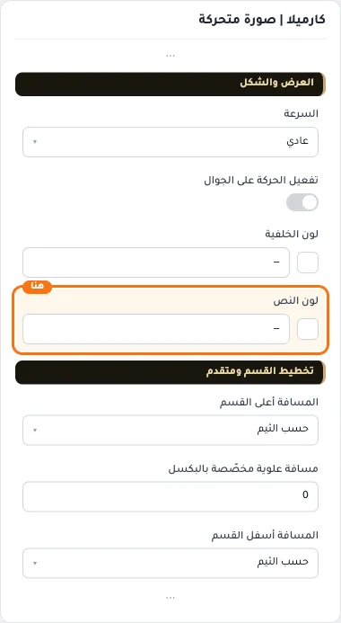

## «مسافة علوية مخصّصة بالبكسل»
رقم · الافتراضي: 0

**الوظيفة:** اختياري. يعمل حين تكون «المسافة أعلى القسم» على «حسب الثيم».

**يظهر حين:** «المسافة أعلى القسم» = حسب الثيم

- **مسافة علوية مخصّصة بالبكسل**
  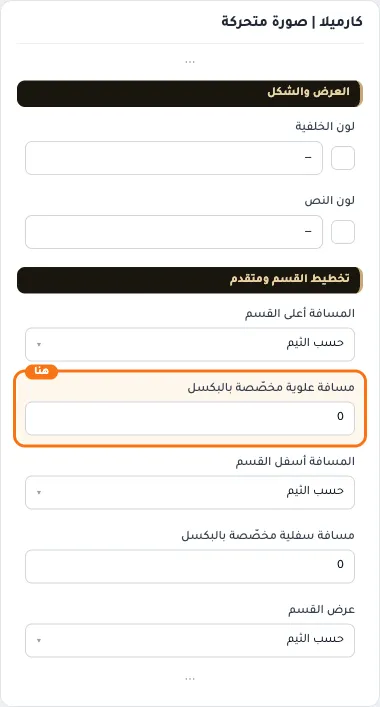

## «مسافة سفلية مخصّصة بالبكسل»
رقم · الافتراضي: 0

**الوظيفة:** اختياري. يعمل حين تكون «المسافة أسفل القسم» على «حسب الثيم».

**يظهر حين:** «المسافة أسفل القسم» = حسب الثيم

- **مسافة سفلية مخصّصة بالبكسل**
  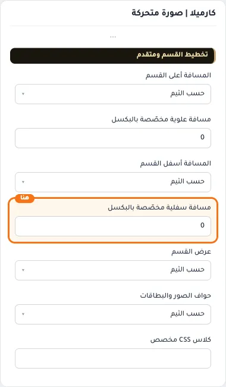

## «كلاس CSS مخصص»
نص · الافتراضي: فارغ

**الوظيفة:** للمصممين. كلاس القسم الثابت: cml-s--animated-image

- **كلاس CSS مخصص**
  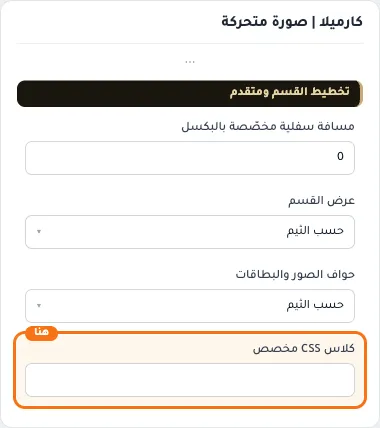
