# كارميلا | معرض كشف الصور

المسافات والعرض والخلفية والحواف: انظر [الخيارات المشتركة](../../01-shared/README.md).

## «عنوان القسم»
نص · الافتراضي: تفاصيل تستحق النظر

**الوظيفة:** عنوان القسم الظاهر أعلاه. اتركه فارغًا لإخفائه.

- **عنوان القسم**
  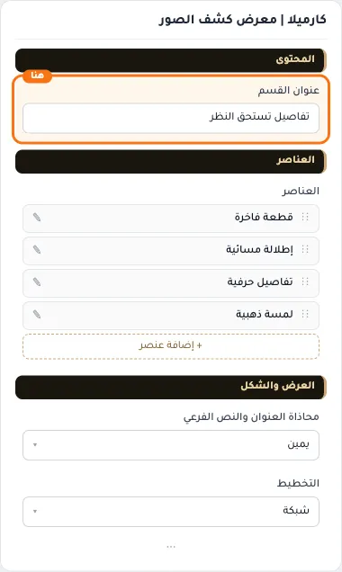

## «العناصر»
عناصر متكررة · الافتراضي: عناصر جاهزة

**الوظيفة:** قائمة العناصر التي يعرضها القسم؛ أضف عنصرًا أو احذفه أو اسحبه لتغيير الترتيب.

- **العناصر**
  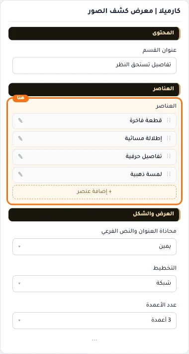

**حقول كل عنصر:**
- «العنوان» (نص، الافتراضي: فارغ): العنوان الرئيسي الذي يظهر أعلى القسم. اتركه فارغًا لإخفائه.
- «وصف فرعي» (نص، الافتراضي: فارغ): سطر قصير تحت العنوان يشرح محتوى القسم. اختياري؛ يختفي إن تُرك فارغًا.
- «الصورة» (صورة، الافتراضي: فارغ): الصورة المعروضة في هذا العنصر.
- «الرابط» (اختيار من المتجر، الافتراضي: فارغ): اختر تصنيفًا أو ماركة من المتجر، أو ضع رابطًا خارجيًا.

## «محاذاة العنوان والنص الفرعي»
قائمة منسدلة · الافتراضي: يمين

**الوظيفة:** محاذاة العنوان الرئيسي والفرعي داخل القسم (الافتراضي: يمين).

- **يمين** — القيمة الافتراضية.
  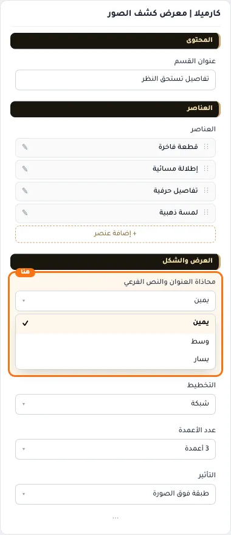
  
- **وسط**
  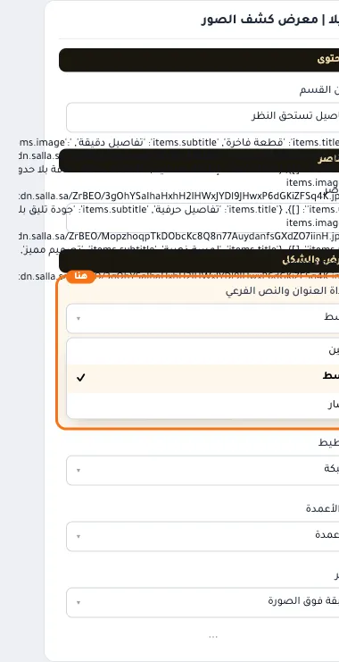
- **يسار**
  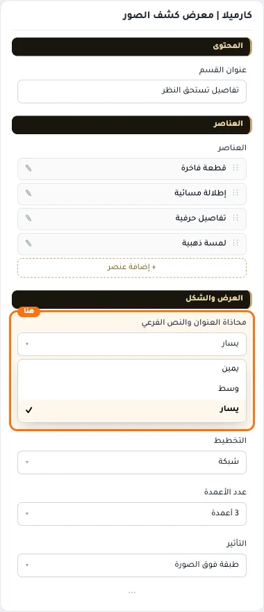

## «التخطيط»
قائمة منسدلة · الافتراضي: شبكة

**الوظيفة:** ترتيب عناصر القسم وطريقة توزيعها.

- **قائمة**
  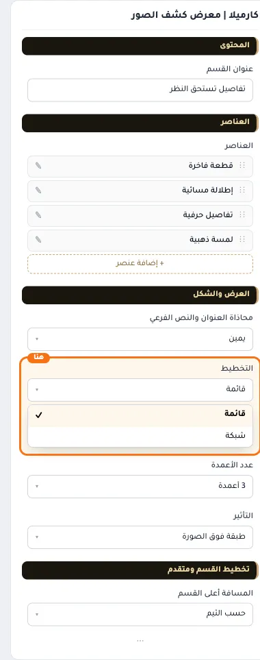
- **شبكة** — القيمة الافتراضية.
  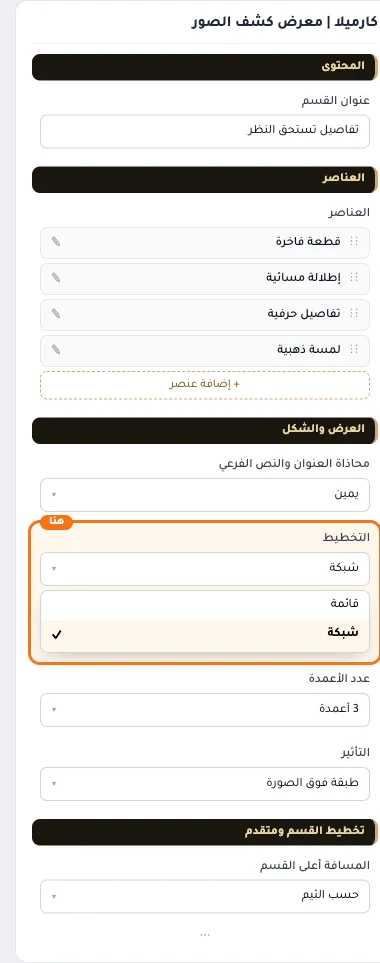
  

## «عدد الأعمدة»
قائمة منسدلة · الافتراضي: 3 أعمدة

**الوظيفة:** عدد الأعمدة التي تتوزع عليها العناصر.

- **عمودان**
  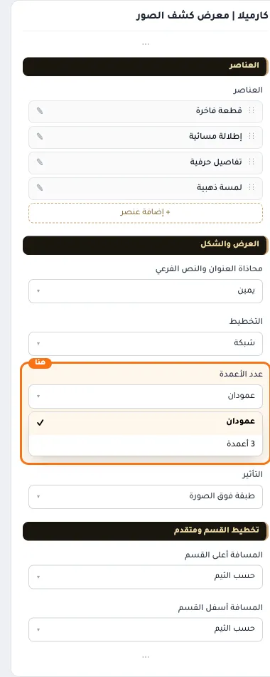
- **3 أعمدة** — القيمة الافتراضية.
  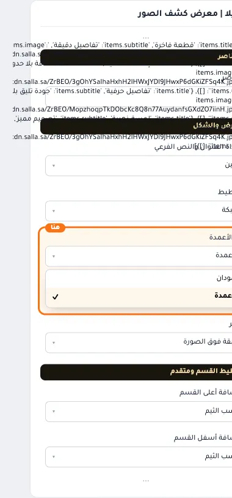
  

## «التأثير»
قائمة منسدلة · الافتراضي: طبقة فوق الصورة

**الوظيفة:** التأثير البصري المطبق على النص أثناء التمرير.

- **طبقة فوق الصورة** — القيمة الافتراضية.
  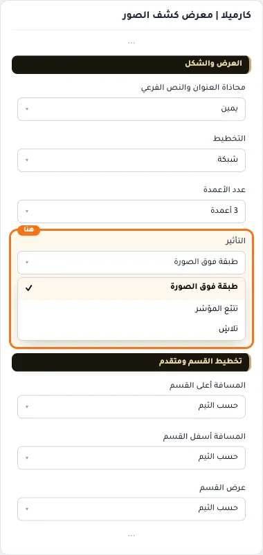
  
- **تتبّع المؤشر**
  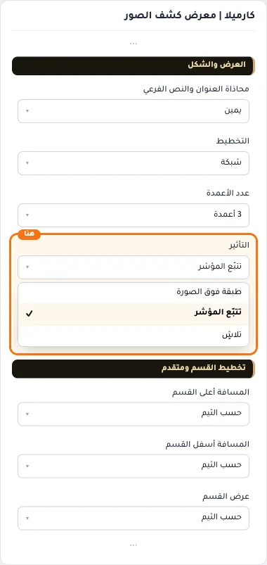
- **تلاشٍ**
  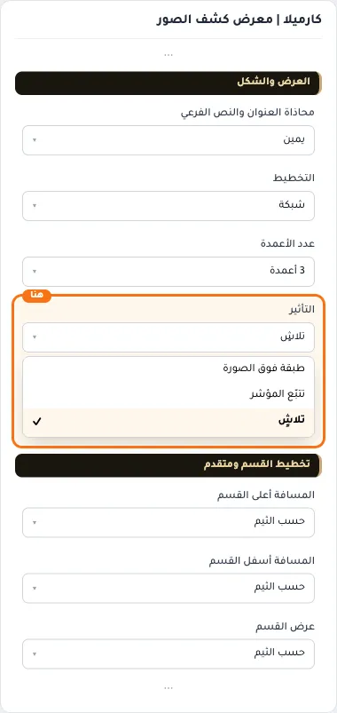

## «كلاس CSS مخصص»
نص · الافتراضي: فارغ

**الوظيفة:** للمصممين. كلاس القسم الثابت: cml-s--hover-reveal-gallery

- **كلاس CSS مخصص**
  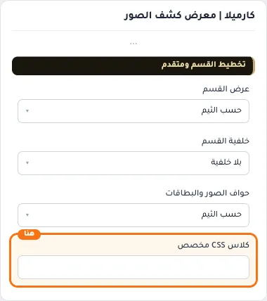
