# كارميلا | ظهور النص

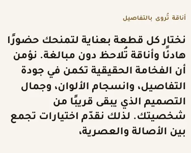

المسافات والعرض والخلفية والحواف: انظر [الخيارات المشتركة](../../01-shared/README.md).

## «سطر تمهيدي صغير»
نص · الافتراضي: قصتنا

**الوظيفة:** كلمة صغيرة فوق العنوان (مثل «جديد» أو «موسم الصيف») تلفت الانتباه قبل العنوان.

- **سطر تمهيدي صغير**
  

## «النص»
نص طويل · الافتراضي: نختار كل قطعة بعناية، من الخامة إلى آخر تفصيل، لتجد ما يشبه أسلوبك ويرافقك كل يوم.

**الوظيفة:** النص المعروض في العنصر.

- **النص**
  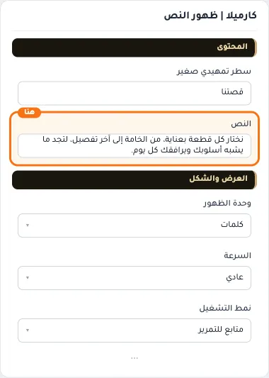

## «وحدة الظهور»
قائمة منسدلة · الافتراضي: كلمات

**الوظيفة:** وحدة ظهور النص: حرفًا حرفًا، أو كلمة كلمة، أو سطرًا سطرًا.

- **كلمات** — القيمة الافتراضية.
  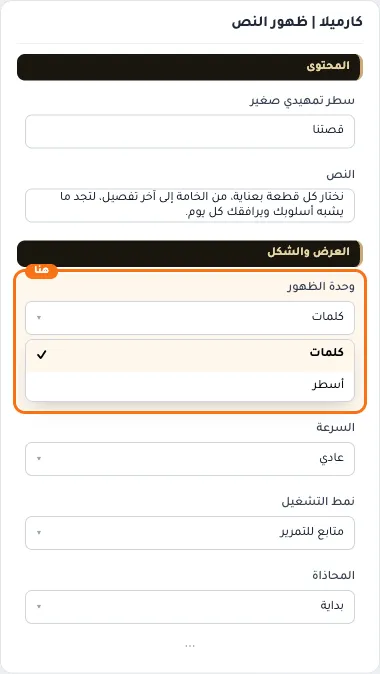
  
- **أسطر**
  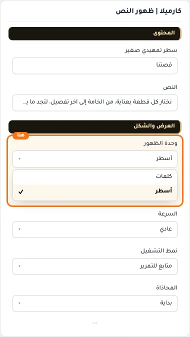

## «السرعة»
قائمة منسدلة · الافتراضي: عادي

**الوظيفة:** سرعة الحركة: الأبطأ أهدأ للقراءة، والأسرع أكثر حيوية.

- **بطيء**
  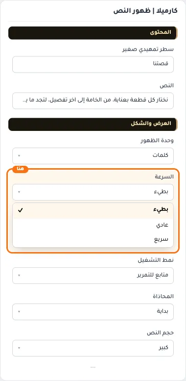
- **عادي** — القيمة الافتراضية.
  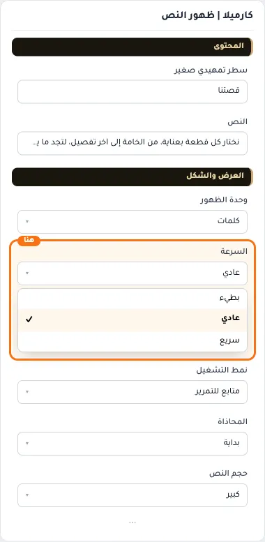
  
- **سريع**
  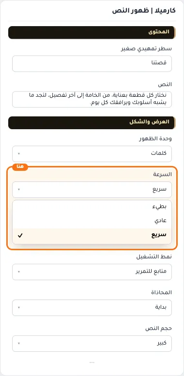

## «نمط التشغيل»
قائمة منسدلة · الافتراضي: متابع للتمرير

**الوظيفة:** متى يبدأ التأثير: مع التمرير أو مرة واحدة عند الظهور.

- **متابع للتمرير** — القيمة الافتراضية.
  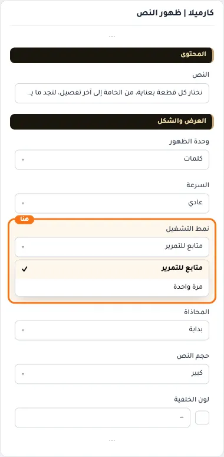
  
- **مرة واحدة**
  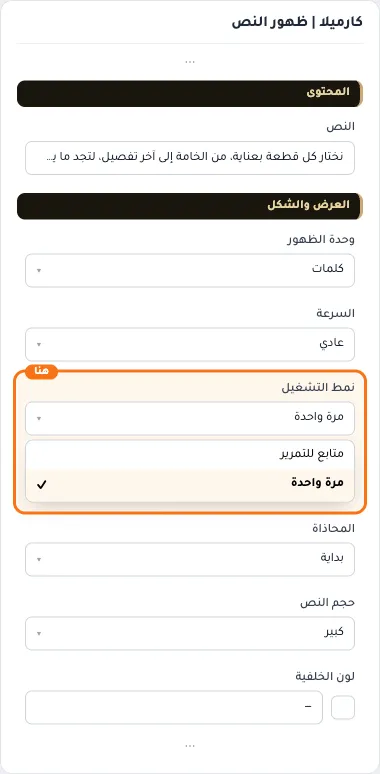

## «المحاذاة»
قائمة منسدلة · الافتراضي: بداية

**الوظيفة:** «بداية» و«يمين» تعطيان المحاذاة نفسها.

- **بداية** — القيمة الافتراضية.
  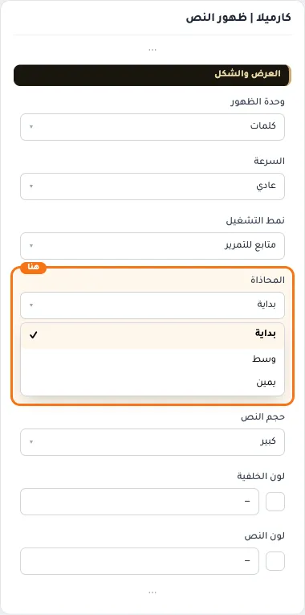
  
- **وسط**
  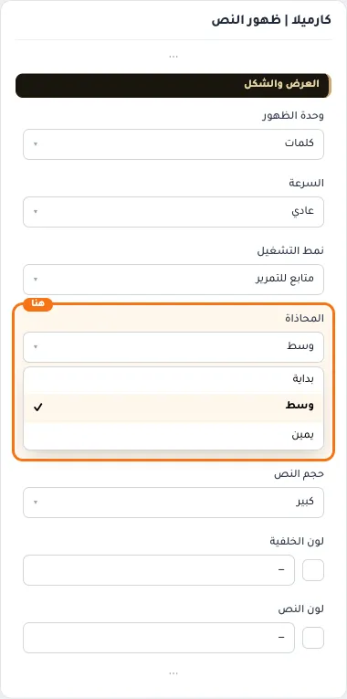
- **يمين**
  

## «حجم النص»
قائمة منسدلة · الافتراضي: كبير

**الوظيفة:** كبير هو الحجم الحالي للمكوّن.

- **صغير**
  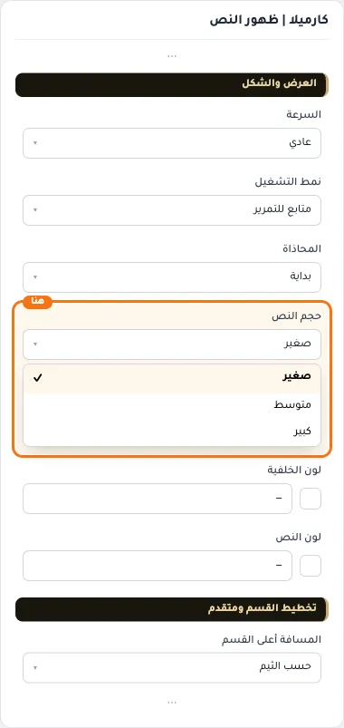
- **متوسط**
  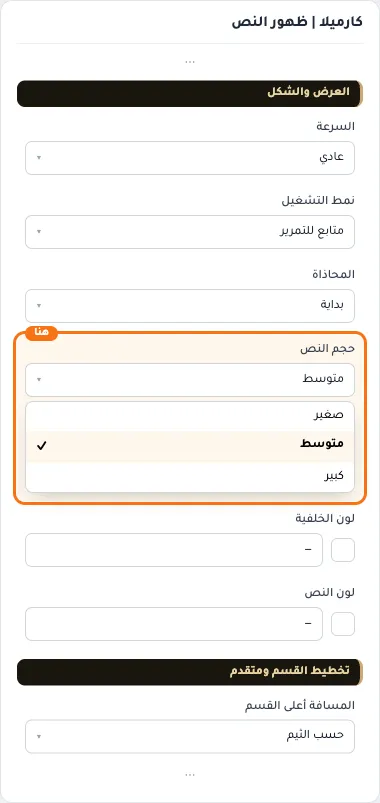
- **كبير** — القيمة الافتراضية.
  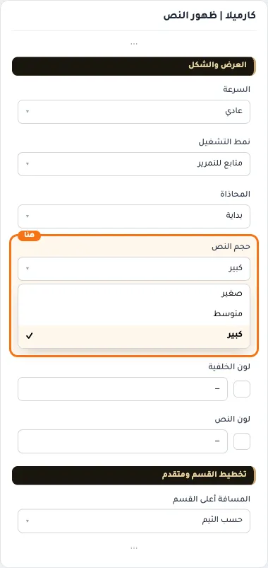
  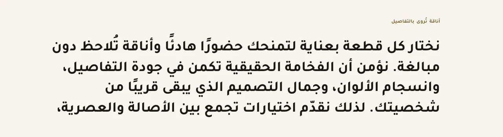

## «لون الخلفية»
لون · الافتراضي: فارغ

**الوظيفة:** لون خلفية القسم.

- **لون الخلفية**
  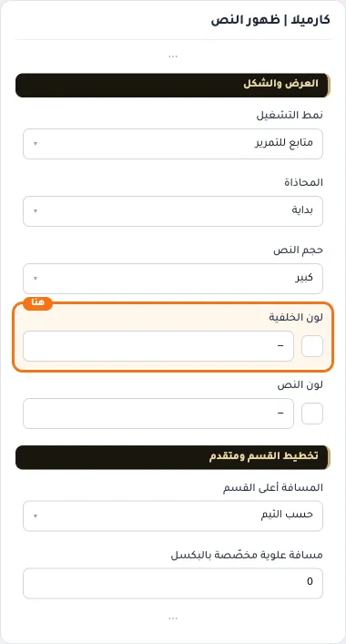

## «لون النص»
لون · الافتراضي: فارغ

**الوظيفة:** لون النص فوق الخلفية أو الصورة.

- **لون النص**
  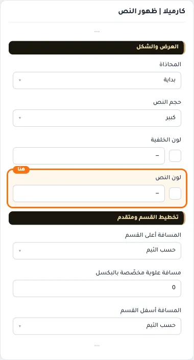

## «مسافة علوية مخصّصة بالبكسل»
رقم · الافتراضي: 0

**الوظيفة:** اختياري. يعمل حين تكون «المسافة أعلى القسم» على «حسب الثيم».

**يظهر حين:** «المسافة أعلى القسم» = حسب الثيم

- **مسافة علوية مخصّصة بالبكسل**
  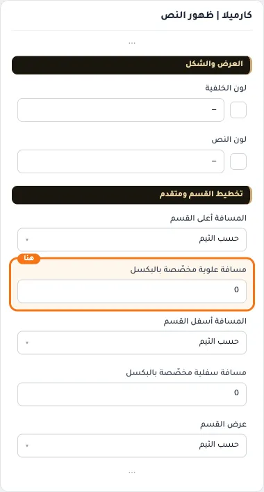

## «مسافة سفلية مخصّصة بالبكسل»
رقم · الافتراضي: 0

**الوظيفة:** اختياري. يعمل حين تكون «المسافة أسفل القسم» على «حسب الثيم».

**يظهر حين:** «المسافة أسفل القسم» = حسب الثيم

- **مسافة سفلية مخصّصة بالبكسل**
  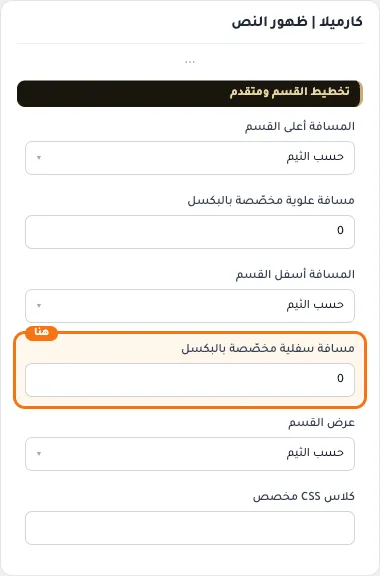

## «كلاس CSS مخصص»
نص · الافتراضي: فارغ

**الوظيفة:** للمصممين. كلاس القسم الثابت: cml-s--text-reveal

- **كلاس CSS مخصص**
  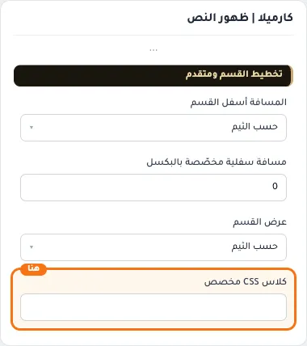
