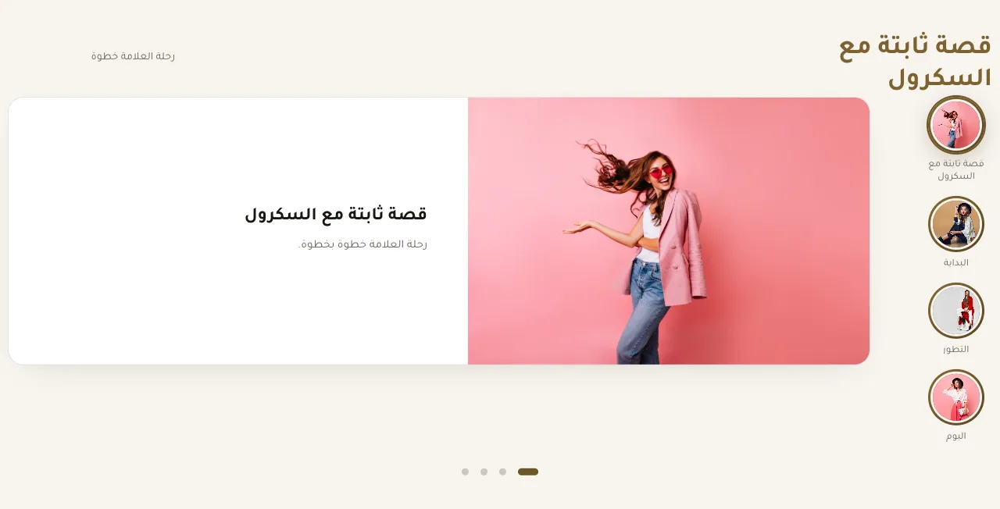
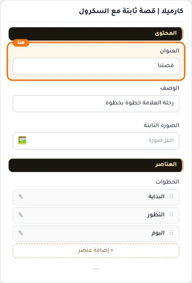
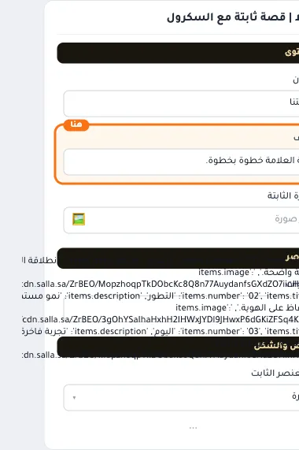
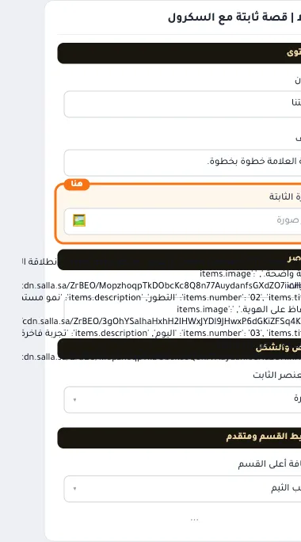
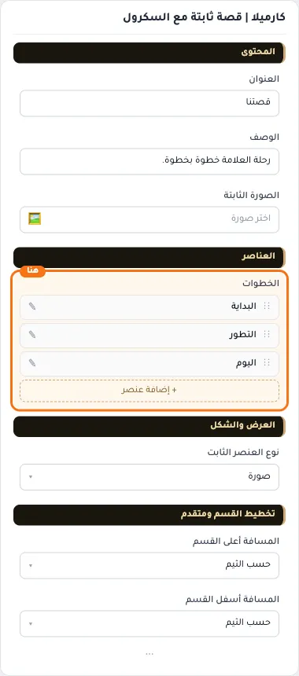
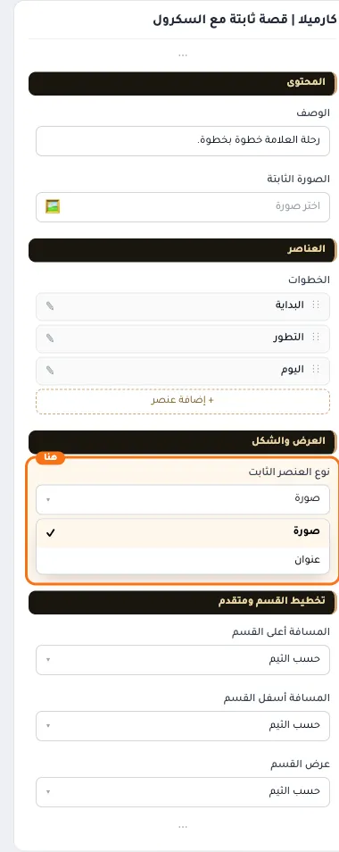
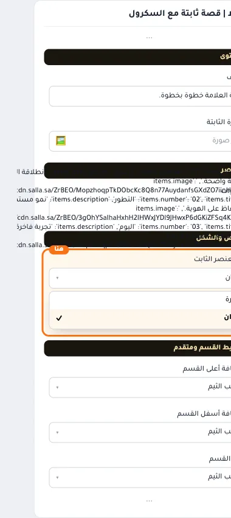
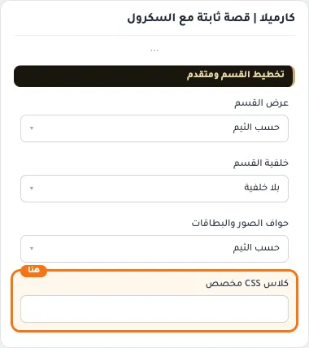

# كارميلا | قصة ثابتة مع السكرول

المسافات والعرض والخلفية والحواف: انظر [الخيارات المشتركة](../../01-shared/README.md).

## «العنوان»
نص · الافتراضي: قصتنا

**الوظيفة:** العنوان الرئيسي الذي يظهر أعلى القسم. اتركه فارغًا لإخفائه.

- **العنوان**
  

## «الوصف»
نص طويل · الافتراضي: رحلة العلامة خطوة بخطوة.

**الوظيفة:** نص توضيحي يظهر مع العنوان لشرح العرض أو المجموعة.

- **الوصف**
  

## «الصورة الثابتة»
صورة · الافتراضي: https://cdn.salla.sa/ZrBEO/MopzhoqpTkDObcKc8Q8n77AuydanfsGXdZO7iinH.jpg

**الوظيفة:** الصورة المعروضة في هذا العنصر.

- **الصورة الثابتة**
  

## «الخطوات»
عناصر متكررة · الافتراضي: عناصر جاهزة

**الوظيفة:** قائمة العناصر التي يعرضها القسم؛ أضف عنصرًا أو احذفه أو اسحبه لتغيير الترتيب.

- **الخطوات**
  

**حقول كل عنصر:**
- «الرقم» (نص، الافتراضي: فارغ): الرقم الكبير الظاهر مع العنصر (مثل 01 أو +500).
- «العنوان» (نص، الافتراضي: فارغ): العنوان الرئيسي الذي يظهر أعلى القسم. اتركه فارغًا لإخفائه.
- «الوصف» (نص طويل، الافتراضي: فارغ): نص توضيحي يظهر مع العنوان لشرح العرض أو المجموعة.
- «صورة» (صورة، الافتراضي: فارغ): الصورة المعروضة في هذا العنصر.

## «نوع العنصر الثابت»
قائمة منسدلة · الافتراضي: صورة

**الوظيفة:** العنصر الذي يبقى ثابتًا أثناء تمرير البطاقات فوقه.

- **صورة** — القيمة الافتراضية.
  
  
- **عنوان**
  

## «كلاس CSS مخصص»
نص · الافتراضي: فارغ

**الوظيفة:** للمصممين. كلاس القسم الثابت: cml-s--sticky-story

- **كلاس CSS مخصص**
  
