# كارميلا | قصص فيديو

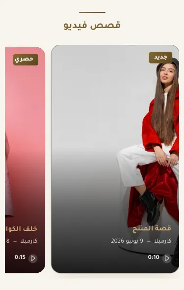

المسافات والعرض والخلفية والحواف: انظر [الخيارات المشتركة](../../01-shared/README.md).

## «عنوان القسم»
نص · الافتراضي: قصص فيديو

**الوظيفة:** عنوان القسم الظاهر أعلاه. اتركه فارغًا لإخفائه.

- **عنوان القسم**
  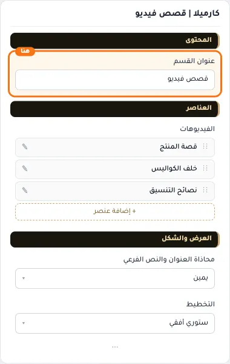

## «الفيديوهات»
عناصر متكررة · الافتراضي: عناصر جاهزة

**الوظيفة:** قائمة العناصر التي يعرضها القسم؛ أضف عنصرًا أو احذفه أو اسحبه لتغيير الترتيب.

- **الفيديوهات**
  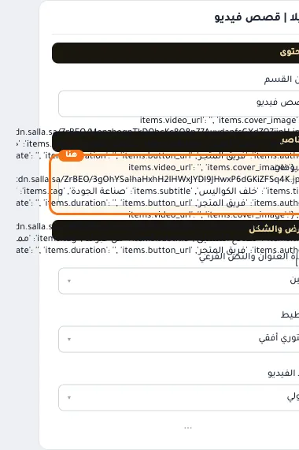

**حقول كل عنصر:**
- «رابط الفيديو» (نص، الافتراضي: فارغ): رابط الفيديو الذي يُشغَّل عند الضغط.
- «صورة الغلاف» (صورة، الافتراضي: فارغ): الصورة التي تظهر قبل تشغيل الفيديو.
- «العنوان» (نص، الافتراضي: فارغ): العنوان الرئيسي الذي يظهر أعلى القسم. اتركه فارغًا لإخفائه.
- «الكاتب / المصدر» (نص، الافتراضي: فارغ): اسم الكاتب أو المصدر تحت العنصر.
- «التاريخ» (نص، الافتراضي: فارغ): التاريخ الظاهر مع العنصر.
- «وصف فرعي (بديل للكاتب)» (نص، الافتراضي: فارغ): سطر قصير تحت العنوان يشرح محتوى القسم. اختياري؛ يختفي إن تُرك فارغًا.
- «وسم» (نص، الافتراضي: فارغ): كلمة صغيرة فوق العنوان تصنّف العنصر.
- «مدة الفيديو» (نص، الافتراضي: فارغ): تُحدَّث تلقائياً من الفيديو إن تُركت فارغة
- «رابط بديل» (اختيار من المتجر، الافتراضي: فارغ): اختر منتجاً أو تصنيفاً أو صفحة تعريفية أو ماركة... أو الصق رابطاً خارجياً.

## «محاذاة العنوان والنص الفرعي»
قائمة منسدلة · الافتراضي: يمين

**الوظيفة:** محاذاة العنوان الرئيسي والفرعي داخل القسم (الافتراضي: يمين).

- **يمين** — القيمة الافتراضية.
  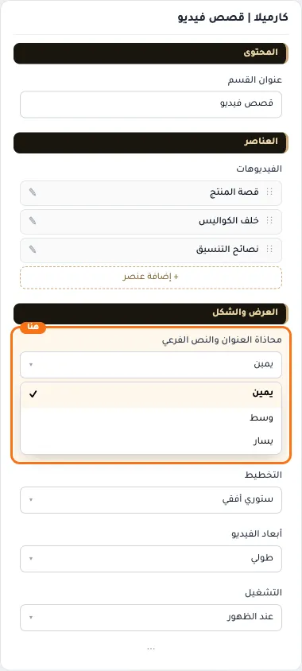
  
- **وسط**
  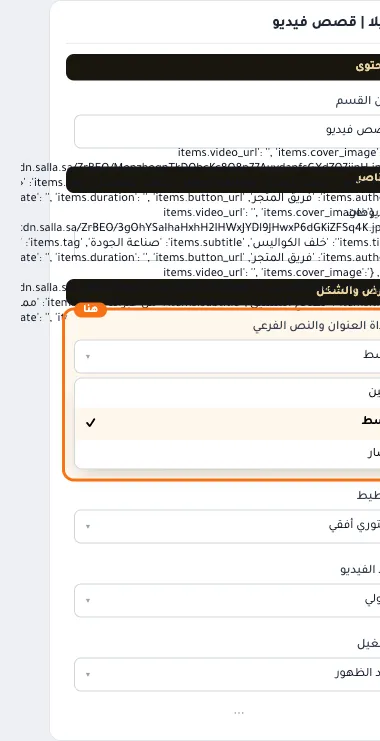
- **يسار**
  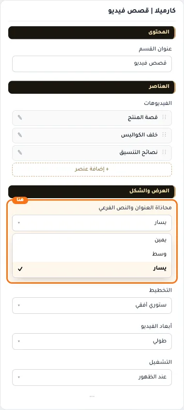

## «التخطيط»
قائمة منسدلة · الافتراضي: ستوري أفقي

**الوظيفة:** ترتيب عناصر القسم وطريقة توزيعها.

- **ستوري أفقي** — القيمة الافتراضية.
  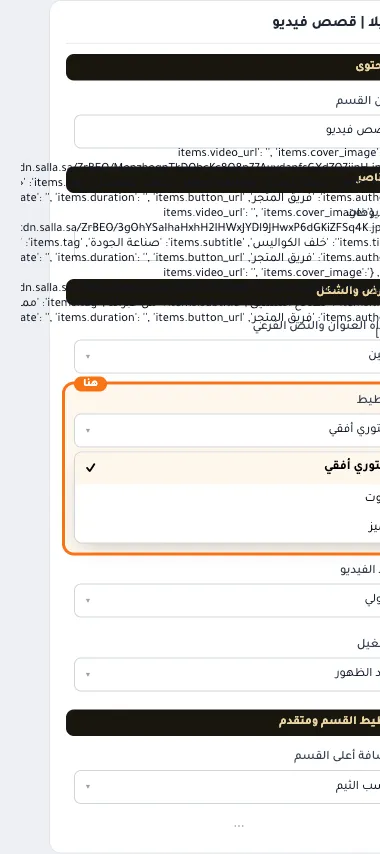
  
- **كروت**
  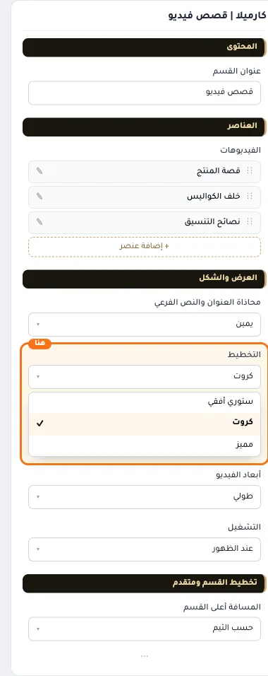
- **مميز**
  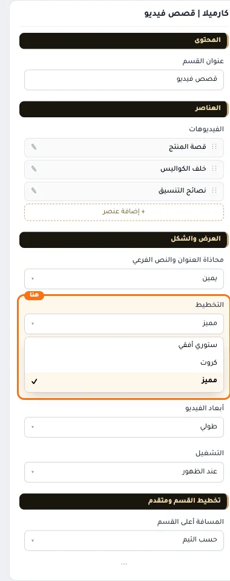

## «أبعاد الفيديو»
قائمة منسدلة · الافتراضي: طولي

**الوظيفة:** أبعاد إطار الفيديو: طولي أو مربع أو عريض.

- **طولي** — القيمة الافتراضية.
  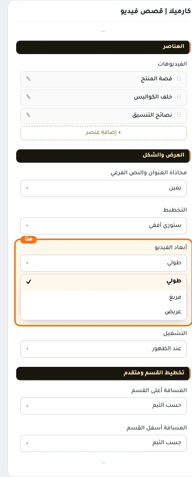
  
- **مربع**
  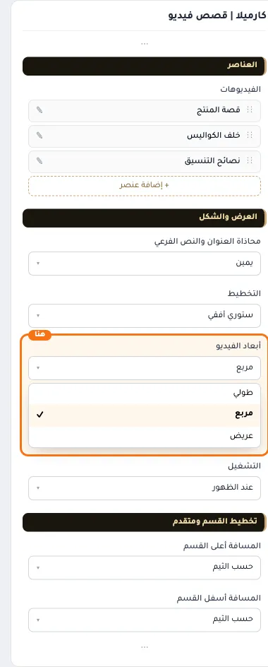
  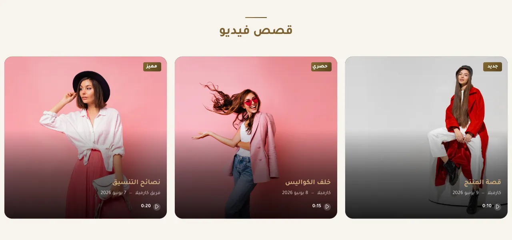
- **عريض**
  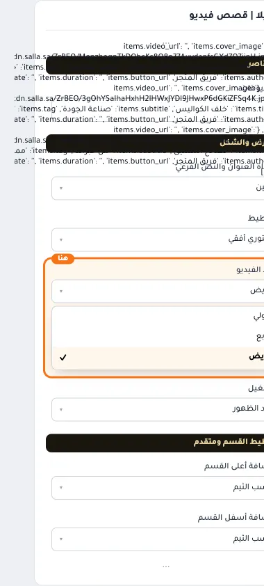
  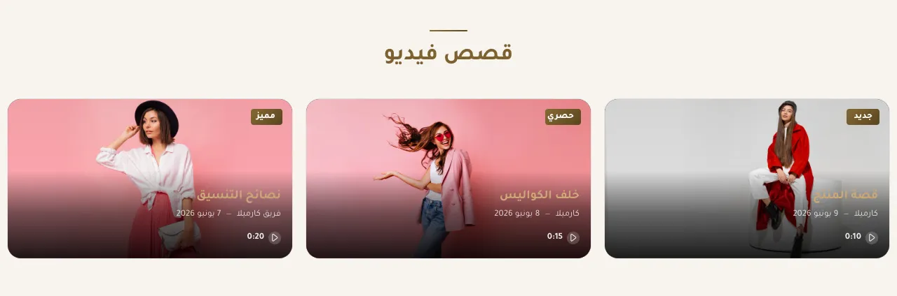

## «التشغيل»
قائمة منسدلة · الافتراضي: عند الظهور

**الوظيفة:** «عند مرور الماوس» يوفّر بيانات الزائر، وعلى الجوال وفي البطاقات بلا غلاف يبقى التشغيل عند الظهور.

- **عند الظهور** — القيمة الافتراضية.
  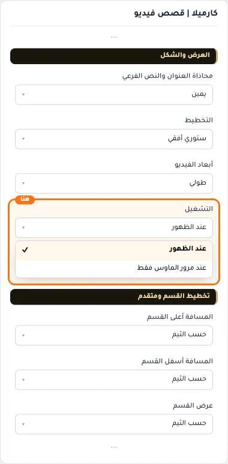
  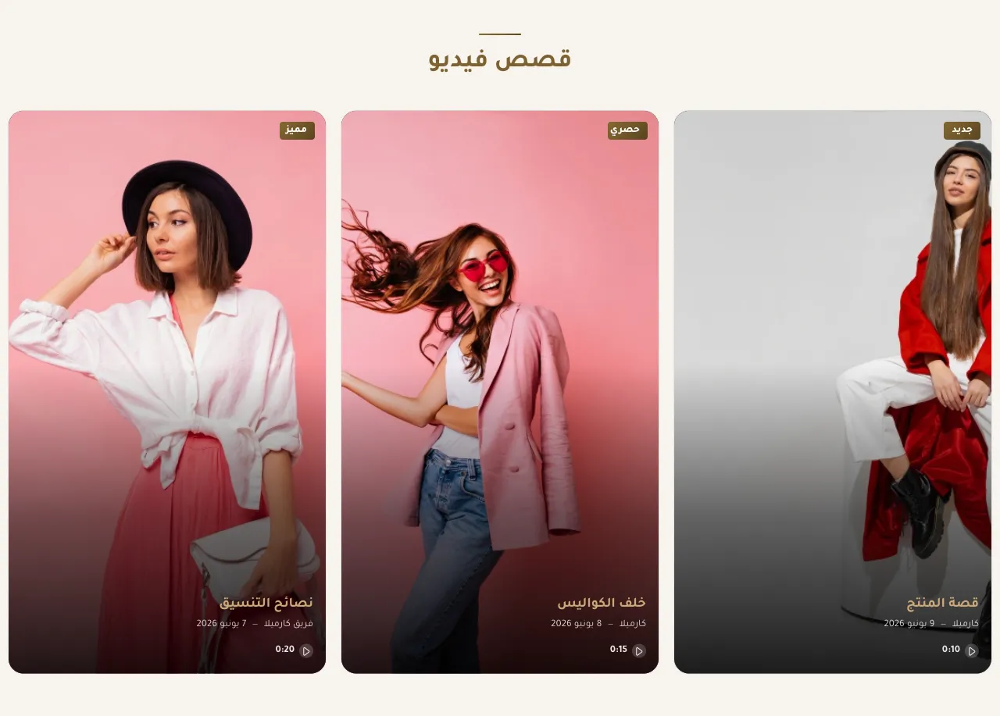
- **عند مرور الماوس فقط**
  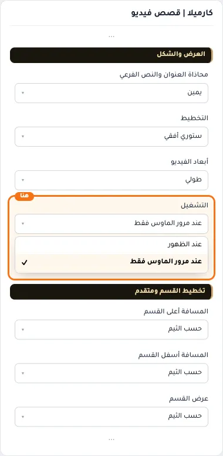

## «كلاس CSS مخصص»
نص · الافتراضي: فارغ

**الوظيفة:** للمصممين. كلاس القسم الثابت: cml-s--video-story

- **كلاس CSS مخصص**
  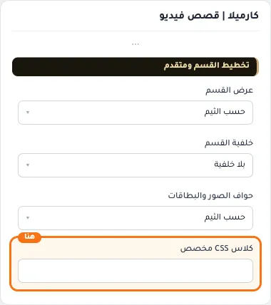
