# كارميلا | شريط نصوص متحرك

المسافات والعرض والخلفية والحواف: انظر [الخيارات المشتركة](../../01-shared/README.md).

## «الشكل»
قائمة منسدلة · الافتراضي: مستقيم

**الوظيفة:** الشكل العام للقسم.

- **مستقيم** — القيمة الافتراضية.
  
  

## «اتجاه الحركة»
قائمة منسدلة · الافتراضي: مع اتجاه القراءة

**الوظيفة:** اتجاه الحركة: مع اتجاه القراءة أو عكسه.

- **مع اتجاه القراءة** — القيمة الافتراضية.
  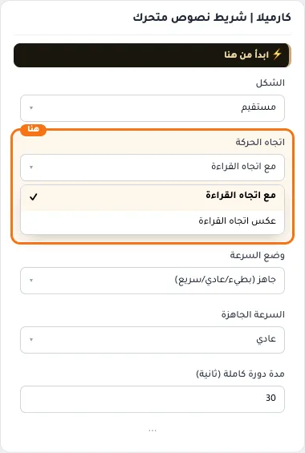
  
- **عكس اتجاه القراءة**
  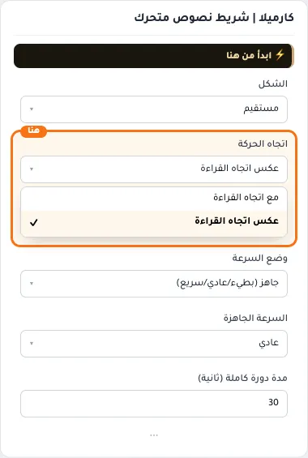

## «وضع السرعة»
قائمة منسدلة · الافتراضي: جاهز (بطيء/عادي/سريع)

**الوظيفة:** هل تبقى السرعة ثابتة أم تتغير مع سرعة التمرير.

- **جاهز (بطيء/عادي/سريع)** — القيمة الافتراضية.
  
  
- **مخصص بالثواني**
  

## «السرعة الجاهزة»
قائمة منسدلة · الافتراضي: عادي

**الوظيفة:** سرعة الحركة: الأبطأ أهدأ للقراءة، والأسرع أكثر حيوية.

**يظهر حين:** «وضع السرعة» = جاهز (بطيء/عادي/سريع)

- **بطيء**
  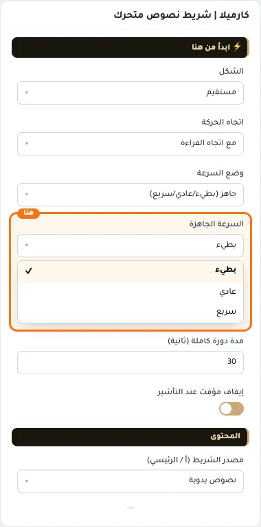
- **عادي** — القيمة الافتراضية.
  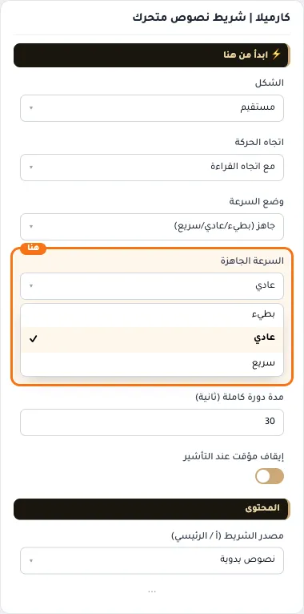
  
- **سريع**
  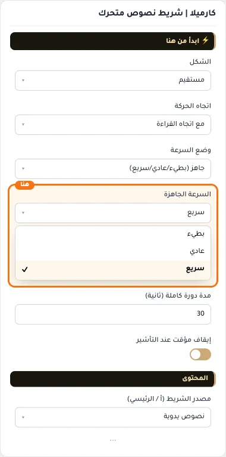

## «مدة دورة كاملة (ثانية)»
رقم · الافتراضي: 30

**الوظيفة:** كلما زاد الرقم أصبح الشريط أبطأ

**يظهر حين:** «وضع السرعة» = مخصص بالثواني

- **مدة دورة كاملة (ثانية)**
  

## «إيقاف مؤقت عند التأشير»
مفتاح · الافتراضي: مفعّل

**الوظيفة:** يوقف الحركة حين يضع الزائر المؤشر عليها ليقرأ.

- **بعد قلب المفتاح**
  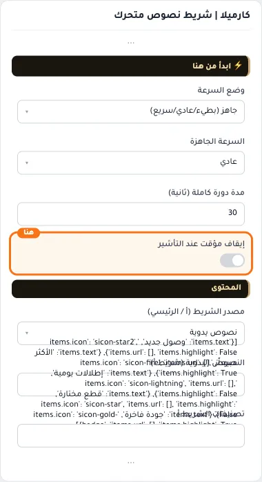

## «مصدر الشريط (أ / الرئيسي)»
قائمة منسدلة · الافتراضي: نصوص يدوية

**الوظيفة:** من أين تأتي نصوص الشريط الرئيسي: نصوص تكتبها، أو التصنيفات، أو التخفيضات.

- **نصوص يدوية** — القيمة الافتراضية.
  
  
- **تصنيفات المتجر**
  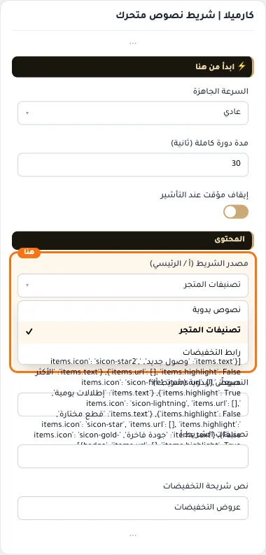
- **رابط التخفيضات**
  

## «النصوص اليدوية (شريط أ)»
عناصر متكررة · الافتراضي: عناصر جاهزة

**الوظيفة:** قائمة العناصر التي يعرضها القسم؛ أضف عنصرًا أو احذفه أو اسحبه لتغيير الترتيب.

**يظهر حين:** «مصدر الشريط (أ / الرئيسي)» = نصوص يدوية

- **النصوص اليدوية (شريط أ)**
  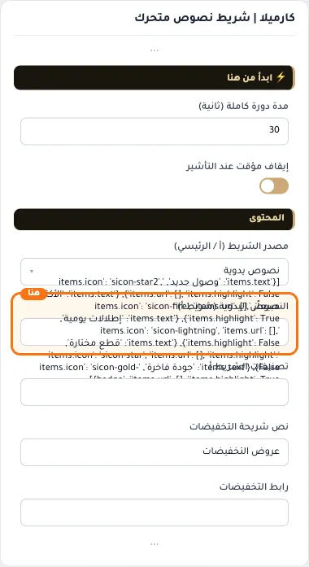

**حقول كل عنصر:**
- «النص» (نص، الافتراضي: فارغ): النص المعروض في العنصر.
- «أيقونة بجانب النص» (أيقونة، الافتراضي: فارغ): اختر من مكتبة أيقونات سلة (sicon-*)
- «رابط (اختياري)» (اختيار من المتجر، الافتراضي: فارغ): اختر منتجاً أو تصنيفاً أو صفحة تعريفية أو ماركة... أو الصق رابطاً خارجياً.
- «تمييز بلون ذهبي» (مفتاح، الافتراضي: مطفأ): يلوّن هذا النص باللون المميز (الذهبي) ليبرز بين النصوص.

## «تصنيفات الشريط أ»
اختيار من المتجر · الافتراضي: فارغ

**الوظيفة:** التصنيفات التي تظهر في القسم، كل تصنيف بصورته واسمه ويفتح صفحته عند الضغط.

**يظهر حين:** «مصدر الشريط (أ / الرئيسي)» = تصنيفات المتجر

- **تصنيفات الشريط أ**
  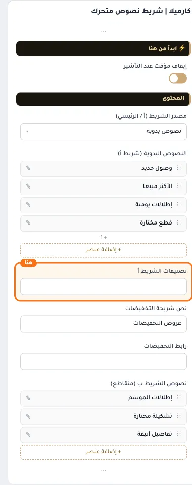

## «نص شريحة التخفيضات»
نص · الافتراضي: عروض التخفيضات

**الوظيفة:** النص المكتوب على شريحة التخفيضات في الشريط.

**يظهر حين:** «مصدر الشريط (أ / الرئيسي)» = رابط التخفيضات

- **نص شريحة التخفيضات**
  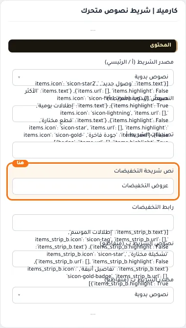

## «رابط التخفيضات»
اختيار من المتجر · الافتراضي: فارغ

**الوظيفة:** الصفحة التي تفتحها شريحة التخفيضات.

**يظهر حين:** «مصدر الشريط (أ / الرئيسي)» = رابط التخفيضات

- **رابط التخفيضات**
  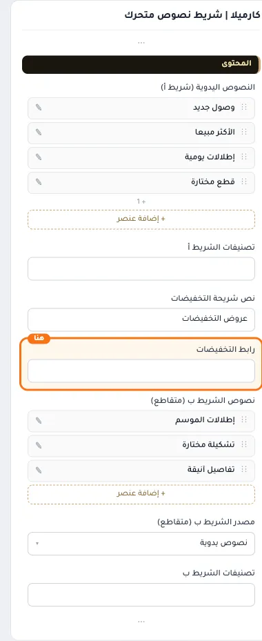

## «نصوص الشريط ب (متقاطع)»
عناصر متكررة · الافتراضي: عناصر جاهزة

**الوظيفة:** نصوص الشريط الثاني المتقاطع.

**يظهر حين:** «الشكل» = crossed

- **نصوص الشريط ب (متقاطع)**
  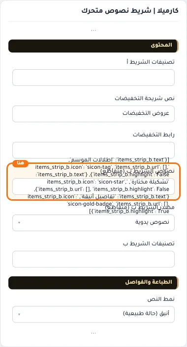

**حقول كل عنصر:**
- «النص» (نص، الافتراضي: فارغ): النص المعروض في العنصر.
- «أيقونة» (أيقونة، الافتراضي: فارغ): الأيقونة التي تظهر بجانب العنصر.
- «رابط» (اختيار من المتجر، الافتراضي: فارغ): اختر منتجاً أو تصنيفاً أو صفحة تعريفية أو ماركة... أو الصق رابطاً خارجياً.
- «تمييز ذهبي» (مفتاح، الافتراضي: مطفأ): يلوّن هذا النص باللون المميز (الذهبي) ليبرز بين النصوص.

## «مصدر الشريط ب (متقاطع)»
قائمة منسدلة · الافتراضي: نصوص يدوية

**الوظيفة:** من أين تأتي نصوص الشريط الثاني المتقاطع.

**يظهر حين:** «الشكل» = crossed

- **نصوص يدوية** — القيمة الافتراضية.
  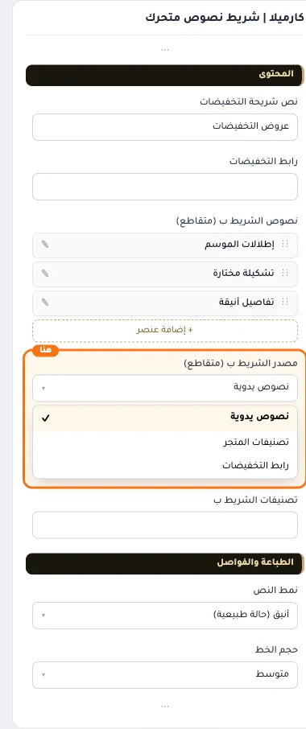
  
- **تصنيفات المتجر**
  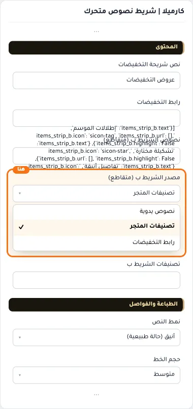
- **رابط التخفيضات**
  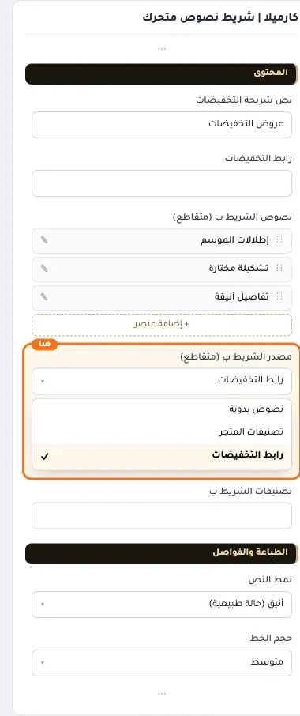

## «تصنيفات الشريط ب»
اختيار من المتجر · الافتراضي: فارغ

**الوظيفة:** التصنيفات التي تظهر في الشريط الثاني.

**يظهر حين:** «الشكل» = crossed و «مصدر الشريط ب (متقاطع)» = تصنيفات المتجر

- **تصنيفات الشريط ب**
  

## «نمط النص»
قائمة منسدلة · الافتراضي: أنيق (حالة طبيعية)

**الوظيفة:** نمط كتابة النص: ممتلئ أو مفرّغ بخط خارجي.

- **كلاسيكي (أحرف كبيرة)**
  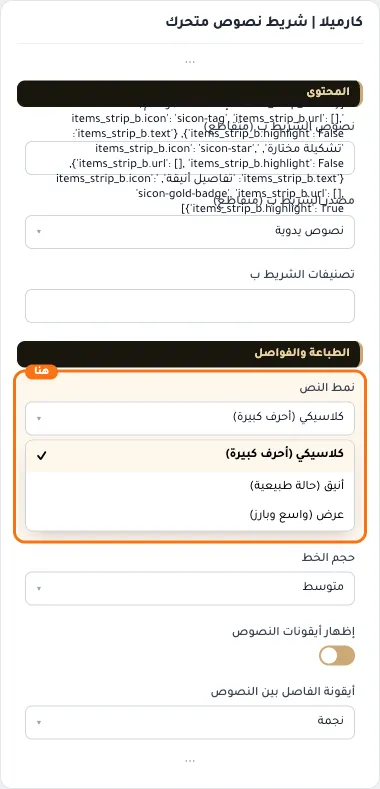
- **أنيق (حالة طبيعية)** — القيمة الافتراضية.
  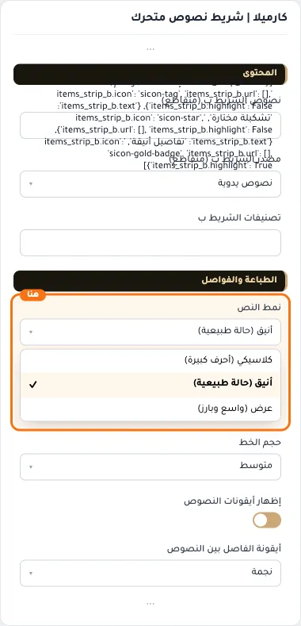
  
- **عرض (واسع وبارز)**
  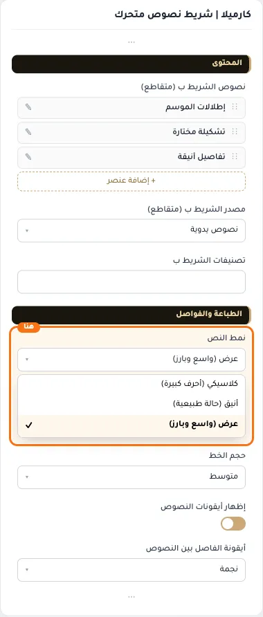

## «حجم الخط»
قائمة منسدلة · الافتراضي: متوسط

**الوظيفة:** حجم خط النص المتحرك.

- **صغير**
  
- **متوسط** — القيمة الافتراضية.
  
  
- **كبير**
  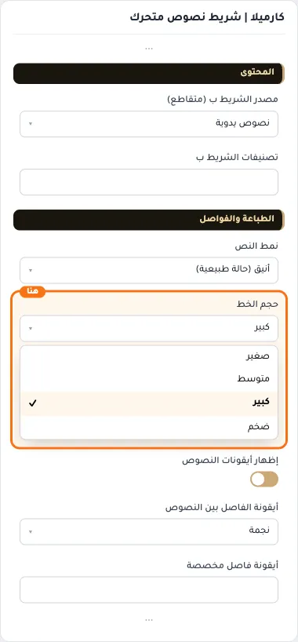
- **ضخم**
  

## «إظهار أيقونات النصوص»
مفتاح · الافتراضي: مفعّل

**الوظيفة:** يظهر أيقونة صغيرة بجانب كل نص.

- **بعد قلب المفتاح**
  

## «أيقونة الفاصل بين النصوص»
قائمة منسدلة · الافتراضي: نجمة

**الوظيفة:** الأيقونة التي تفصل بين النصوص المتتالية.

- **نجمة** — القيمة الافتراضية.
  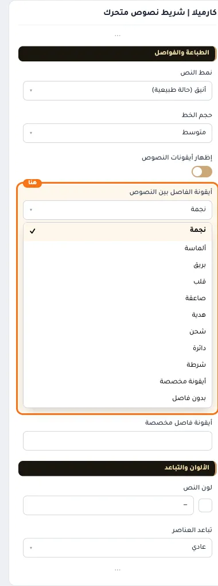
  
- **ألماسة**
  
- **بريق**
  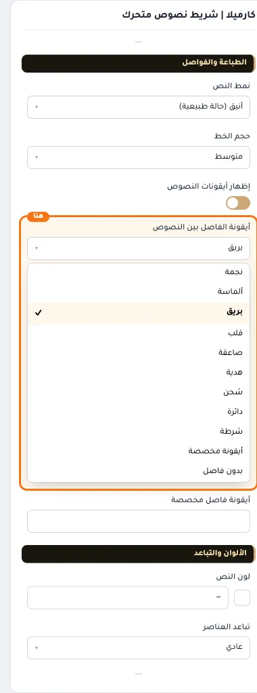
- **قلب**
  
- **صاعقة**
  
- **هدية**
  
- **شحن**
  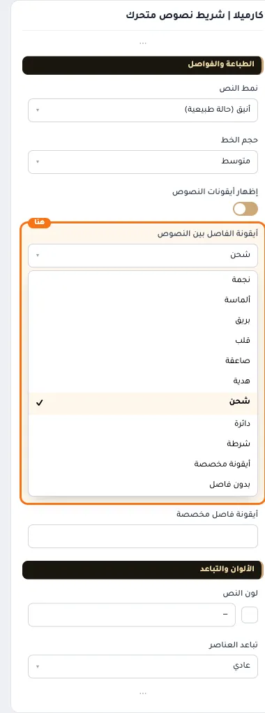
- **دائرة**
  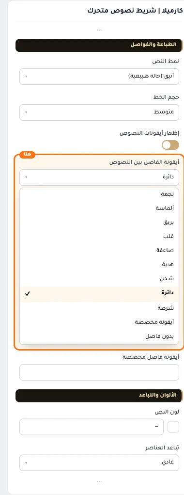
- **شرطة**
  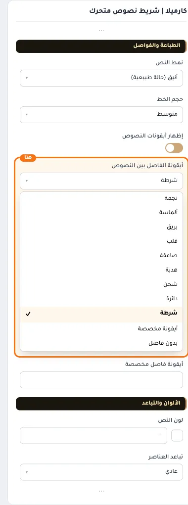
- **أيقونة مخصصة**
  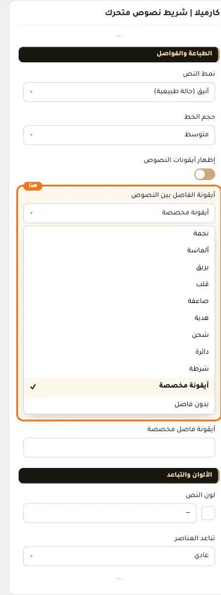
- **بدون فاصل**
  

## «أيقونة فاصل مخصصة»
أيقونة · الافتراضي: فارغ

**الوظيفة:** تُستخدم عند اختيار «أيقونة مخصصة»

**يظهر حين:** «أيقونة الفاصل بين النصوص» = أيقونة مخصصة

- **أيقونة فاصل مخصصة**
  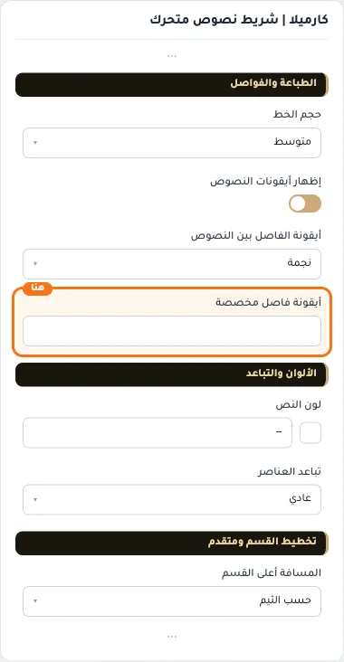

## «لون النص»
لون · الافتراضي: فارغ

**الوظيفة:** لون النص فوق الخلفية أو الصورة.

- **لون النص**
  

## «تباعد العناصر»
قائمة منسدلة · الافتراضي: عادي

**الوظيفة:** المسافة بين العناصر: متقاربة أو متباعدة.

- **مضغوط**
  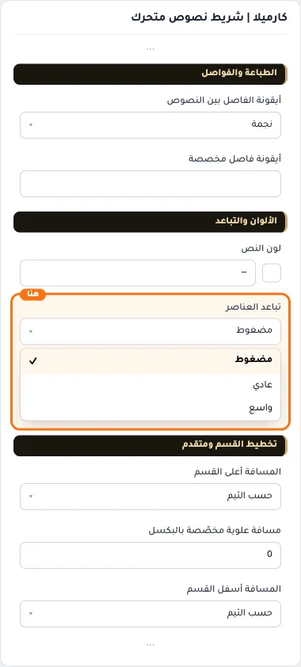
- **عادي** — القيمة الافتراضية.
  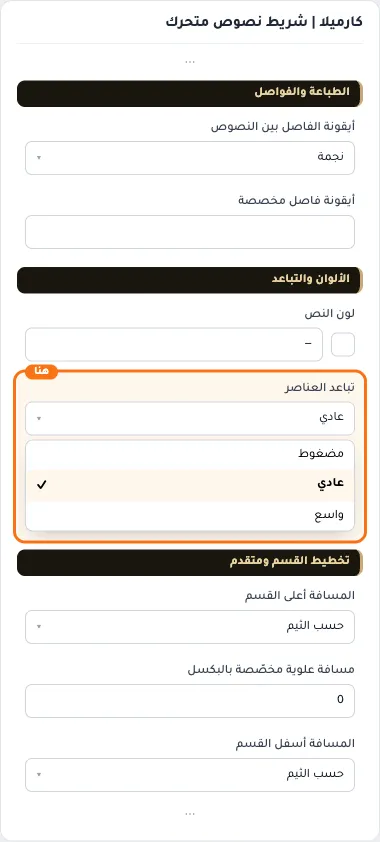
  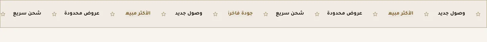
- **واسع**
  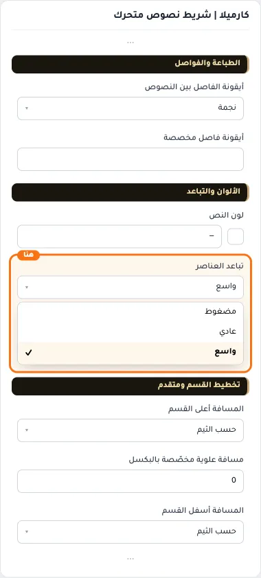

## «مسافة علوية مخصّصة بالبكسل»
رقم · الافتراضي: 0

**الوظيفة:** اختياري. يعمل حين تكون «المسافة أعلى القسم» على «حسب الثيم».

**يظهر حين:** «المسافة أعلى القسم» = حسب الثيم

- **مسافة علوية مخصّصة بالبكسل**
  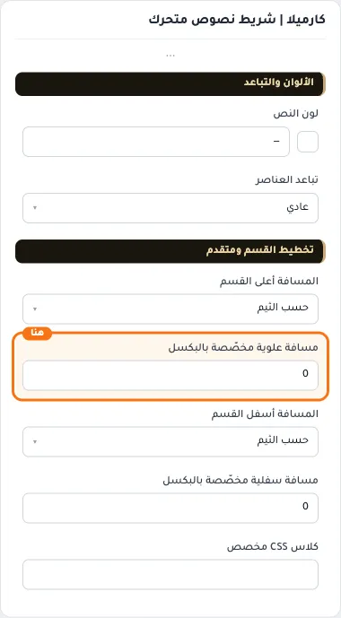

## «مسافة سفلية مخصّصة بالبكسل»
رقم · الافتراضي: 0

**الوظيفة:** اختياري. يعمل حين تكون «المسافة أسفل القسم» على «حسب الثيم».

**يظهر حين:** «المسافة أسفل القسم» = حسب الثيم

- **مسافة سفلية مخصّصة بالبكسل**
  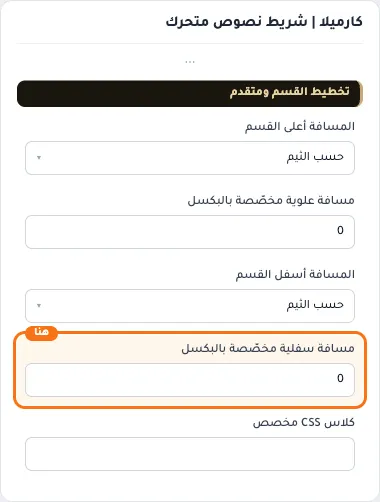

## «كلاس CSS مخصص»
نص · الافتراضي: فارغ

**الوظيفة:** للمصممين. كلاس القسم الثابت: cml-s--marquee

- **كلاس CSS مخصص**
  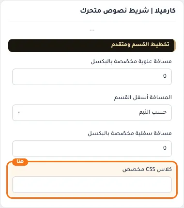
