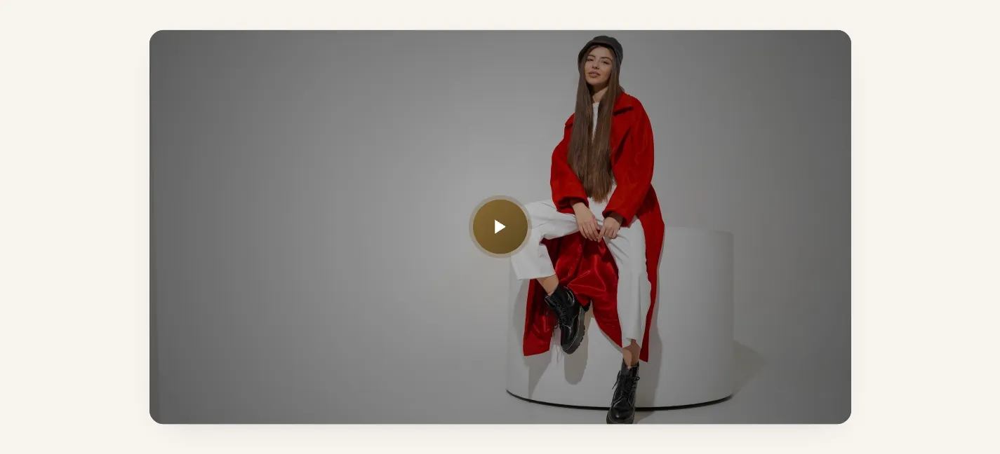
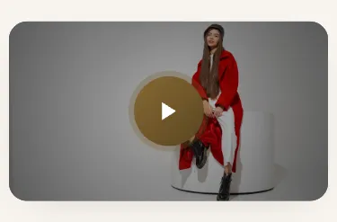
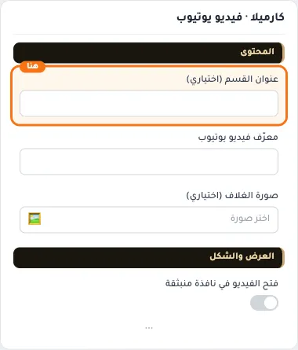
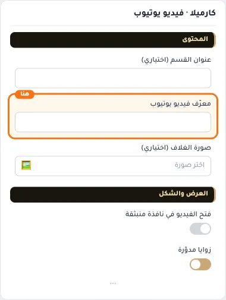
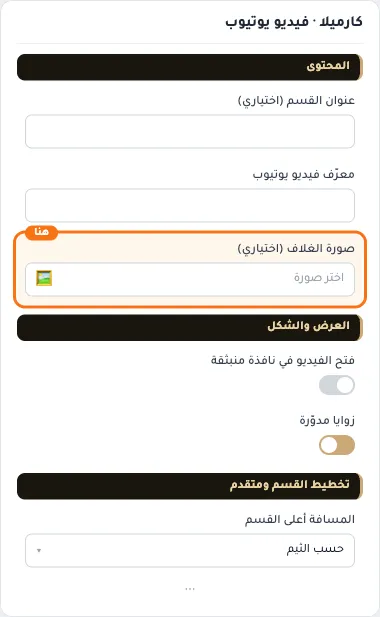
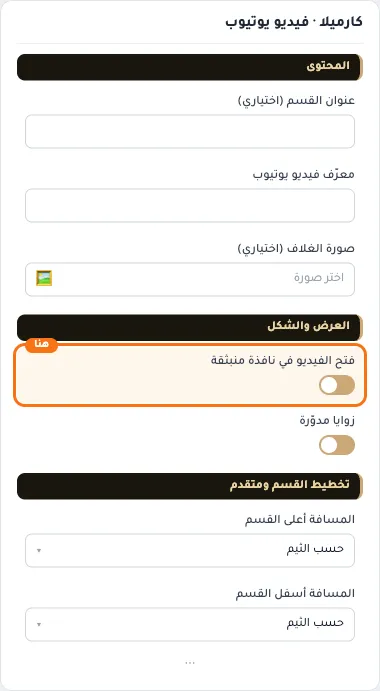
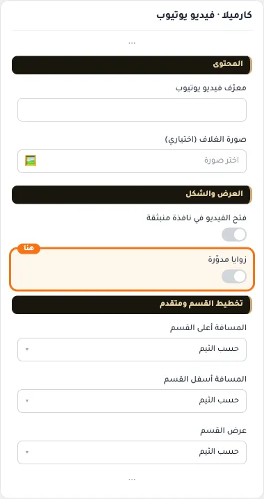
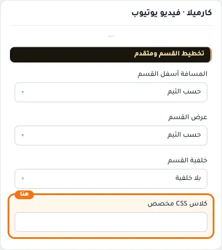

# كارميلا · فيديو يوتيوب

المسافات والعرض والخلفية والحواف: انظر [الخيارات المشتركة](../../01-shared/README.md).

## «عنوان القسم (اختياري)»
نص · الافتراضي: فارغ

**الوظيفة:** يظهر فوق الفيديو عند تعبئته.

- **عنوان القسم (اختياري)**
  

## «معرّف فيديو يوتيوب»
نص · الافتراضي: فارغ

**الوظيفة:** الجزء الأخير من رابط يوتيوب: youtube.com/watch?v=XXXXXXX

- **معرّف فيديو يوتيوب**
  

## «صورة الغلاف (اختياري)»
صورة · الافتراضي: فارغ

**الوظيفة:** تظهر صورة غلاف مع زر تشغيل بدل تحميل الفيديو مباشرة. اتركها فارغة لعرض الفيديو مباشرة.

- **صورة الغلاف (اختياري)**
  

## «فتح الفيديو في نافذة منبثقة»
مفتاح · الافتراضي: مطفأ

**الوظيفة:** عند التفعيل يفتح الفيديو في نافذة منبثقة فوق الصفحة مع زر إغلاق. عند الإيقاف يعمل الفيديو داخل الإطار.

- **بعد قلب المفتاح**
  

## «زوايا مدوّرة»
مفتاح · الافتراضي: مفعّل

**الوظيفة:** مدوّرة بقطر الثيم افتراضيًّا؛ إطفاؤه يجعل إطار الفيديو حاد الزوايا.

- **بعد قلب المفتاح**
  

## «كلاس CSS مخصص»
نص · الافتراضي: فارغ

**الوظيفة:** للمصممين. كلاس القسم الثابت: cml-s--youtube

- **كلاس CSS مخصص**
  
