# كارميلا · مميزات المتجر

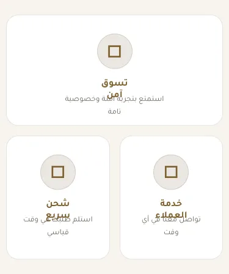

المسافات والعرض والخلفية والحواف: انظر [الخيارات المشتركة](../../01-shared/README.md).

## «عنوان القسم (اختياري)»
نص · الافتراضي: فارغ

**الوظيفة:** يظهر فوق شبكة المميزات عند تعبئته.

- **عنوان القسم (اختياري)**
  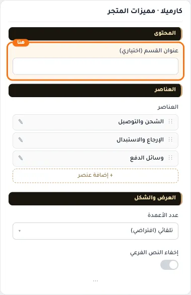

## «items»
عناصر متكررة · الافتراضي: عناصر جاهزة

**الوظيفة:** قائمة العناصر التي يعرضها القسم؛ أضف عنصرًا أو احذفه أو اسحبه لتغيير الترتيب.

- **items**
  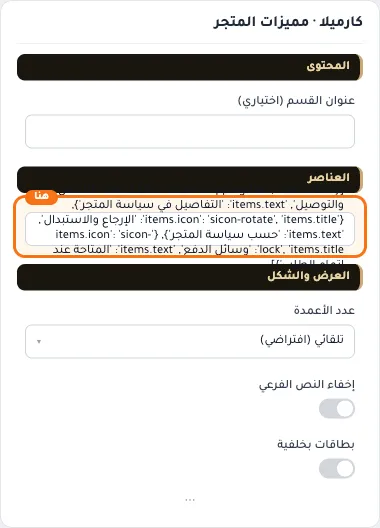

**حقول كل عنصر:**
- «الأيقونة» (أيقونة، الافتراضي: sicon-store2): الأيقونة التي تظهر بجانب العنصر.
- «العنوان» (نص، الافتراضي: فارغ): العنوان الرئيسي الذي يظهر أعلى القسم. اتركه فارغًا لإخفائه.
- «النص التوضيحي» (نص، الافتراضي: فارغ): النص المعروض في العنصر.

## «عدد الأعمدة»
قائمة منسدلة · الافتراضي: تلقائي (افتراضي)

**الوظيفة:** تلقائي = عمودان للجوال وثلاثة لسطح المكتب.

- **تلقائي (افتراضي)** — القيمة الافتراضية.
  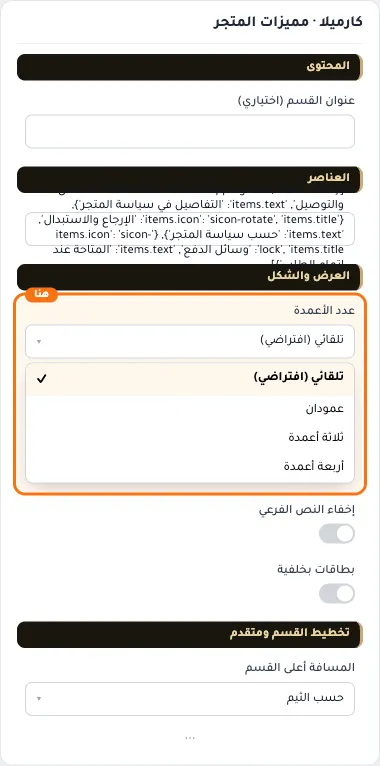
  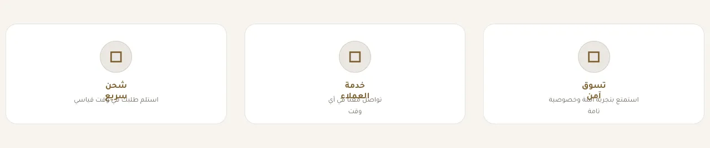
- **عمودان**
  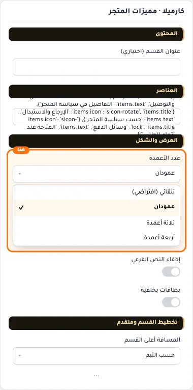
- **ثلاثة أعمدة**
  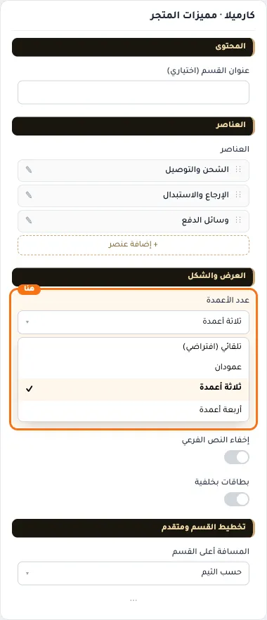
- **أربعة أعمدة**
  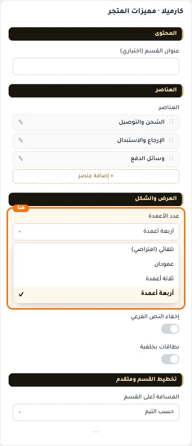

## «إخفاء النص الفرعي»
مفتاح · الافتراضي: مطفأ

**الوظيفة:** يعرض الأيقونة وعنوان الميزة فقط.

- **بعد قلب المفتاح**
  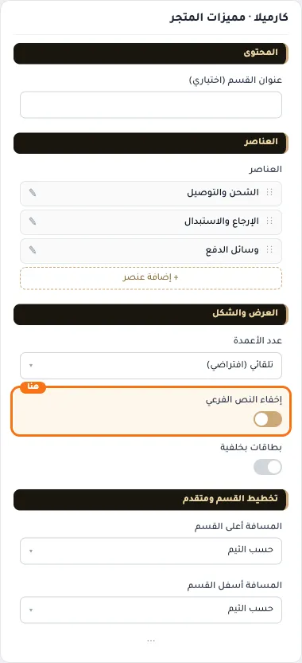

## «بطاقات بخلفية»
مفتاح · الافتراضي: مطفأ

**الوظيفة:** كل ميزة داخل بطاقة بحدود وزوايا مدوّرة.

- **بعد قلب المفتاح**
  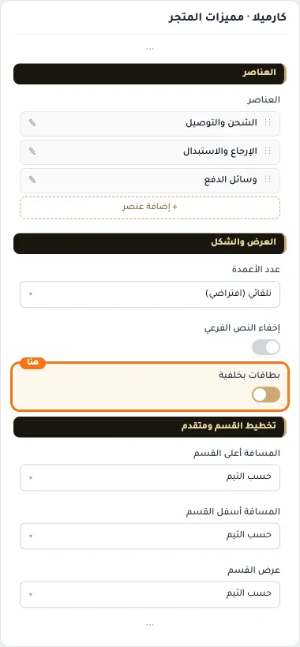

## «كلاس CSS مخصص»
نص · الافتراضي: فارغ

**الوظيفة:** للمصممين. كلاس القسم الثابت: cml-s--store-features

- **كلاس CSS مخصص**
  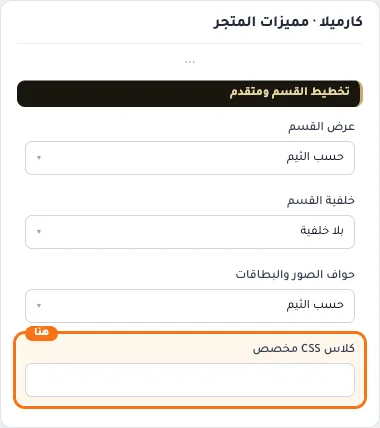
