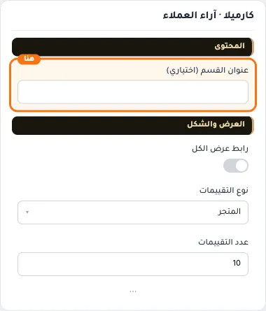
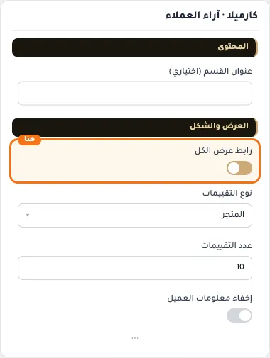
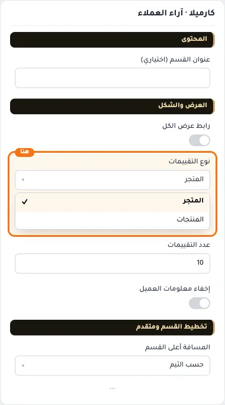
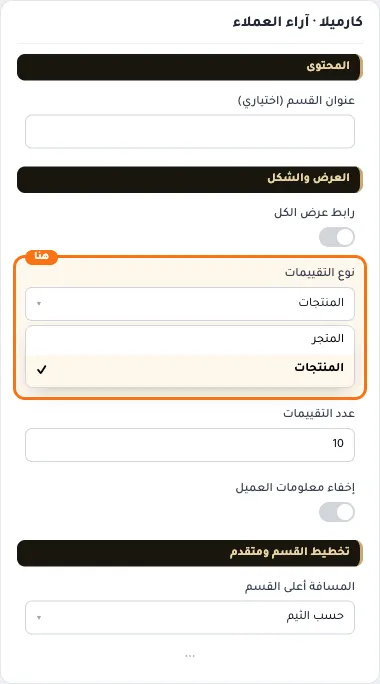
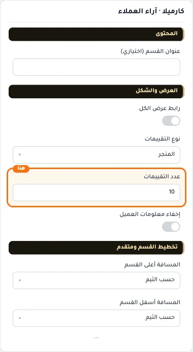
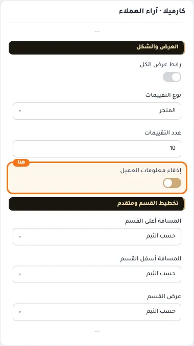
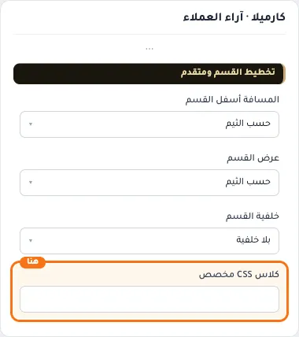

# كارميلا · آراء العملاء

المسافات والعرض والخلفية والحواف: انظر [الخيارات المشتركة](../../01-shared/README.md).

## «عنوان القسم (اختياري)»
نص · الافتراضي: فارغ

**الوظيفة:** يظهر فوق التقييمات عند تعبئته.

- **عنوان القسم (اختياري)**
  

## «رابط عرض الكل»
مفتاح · الافتراضي: مطفأ

**الوظيفة:** إظهار رابط الانتقال لكل التقييمات.

- **بعد قلب المفتاح**
  

## «نوع التقييمات»
قائمة منسدلة · الافتراضي: المتجر

**الوظيفة:** نوع التقييمات المعروضة: تقييمات المتجر أو تقييمات المنتجات.

- **المتجر** — القيمة الافتراضية.
  
- **المنتجات**
  

## «عدد التقييمات»
نص · الافتراضي: 10

**الوظيفة:** أقصى عدد من العناصر يُعرض في القسم.

- **عدد التقييمات**
  

## «إخفاء معلومات العميل»
مفتاح · الافتراضي: مطفأ

**الوظيفة:** يخفي اسم العميل وصورته ويبقي نص التقييم.

- **بعد قلب المفتاح**
  

## «كلاس CSS مخصص»
نص · الافتراضي: فارغ

**الوظيفة:** للمصممين. كلاس القسم الثابت: cml-s--testimonials

- **كلاس CSS مخصص**
  
