# كارميلا · أحدث المنتجات

المسافات والعرض والخلفية والحواف: انظر [الخيارات المشتركة](../../01-shared/README.md).

## «العنوان»
نص · الافتراضي: وصل حديثاً

**الوظيفة:** العنوان الرئيسي الذي يظهر أعلى القسم. اتركه فارغًا لإخفائه.

- **العنوان**
  

## «وصف فرعي تحت العنوان (اختياري)»
نص · الافتراضي: أحدث ما أضفناه إلى المتجر

**الوظيفة:** سطر قصير تحت العنوان يشرح محتوى القسم. اختياري؛ يختفي إن تُرك فارغًا.

- **وصف فرعي تحت العنوان (اختياري)**
  

## «رابط زر «عرض الكل» (اختياري)»
اختيار من المتجر · الافتراضي: فارغ

**الوظيفة:** وجهة زر «عرض الكل» أعلى القسم؛ اتركه فارغًا لإخفاء الزر.

- **رابط زر «عرض الكل» (اختياري)**
  

## «وضع العرض»
قائمة منسدلة · الافتراضي: أحدث المنتجات

**الوظيفة:** طريقة عرض المحتوى في القسم.

- **أحدث المنتجات** — القيمة الافتراضية.
  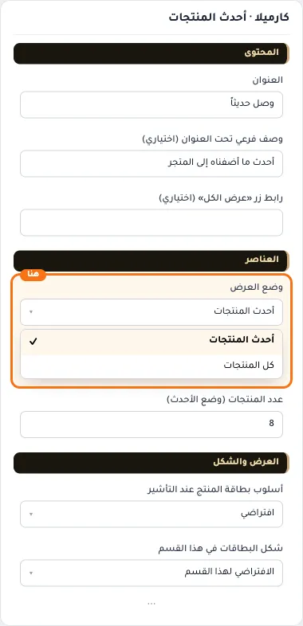
- **كل المنتجات**
  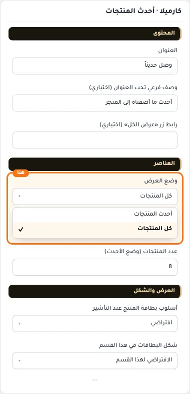

## «عدد المنتجات (وضع الأحدث)»
نص · الافتراضي: 8

**الوظيفة:** أقصى عدد من العناصر يُعرض في القسم.

- **عدد المنتجات (وضع الأحدث)**
  

## «أسلوب بطاقة المنتج عند التأشير»
قائمة منسدلة · الافتراضي: افتراضي

**الوظيفة:** يحدد مكان زر الإضافة: «افتراضي» زر ثابت أسفل البطاقة، و«شريط أدوات أفقي» أو «إضافة سريعة» يظهر الزر فوق الصورة عند التأشير بدل الزر الثابت.

- **افتراضي** — القيمة الافتراضية.
  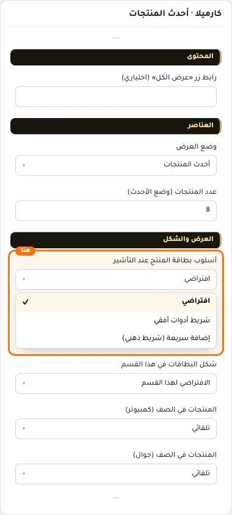
- **شريط أدوات أفقي**
  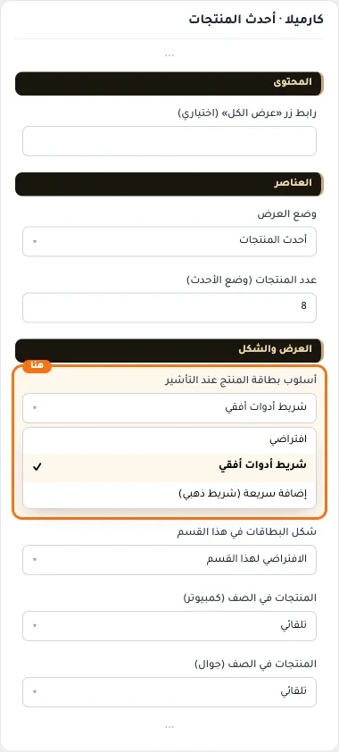
- **إضافة سريعة (شريط ذهبي)**
  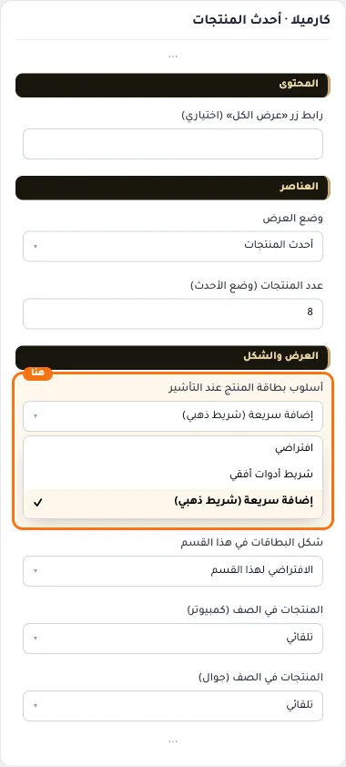

## «شكل البطاقات في هذا القسم»
قائمة منسدلة · الافتراضي: الافتراضي لهذا القسم

**الوظيفة:** الشكل يحدد مظهر البطاقة، و«أسلوب البطاقة عند التأشير» يحدد مكان زر الإضافة. يعملان معًا في كل التركيبات.

- **الافتراضي لهذا القسم** — القيمة الافتراضية.
  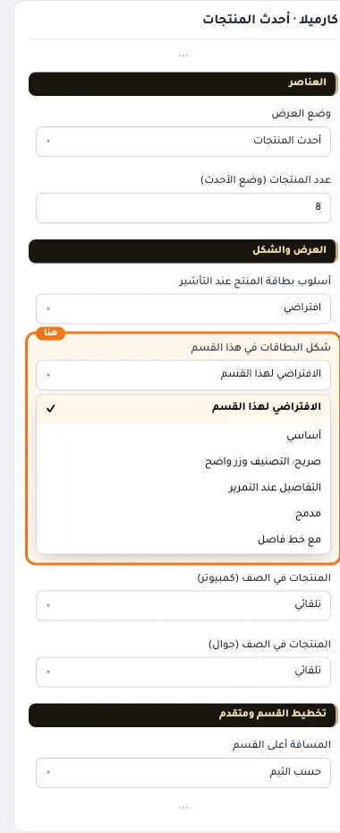
- **أساسي**
  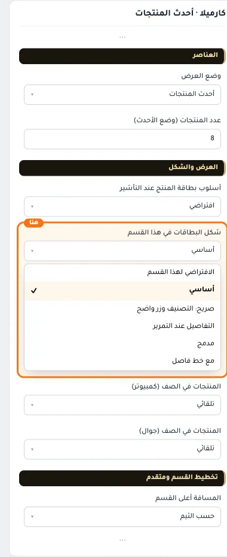
- **صريح: التصنيف وزر واضح**
  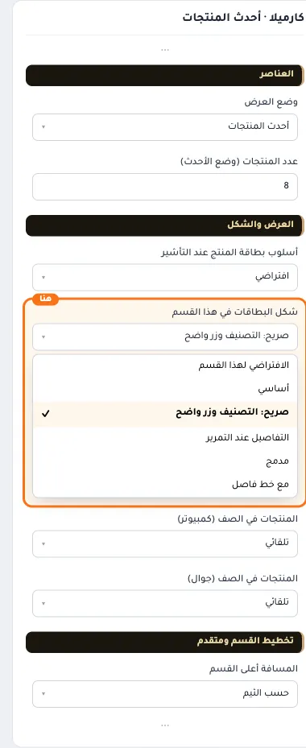
- **التفاصيل عند التمرير**
  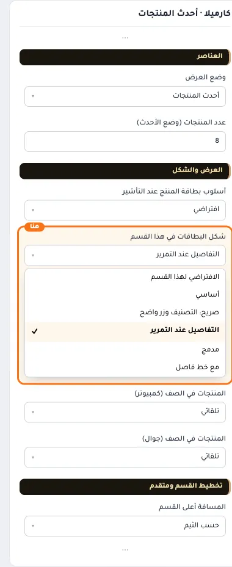
- **مدمج**
  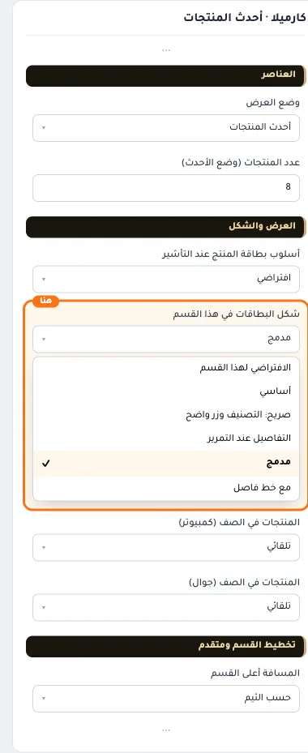
- **مع خط فاصل**
  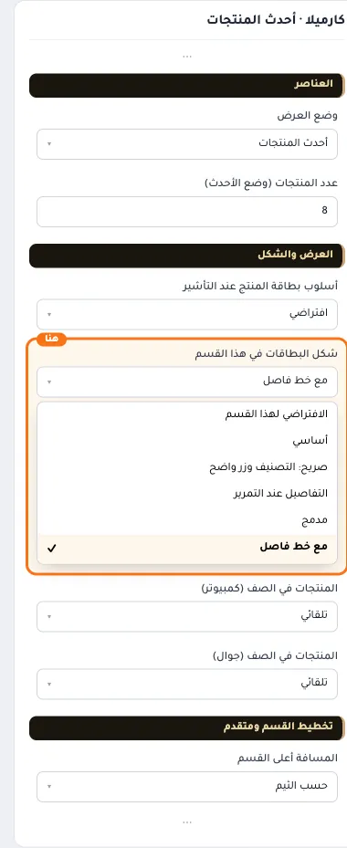

## «المنتجات في الصف (كمبيوتر)»
قائمة منسدلة · الافتراضي: تلقائي

**الوظيفة:** في الشبكة، وفي السلايدر عدد المنتجات الظاهرة معًا.

- **تلقائي** — القيمة الافتراضية.
  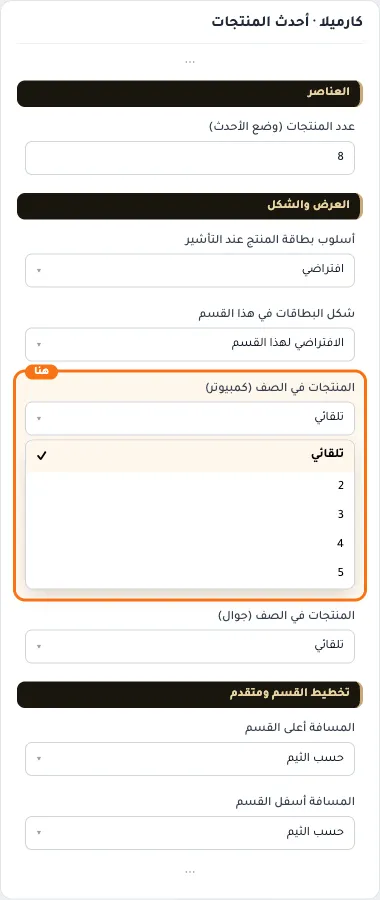
- **2**
  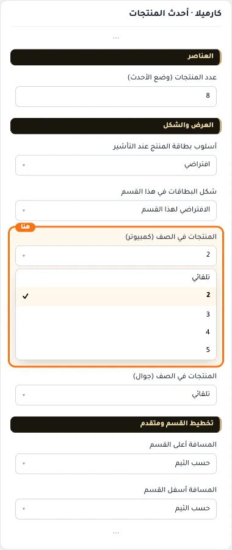
- **3**
  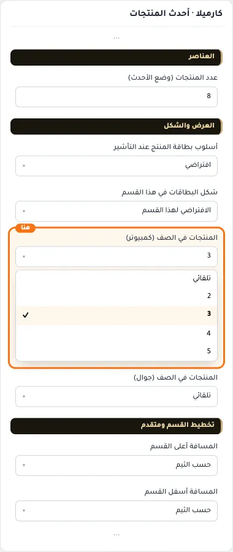
- **4**
  
- **5**
  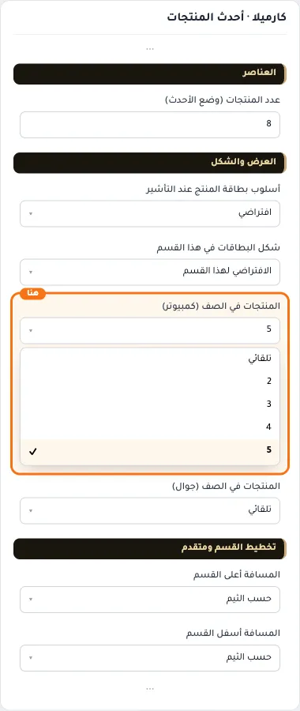

## «المنتجات في الصف (جوال)»
قائمة منسدلة · الافتراضي: تلقائي

**الوظيفة:** في الشبكة، وفي السلايدر عدد المنتجات الظاهرة معًا.

- **تلقائي** — القيمة الافتراضية.
  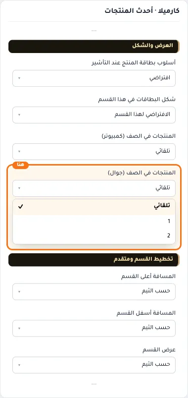
- **1**
  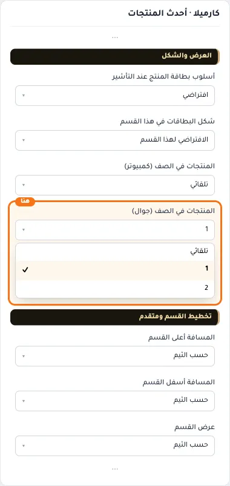
- **2**
  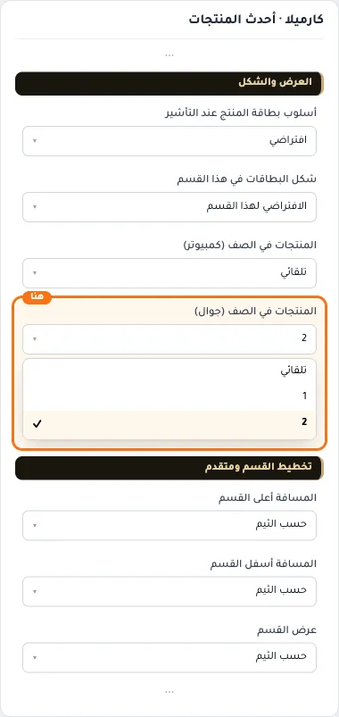

## «كلاس CSS مخصص»
نص · الافتراضي: فارغ

**الوظيفة:** للمصممين. كلاس القسم الثابت: cml-s--latest-products

- **كلاس CSS مخصص**
  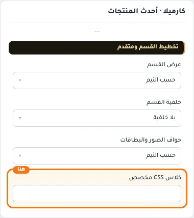
