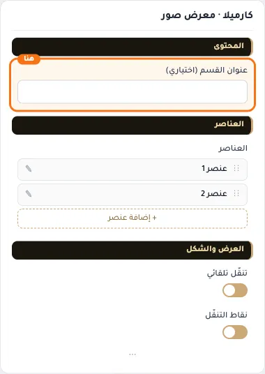
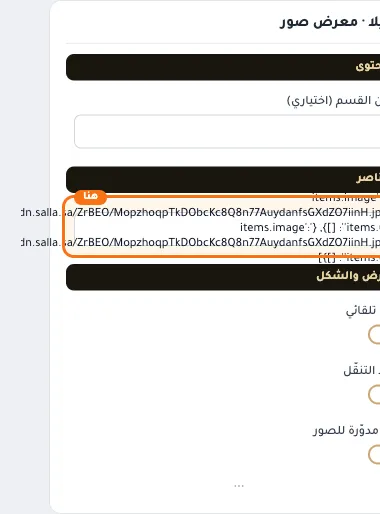
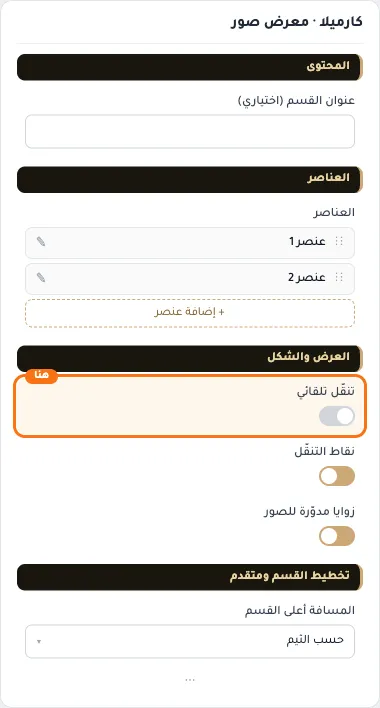
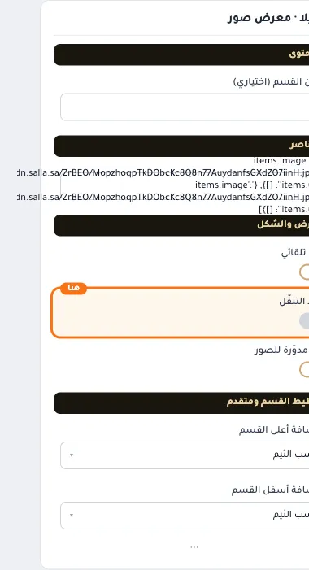
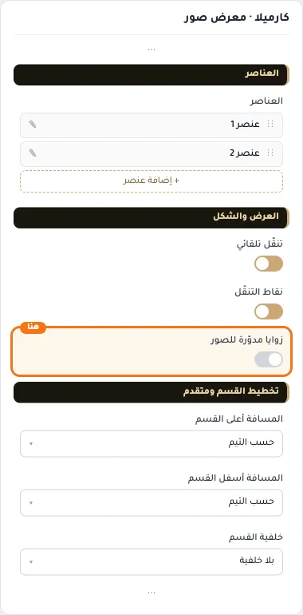
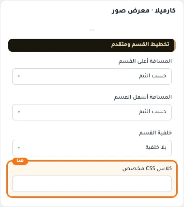

# كارميلا · معرض صور

المسافات والعرض والخلفية والحواف: انظر [الخيارات المشتركة](../../01-shared/README.md).

## «عنوان القسم (اختياري)»
نص · الافتراضي: فارغ

**الوظيفة:** يظهر فوق معرض الصور عند تعبئته.

- **عنوان القسم (اختياري)**
  

## «items»
عناصر متكررة · الافتراضي: عناصر جاهزة

**الوظيفة:** قائمة العناصر التي يعرضها القسم؛ أضف عنصرًا أو احذفه أو اسحبه لتغيير الترتيب.

- **items**
  

**حقول كل عنصر:**
- «الصورة» (صورة، الافتراضي: فارغ): الصورة المعروضة في هذا العنصر.
- «الرابط» (اختيار من المتجر، الافتراضي: فارغ): الصفحة التي يفتحها الضغط على الزر أو العنصر.

## «تنقّل تلقائي»
مفتاح · الافتراضي: مفعّل

**الوظيفة:** التمرير الآلي بين الصور.

- **بعد قلب المفتاح**
  

## «نقاط التنقّل»
مفتاح · الافتراضي: مفعّل

**الوظيفة:** إظهار مؤشرات الشرائح أسفل المعرض.

- **بعد قلب المفتاح**
  

## «زوايا مدوّرة للصور»
مفتاح · الافتراضي: مفعّل

**الوظيفة:** إطفاؤه يجعل الصور بزوايا حادة.

- **بعد قلب المفتاح**
  

## «كلاس CSS مخصص»
نص · الافتراضي: فارغ

**الوظيفة:** للمصممين. كلاس القسم الثابت: cml-s--photos-slider

- **كلاس CSS مخصص**
  
