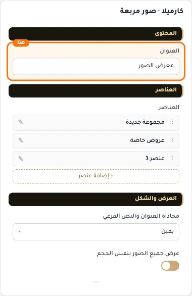
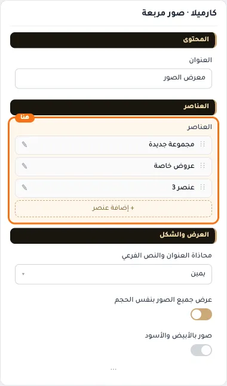
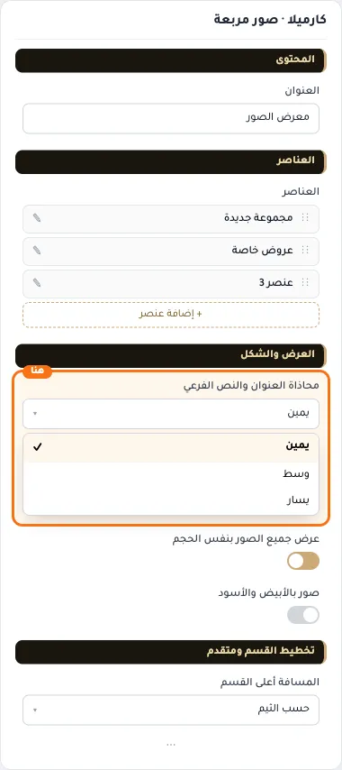
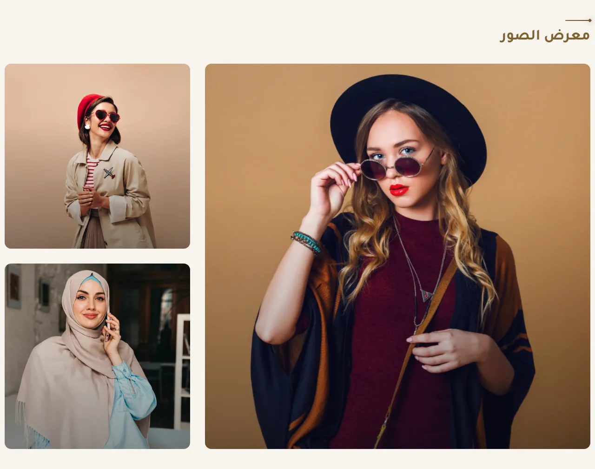
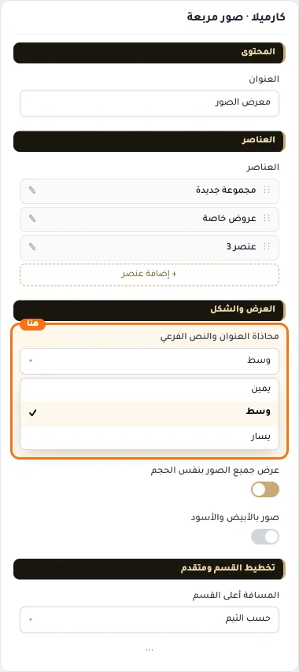
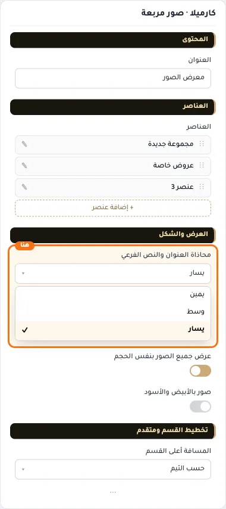
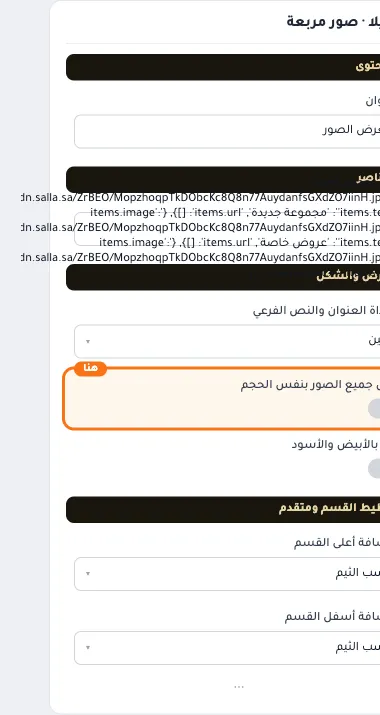
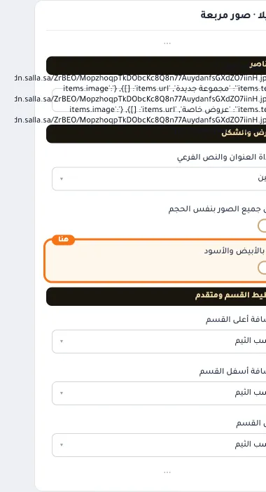
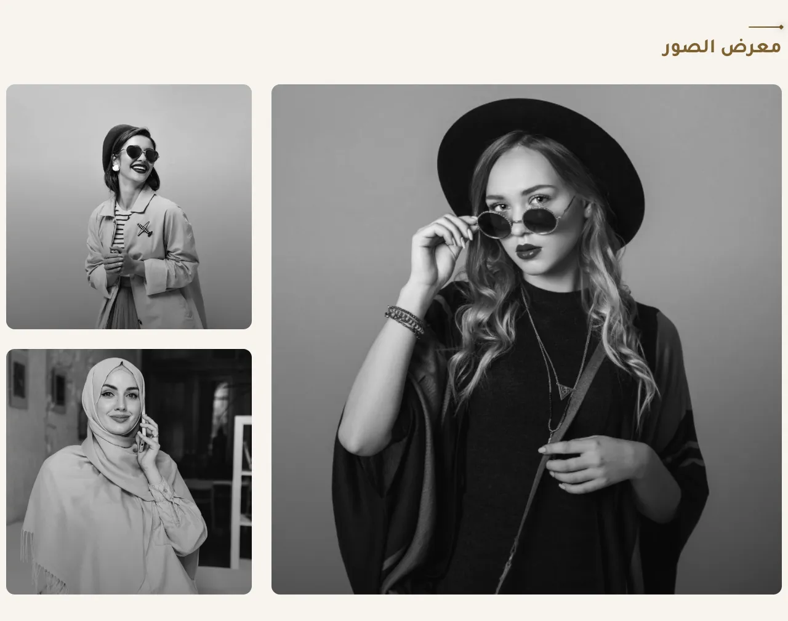
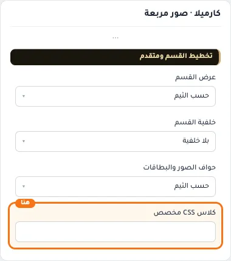

# كارميلا · صور مربعة

المسافات والعرض والخلفية والحواف: انظر [الخيارات المشتركة](../../01-shared/README.md).

## «العنوان»
نص · الافتراضي: معرض الصور

**الوظيفة:** العنوان الرئيسي الذي يظهر أعلى القسم. اتركه فارغًا لإخفائه.

- **العنوان**
  

## «العناصر»
عناصر متكررة · الافتراضي: عناصر جاهزة

**الوظيفة:** قائمة العناصر التي يعرضها القسم؛ أضف عنصرًا أو احذفه أو اسحبه لتغيير الترتيب.

- **العناصر**
  

**حقول كل عنصر:**
- «الصورة» (صورة، الافتراضي: فارغ): الصورة المعروضة في هذا العنصر.
- «نص على الصورة» (نص، الافتراضي: فارغ): النص المعروض في العنصر.
- «الرابط» (اختيار من المتجر، الافتراضي: فارغ): الصفحة التي يفتحها الضغط على الزر أو العنصر.

## «محاذاة العنوان والنص الفرعي»
قائمة منسدلة · الافتراضي: يمين

**الوظيفة:** محاذاة العنوان الرئيسي والفرعي داخل القسم (الافتراضي: يمين).

- **يمين** — القيمة الافتراضية.
  
  
- **وسط**
  
- **يسار**
  

## «عرض جميع الصور بنفس الحجم»
مفتاح · الافتراضي: مفعّل

**الوظيفة:** عند الإيقاف وكان عدد الصور ٣ أو ٥، تظهر الصورة الأولى كبيرة (موزاييك) والباقي حولها. الأعداد الأخرى متساوية دائمًا: صورتان أو أربع في عمودين، والباقي في ثلاثة أعمدة.

- **بعد قلب المفتاح**
  

## «صور بالأبيض والأسود»
مفتاح · الافتراضي: مطفأ

**الوظيفة:** تتلوّن عند مرور الماوس، وتبقى ملوّنة على الجوال.

- **بعد قلب المفتاح**
  
  

## «كلاس CSS مخصص»
نص · الافتراضي: فارغ

**الوظيفة:** للمصممين. كلاس القسم الثابت: cml-s--square-photos

- **كلاس CSS مخصص**
  
