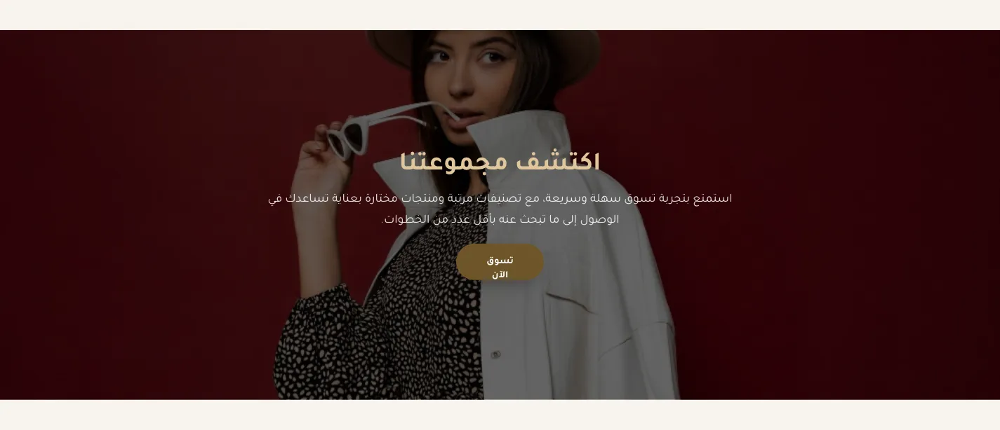
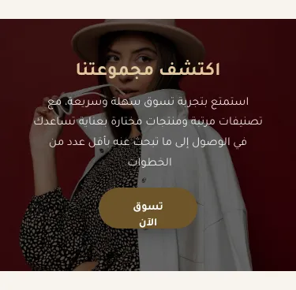
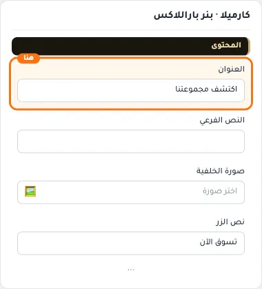
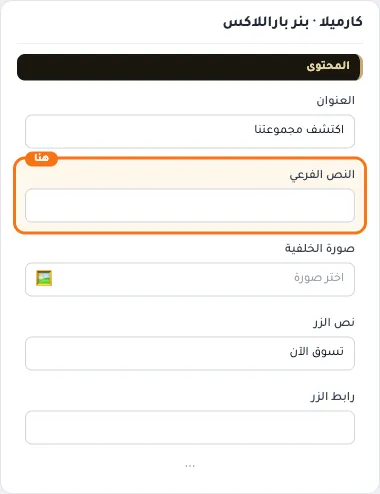
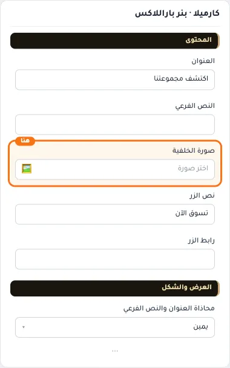
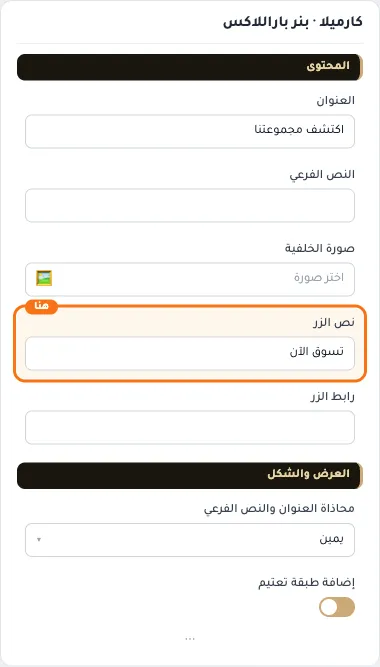
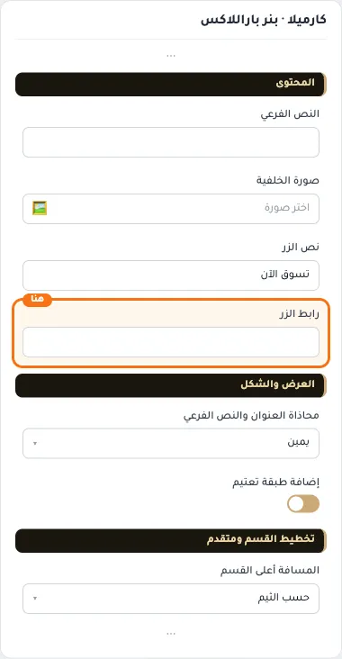
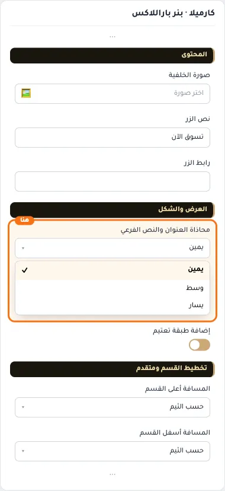
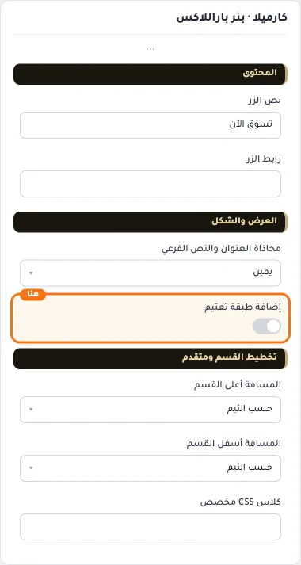
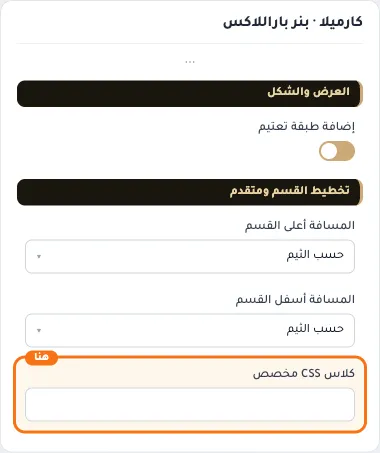

# كارميلا · بنر باراللاكس

المسافات والعرض والخلفية والحواف: انظر [الخيارات المشتركة](../../01-shared/README.md).

## «العنوان»
نص · الافتراضي: اكتشف مجموعتنا

**الوظيفة:** العنوان الرئيسي الذي يظهر أعلى القسم. اتركه فارغًا لإخفائه.

- **العنوان**
  

## «النص الفرعي»
نص طويل · الافتراضي: فارغ

**الوظيفة:** سطر وصفي قصير تحت العنوان. اتركه فارغًا لإخفائه.

- **النص الفرعي**
  

## «صورة الخلفية»
صورة · الافتراضي: https://cdn.salla.sa/ZrBEO/MopzhoqpTkDObcKc8Q8n77AuydanfsGXdZO7iinH.jpg

**الوظيفة:** الصورة المعروضة في هذا العنصر.

- **صورة الخلفية**
  

## «نص الزر»
نص · الافتراضي: تسوق الآن

**الوظيفة:** النص المكتوب على الزر.

- **نص الزر**
  

## «رابط الزر»
اختيار من المتجر · الافتراضي: فارغ

**الوظيفة:** الصفحة التي يفتحها الضغط على الزر أو العنصر.

- **رابط الزر**
  

## «محاذاة العنوان والنص الفرعي»
قائمة منسدلة · الافتراضي: يمين

**الوظيفة:** محاذاة العنوان والنص الفرعي والزر داخل البانر (الافتراضي: يمين).

- **يمين** — القيمة الافتراضية.
  
  
- **وسط**
  
- **يسار**
  

## «إضافة طبقة تعتيم»
مفتاح · الافتراضي: مفعّل

**الوظيفة:** يضع طبقة داكنة فوق الصورة ليتضح النص فوقها.

- **بعد قلب المفتاح**
  

## «كلاس CSS مخصص»
نص · الافتراضي: فارغ

**الوظيفة:** للمصممين. كلاس القسم الثابت: cml-s--parallax-background

- **كلاس CSS مخصص**
  
