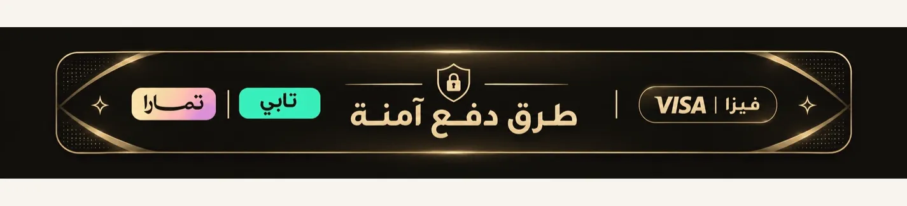
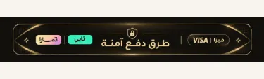
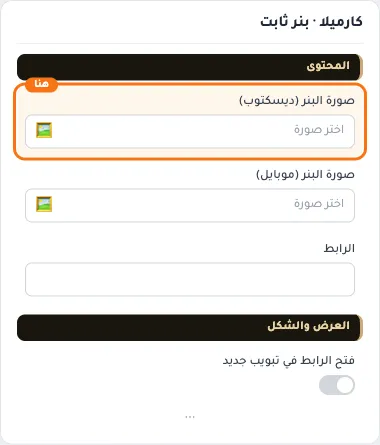
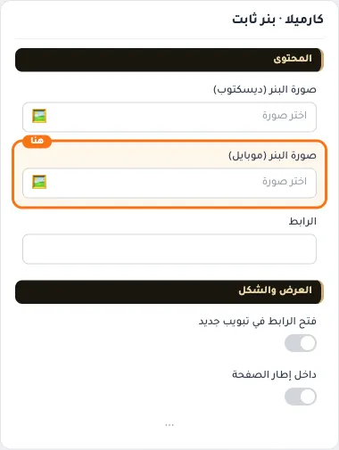
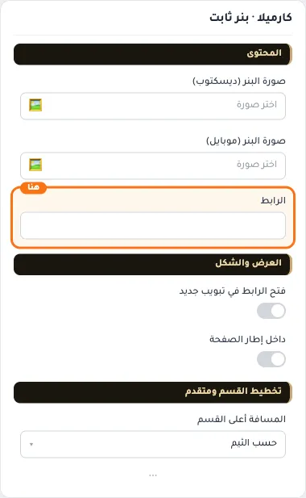
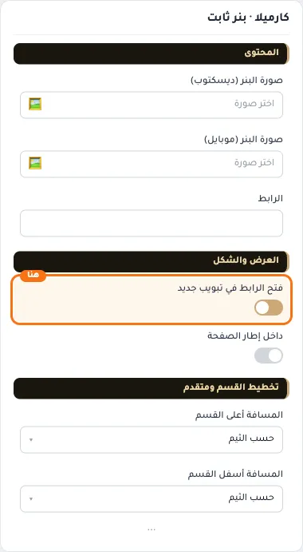
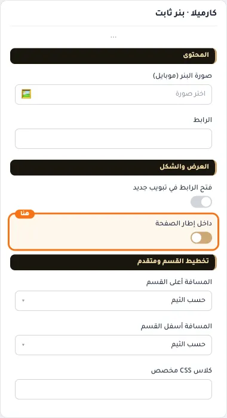
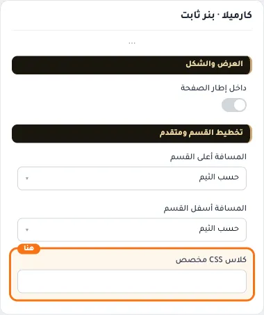

# كارميلا · بنر ثابت

المسافات والعرض والخلفية والحواف: انظر [الخيارات المشتركة](../../01-shared/README.md).

## «صورة البنر (ديسكتوب)»
صورة · الافتراضي: https://cdn.salla.sa/ZrBEO/MopzhoqpTkDObcKc8Q8n77AuydanfsGXdZO7iinH.jpg

**الوظيفة:** المقاس الموصى به: 1200×300

- **صورة البنر (ديسكتوب)**
  

## «صورة البنر (موبايل)»
صورة · الافتراضي: https://cdn.salla.sa/ZrBEO/MopzhoqpTkDObcKc8Q8n77AuydanfsGXdZO7iinH.jpg

**الوظيفة:** صورة بديلة تظهر على الجوال بدل صورة الكمبيوتر، بأبعاد طولية تناسب الشاشة الصغيرة.

- **صورة البنر (موبايل)**
  

## «الرابط»
اختيار من المتجر · الافتراضي: فارغ

**الوظيفة:** الصفحة التي يفتحها الضغط على الزر أو العنصر.

- **الرابط**
  

## «فتح الرابط في تبويب جديد»
مفتاح · الافتراضي: مطفأ

**الوظيفة:** مناسب للحملات والروابط الخارجية.

- **بعد قلب المفتاح**
  

## «داخل إطار الصفحة»
مفتاح · الافتراضي: مطفأ

**الوظيفة:** عرض البنر بعرض المحتوى وزوايا مدوّرة بدل العرض الكامل.

- **بعد قلب المفتاح**
  

## «كلاس CSS مخصص»
نص · الافتراضي: فارغ

**الوظيفة:** للمصممين. كلاس القسم الثابت: cml-s--fixed-banner

- **كلاس CSS مخصص**
  
