# كارميلا · بانر إعلاني / خصم

المسافات والعرض والخلفية والحواف: انظر [الخيارات المشتركة](../../01-shared/README.md).

## «عنوان مختصر (اختياري)»
نص · الافتراضي: فارغ

**الوظيفة:** العنوان الرئيسي الذي يظهر أعلى القسم. اتركه فارغًا لإخفائه.

- **عنوان مختصر (اختياري)**
  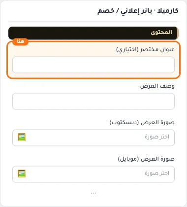

## «وصف العرض»
نص طويل · الافتراضي: فارغ

**الوظيفة:** سطر وصفي إضافي يظهر أسفل العنوان.

- **وصف العرض**
  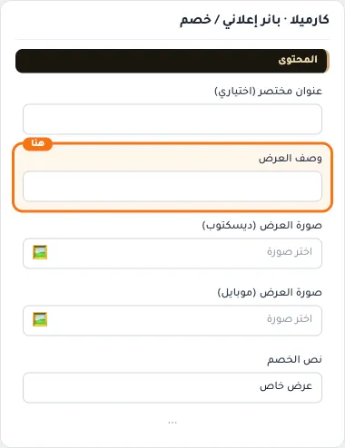

## «صورة العرض (ديسكتوب)»
صورة · الافتراضي: https://cdn.salla.sa/ZrBEO/MopzhoqpTkDObcKc8Q8n77AuydanfsGXdZO7iinH.jpg

**الوظيفة:** المقاس الموصى به: 1200×500 — تظهر كصورة البانر/النافذة

- **صورة العرض (ديسكتوب)**
  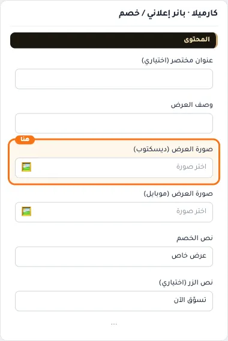

## «صورة العرض (موبايل)»
صورة · الافتراضي: فارغ

**الوظيفة:** صورة بديلة تظهر على الجوال بدل صورة الكمبيوتر، بأبعاد طولية تناسب الشاشة الصغيرة.

- **صورة العرض (موبايل)**
  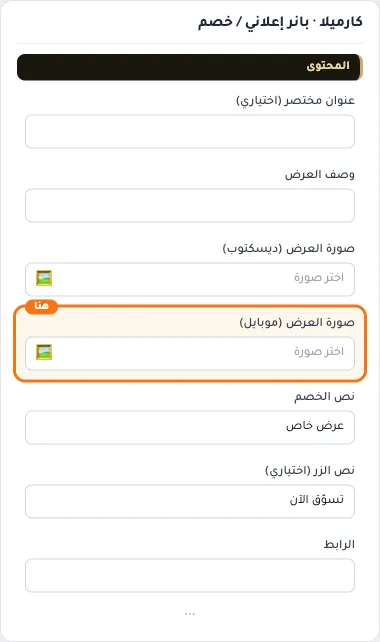

## «نص الخصم»
نص · الافتراضي: عرض خاص

**الوظيفة:** مثال: خصم 30% أو وفّر 50 ر.س

- **نص الخصم**
  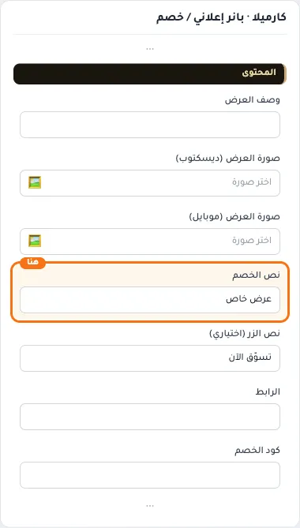

## «نص الزر (اختياري)»
نص · الافتراضي: تسوّق الآن

**الوظيفة:** النص المكتوب على الزر. اتركه فارغًا لإخفاء الزر.

- **نص الزر (اختياري)**
  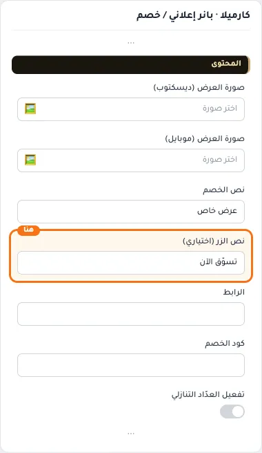

## «الرابط»
اختيار من المتجر · الافتراضي: فارغ

**الوظيفة:** الصفحة التي يفتحها الضغط على الزر أو العنصر.

- **الرابط**
  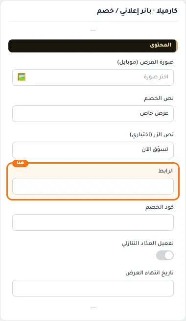

## «كود الخصم»
نص · الافتراضي: فارغ

**الوظيفة:** يظهر داخل إطار مميّز مع زر نسخ.

- **كود الخصم**
  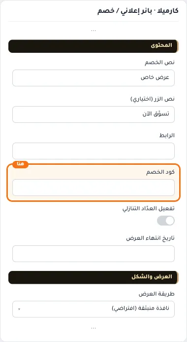

## «تفعيل العدّاد التنازلي»
مفتاح · الافتراضي: مطفأ

**الوظيفة:** يعرض مؤقتاً تنازلياً حتى تاريخ انتهاء العرض.

- **بعد قلب المفتاح**
  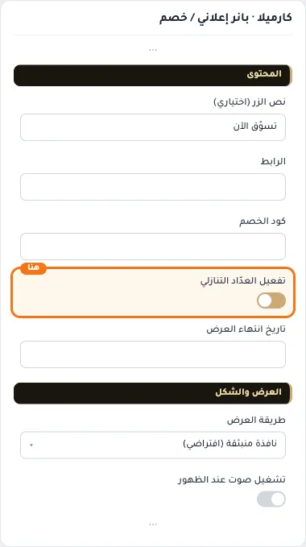

## «تاريخ انتهاء العرض»
نص · الافتراضي: فارغ

**الوظيفة:** تاريخ انتهاء العرض بالصيغة YYYY-MM-DD. تاريخ فقط بلا وقت؛ ينتهي العدّاد في آخر ذلك اليوم. اتركه فارغاً لإخفاء العدّاد.

**يظهر حين:** «تفعيل العدّاد التنازلي» = مفعّل

- **تاريخ انتهاء العرض**
  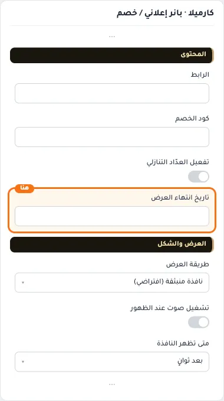

## «طريقة العرض»
قائمة منسدلة · الافتراضي: نافذة منبثقة (افتراضي)

**الوظيفة:** النافذة المنبثقة (الافتراضي) تظهر تلقائياً عند فتح المتجر وتُغلق مرة واحدة. «بانر علوي» يعرضه كقسم ثابت في الصفحة.

- **نافذة منبثقة (افتراضي)** — القيمة الافتراضية.
  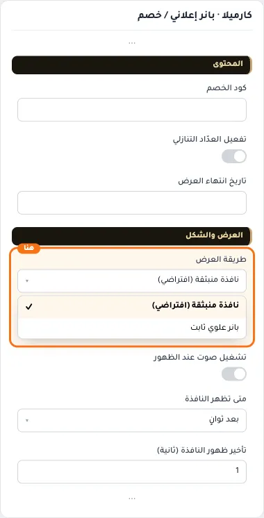
- **بانر علوي ثابت**
  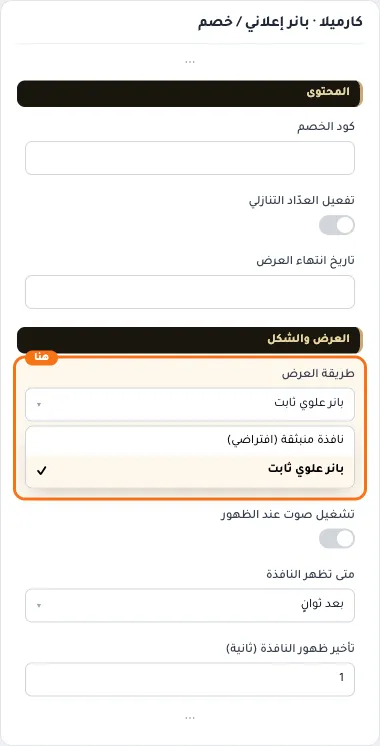

## «تشغيل صوت عند الظهور»
مفتاح · الافتراضي: مطفأ

**الوظيفة:** يشغّل نغمة داخلية قصيرة عند ظهور العرض (منبثق أو شريط).

- **بعد قلب المفتاح**
  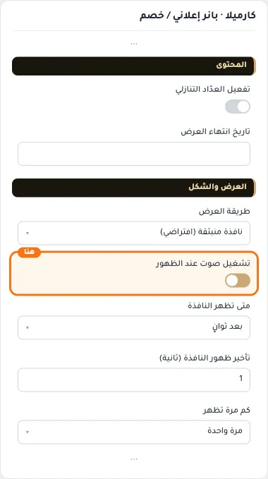

## «متى تظهر النافذة»
قائمة منسدلة · الافتراضي: بعد ثوانٍ

**الوظيفة:** متى تظهر النافذة للزائر: بعد ثوانٍ، أو عند التمرير، أو عند محاولة المغادرة.

**يظهر حين:** «طريقة العرض» = نافذة منبثقة (افتراضي)

- **بعد ثوانٍ** — القيمة الافتراضية.
  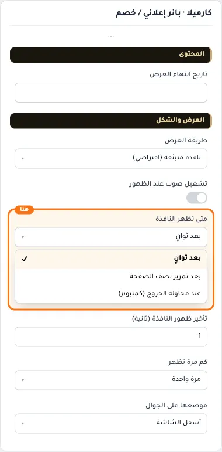
- **بعد تمرير نصف الصفحة**
  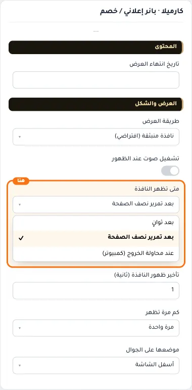
- **عند محاولة الخروج (كمبيوتر)**
  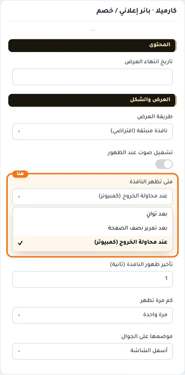

## «تأخير ظهور النافذة (ثانية)»
رقم · الافتراضي: 1

**الوظيفة:** يعمل مع «بعد ثوانٍ»، ومع «عند محاولة الخروج» على الجوال. من 1 إلى 60 ثانية.

**يظهر حين:** «طريقة العرض» = نافذة منبثقة (افتراضي)

- **تأخير ظهور النافذة (ثانية)**
  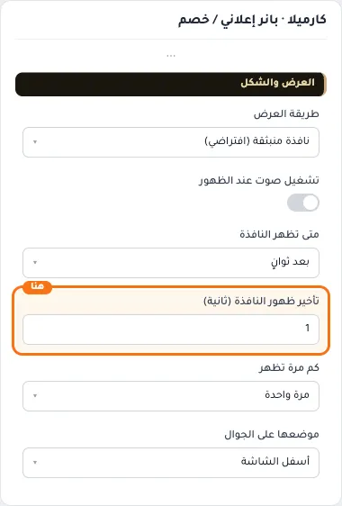

## «كم مرة تظهر»
قائمة منسدلة · الافتراضي: مرة واحدة

**الوظيفة:** بعد أن يغلقها الزائر.

**يظهر حين:** «طريقة العرض» = نافذة منبثقة (افتراضي)

- **مرة واحدة** — القيمة الافتراضية.
  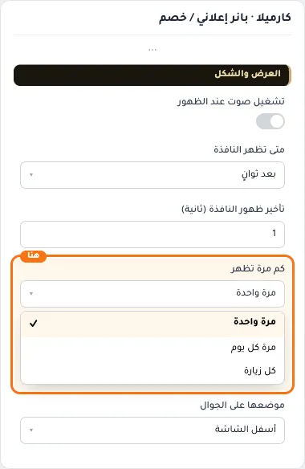
- **مرة كل يوم**
  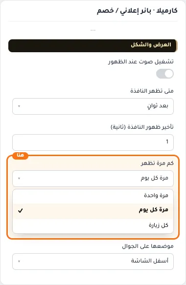
- **كل زيارة**
  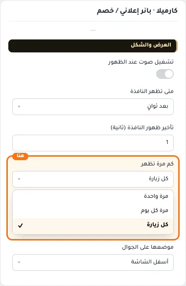

## «موضعها على الجوال»
قائمة منسدلة · الافتراضي: أسفل الشاشة

**الوظيفة:** مكان ظهور النافذة على الجوال: في المنتصف أو من الأسفل.

**يظهر حين:** «طريقة العرض» = نافذة منبثقة (افتراضي)

- **أسفل الشاشة** — القيمة الافتراضية.
  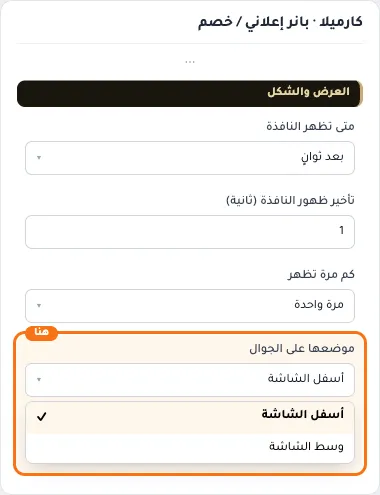
- **وسط الشاشة**
  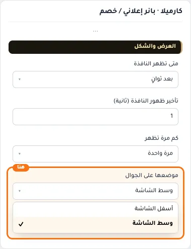
