# كارميلا · منتجات مميزة - نمط 1

المسافات والعرض والخلفية والحواف: انظر [الخيارات المشتركة](../../01-shared/README.md).

## «عنوان القسم»
نص · الافتراضي: منتجات مميزة

**الوظيفة:** العنوان الرئيسي الذي يظهر أعلى القسم. اتركه فارغًا لإخفائه.

- **عنوان القسم**
  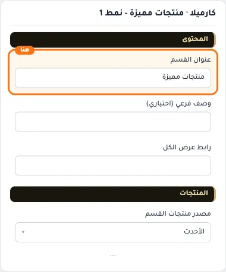

## «وصف فرعي (اختياري)»
نص · الافتراضي: 

**الوظيفة:** سطر قصير تحت العنوان يشرح محتوى القسم. اختياري؛ يختفي إن تُرك فارغًا.

- **وصف فرعي (اختياري)**
  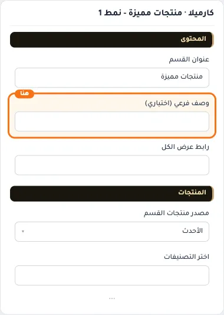

## «رابط عرض الكل»
اختيار من المتجر · الافتراضي: فارغ

**الوظيفة:** وجهة زر «عرض الكل» أعلى القسم؛ اتركه فارغًا لإخفاء الزر.

- **رابط عرض الكل**
  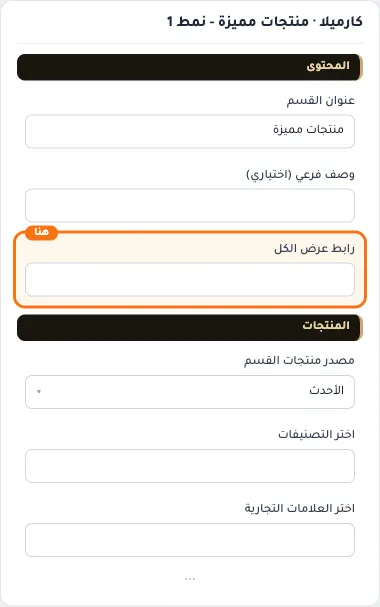

## «مصدر منتجات القسم»
قائمة منسدلة · الافتراضي: الأحدث

**الوظيفة:** يحدد من أين تأتي منتجات القسم: أحدث المنتجات، أو تصنيفات محددة، أو علامات تجارية، أو منتجات تختارها يدويًا. الحقل المناسب يظهر بعد الاختيار.

- **الأحدث** — القيمة الافتراضية.
  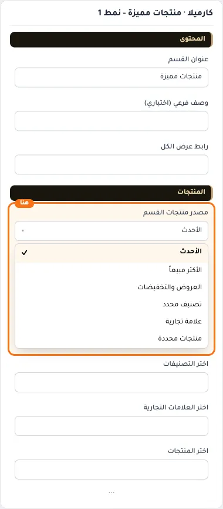
  
- **الأكثر مبيعاً**
  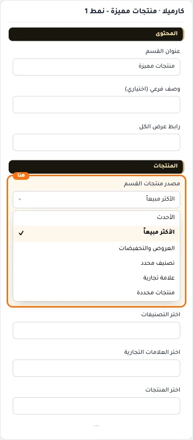
- **العروض والتخفيضات**
  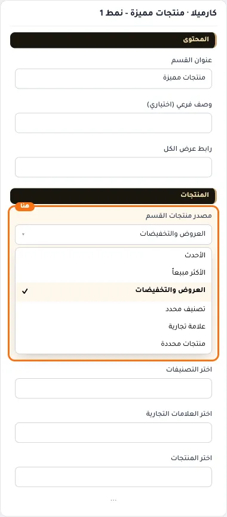
- **تصنيف محدد**
  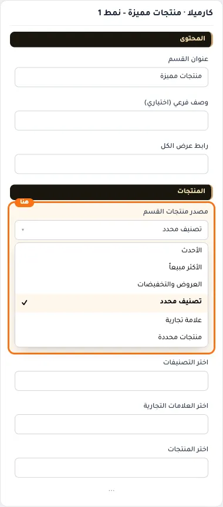
- **علامة تجارية**
  
- **منتجات محددة**
  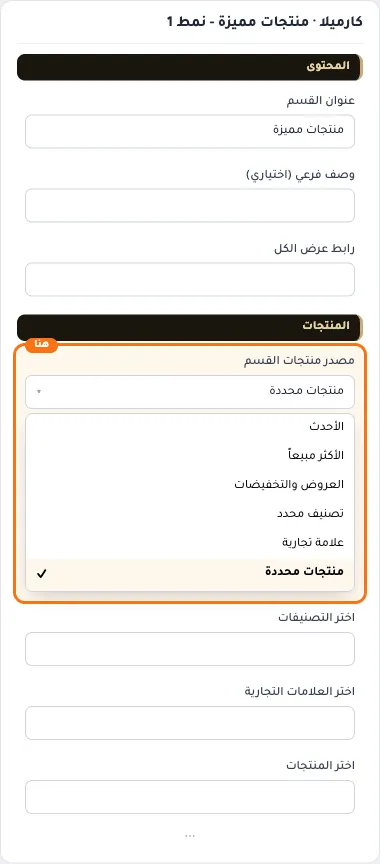

## «اختر التصنيفات»
اختيار من المتجر · الافتراضي: فارغ

**الوظيفة:** التصنيفات التي تُجلب منها المنتجات؛ يظهر حين يكون المصدر «تصنيفات».

**يظهر حين:** «مصدر منتجات القسم» = تصنيف محدد

- **اختر التصنيفات**
  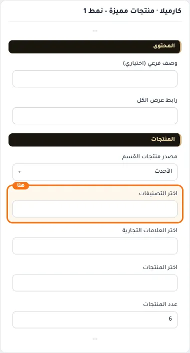

## «اختر العلامات التجارية»
اختيار من المتجر · الافتراضي: فارغ

**الوظيفة:** العلامات التجارية التي تُجلب منها المنتجات؛ يظهر حين يكون المصدر «علامات تجارية».

**يظهر حين:** «مصدر منتجات القسم» = علامة تجارية

- **اختر العلامات التجارية**
  

## «اختر المنتجات»
اختيار من المتجر · الافتراضي: فارغ

**الوظيفة:** المنتجات التي تختارها بنفسك لتظهر في القسم بالترتيب الذي تحدده؛ يظهر حين يكون المصدر «منتجات محددة».

**يظهر حين:** «مصدر منتجات القسم» = منتجات محددة

- **اختر المنتجات**
  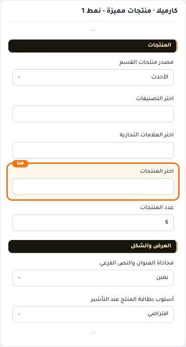

## «عدد المنتجات»
نص · الافتراضي: 6

**الوظيفة:** أقصى عدد من العناصر يُعرض في القسم.

- **عدد المنتجات**
  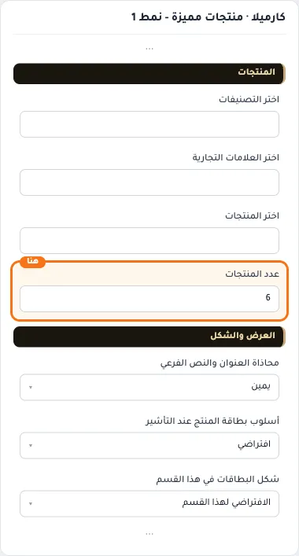

## «محاذاة العنوان والنص الفرعي»
قائمة منسدلة · الافتراضي: يمين

**الوظيفة:** محاذاة العنوان الرئيسي والفرعي داخل القسم (الافتراضي: يمين).

- **يمين** — القيمة الافتراضية.
  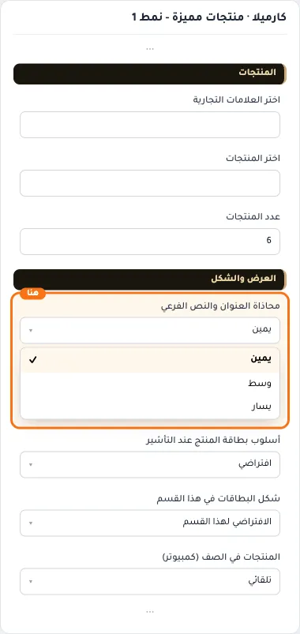
  
- **وسط**
  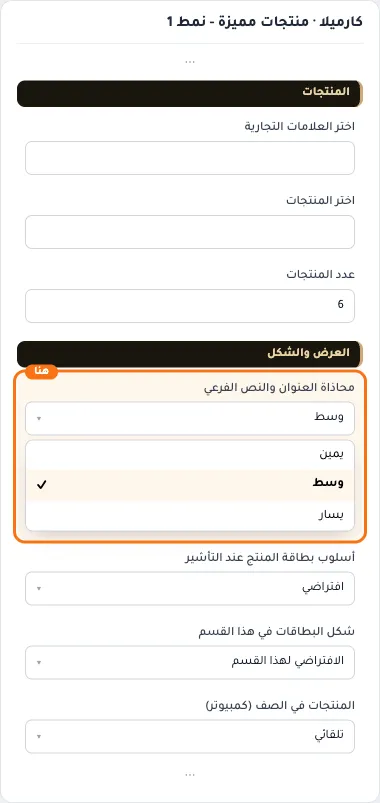
- **يسار**
  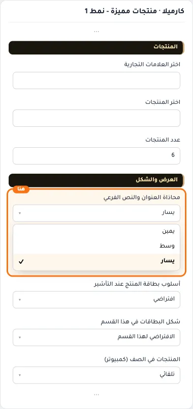

## «أسلوب بطاقة المنتج عند التأشير»
قائمة منسدلة · الافتراضي: افتراضي

**الوظيفة:** يحدد مكان زر الإضافة: «افتراضي» زر ثابت أسفل البطاقة، و«شريط أدوات أفقي» أو «إضافة سريعة» يظهر الزر فوق الصورة عند التأشير بدل الزر الثابت.

- **افتراضي** — القيمة الافتراضية.
  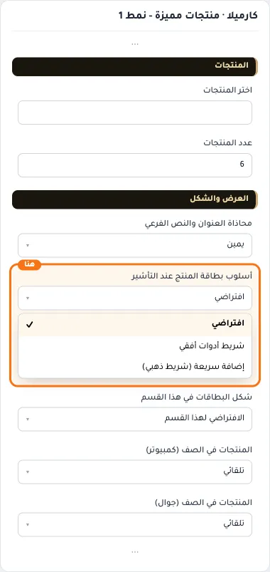
  
- **شريط أدوات أفقي**
  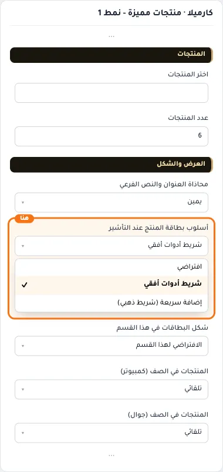
- **إضافة سريعة (شريط ذهبي)**
  

## «شكل البطاقات في هذا القسم»
قائمة منسدلة · الافتراضي: الافتراضي لهذا القسم

**الوظيفة:** الشكل يحدد مظهر البطاقة، و«أسلوب البطاقة عند التأشير» يحدد مكان زر الإضافة. يعملان معًا في كل التركيبات.

- **الافتراضي لهذا القسم** — القيمة الافتراضية.
  
  
- **أساسي**
  
- **صريح: التصنيف وزر واضح**
  
- **التفاصيل عند التمرير**
  
- **مدمج**
  
- **مع خط فاصل**
  

## «المنتجات في الصف (كمبيوتر)»
قائمة منسدلة · الافتراضي: تلقائي

**الوظيفة:** في الشبكة، وفي السلايدر عدد المنتجات الظاهرة معًا.

- **تلقائي** — القيمة الافتراضية.
  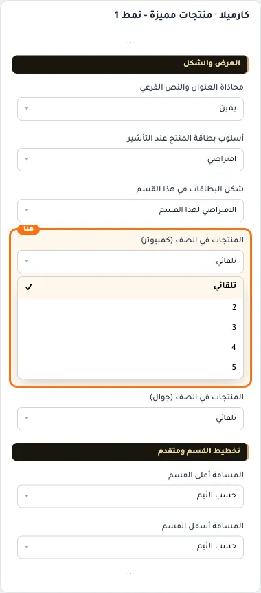
  
- **2**
  
  
- **3**
  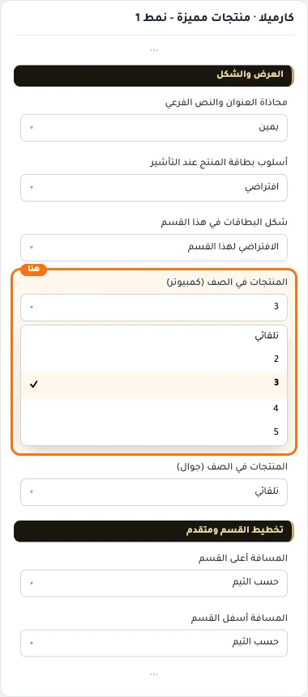
  
- **4**
  
  
- **5**
  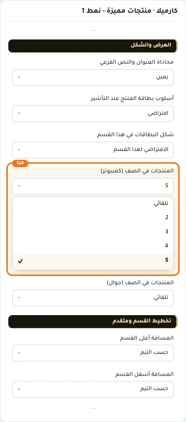
  

## «المنتجات في الصف (جوال)»
قائمة منسدلة · الافتراضي: تلقائي

**الوظيفة:** في الشبكة، وفي السلايدر عدد المنتجات الظاهرة معًا.

- **تلقائي** — القيمة الافتراضية.
  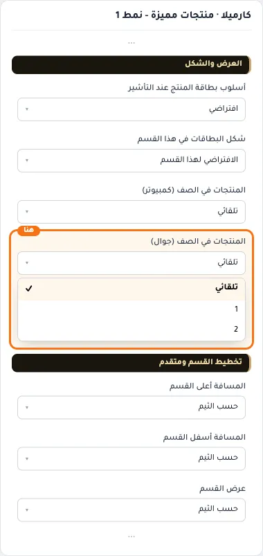
  
- **1**
  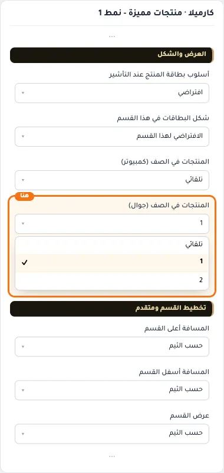
  
- **2**
  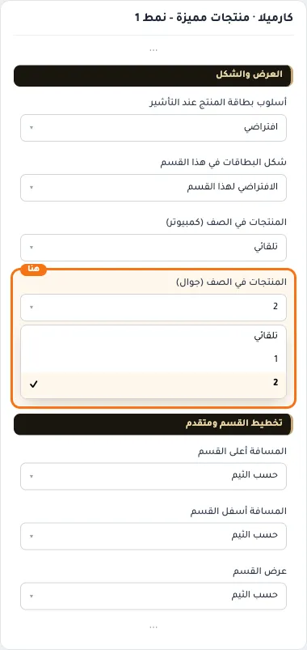
  

## «كلاس CSS مخصص»
نص · الافتراضي: فارغ

**الوظيفة:** للمصممين. كلاس القسم الثابت: cml-s--featured-products-style1

- **كلاس CSS مخصص**
  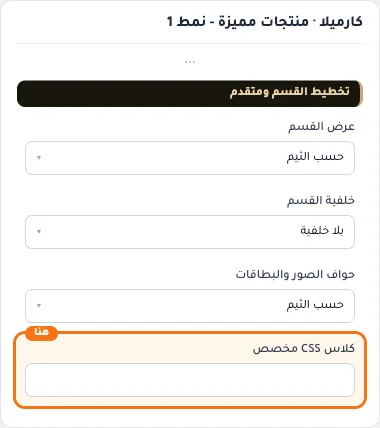
