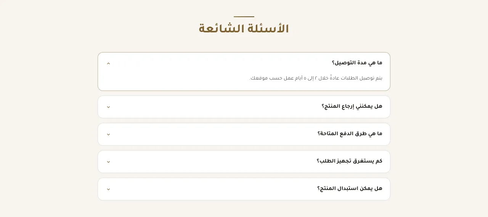
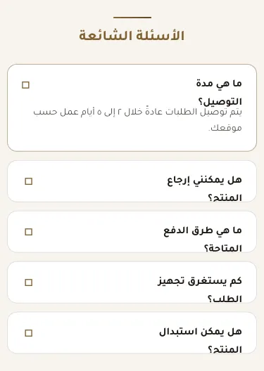
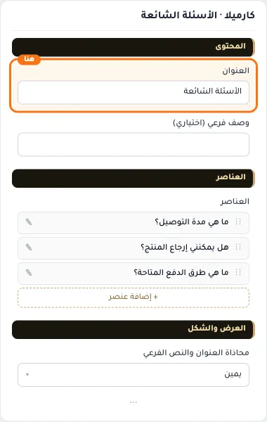
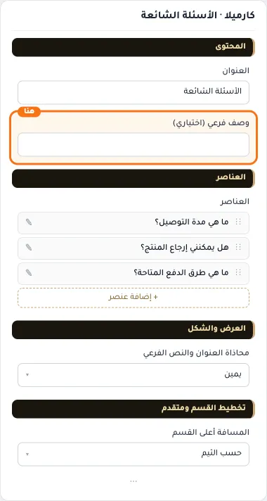
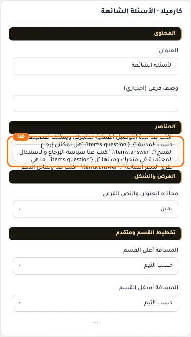
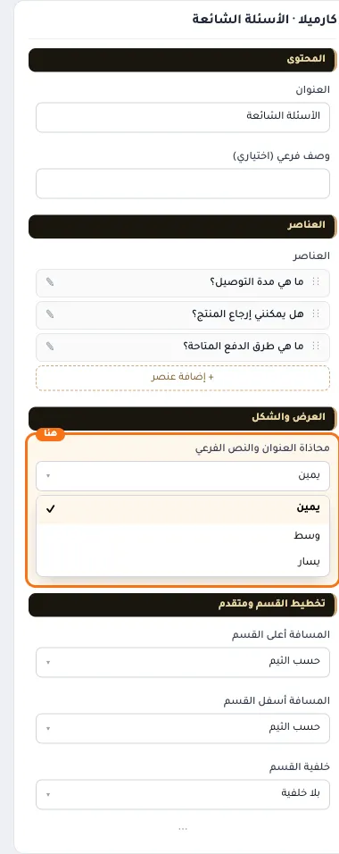
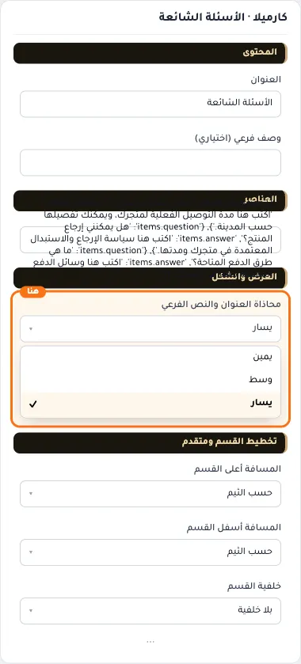
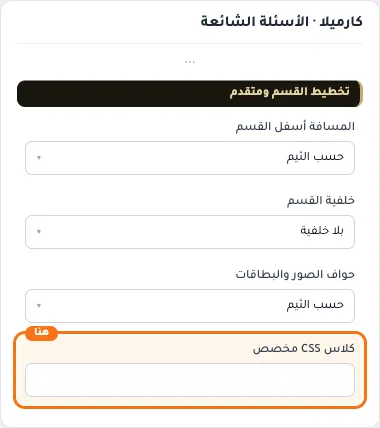

# كارميلا · الأسئلة الشائعة

المسافات والعرض والخلفية والحواف: انظر [الخيارات المشتركة](../../01-shared/README.md).

## «العنوان»
نص · الافتراضي: الأسئلة الشائعة

**الوظيفة:** العنوان الرئيسي الذي يظهر أعلى القسم. اتركه فارغًا لإخفائه.

- **العنوان**
  

## «وصف فرعي (اختياري)»
نص · الافتراضي: 

**الوظيفة:** سطر قصير تحت العنوان يشرح محتوى القسم. اختياري؛ يختفي إن تُرك فارغًا.

- **وصف فرعي (اختياري)**
  

## «items»
عناصر متكررة · الافتراضي: عناصر جاهزة

**الوظيفة:** قائمة العناصر التي يعرضها القسم؛ أضف عنصرًا أو احذفه أو اسحبه لتغيير الترتيب.

- **items**
  

**حقول كل عنصر:**
- «السؤال» (نص، الافتراضي: فارغ): نص السؤال الظاهر في القائمة.
- «الإجابة» (نص طويل، الافتراضي: فارغ): الإجابة التي تنفتح تحت السؤال عند الضغط عليه.
- «نص زر تحت الإجابة (اختياري)» (نص، الافتراضي: فارغ): النص المكتوب على الزر.
- «رابط الزر» (اختيار من المتجر، الافتراضي: فارغ): الصفحة التي يفتحها الزر.

## «محاذاة العنوان والنص الفرعي»
قائمة منسدلة · الافتراضي: يمين

**الوظيفة:** محاذاة العنوان الرئيسي والفرعي داخل القسم (الافتراضي: يمين).

- **يمين** — القيمة الافتراضية.
  
  
- **وسط**
  
- **يسار**
  

## «كلاس CSS مخصص»
نص · الافتراضي: فارغ

**الوظيفة:** للمصممين. كلاس القسم الثابت: cml-s--faq

- **كلاس CSS مخصص**
  
