# كارميلا · فئات دائرية

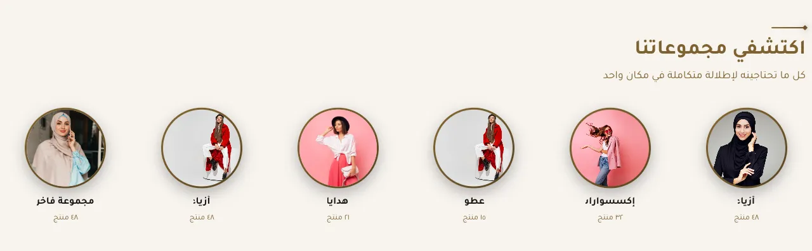

المسافات والعرض والخلفية والحواف: انظر [الخيارات المشتركة](../../01-shared/README.md).

## «العنوان»
نص · الافتراضي: تسوّق حسب الفئة

**الوظيفة:** العنوان الرئيسي الذي يظهر أعلى القسم. اتركه فارغًا لإخفائه.

- **العنوان**
  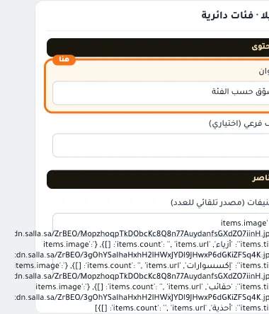

## «وصف فرعي (اختياري)»
نص · الافتراضي: 

**الوظيفة:** سطر قصير تحت العنوان يشرح محتوى القسم. اختياري؛ يختفي إن تُرك فارغًا.

- **وصف فرعي (اختياري)**
  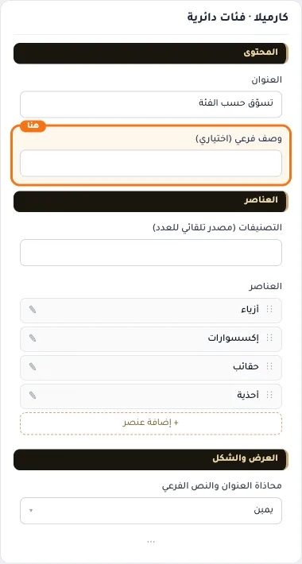

## «التصنيفات (مصدر تلقائي للعدد)»
اختيار من المتجر · الافتراضي: فارغ

**الوظيفة:** اختر تصنيفات ليتم عرضها مع عدد المنتجات تلقائياً. عند تركها فارغة تُستخدم العناصر اليدوية.

- **التصنيفات (مصدر تلقائي للعدد)**
  

## «items»
عناصر متكررة · الافتراضي: عناصر جاهزة

**الوظيفة:** قائمة العناصر التي يعرضها القسم؛ أضف عنصرًا أو احذفه أو اسحبه لتغيير الترتيب.

- **items**
  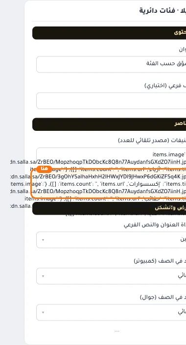

**حقول كل عنصر:**
- «صورة الفئة» (صورة، الافتراضي: فارغ): * يُفضّل صورة مربعة 400×400 بكسل
- «اسم الفئة» (نص، الافتراضي: فارغ): العنوان الرئيسي الذي يظهر أعلى القسم. اتركه فارغًا لإخفائه.
- «عدد المنتجات (نص اختياري)» (نص، الافتراضي: فارغ): نص صغير اختياري تحت اسم التصنيف (مثل «24 منتج»).
- «الرابط» (اختيار من المتجر، الافتراضي: فارغ): اختر منتجاً أو تصنيفاً أو صفحة تعريفية أو ماركة... أو الصق رابطاً خارجياً.

## «محاذاة العنوان والنص الفرعي»
قائمة منسدلة · الافتراضي: يمين

**الوظيفة:** محاذاة العنوان الرئيسي والفرعي داخل القسم (الافتراضي: يمين).

- **يمين** — القيمة الافتراضية.
  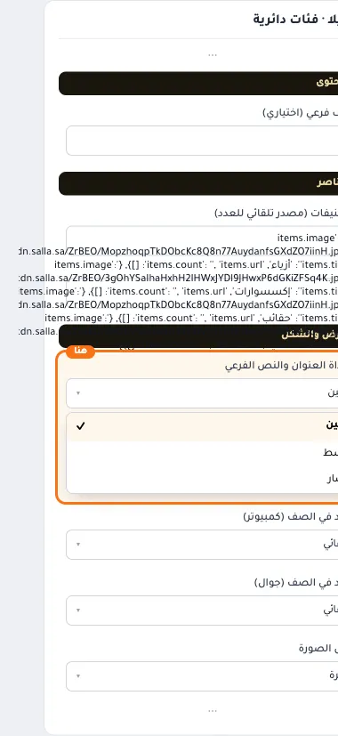
  
- **وسط**
  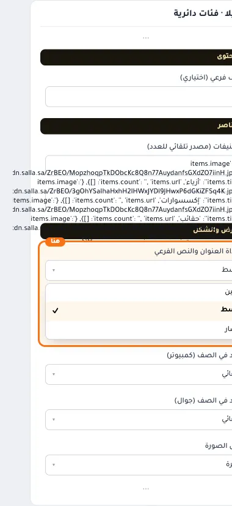
- **يسار**
  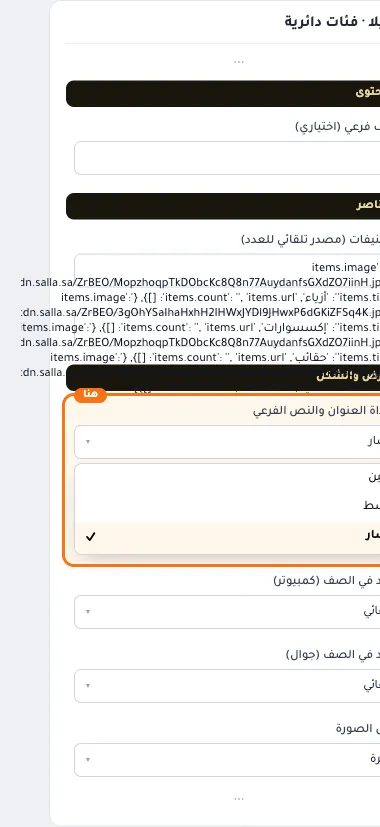

## «العدد في الصف (كمبيوتر)»
قائمة منسدلة · الافتراضي: تلقائي

**الوظيفة:** عدد العناصر في الصف الواحد على شاشة الكمبيوتر.

- **تلقائي** — القيمة الافتراضية.
  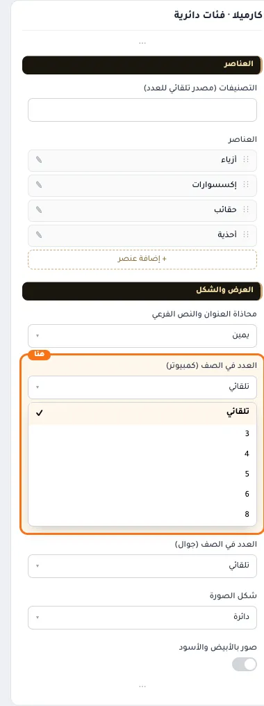
  
- **3**
  
  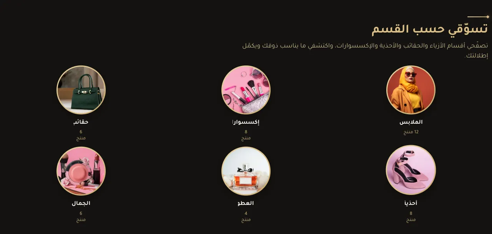
- **4**
  
  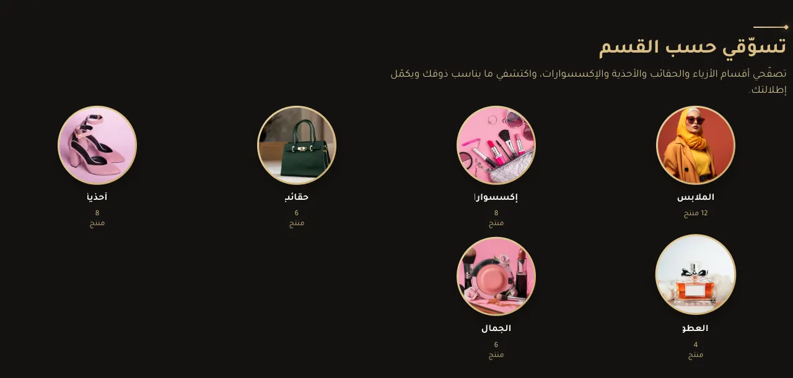
- **5**
  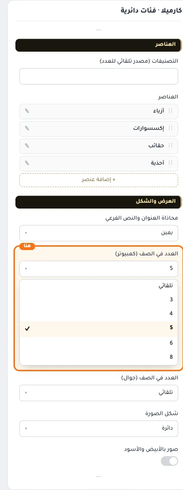
  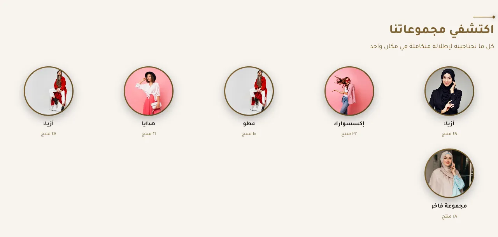
- **6**
  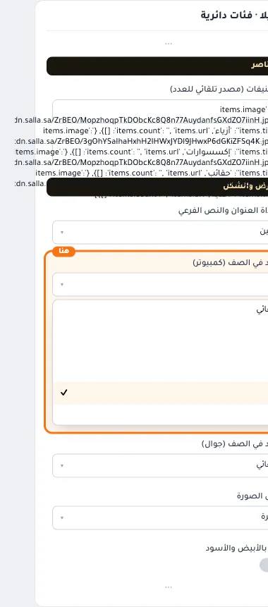
  
- **8**
  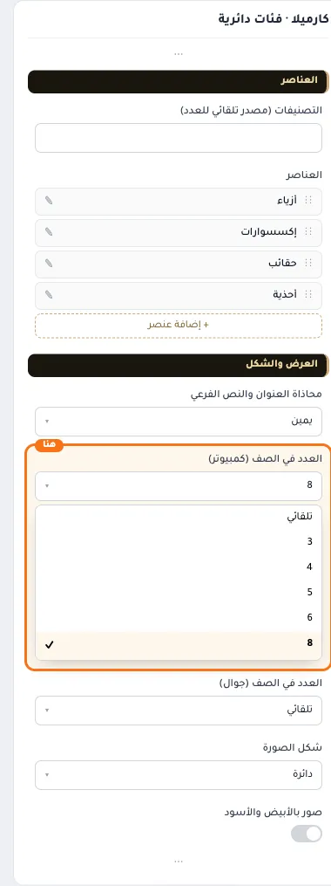
  

## «العدد في الصف (جوال)»
قائمة منسدلة · الافتراضي: تلقائي

**الوظيفة:** عدد العناصر في الصف الواحد على الجوال.

- **تلقائي** — القيمة الافتراضية.
  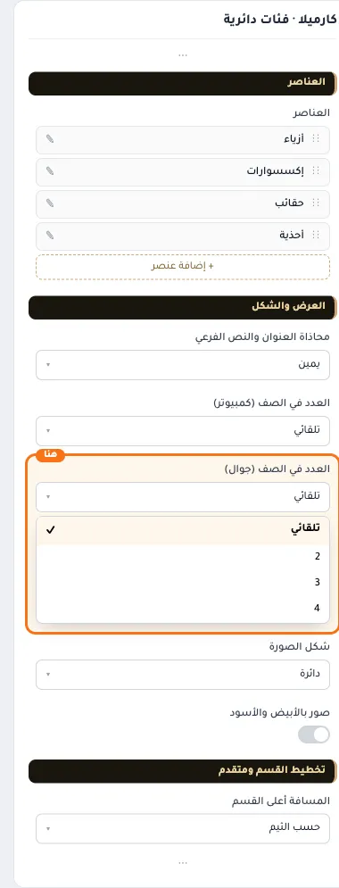
  
- **2**
  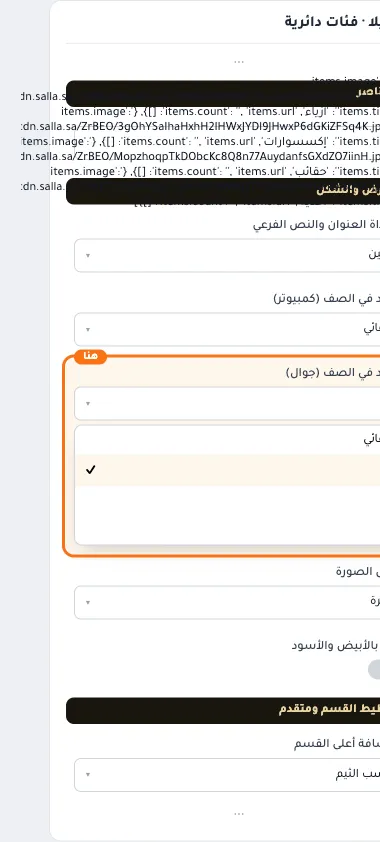
  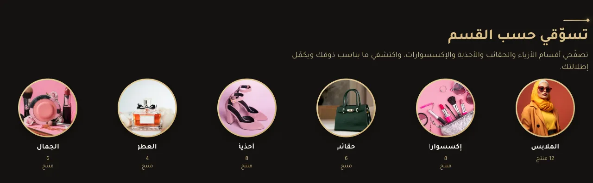
- **3**
  
  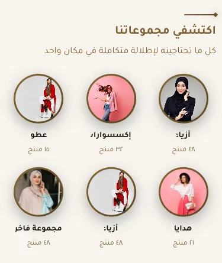
- **4**
  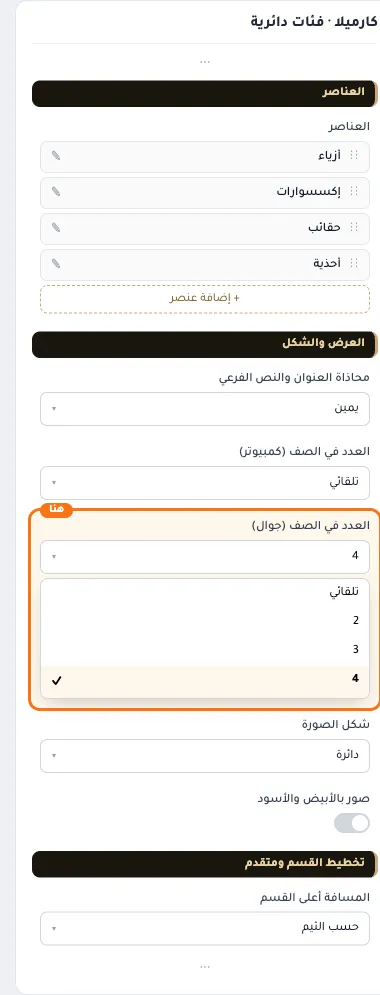
  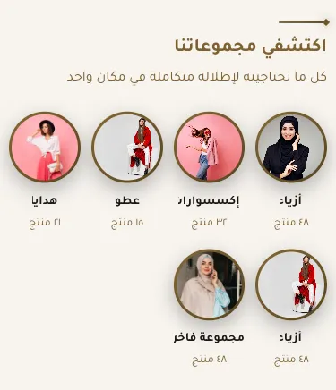

## «شكل الصورة»
قائمة منسدلة · الافتراضي: دائرة

**الوظيفة:** شكل إطار الصورة: دائري أو مربع أو مستدير الزوايا.

- **دائرة** — القيمة الافتراضية.
  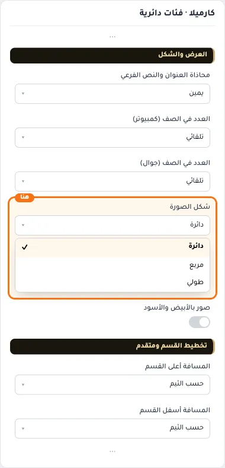
  
- **مربع**
  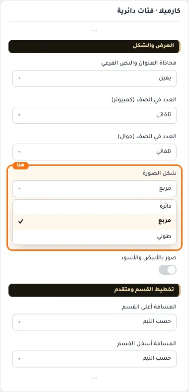
  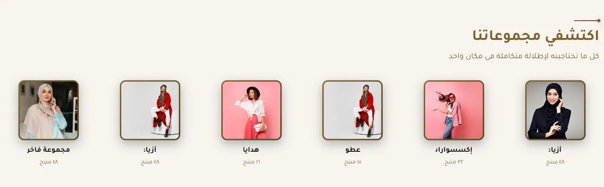
- **طولي**
  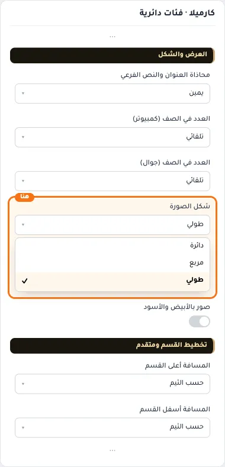
  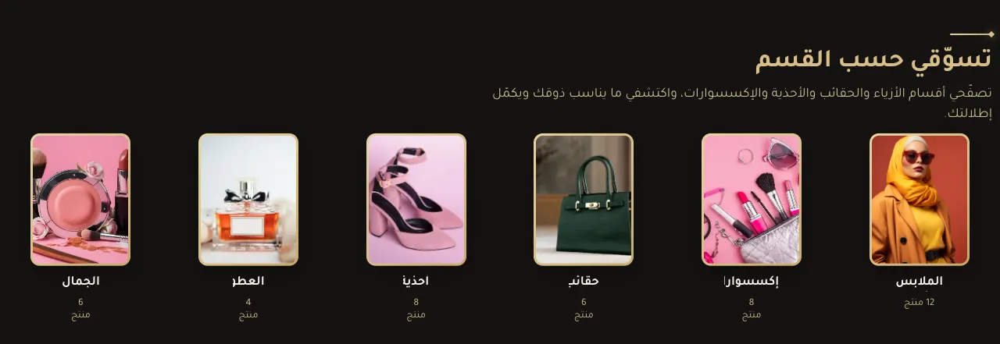

## «صور بالأبيض والأسود»
مفتاح · الافتراضي: مطفأ

**الوظيفة:** تتلوّن عند مرور الماوس، وتبقى ملوّنة على الجوال.

- **بعد قلب المفتاح**
  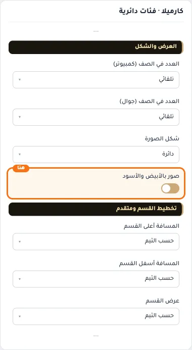
  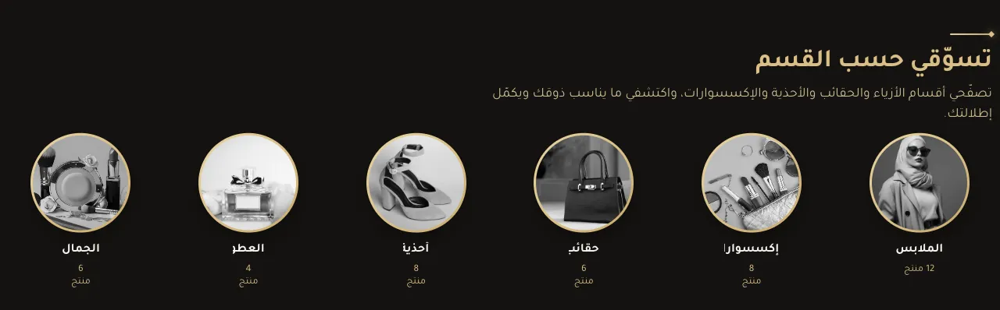

## «كلاس CSS مخصص»
نص · الافتراضي: فارغ

**الوظيفة:** للمصممين. كلاس القسم الثابت: cml-s--circular-categories

- **كلاس CSS مخصص**
  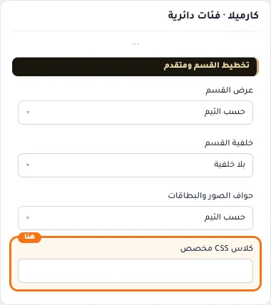
