# فيديو متحرك (محسّن)

المسافات والعرض والخلفية والحواف: انظر [الخيارات المشتركة](../../01-shared/README.md).

## «الشرائح»
عناصر متكررة · الافتراضي: عناصر جاهزة

**الوظيفة:** الشرائح التي يعرضها القسم؛ لكل شريحة صورتها ونصوصها ورابطها.

- **الشرائح**
  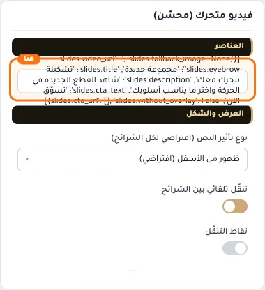

**حقول كل عنصر:**
- «رابط الفيديو (يوتيوب أو فيميو)» (نص، الافتراضي: فارغ): الصق رابط فيديو يوتيوب أو فيميو
- «صورة بديلة» (صورة، الافتراضي: فارغ): تظهر خلف الفيديو وعند عدم تشغيله
- «نص علوي صغير (Eyebrow)» (نص، الافتراضي: فارغ): يظهر فوق العنوان بلون ذهبي
- «عنوان رئيسي» (نص، الافتراضي: فارغ): العنوان الرئيسي الذي يظهر أعلى القسم. اتركه فارغًا لإخفائه.
- «نص إضافي» (نص طويل، الافتراضي: فارغ): نص توضيحي يظهر مع العنوان لشرح العرض أو المجموعة.
- «نص زر الإجراء (CTA)» (نص، الافتراضي: فارغ): النص المكتوب على الزر. اتركه فارغًا لإخفاء الزر.
- «وجهة الزر» (اختيار من المتجر، الافتراضي: فارغ): اختر منتجاً أو تصنيفاً أو صفحة تعريفية... أو الصق رابطاً خارجياً.
- «تأثير نص هذه الشريحة» (قائمة منسدلة، الافتراضي: افتراضي (حسب الإعداد العام)): اتركه على (افتراضي) لاستخدام إعداد المكوّن العام.
- «إزالة طبقة التعتيم» (مفتاح، الافتراضي: مطفأ): يزيل الطبقة الداكنة فوق الصورة؛ مناسب للصور الفاتحة التي تحمل نصًا داكنًا أو بلا نص.

## «نوع تأثير النص (افتراضي لكل الشرائح)»
قائمة منسدلة · الافتراضي: ظهور من الأسفل (افتراضي)

**الوظيفة:** كيف تظهر نصوص الشرائح. يمكن تخصيص كل شريحة على حدة من إعداداتها.

- **ظهور من الأسفل (افتراضي)** — القيمة الافتراضية.
  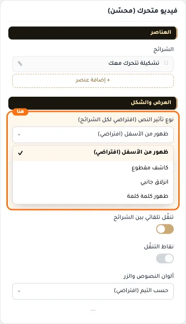
- **كاشف مقطوع**
  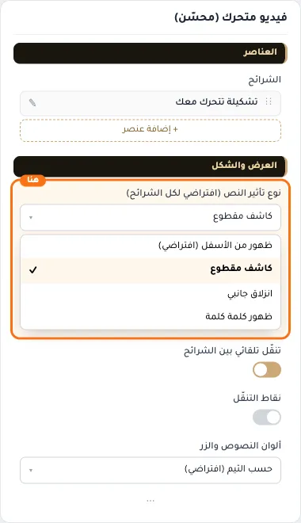
- **انزلاق جانبي**
  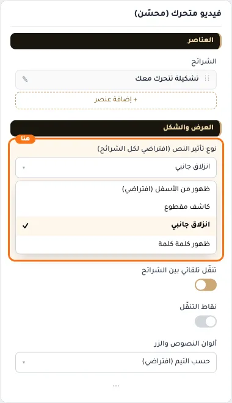
- **ظهور كلمة كلمة**
  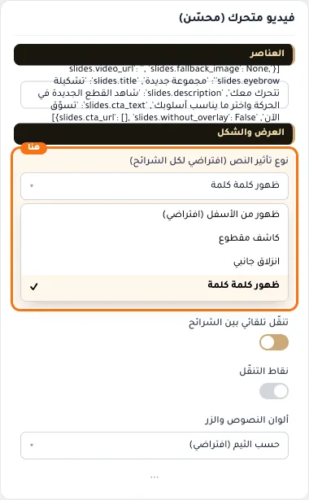

## «تنقّل تلقائي بين الشرائح»
مفتاح · الافتراضي: مفعّل

**الوظيفة:** إطفاؤه يثبّت الشريحة حتى يسحب الزائر.

- **بعد قلب المفتاح**
  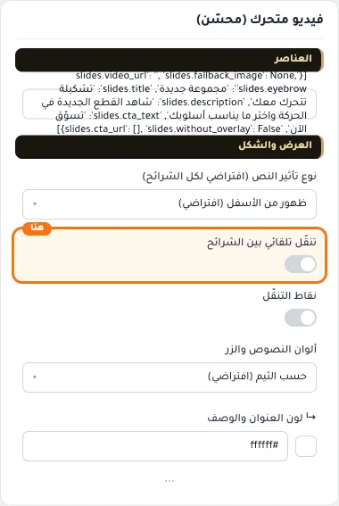

## «نقاط التنقّل»
مفتاح · الافتراضي: مطفأ

**الوظيفة:** مؤشرات الشرائح أسفل العرض.

- **بعد قلب المفتاح**
  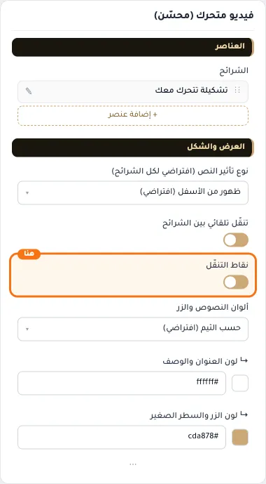

## «ألوان النصوص والزر»
قائمة منسدلة · الافتراضي: حسب الثيم (افتراضي)

**الوظيفة:** حسب الثيم: العنوان أبيض فوق الصورة، والزر والسطر الصغير بلون أزرار المتجر. «العنوان بلون الثيم» يلوّن العنوان بلون الأزرار ويتغير معه تلقائيًا.

- **حسب الثيم (افتراضي)** — القيمة الافتراضية.
  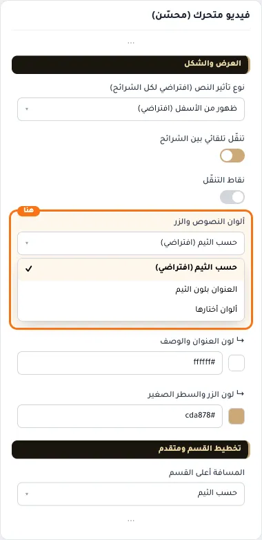
- **العنوان بلون الثيم**
  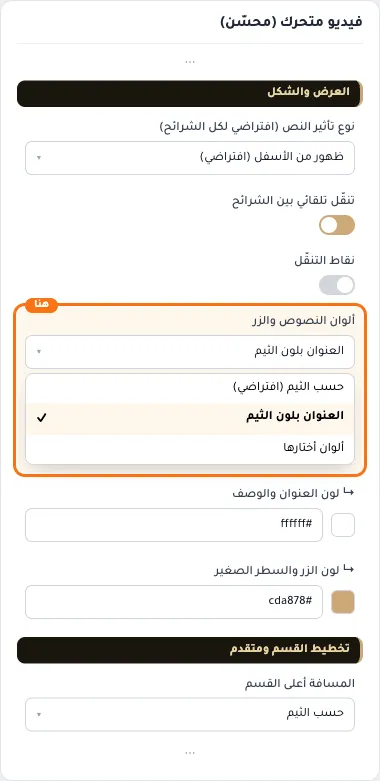
- **ألوان أختارها**
  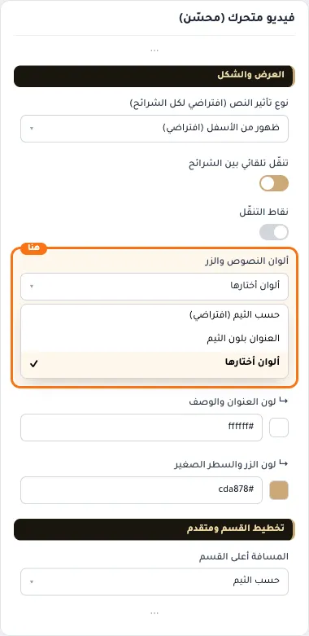

## «↳ لون العنوان والوصف»
لون · الافتراضي: #ffffff

**الوظيفة:** الوصف يأخذ نفس اللون بشفافية خفيفة.

**يظهر حين:** «ألوان النصوص والزر» = ألوان أختارها

- **↳ لون العنوان والوصف**
  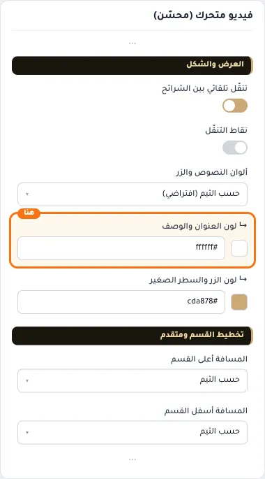

## «↳ لون الزر والسطر الصغير»
لون · الافتراضي: #cda878

**الوظيفة:** لون نص الزر يُختار تلقائيًا ليبقى مقروءًا، واللون الداكن يُفتَّح فوق الصورة للسطر الصغير والزر المفرّغ.

**يظهر حين:** «ألوان النصوص والزر» = ألوان أختارها

- **↳ لون الزر والسطر الصغير**
  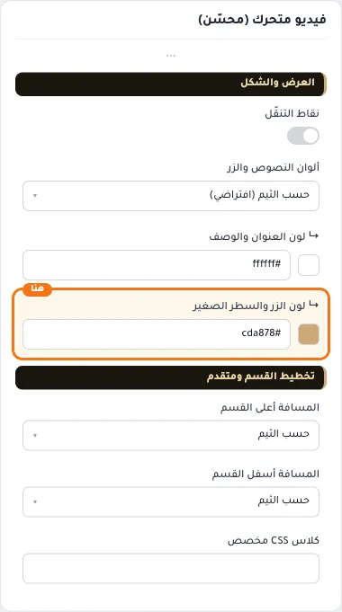

## «كلاس CSS مخصص»
نص · الافتراضي: فارغ

**الوظيفة:** للمصممين. كلاس القسم الثابت: cml-s--enhanced-video-slider

- **كلاس CSS مخصص**
  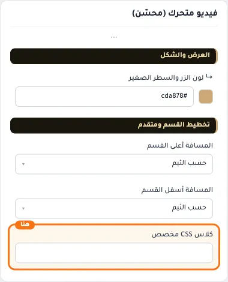
